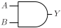
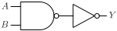

# AND2

Two input AND gate

## Pin information

| Pin   | Description   |
| :-:    | :-            |
| A | Input A |
| B | Input B |
| Y | Output |
| VDD | Power supply |
| VSS | Ground |


## Logic function and Truth table

### Logic function (Python)
<div align="center">
Y = A & B
</div>

### Logic function (Boolean)
\\[ Y = A \cdot B \\]

### Truth Table for Y


| A | B | Y |
| :--- | :--- | :--- |
| 1 | 1 | 1 | 
| 0 | - | 0 | 
| - | 0 | 0 | 


## Symbol

<div align="center">

</div>

## Schematic

<div align="center">

</div>

## Cell variants

| Cell name <br> | Width <br> [unit sites] | Area <br> [\\(\mu m^2\\)] |
| :-        | :-:   | :-:   |
| [AND2_DL](#and2_dl) | TBD | TBD |
| [AND2_D1](#and2_d1) | TBD | TBD |
| [AND2_D2](#and2_d2) | TBD | TBD |
| [AND2_D4](#and2_d4) | TBD | TBD |


### AND2_DL

#### Hierarchical SPICE netlist
```spice
.subckt AND2_DL A B Y VDD VSS
Xnand2 A B NO VDD VSS nand2_par WN=1.8e-07 WP=2e-07 
Xinv NO Y VDD VSS inv_par WN=3.2e-07 WP=4.9e-07 
.ends
```

#### Flat SPICE netlist
```spice
.subckt AND2_DL A B Y VDD VSS
XMN0 n0 A VSS VSS sg13_lv_nmos w=1.8e-07 l=1.3e-07 ad=5.58e-14 as=5.58e-14 pd=9.8e-07 ps=9.8e-07 ng=1 
XMN1 n1 B n0 VSS sg13_lv_nmos w=1.8e-07 l=1.3e-07 ad=5.58e-14 as=5.58e-14 pd=9.8e-07 ps=9.8e-07 ng=1 
XMP0 n1 A VDD VDD sg13_lv_pmos w=2e-07 l=1.3e-07 ad=6.2e-14 as=6.2e-14 pd=1.02e-06 ps=1.02e-06 ng=1 
XMP1 n1 B VDD VDD sg13_lv_pmos w=2e-07 l=1.3e-07 ad=6.2e-14 as=6.2e-14 pd=1.02e-06 ps=1.02e-06 ng=1 
XMN2 Y n1 VSS VSS sg13_lv_nmos w=3.2e-07 l=1.3e-07 ad=9.92e-14 as=9.92e-14 pd=1.26e-06 ps=1.26e-06 ng=1 
XMP2 Y n1 VDD VDD sg13_lv_pmos w=4.9e-07 l=1.3e-07 ad=1.519e-13 as=1.519e-13 pd=1.6e-06 ps=1.6e-06 ng=1 
.ends
```

#### CDL netlist
```cdl
.SUBCKT AND2_DL A B Y VDD VSS
*.PININFO A:I B:I Y:O VDD:B VSS:B 
MN0 n0 A VSS VSS sg13_lv_nmos w=1.8e-07 l=1.3e-07 ng=1 
MN1 n1 B n0 VSS sg13_lv_nmos w=1.8e-07 l=1.3e-07 ng=1 
MP0 n1 A VDD VDD sg13_lv_pmos w=2e-07 l=1.3e-07 ng=1 
MP1 n1 B VDD VDD sg13_lv_pmos w=2e-07 l=1.3e-07 ng=1 
MN2 Y n1 VSS VSS sg13_lv_nmos w=3.2e-07 l=1.3e-07 ng=1 
MP2 Y n1 VDD VDD sg13_lv_pmos w=4.9e-07 l=1.3e-07 ng=1 
.ENDS
```

#### Layout

<div align="center">

</div>

### AND2_D1

#### Hierarchical SPICE netlist
```spice
.subckt AND2_D1 A B Y VDD VSS
Xnand2 A B NO VDD VSS nand2_par WN=3.2e-07 WP=3.6e-07 
Xinv NO Y VDD VSS inv_par WN=6.4e-07 WP=9.8e-07 
.ends
```

#### Flat SPICE netlist
```spice
.subckt AND2_D1 A B Y VDD VSS
XMN0 n0 A VSS VSS sg13_lv_nmos w=3.2e-07 l=1.3e-07 ad=9.92e-14 as=9.92e-14 pd=1.26e-06 ps=1.26e-06 ng=1 
XMN1 n1 B n0 VSS sg13_lv_nmos w=3.2e-07 l=1.3e-07 ad=9.92e-14 as=9.92e-14 pd=1.26e-06 ps=1.26e-06 ng=1 
XMP0 n1 A VDD VDD sg13_lv_pmos w=3.6e-07 l=1.3e-07 ad=1.116e-13 as=1.116e-13 pd=1.34e-06 ps=1.34e-06 ng=1 
XMP1 n1 B VDD VDD sg13_lv_pmos w=3.6e-07 l=1.3e-07 ad=1.116e-13 as=1.116e-13 pd=1.34e-06 ps=1.34e-06 ng=1 
XMN2 Y n1 VSS VSS sg13_lv_nmos w=6.4e-07 l=1.3e-07 ad=1.984e-13 as=1.984e-13 pd=1.9e-06 ps=1.9e-06 ng=1 
XMP2 Y n1 VDD VDD sg13_lv_pmos w=9.8e-07 l=1.3e-07 ad=3.038e-13 as=3.038e-13 pd=2.58e-06 ps=2.58e-06 ng=1 
.ends
```

#### CDL netlist
```cdl
.SUBCKT AND2_D1 A B Y VDD VSS
*.PININFO A:I B:I Y:O VDD:B VSS:B 
MN0 n0 A VSS VSS sg13_lv_nmos w=3.2e-07 l=1.3e-07 ng=1 
MN1 n1 B n0 VSS sg13_lv_nmos w=3.2e-07 l=1.3e-07 ng=1 
MP0 n1 A VDD VDD sg13_lv_pmos w=3.6e-07 l=1.3e-07 ng=1 
MP1 n1 B VDD VDD sg13_lv_pmos w=3.6e-07 l=1.3e-07 ng=1 
MN2 Y n1 VSS VSS sg13_lv_nmos w=6.4e-07 l=1.3e-07 ng=1 
MP2 Y n1 VDD VDD sg13_lv_pmos w=9.8e-07 l=1.3e-07 ng=1 
.ENDS
```

#### Layout

<div align="center">

</div>

### AND2_D2

#### Hierarchical SPICE netlist
```spice
.subckt AND2_D2 A B Y VDD VSS
Xnand2 A B NO VDD VSS nand2_par WN=5e-07 WP=5.5e-07 
Xinv NO Y VDD VSS inv_par WN=1.07e-06 WP=1.6e-06 
.ends
```

#### Flat SPICE netlist
```spice
.subckt AND2_D2 A B Y VDD VSS
XMN0 n0 A VSS VSS sg13_lv_nmos w=5e-07 l=1.3e-07 ad=1.55e-13 as=1.55e-13 pd=1.62e-06 ps=1.62e-06 ng=1 
XMN1 n1 B n0 VSS sg13_lv_nmos w=5e-07 l=1.3e-07 ad=1.55e-13 as=1.55e-13 pd=1.62e-06 ps=1.62e-06 ng=1 
XMP0 n1 A VDD VDD sg13_lv_pmos w=5.5e-07 l=1.3e-07 ad=1.705e-13 as=1.705e-13 pd=1.72e-06 ps=1.72e-06 ng=1 
XMP1 n1 B VDD VDD sg13_lv_pmos w=5.5e-07 l=1.3e-07 ad=1.705e-13 as=1.705e-13 pd=1.72e-06 ps=1.72e-06 ng=1 
XMN2 Y n1 VSS VSS sg13_lv_nmos w=1.07e-06 l=1.3e-07 ad=3.317e-13 as=3.317e-13 pd=2.76e-06 ps=2.76e-06 ng=1 
XMP2 Y n1 VDD VDD sg13_lv_pmos w=1.6e-06 l=1.3e-07 ad=4.96e-13 as=4.96e-13 pd=3.82e-06 ps=3.82e-06 ng=1 
.ends
```

#### CDL netlist
```cdl
.SUBCKT AND2_D2 A B Y VDD VSS
*.PININFO A:I B:I Y:O VDD:B VSS:B 
MN0 n0 A VSS VSS sg13_lv_nmos w=5e-07 l=1.3e-07 ng=1 
MN1 n1 B n0 VSS sg13_lv_nmos w=5e-07 l=1.3e-07 ng=1 
MP0 n1 A VDD VDD sg13_lv_pmos w=5.5e-07 l=1.3e-07 ng=1 
MP1 n1 B VDD VDD sg13_lv_pmos w=5.5e-07 l=1.3e-07 ng=1 
MN2 Y n1 VSS VSS sg13_lv_nmos w=1.07e-06 l=1.3e-07 ng=1 
MP2 Y n1 VDD VDD sg13_lv_pmos w=1.6e-06 l=1.3e-07 ng=1 
.ENDS
```

#### Layout

<div align="center">

</div>

### AND2_D4

#### Hierarchical SPICE netlist
```spice
.subckt AND2_D4 A B Y VDD VSS
Xnand2 A B NO VDD VSS nand2_par WN=1e-06 WP=1.1e-06 
Xinv NO Y VDD VSS inv_par WN=2.14e-06 WP=3.2e-06 NGN=2 NGP=2 
.ends
```

#### Flat SPICE netlist
```spice
.subckt AND2_D4 A B Y VDD VSS
XMN0 n0 A VSS VSS sg13_lv_nmos w=1e-06 l=1.3e-07 ad=3.1e-13 as=3.1e-13 pd=2.62e-06 ps=2.62e-06 ng=1 
XMN1 n1 B n0 VSS sg13_lv_nmos w=1e-06 l=1.3e-07 ad=3.1e-13 as=3.1e-13 pd=2.62e-06 ps=2.62e-06 ng=1 
XMP0 n1 A VDD VDD sg13_lv_pmos w=1.1e-06 l=1.3e-07 ad=3.41e-13 as=3.41e-13 pd=2.82e-06 ps=2.82e-06 ng=1 
XMP1 n1 B VDD VDD sg13_lv_pmos w=1.1e-06 l=1.3e-07 ad=3.41e-13 as=3.41e-13 pd=2.82e-06 ps=2.82e-06 ng=1 
XMN2 Y n1 VSS VSS sg13_lv_nmos w=2.14e-06 l=1.3e-07 ad=6.634e-13 as=6.634e-13 pd=4.9e-06 ps=4.9e-06 ng=2 
XMP2 Y n1 VDD VDD sg13_lv_pmos w=3.2e-06 l=1.3e-07 ad=9.92e-13 as=9.92e-13 pd=7.02e-06 ps=7.02e-06 ng=2 
.ends
```

#### CDL netlist
```cdl
.SUBCKT AND2_D4 A B Y VDD VSS
*.PININFO A:I B:I Y:O VDD:B VSS:B 
MN0 n0 A VSS VSS sg13_lv_nmos w=1e-06 l=1.3e-07 ng=1 
MN1 n1 B n0 VSS sg13_lv_nmos w=1e-06 l=1.3e-07 ng=1 
MP0 n1 A VDD VDD sg13_lv_pmos w=1.1e-06 l=1.3e-07 ng=1 
MP1 n1 B VDD VDD sg13_lv_pmos w=1.1e-06 l=1.3e-07 ng=1 
MN2 Y n1 VSS VSS sg13_lv_nmos w=2.14e-06 l=1.3e-07 ng=2 
MP2 Y n1 VDD VDD sg13_lv_pmos w=3.2e-06 l=1.3e-07 ng=2 
.ENDS
```

#### Layout

<div align="center">

</div>

## Pin capacitance
No pin capacitance data


## Static power
No static power data


## Dynamic power
No dynamic power data


## Delay
No delay data

