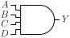
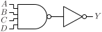
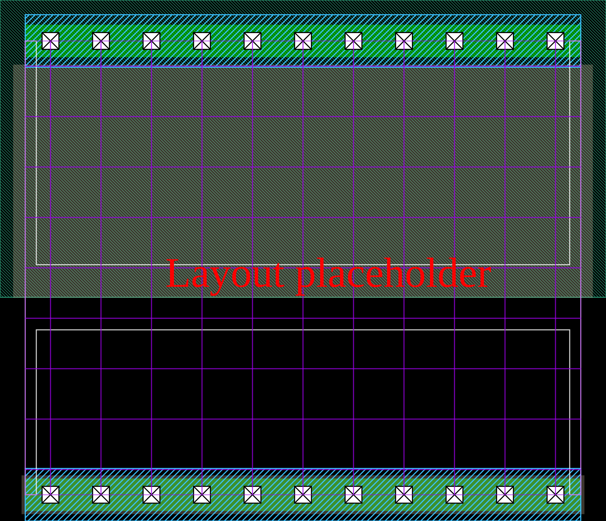

# AND4

Four input AND gate

## Pin information

| Pin   | Description   |
| :-:    | :-            |
| A | Input A |
| B | Input B |
| C | Input C |
| D | Input D |
| Y | Output |
| VDD | Power supply |
| VSS | Ground |


## Logic function and Truth table

### Logic function (Python)
<div align="center">
Y = A & B & C & D
</div>

### Logic function (Boolean)
\\[ Y = A \cdot B \cdot C \cdot D \\]

### Truth Table for Y


| A | B | C | D | Y |
| :--- | :--- | :--- | :--- | :--- |
| 1 | 1 | 1 | 1 | 1 | 
| 0 | - | - | - | 0 | 
| - | 0 | - | - | 0 | 
| - | - | 0 | - | 0 | 
| - | - | - | 0 | 0 | 


## Symbol

<div align="center">

</div>

## Schematic

<div align="center">

</div>

## Cell variants

| Cell name <br> | Width <br> [unit sites] | Area <br> [\\(\mu m^2\\)] |
| :-        | :-:   | :-:   |
| [AND4_DL](#and4_dl) | TBD | TBD |
| [AND4_D1](#and4_d1) | TBD | TBD |
| [AND4_D2](#and4_d2) | TBD | TBD |
| [AND4_D4](#and4_d4) | TBD | TBD |


### AND4_DL

#### Hierarchical SPICE netlist
```spice
.subckt AND4_DL A B C D Y VDD VSS
Xnand4 A B C D NO VDD VSS nand4_par WN=3.4e-07 WP=3e-07 
Xinv NO Y VDD VSS inv_par WN=3.2e-07 WP=4.9e-07 
.ends
```

#### Flat SPICE netlist
```spice
.subckt AND4_DL A B C D Y VDD VSS
XMN0 n0 D VSS VSS sg13_lv_nmos w=3.4e-07 l=1.3e-07 ad=1.054e-13 as=1.054e-13 pd=1.3e-06 ps=1.3e-06 ng=1 
XMN1 n1 C n0 VSS sg13_lv_nmos w=3.4e-07 l=1.3e-07 ad=1.054e-13 as=1.054e-13 pd=1.3e-06 ps=1.3e-06 ng=1 
XMN2 n2 B n1 VSS sg13_lv_nmos w=3.4e-07 l=1.3e-07 ad=1.054e-13 as=1.054e-13 pd=1.3e-06 ps=1.3e-06 ng=1 
XMN3 n3 A n2 VSS sg13_lv_nmos w=3.4e-07 l=1.3e-07 ad=1.054e-13 as=1.054e-13 pd=1.3e-06 ps=1.3e-06 ng=1 
XMP0 n3 A VDD VDD sg13_lv_pmos w=3e-07 l=1.3e-07 ad=9.3e-14 as=9.3e-14 pd=1.22e-06 ps=1.22e-06 ng=1 
XMP1 n3 B VDD VDD sg13_lv_pmos w=3e-07 l=1.3e-07 ad=9.3e-14 as=9.3e-14 pd=1.22e-06 ps=1.22e-06 ng=1 
XMP2 n3 C VDD VDD sg13_lv_pmos w=3e-07 l=1.3e-07 ad=9.3e-14 as=9.3e-14 pd=1.22e-06 ps=1.22e-06 ng=1 
XMP3 n3 D VDD VDD sg13_lv_pmos w=3e-07 l=1.3e-07 ad=9.3e-14 as=9.3e-14 pd=1.22e-06 ps=1.22e-06 ng=1 
XMN4 Y n3 VSS VSS sg13_lv_nmos w=3.2e-07 l=1.3e-07 ad=9.92e-14 as=9.92e-14 pd=1.26e-06 ps=1.26e-06 ng=1 
XMP4 Y n3 VDD VDD sg13_lv_pmos w=4.9e-07 l=1.3e-07 ad=1.519e-13 as=1.519e-13 pd=1.6e-06 ps=1.6e-06 ng=1 
.ends
```

#### CDL netlist
```cdl
.SUBCKT AND4_DL A B C D Y VDD VSS
*.PININFO A:I B:I C:I D:I Y:O VDD:B VSS:B 
MN0 n0 D VSS VSS sg13_lv_nmos w=3.4e-07 l=1.3e-07 ng=1 
MN1 n1 C n0 VSS sg13_lv_nmos w=3.4e-07 l=1.3e-07 ng=1 
MN2 n2 B n1 VSS sg13_lv_nmos w=3.4e-07 l=1.3e-07 ng=1 
MN3 n3 A n2 VSS sg13_lv_nmos w=3.4e-07 l=1.3e-07 ng=1 
MP0 n3 A VDD VDD sg13_lv_pmos w=3e-07 l=1.3e-07 ng=1 
MP1 n3 B VDD VDD sg13_lv_pmos w=3e-07 l=1.3e-07 ng=1 
MP2 n3 C VDD VDD sg13_lv_pmos w=3e-07 l=1.3e-07 ng=1 
MP3 n3 D VDD VDD sg13_lv_pmos w=3e-07 l=1.3e-07 ng=1 
MN4 Y n3 VSS VSS sg13_lv_nmos w=3.2e-07 l=1.3e-07 ng=1 
MP4 Y n3 VDD VDD sg13_lv_pmos w=4.9e-07 l=1.3e-07 ng=1 
.ENDS
```

#### Layout

<div align="center">

</div>

### AND4_D1

#### Hierarchical SPICE netlist
```spice
.subckt AND4_D1 A B C D Y VDD VSS
Xnand4 A B C D NO VDD VSS nand4_par WN=4.5e-07 WP=4e-07 
Xinv NO Y VDD VSS inv_par WN=6.4e-07 WP=9.8e-07 
.ends
```

#### Flat SPICE netlist
```spice
.subckt AND4_D1 A B C D Y VDD VSS
XMN0 n0 D VSS VSS sg13_lv_nmos w=4.5e-07 l=1.3e-07 ad=1.395e-13 as=1.395e-13 pd=1.52e-06 ps=1.52e-06 ng=1 
XMN1 n1 C n0 VSS sg13_lv_nmos w=4.5e-07 l=1.3e-07 ad=1.395e-13 as=1.395e-13 pd=1.52e-06 ps=1.52e-06 ng=1 
XMN2 n2 B n1 VSS sg13_lv_nmos w=4.5e-07 l=1.3e-07 ad=1.395e-13 as=1.395e-13 pd=1.52e-06 ps=1.52e-06 ng=1 
XMN3 n3 A n2 VSS sg13_lv_nmos w=4.5e-07 l=1.3e-07 ad=1.395e-13 as=1.395e-13 pd=1.52e-06 ps=1.52e-06 ng=1 
XMP0 n3 A VDD VDD sg13_lv_pmos w=4e-07 l=1.3e-07 ad=1.24e-13 as=1.24e-13 pd=1.42e-06 ps=1.42e-06 ng=1 
XMP1 n3 B VDD VDD sg13_lv_pmos w=4e-07 l=1.3e-07 ad=1.24e-13 as=1.24e-13 pd=1.42e-06 ps=1.42e-06 ng=1 
XMP2 n3 C VDD VDD sg13_lv_pmos w=4e-07 l=1.3e-07 ad=1.24e-13 as=1.24e-13 pd=1.42e-06 ps=1.42e-06 ng=1 
XMP3 n3 D VDD VDD sg13_lv_pmos w=4e-07 l=1.3e-07 ad=1.24e-13 as=1.24e-13 pd=1.42e-06 ps=1.42e-06 ng=1 
XMN4 Y n3 VSS VSS sg13_lv_nmos w=6.4e-07 l=1.3e-07 ad=1.984e-13 as=1.984e-13 pd=1.9e-06 ps=1.9e-06 ng=1 
XMP4 Y n3 VDD VDD sg13_lv_pmos w=9.8e-07 l=1.3e-07 ad=3.038e-13 as=3.038e-13 pd=2.58e-06 ps=2.58e-06 ng=1 
.ends
```

#### CDL netlist
```cdl
.SUBCKT AND4_D1 A B C D Y VDD VSS
*.PININFO A:I B:I C:I D:I Y:O VDD:B VSS:B 
MN0 n0 D VSS VSS sg13_lv_nmos w=4.5e-07 l=1.3e-07 ng=1 
MN1 n1 C n0 VSS sg13_lv_nmos w=4.5e-07 l=1.3e-07 ng=1 
MN2 n2 B n1 VSS sg13_lv_nmos w=4.5e-07 l=1.3e-07 ng=1 
MN3 n3 A n2 VSS sg13_lv_nmos w=4.5e-07 l=1.3e-07 ng=1 
MP0 n3 A VDD VDD sg13_lv_pmos w=4e-07 l=1.3e-07 ng=1 
MP1 n3 B VDD VDD sg13_lv_pmos w=4e-07 l=1.3e-07 ng=1 
MP2 n3 C VDD VDD sg13_lv_pmos w=4e-07 l=1.3e-07 ng=1 
MP3 n3 D VDD VDD sg13_lv_pmos w=4e-07 l=1.3e-07 ng=1 
MN4 Y n3 VSS VSS sg13_lv_nmos w=6.4e-07 l=1.3e-07 ng=1 
MP4 Y n3 VDD VDD sg13_lv_pmos w=9.8e-07 l=1.3e-07 ng=1 
.ENDS
```

#### Layout

<div align="center">

</div>

### AND4_D2

#### Hierarchical SPICE netlist
```spice
.subckt AND4_D2 A B C D Y VDD VSS
Xnand4 A B C D NO VDD VSS nand4_par WN=7.5e-07 WP=6.5e-07 
Xinv NO Y VDD VSS inv_par WN=1.07e-06 WP=1.6e-06 
.ends
```

#### Flat SPICE netlist
```spice
.subckt AND4_D2 A B C D Y VDD VSS
XMN0 n0 D VSS VSS sg13_lv_nmos w=7.5e-07 l=1.3e-07 ad=2.325e-13 as=2.325e-13 pd=2.12e-06 ps=2.12e-06 ng=1 
XMN1 n1 C n0 VSS sg13_lv_nmos w=7.5e-07 l=1.3e-07 ad=2.325e-13 as=2.325e-13 pd=2.12e-06 ps=2.12e-06 ng=1 
XMN2 n2 B n1 VSS sg13_lv_nmos w=7.5e-07 l=1.3e-07 ad=2.325e-13 as=2.325e-13 pd=2.12e-06 ps=2.12e-06 ng=1 
XMN3 n3 A n2 VSS sg13_lv_nmos w=7.5e-07 l=1.3e-07 ad=2.325e-13 as=2.325e-13 pd=2.12e-06 ps=2.12e-06 ng=1 
XMP0 n3 A VDD VDD sg13_lv_pmos w=6.5e-07 l=1.3e-07 ad=2.015e-13 as=2.015e-13 pd=1.92e-06 ps=1.92e-06 ng=1 
XMP1 n3 B VDD VDD sg13_lv_pmos w=6.5e-07 l=1.3e-07 ad=2.015e-13 as=2.015e-13 pd=1.92e-06 ps=1.92e-06 ng=1 
XMP2 n3 C VDD VDD sg13_lv_pmos w=6.5e-07 l=1.3e-07 ad=2.015e-13 as=2.015e-13 pd=1.92e-06 ps=1.92e-06 ng=1 
XMP3 n3 D VDD VDD sg13_lv_pmos w=6.5e-07 l=1.3e-07 ad=2.015e-13 as=2.015e-13 pd=1.92e-06 ps=1.92e-06 ng=1 
XMN4 Y n3 VSS VSS sg13_lv_nmos w=1.07e-06 l=1.3e-07 ad=3.317e-13 as=3.317e-13 pd=2.76e-06 ps=2.76e-06 ng=1 
XMP4 Y n3 VDD VDD sg13_lv_pmos w=1.6e-06 l=1.3e-07 ad=4.96e-13 as=4.96e-13 pd=3.82e-06 ps=3.82e-06 ng=1 
.ends
```

#### CDL netlist
```cdl
.SUBCKT AND4_D2 A B C D Y VDD VSS
*.PININFO A:I B:I C:I D:I Y:O VDD:B VSS:B 
MN0 n0 D VSS VSS sg13_lv_nmos w=7.5e-07 l=1.3e-07 ng=1 
MN1 n1 C n0 VSS sg13_lv_nmos w=7.5e-07 l=1.3e-07 ng=1 
MN2 n2 B n1 VSS sg13_lv_nmos w=7.5e-07 l=1.3e-07 ng=1 
MN3 n3 A n2 VSS sg13_lv_nmos w=7.5e-07 l=1.3e-07 ng=1 
MP0 n3 A VDD VDD sg13_lv_pmos w=6.5e-07 l=1.3e-07 ng=1 
MP1 n3 B VDD VDD sg13_lv_pmos w=6.5e-07 l=1.3e-07 ng=1 
MP2 n3 C VDD VDD sg13_lv_pmos w=6.5e-07 l=1.3e-07 ng=1 
MP3 n3 D VDD VDD sg13_lv_pmos w=6.5e-07 l=1.3e-07 ng=1 
MN4 Y n3 VSS VSS sg13_lv_nmos w=1.07e-06 l=1.3e-07 ng=1 
MP4 Y n3 VDD VDD sg13_lv_pmos w=1.6e-06 l=1.3e-07 ng=1 
.ENDS
```

#### Layout

<div align="center">

</div>

### AND4_D4

#### Hierarchical SPICE netlist
```spice
.subckt AND4_D4 A B C D Y VDD VSS
Xnand4_1 A B C D NO VDD VSS nand4_par WN=7.2e-07 WP=6.2e-07 
Xnand4_2 A B C D NO VDD VSS nand4_par WN=7.2e-07 WP=6.2e-07 
Xinv NO Y VDD VSS inv_par WN=2.14e-06 WP=3.2e-06 NGN=2 NGP=2 
.ends
```

#### Flat SPICE netlist
```spice
.subckt AND4_D4 A B C D Y VDD VSS
XMN0 n0 D VSS VSS sg13_lv_nmos w=7.2e-07 l=1.3e-07 ad=2.232e-13 as=2.232e-13 pd=2.06e-06 ps=2.06e-06 ng=1 
XMN1 n1 C n0 VSS sg13_lv_nmos w=7.2e-07 l=1.3e-07 ad=2.232e-13 as=2.232e-13 pd=2.06e-06 ps=2.06e-06 ng=1 
XMN2 n2 B n1 VSS sg13_lv_nmos w=7.2e-07 l=1.3e-07 ad=2.232e-13 as=2.232e-13 pd=2.06e-06 ps=2.06e-06 ng=1 
XMN3 n3 A n2 VSS sg13_lv_nmos w=7.2e-07 l=1.3e-07 ad=2.232e-13 as=2.232e-13 pd=2.06e-06 ps=2.06e-06 ng=1 
XMP0 n3 A VDD VDD sg13_lv_pmos w=6.2e-07 l=1.3e-07 ad=1.922e-13 as=1.922e-13 pd=1.86e-06 ps=1.86e-06 ng=1 
XMP1 n3 B VDD VDD sg13_lv_pmos w=6.2e-07 l=1.3e-07 ad=1.922e-13 as=1.922e-13 pd=1.86e-06 ps=1.86e-06 ng=1 
XMP2 n3 C VDD VDD sg13_lv_pmos w=6.2e-07 l=1.3e-07 ad=1.922e-13 as=1.922e-13 pd=1.86e-06 ps=1.86e-06 ng=1 
XMP3 n3 D VDD VDD sg13_lv_pmos w=6.2e-07 l=1.3e-07 ad=1.922e-13 as=1.922e-13 pd=1.86e-06 ps=1.86e-06 ng=1 
XMN4 n4 D VSS VSS sg13_lv_nmos w=7.2e-07 l=1.3e-07 ad=2.232e-13 as=2.232e-13 pd=2.06e-06 ps=2.06e-06 ng=1 
XMN5 n5 C n4 VSS sg13_lv_nmos w=7.2e-07 l=1.3e-07 ad=2.232e-13 as=2.232e-13 pd=2.06e-06 ps=2.06e-06 ng=1 
XMN6 n6 B n5 VSS sg13_lv_nmos w=7.2e-07 l=1.3e-07 ad=2.232e-13 as=2.232e-13 pd=2.06e-06 ps=2.06e-06 ng=1 
XMN7 n3 A n6 VSS sg13_lv_nmos w=7.2e-07 l=1.3e-07 ad=2.232e-13 as=2.232e-13 pd=2.06e-06 ps=2.06e-06 ng=1 
XMP4 n3 A VDD VDD sg13_lv_pmos w=6.2e-07 l=1.3e-07 ad=1.922e-13 as=1.922e-13 pd=1.86e-06 ps=1.86e-06 ng=1 
XMP5 n3 B VDD VDD sg13_lv_pmos w=6.2e-07 l=1.3e-07 ad=1.922e-13 as=1.922e-13 pd=1.86e-06 ps=1.86e-06 ng=1 
XMP6 n3 C VDD VDD sg13_lv_pmos w=6.2e-07 l=1.3e-07 ad=1.922e-13 as=1.922e-13 pd=1.86e-06 ps=1.86e-06 ng=1 
XMP7 n3 D VDD VDD sg13_lv_pmos w=6.2e-07 l=1.3e-07 ad=1.922e-13 as=1.922e-13 pd=1.86e-06 ps=1.86e-06 ng=1 
XMN8 Y n3 VSS VSS sg13_lv_nmos w=2.14e-06 l=1.3e-07 ad=6.634e-13 as=6.634e-13 pd=4.9e-06 ps=4.9e-06 ng=2 
XMP8 Y n3 VDD VDD sg13_lv_pmos w=3.2e-06 l=1.3e-07 ad=9.92e-13 as=9.92e-13 pd=7.02e-06 ps=7.02e-06 ng=2 
.ends
```

#### CDL netlist
```cdl
.SUBCKT AND4_D4 A B C D Y VDD VSS
*.PININFO A:I B:I C:I D:I Y:O VDD:B VSS:B 
MN0 n0 D VSS VSS sg13_lv_nmos w=7.2e-07 l=1.3e-07 ng=1 
MN1 n1 C n0 VSS sg13_lv_nmos w=7.2e-07 l=1.3e-07 ng=1 
MN2 n2 B n1 VSS sg13_lv_nmos w=7.2e-07 l=1.3e-07 ng=1 
MN3 n3 A n2 VSS sg13_lv_nmos w=7.2e-07 l=1.3e-07 ng=1 
MP0 n3 A VDD VDD sg13_lv_pmos w=6.2e-07 l=1.3e-07 ng=1 
MP1 n3 B VDD VDD sg13_lv_pmos w=6.2e-07 l=1.3e-07 ng=1 
MP2 n3 C VDD VDD sg13_lv_pmos w=6.2e-07 l=1.3e-07 ng=1 
MP3 n3 D VDD VDD sg13_lv_pmos w=6.2e-07 l=1.3e-07 ng=1 
MN4 n4 D VSS VSS sg13_lv_nmos w=7.2e-07 l=1.3e-07 ng=1 
MN5 n5 C n4 VSS sg13_lv_nmos w=7.2e-07 l=1.3e-07 ng=1 
MN6 n6 B n5 VSS sg13_lv_nmos w=7.2e-07 l=1.3e-07 ng=1 
MN7 n3 A n6 VSS sg13_lv_nmos w=7.2e-07 l=1.3e-07 ng=1 
MP4 n3 A VDD VDD sg13_lv_pmos w=6.2e-07 l=1.3e-07 ng=1 
MP5 n3 B VDD VDD sg13_lv_pmos w=6.2e-07 l=1.3e-07 ng=1 
MP6 n3 C VDD VDD sg13_lv_pmos w=6.2e-07 l=1.3e-07 ng=1 
MP7 n3 D VDD VDD sg13_lv_pmos w=6.2e-07 l=1.3e-07 ng=1 
MN8 Y n3 VSS VSS sg13_lv_nmos w=2.14e-06 l=1.3e-07 ng=2 
MP8 Y n3 VDD VDD sg13_lv_pmos w=3.2e-06 l=1.3e-07 ng=2 
.ENDS
```

#### Layout

<div align="center">

</div>

## Pin capacitance
No pin capacitance data


## Static power
No static power data


## Dynamic power
No dynamic power data


## Delay
No delay data

