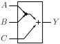
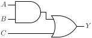

# AO21

AND-OR gate with two AND inputs and one direct OR input

## Pin information

| Pin   | Description   |
| :-:    | :-            |
| A | Input A, connected to AND gate |
| B | Input B, connected to AND gate |
| C | Input C, direct input to OR gate |
| Y | Output |
| VDD | Power supply |
| VSS | Ground |


## Logic function and Truth table

### Logic function (Python)
<div align="center">
Y = (A & B) | C
</div>

### Logic function (Boolean)
\\[ Y = (A \cdot B) + C \\]

### Truth Table for Y


| A | B | C | Y |
| :--- | :--- | :--- | :--- |
| - | - | 1 | 1 | 
| 1 | 1 | - | 1 | 
| 0 | - | 0 | 0 | 
| - | 0 | 0 | 0 | 


## Symbol

<div align="center">

</div>

## Schematic

<div align="center">

</div>

## Cell variants

| Cell name <br> | Width <br> [unit sites] | Area <br> [\\(\mu m^2\\)] |
| :-        | :-:   | :-:   |
| [AO21_DL](#ao21_dl) | TBD | TBD |
| [AO21_D1](#ao21_d1) | TBD | TBD |
| [AO21_D2](#ao21_d2) | TBD | TBD |


### AO21_DL

#### Hierarchical SPICE netlist
```spice
.subckt AO21_DL A B C Y VDD VSS
XMN0 n0 A VSS VSS sg13_lv_nmos w=2e-07 l=1.3e-07 ad={2e-07*3.1e-07} as={2e-07*3.1e-07} pd={2*(2e-07+3.1e-07)} ps={2*(2e-07+3.1e-07)} 
XMN1 NY B n0 VSS sg13_lv_nmos w=2e-07 l=1.3e-07 ad={2e-07*3.1e-07} as={2e-07*3.1e-07} pd={2*(2e-07+3.1e-07)} ps={2*(2e-07+3.1e-07)} 
XMN2 NY C VSS VSS sg13_lv_nmos w=1.5e-07 l=1.3e-07 ad={1.5e-07*3.1e-07} as={1.5e-07*3.1e-07} pd={2*(1.5e-07+3.1e-07)} ps={2*(1.5e-07+3.1e-07)} 
XMP0 n1 A VDD VDD sg13_lv_pmos w=3e-07 l=1.3e-07 ad={3e-07*3.1e-07} as={3e-07*3.1e-07} pd={2*(3e-07+3.1e-07)} ps={2*(3e-07+3.1e-07)} 
XMP1 n1 B VDD VDD sg13_lv_pmos w=3e-07 l=1.3e-07 ad={3e-07*3.1e-07} as={3e-07*3.1e-07} pd={2*(3e-07+3.1e-07)} ps={2*(3e-07+3.1e-07)} 
XMP2 NY C n1 VDD sg13_lv_pmos w=3e-07 l=1.3e-07 ad={3e-07*3.1e-07} as={3e-07*3.1e-07} pd={2*(3e-07+3.1e-07)} ps={2*(3e-07+3.1e-07)} 
Xinv NY Y VDD VSS inv_par WN=3.2e-07 WP=6.6e-07 
.ends
```

#### Flat SPICE netlist
```spice
.subckt AO21_DL A B C Y VDD VSS
XMN0 n0 A VSS VSS sg13_lv_nmos w=2e-07 l=1.3e-07 ad=6.2e-14 as=6.2e-14 pd=1.02e-06 ps=1.02e-06 
XMN1 n1 B n0 VSS sg13_lv_nmos w=2e-07 l=1.3e-07 ad=6.2e-14 as=6.2e-14 pd=1.02e-06 ps=1.02e-06 
XMN2 n1 C VSS VSS sg13_lv_nmos w=1.5e-07 l=1.3e-07 ad=4.65e-14 as=4.65e-14 pd=9.2e-07 ps=9.2e-07 
XMP0 n2 A VDD VDD sg13_lv_pmos w=3e-07 l=1.3e-07 ad=9.3e-14 as=9.3e-14 pd=1.22e-06 ps=1.22e-06 
XMP1 n2 B VDD VDD sg13_lv_pmos w=3e-07 l=1.3e-07 ad=9.3e-14 as=9.3e-14 pd=1.22e-06 ps=1.22e-06 
XMP2 n1 C n2 VDD sg13_lv_pmos w=3e-07 l=1.3e-07 ad=9.3e-14 as=9.3e-14 pd=1.22e-06 ps=1.22e-06 
XMN3 Y n1 VSS VSS sg13_lv_nmos w=3.2e-07 l=1.3e-07 ad=9.92e-14 as=9.92e-14 pd=1.26e-06 ps=1.26e-06 ng=1 
XMP3 Y n1 VDD VDD sg13_lv_pmos w=6.6e-07 l=1.3e-07 ad=2.046e-13 as=2.046e-13 pd=1.94e-06 ps=1.94e-06 ng=1 
.ends
```

#### CDL netlist
```cdl
.SUBCKT AO21_DL A B C Y VDD VSS
*.PININFO B:I C:I A:I Y:O VDD:B VSS:B 
MN0 n0 A VSS VSS sg13_lv_nmos w=2e-07 l=1.3e-07 
MN1 n1 B n0 VSS sg13_lv_nmos w=2e-07 l=1.3e-07 
MN2 n1 C VSS VSS sg13_lv_nmos w=1.5e-07 l=1.3e-07 
MP0 n2 A VDD VDD sg13_lv_pmos w=3e-07 l=1.3e-07 
MP1 n2 B VDD VDD sg13_lv_pmos w=3e-07 l=1.3e-07 
MP2 n1 C n2 VDD sg13_lv_pmos w=3e-07 l=1.3e-07 
MN3 Y n1 VSS VSS sg13_lv_nmos w=3.2e-07 l=1.3e-07 ng=1 
MP3 Y n1 VDD VDD sg13_lv_pmos w=6.6e-07 l=1.3e-07 ng=1 
.ENDS
```

#### Layout

<div align="center">

</div>

### AO21_D1

#### Hierarchical SPICE netlist
```spice
.subckt AO21_D1 A B C Y VDD VSS
XMN0 n0 A VSS VSS sg13_lv_nmos w=3e-07 l=1.3e-07 ad={3e-07*3.1e-07} as={3e-07*3.1e-07} pd={2*(3e-07+3.1e-07)} ps={2*(3e-07+3.1e-07)} 
XMN1 NY B n0 VSS sg13_lv_nmos w=3e-07 l=1.3e-07 ad={3e-07*3.1e-07} as={3e-07*3.1e-07} pd={2*(3e-07+3.1e-07)} ps={2*(3e-07+3.1e-07)} 
XMN2 NY C VSS VSS sg13_lv_nmos w=2e-07 l=1.3e-07 ad={2e-07*3.1e-07} as={2e-07*3.1e-07} pd={2*(2e-07+3.1e-07)} ps={2*(2e-07+3.1e-07)} 
XMP0 n1 A VDD VDD sg13_lv_pmos w=4e-07 l=1.3e-07 ad={4e-07*3.1e-07} as={4e-07*3.1e-07} pd={2*(4e-07+3.1e-07)} ps={2*(4e-07+3.1e-07)} 
XMP1 n1 B VDD VDD sg13_lv_pmos w=4e-07 l=1.3e-07 ad={4e-07*3.1e-07} as={4e-07*3.1e-07} pd={2*(4e-07+3.1e-07)} ps={2*(4e-07+3.1e-07)} 
XMP2 NY C n1 VDD sg13_lv_pmos w=4e-07 l=1.3e-07 ad={4e-07*3.1e-07} as={4e-07*3.1e-07} pd={2*(4e-07+3.1e-07)} ps={2*(4e-07+3.1e-07)} 
Xinv NY Y VDD VSS inv_par WN=6.4e-07 WP=9.8e-07 
.ends
```

#### Flat SPICE netlist
```spice
.subckt AO21_D1 A B C Y VDD VSS
XMN0 n0 A VSS VSS sg13_lv_nmos w=3e-07 l=1.3e-07 ad=9.3e-14 as=9.3e-14 pd=1.22e-06 ps=1.22e-06 
XMN1 n1 B n0 VSS sg13_lv_nmos w=3e-07 l=1.3e-07 ad=9.3e-14 as=9.3e-14 pd=1.22e-06 ps=1.22e-06 
XMN2 n1 C VSS VSS sg13_lv_nmos w=2e-07 l=1.3e-07 ad=6.2e-14 as=6.2e-14 pd=1.02e-06 ps=1.02e-06 
XMP0 n2 A VDD VDD sg13_lv_pmos w=4e-07 l=1.3e-07 ad=1.24e-13 as=1.24e-13 pd=1.42e-06 ps=1.42e-06 
XMP1 n2 B VDD VDD sg13_lv_pmos w=4e-07 l=1.3e-07 ad=1.24e-13 as=1.24e-13 pd=1.42e-06 ps=1.42e-06 
XMP2 n1 C n2 VDD sg13_lv_pmos w=4e-07 l=1.3e-07 ad=1.24e-13 as=1.24e-13 pd=1.42e-06 ps=1.42e-06 
XMN3 Y n1 VSS VSS sg13_lv_nmos w=6.4e-07 l=1.3e-07 ad=1.984e-13 as=1.984e-13 pd=1.9e-06 ps=1.9e-06 ng=1 
XMP3 Y n1 VDD VDD sg13_lv_pmos w=9.8e-07 l=1.3e-07 ad=3.038e-13 as=3.038e-13 pd=2.58e-06 ps=2.58e-06 ng=1 
.ends
```

#### CDL netlist
```cdl
.SUBCKT AO21_D1 A B C Y VDD VSS
*.PININFO B:I C:I A:I Y:O VDD:B VSS:B 
MN0 n0 A VSS VSS sg13_lv_nmos w=3e-07 l=1.3e-07 
MN1 n1 B n0 VSS sg13_lv_nmos w=3e-07 l=1.3e-07 
MN2 n1 C VSS VSS sg13_lv_nmos w=2e-07 l=1.3e-07 
MP0 n2 A VDD VDD sg13_lv_pmos w=4e-07 l=1.3e-07 
MP1 n2 B VDD VDD sg13_lv_pmos w=4e-07 l=1.3e-07 
MP2 n1 C n2 VDD sg13_lv_pmos w=4e-07 l=1.3e-07 
MN3 Y n1 VSS VSS sg13_lv_nmos w=6.4e-07 l=1.3e-07 ng=1 
MP3 Y n1 VDD VDD sg13_lv_pmos w=9.8e-07 l=1.3e-07 ng=1 
.ENDS
```

#### Layout

<div align="center">

</div>

### AO21_D2

#### Hierarchical SPICE netlist
```spice
.subckt AO21_D2 A B C Y VDD VSS
XMN0 n0 A VSS VSS sg13_lv_nmos w=5e-07 l=1.3e-07 ad={5e-07*3.1e-07} as={5e-07*3.1e-07} pd={2*(5e-07+3.1e-07)} ps={2*(5e-07+3.1e-07)} 
XMN1 NY B n0 VSS sg13_lv_nmos w=5e-07 l=1.3e-07 ad={5e-07*3.1e-07} as={5e-07*3.1e-07} pd={2*(5e-07+3.1e-07)} ps={2*(5e-07+3.1e-07)} 
XMN2 NY C VSS VSS sg13_lv_nmos w=3e-07 l=1.3e-07 ad={3e-07*3.1e-07} as={3e-07*3.1e-07} pd={2*(3e-07+3.1e-07)} ps={2*(3e-07+3.1e-07)} 
XMP0 n1 A VDD VDD sg13_lv_pmos w=6e-07 l=1.3e-07 ad={6e-07*3.1e-07} as={6e-07*3.1e-07} pd={2*(6e-07+3.1e-07)} ps={2*(6e-07+3.1e-07)} 
XMP1 n1 B VDD VDD sg13_lv_pmos w=6e-07 l=1.3e-07 ad={6e-07*3.1e-07} as={6e-07*3.1e-07} pd={2*(6e-07+3.1e-07)} ps={2*(6e-07+3.1e-07)} 
XMP2 NY C n1 VDD sg13_lv_pmos w=6e-07 l=1.3e-07 ad={6e-07*3.1e-07} as={6e-07*3.1e-07} pd={2*(6e-07+3.1e-07)} ps={2*(6e-07+3.1e-07)} 
Xinv NY Y VDD VSS inv_par WN=1.07e-06 WP=1.6e-06 
.ends
```

#### Flat SPICE netlist
```spice
.subckt AO21_D2 A B C Y VDD VSS
XMN0 n0 A VSS VSS sg13_lv_nmos w=5e-07 l=1.3e-07 ad=1.55e-13 as=1.55e-13 pd=1.62e-06 ps=1.62e-06 
XMN1 n1 B n0 VSS sg13_lv_nmos w=5e-07 l=1.3e-07 ad=1.55e-13 as=1.55e-13 pd=1.62e-06 ps=1.62e-06 
XMN2 n1 C VSS VSS sg13_lv_nmos w=3e-07 l=1.3e-07 ad=9.3e-14 as=9.3e-14 pd=1.22e-06 ps=1.22e-06 
XMP0 n2 A VDD VDD sg13_lv_pmos w=6e-07 l=1.3e-07 ad=1.86e-13 as=1.86e-13 pd=1.82e-06 ps=1.82e-06 
XMP1 n2 B VDD VDD sg13_lv_pmos w=6e-07 l=1.3e-07 ad=1.86e-13 as=1.86e-13 pd=1.82e-06 ps=1.82e-06 
XMP2 n1 C n2 VDD sg13_lv_pmos w=6e-07 l=1.3e-07 ad=1.86e-13 as=1.86e-13 pd=1.82e-06 ps=1.82e-06 
XMN3 Y n1 VSS VSS sg13_lv_nmos w=1.07e-06 l=1.3e-07 ad=3.317e-13 as=3.317e-13 pd=2.76e-06 ps=2.76e-06 ng=1 
XMP3 Y n1 VDD VDD sg13_lv_pmos w=1.6e-06 l=1.3e-07 ad=4.96e-13 as=4.96e-13 pd=3.82e-06 ps=3.82e-06 ng=1 
.ends
```

#### CDL netlist
```cdl
.SUBCKT AO21_D2 A B C Y VDD VSS
*.PININFO B:I C:I A:I Y:O VDD:B VSS:B 
MN0 n0 A VSS VSS sg13_lv_nmos w=5e-07 l=1.3e-07 
MN1 n1 B n0 VSS sg13_lv_nmos w=5e-07 l=1.3e-07 
MN2 n1 C VSS VSS sg13_lv_nmos w=3e-07 l=1.3e-07 
MP0 n2 A VDD VDD sg13_lv_pmos w=6e-07 l=1.3e-07 
MP1 n2 B VDD VDD sg13_lv_pmos w=6e-07 l=1.3e-07 
MP2 n1 C n2 VDD sg13_lv_pmos w=6e-07 l=1.3e-07 
MN3 Y n1 VSS VSS sg13_lv_nmos w=1.07e-06 l=1.3e-07 ng=1 
MP3 Y n1 VDD VDD sg13_lv_pmos w=1.6e-06 l=1.3e-07 ng=1 
.ENDS
```

#### Layout

<div align="center">

</div>

## Pin capacitance
No pin capacitance data


## Static power
No static power data


## Dynamic power
No dynamic power data


## Delay
No delay data

