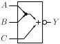
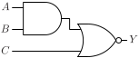

# AOI21

Inverted output AND-OR gate with two AND inputs and one direct OR input

## Pin information

| Pin   | Description   |
| :-:    | :-            |
| A | Input A, connected to AND gate |
| B | Input B, connected to AND gate |
| C | Input C, direct input to OR gate |
| Y | Output |
| VDD | Power supply |
| VSS | Ground |


## Logic function and Truth table

### Logic function (Python)
<div align="center">
Y = ~((A & B) | C)
</div>

### Logic function (Boolean)
\\[ Y = \overline{(A \cdot B) + C} \\]

### Truth Table for Y


| A | B | C | Y |
| :--- | :--- | :--- | :--- |
| 0 | - | 0 | 1 | 
| - | 0 | 0 | 1 | 
| - | - | 1 | 0 | 
| 1 | 1 | - | 0 | 


## Symbol

<div align="center">

</div>

## Schematic

<div align="center">

</div>

## Cell variants

| Cell name <br> | Width <br> [unit sites] | Area <br> [\\(\mu m^2\\)] |
| :-        | :-:   | :-:   |
| [AOI21_DL](#aoi21_dl) | TBD | TBD |
| [AOI21_D1](#aoi21_d1) | TBD | TBD |
| [AOI21_D2](#aoi21_d2) | TBD | TBD |


### AOI21_DL

#### Hierarchical SPICE netlist
```spice
.subckt AOI21_DL A B C Y VDD VSS
XMN0 n0 A VSS VSS sg13_lv_nmos w=6e-07 l=1.3e-07 ad={6e-07*3.1e-07} as={6e-07*3.1e-07} pd={2*(6e-07+3.1e-07)} ps={2*(6e-07+3.1e-07)} 
XMN1 Y B n0 VSS sg13_lv_nmos w=6e-07 l=1.3e-07 ad={6e-07*3.1e-07} as={6e-07*3.1e-07} pd={2*(6e-07+3.1e-07)} ps={2*(6e-07+3.1e-07)} 
XMN2 Y C VSS VSS sg13_lv_nmos w=3e-07 l=1.3e-07 ad={3e-07*3.1e-07} as={3e-07*3.1e-07} pd={2*(3e-07+3.1e-07)} ps={2*(3e-07+3.1e-07)} 
XMP0 n1 A VDD VDD sg13_lv_pmos w=9e-07 l=1.3e-07 ad={9e-07*3.1e-07} as={9e-07*3.1e-07} pd={2*(9e-07+3.1e-07)} ps={2*(9e-07+3.1e-07)} 
XMP1 n1 B VDD VDD sg13_lv_pmos w=9e-07 l=1.3e-07 ad={9e-07*3.1e-07} as={9e-07*3.1e-07} pd={2*(9e-07+3.1e-07)} ps={2*(9e-07+3.1e-07)} 
XMP2 Y C n1 VDD sg13_lv_pmos w=9e-07 l=1.3e-07 ad={9e-07*3.1e-07} as={9e-07*3.1e-07} pd={2*(9e-07+3.1e-07)} ps={2*(9e-07+3.1e-07)} 
.ends
```

#### Flat SPICE netlist
```spice
.subckt AOI21_DL A B C Y VDD VSS
XMN0 n0 A VSS VSS sg13_lv_nmos w=6e-07 l=1.3e-07 ad=1.86e-13 as=1.86e-13 pd=1.82e-06 ps=1.82e-06 
XMN1 Y B n0 VSS sg13_lv_nmos w=6e-07 l=1.3e-07 ad=1.86e-13 as=1.86e-13 pd=1.82e-06 ps=1.82e-06 
XMN2 Y C VSS VSS sg13_lv_nmos w=3e-07 l=1.3e-07 ad=9.3e-14 as=9.3e-14 pd=1.22e-06 ps=1.22e-06 
XMP0 n1 A VDD VDD sg13_lv_pmos w=9e-07 l=1.3e-07 ad=2.79e-13 as=2.79e-13 pd=2.42e-06 ps=2.42e-06 
XMP1 n1 B VDD VDD sg13_lv_pmos w=9e-07 l=1.3e-07 ad=2.79e-13 as=2.79e-13 pd=2.42e-06 ps=2.42e-06 
XMP2 Y C n1 VDD sg13_lv_pmos w=9e-07 l=1.3e-07 ad=2.79e-13 as=2.79e-13 pd=2.42e-06 ps=2.42e-06 
.ends
```

#### CDL netlist
```cdl
.SUBCKT AOI21_DL A B C Y VDD VSS
*.PININFO A:I B:I C:I Y:O VDD:B VSS:B 
MN0 n0 A VSS VSS sg13_lv_nmos w=6e-07 l=1.3e-07 
MN1 Y B n0 VSS sg13_lv_nmos w=6e-07 l=1.3e-07 
MN2 Y C VSS VSS sg13_lv_nmos w=3e-07 l=1.3e-07 
MP0 n1 A VDD VDD sg13_lv_pmos w=9e-07 l=1.3e-07 
MP1 n1 B VDD VDD sg13_lv_pmos w=9e-07 l=1.3e-07 
MP2 Y C n1 VDD sg13_lv_pmos w=9e-07 l=1.3e-07 
.ENDS
```

#### Layout

<div align="center">

</div>

### AOI21_D1

#### Hierarchical SPICE netlist
```spice
.subckt AOI21_D1 A B C Y VDD VSS
XMN0 n0 A VSS VSS sg13_lv_nmos w=9e-07 l=1.3e-07 ad={9e-07*3.1e-07} as={9e-07*3.1e-07} pd={2*(9e-07+3.1e-07)} ps={2*(9e-07+3.1e-07)} 
XMN1 Y B n0 VSS sg13_lv_nmos w=9e-07 l=1.3e-07 ad={9e-07*3.1e-07} as={9e-07*3.1e-07} pd={2*(9e-07+3.1e-07)} ps={2*(9e-07+3.1e-07)} 
XMN2 Y C VSS VSS sg13_lv_nmos w=6.4e-07 l=1.3e-07 ad={6.4e-07*3.1e-07} as={6.4e-07*3.1e-07} pd={2*(6.4e-07+3.1e-07)} ps={2*(6.4e-07+3.1e-07)} 
XMP0 n1 A VDD VDD sg13_lv_pmos w=1.28e-06 l=1.3e-07 ad={1.28e-06*3.1e-07} as={1.28e-06*3.1e-07} pd={2*(1.28e-06+3.1e-07)} ps={2*(1.28e-06+3.1e-07)} 
XMP1 n1 B VDD VDD sg13_lv_pmos w=1.28e-06 l=1.3e-07 ad={1.28e-06*3.1e-07} as={1.28e-06*3.1e-07} pd={2*(1.28e-06+3.1e-07)} ps={2*(1.28e-06+3.1e-07)} 
XMP2 Y C n1 VDD sg13_lv_pmos w=1.28e-06 l=1.3e-07 ad={1.28e-06*3.1e-07} as={1.28e-06*3.1e-07} pd={2*(1.28e-06+3.1e-07)} ps={2*(1.28e-06+3.1e-07)} 
.ends
```

#### Flat SPICE netlist
```spice
.subckt AOI21_D1 A B C Y VDD VSS
XMN0 n0 A VSS VSS sg13_lv_nmos w=9e-07 l=1.3e-07 ad=2.79e-13 as=2.79e-13 pd=2.42e-06 ps=2.42e-06 
XMN1 Y B n0 VSS sg13_lv_nmos w=9e-07 l=1.3e-07 ad=2.79e-13 as=2.79e-13 pd=2.42e-06 ps=2.42e-06 
XMN2 Y C VSS VSS sg13_lv_nmos w=6.4e-07 l=1.3e-07 ad=1.984e-13 as=1.984e-13 pd=1.9e-06 ps=1.9e-06 
XMP0 n1 A VDD VDD sg13_lv_pmos w=1.28e-06 l=1.3e-07 ad=3.968e-13 as=3.968e-13 pd=3.18e-06 ps=3.18e-06 
XMP1 n1 B VDD VDD sg13_lv_pmos w=1.28e-06 l=1.3e-07 ad=3.968e-13 as=3.968e-13 pd=3.18e-06 ps=3.18e-06 
XMP2 Y C n1 VDD sg13_lv_pmos w=1.28e-06 l=1.3e-07 ad=3.968e-13 as=3.968e-13 pd=3.18e-06 ps=3.18e-06 
.ends
```

#### CDL netlist
```cdl
.SUBCKT AOI21_D1 A B C Y VDD VSS
*.PININFO A:I B:I C:I Y:O VDD:B VSS:B 
MN0 n0 A VSS VSS sg13_lv_nmos w=9e-07 l=1.3e-07 
MN1 Y B n0 VSS sg13_lv_nmos w=9e-07 l=1.3e-07 
MN2 Y C VSS VSS sg13_lv_nmos w=6.4e-07 l=1.3e-07 
MP0 n1 A VDD VDD sg13_lv_pmos w=1.28e-06 l=1.3e-07 
MP1 n1 B VDD VDD sg13_lv_pmos w=1.28e-06 l=1.3e-07 
MP2 Y C n1 VDD sg13_lv_pmos w=1.28e-06 l=1.3e-07 
.ENDS
```

#### Layout

<div align="center">

</div>

### AOI21_D2

#### Hierarchical SPICE netlist
```spice
.subckt AOI21_D2 A B C Y VDD VSS
XMN0 n0 A VSS VSS sg13_lv_nmos w=1.8e-06 l=1.3e-07 ad={1.8e-06*3.1e-07} as={1.8e-06*3.1e-07} pd={2*(1.8e-06+3.1e-07)} ps={2*(1.8e-06+3.1e-07)} ng=2 
XMN1 Y B n0 VSS sg13_lv_nmos w=1.8e-06 l=1.3e-07 ad={1.8e-06*3.1e-07} as={1.8e-06*3.1e-07} pd={2*(1.8e-06+3.1e-07)} ps={2*(1.8e-06+3.1e-07)} ng=2 
XMN2 Y C VSS VSS sg13_lv_nmos w=1.28e-06 l=1.3e-07 ad={1.28e-06*3.1e-07} as={1.28e-06*3.1e-07} pd={2*(1.28e-06+3.1e-07)} ps={2*(1.28e-06+3.1e-07)} ng=2 
XMP0_0 n1_0 A VDD VDD sg13_lv_pmos w=1.28e-06 l=1.3e-07 ad={1.28e-06*3.1e-07} as={1.28e-06*3.1e-07} pd={2*(1.28e-06+3.1e-07)} ps={2*(1.28e-06+3.1e-07)} 
XMP0_1 n1_1 A VDD VDD sg13_lv_pmos w=1.28e-06 l=1.3e-07 ad={1.28e-06*3.1e-07} as={1.28e-06*3.1e-07} pd={2*(1.28e-06+3.1e-07)} ps={2*(1.28e-06+3.1e-07)} 
XMP1_0 n1_0 B VDD VDD sg13_lv_pmos w=1.28e-06 l=1.3e-07 ad={1.28e-06*3.1e-07} as={1.28e-06*3.1e-07} pd={2*(1.28e-06+3.1e-07)} ps={2*(1.28e-06+3.1e-07)} 
XMP1_1 n1_1 B VDD VDD sg13_lv_pmos w=1.28e-06 l=1.3e-07 ad={1.28e-06*3.1e-07} as={1.28e-06*3.1e-07} pd={2*(1.28e-06+3.1e-07)} ps={2*(1.28e-06+3.1e-07)} 
XMP2_0 Y C n1_0 VDD sg13_lv_pmos w=1.28e-06 l=1.3e-07 ad={1.28e-06*3.1e-07} as={1.28e-06*3.1e-07} pd={2*(1.28e-06+3.1e-07)} ps={2*(1.28e-06+3.1e-07)} 
XMP2_1 Y C n1_1 VDD sg13_lv_pmos w=1.28e-06 l=1.3e-07 ad={1.28e-06*3.1e-07} as={1.28e-06*3.1e-07} pd={2*(1.28e-06+3.1e-07)} ps={2*(1.28e-06+3.1e-07)} 
.ends
```

#### Flat SPICE netlist
```spice
.subckt AOI21_D2 A B C Y VDD VSS
XMN0 n0 A VSS VSS sg13_lv_nmos w=1.8e-06 l=1.3e-07 ad=5.58e-13 as=5.58e-13 pd=4.22e-06 ps=4.22e-06 ng=2 
XMN1 Y B n0 VSS sg13_lv_nmos w=1.8e-06 l=1.3e-07 ad=5.58e-13 as=5.58e-13 pd=4.22e-06 ps=4.22e-06 ng=2 
XMN2 Y C VSS VSS sg13_lv_nmos w=1.28e-06 l=1.3e-07 ad=3.968e-13 as=3.968e-13 pd=3.18e-06 ps=3.18e-06 ng=2 
XMP0 n1 A VDD VDD sg13_lv_pmos w=1.28e-06 l=1.3e-07 ad=3.968e-13 as=3.968e-13 pd=3.18e-06 ps=3.18e-06 
XMP1 n2 A VDD VDD sg13_lv_pmos w=1.28e-06 l=1.3e-07 ad=3.968e-13 as=3.968e-13 pd=3.18e-06 ps=3.18e-06 
XMP2 n1 B VDD VDD sg13_lv_pmos w=1.28e-06 l=1.3e-07 ad=3.968e-13 as=3.968e-13 pd=3.18e-06 ps=3.18e-06 
XMP3 n2 B VDD VDD sg13_lv_pmos w=1.28e-06 l=1.3e-07 ad=3.968e-13 as=3.968e-13 pd=3.18e-06 ps=3.18e-06 
XMP4 Y C n1 VDD sg13_lv_pmos w=1.28e-06 l=1.3e-07 ad=3.968e-13 as=3.968e-13 pd=3.18e-06 ps=3.18e-06 
XMP5 Y C n2 VDD sg13_lv_pmos w=1.28e-06 l=1.3e-07 ad=3.968e-13 as=3.968e-13 pd=3.18e-06 ps=3.18e-06 
.ends
```

#### CDL netlist
```cdl
.SUBCKT AOI21_D2 A B C Y VDD VSS
*.PININFO A:I B:I C:I Y:O VDD:B VSS:B 
MN0 n0 A VSS VSS sg13_lv_nmos w=1.8e-06 l=1.3e-07 ng=2 
MN1 Y B n0 VSS sg13_lv_nmos w=1.8e-06 l=1.3e-07 ng=2 
MN2 Y C VSS VSS sg13_lv_nmos w=1.28e-06 l=1.3e-07 ng=2 
MP0 n1 A VDD VDD sg13_lv_pmos w=1.28e-06 l=1.3e-07 
MP1 n2 A VDD VDD sg13_lv_pmos w=1.28e-06 l=1.3e-07 
MP2 n1 B VDD VDD sg13_lv_pmos w=1.28e-06 l=1.3e-07 
MP3 n2 B VDD VDD sg13_lv_pmos w=1.28e-06 l=1.3e-07 
MP4 Y C n1 VDD sg13_lv_pmos w=1.28e-06 l=1.3e-07 
MP5 Y C n2 VDD sg13_lv_pmos w=1.28e-06 l=1.3e-07 
.ENDS
```

#### Layout

<div align="center">

</div>

## Pin capacitance
No pin capacitance data


## Static power
No static power data


## Dynamic power
No dynamic power data


## Delay
No delay data

