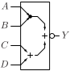
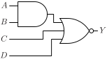

# AOI211

Inverted output AND-OR gate with two input AND gate and two direct inputs to OR gate

## Pin information

| Pin   | Description   |
| :-:    | :-            |
| A | Input A, connected to AND gate |
| B | Input B, connected to AND gate |
| C | Input C, connected to OR gate |
| D | Input D, connected to OR gate |
| Y | Output |
| VDD | Power supply |
| VSS | Ground |


## Logic function and Truth table

### Logic function (Python)
<div align="center">
Y = ~((A & B) | C | D)
</div>

### Logic function (Boolean)
\\[ Y = \overline{(A \cdot B) + C + D} \\]

### Truth Table for Y


| A | B | C | D | Y |
| :--- | :--- | :--- | :--- | :--- |
| 0 | - | 0 | 0 | 1 | 
| - | 0 | 0 | 0 | 1 | 
| - | - | 1 | - | 0 | 
| - | - | - | 1 | 0 | 
| 1 | 1 | - | - | 0 | 


## Symbol

<div align="center">

</div>

## Schematic

<div align="center">

</div>

## Cell variants

| Cell name <br> | Width <br> [unit sites] | Area <br> [\\(\mu m^2\\)] |
| :-        | :-:   | :-:   |
| [AOI211_DL](#aoi211_dl) | TBD | TBD |
| [AOI211_D1](#aoi211_d1) | TBD | TBD |
| [AOI211_D2](#aoi211_d2) | TBD | TBD |


### AOI211_DL

#### Hierarchical SPICE netlist
```spice
.subckt AOI211_DL A B C D Y VDD VSS
XMN0 Y D VSS VSS sg13_lv_nmos w=3e-07 l=1.3e-07 ad={3e-07*3.1e-07} as={3e-07*3.1e-07} pd={2*(3e-07+3.1e-07)} ps={2*(3e-07+3.1e-07)} 
XMN1 Y C VSS VSS sg13_lv_nmos w=3e-07 l=1.3e-07 ad={3e-07*3.1e-07} as={3e-07*3.1e-07} pd={2*(3e-07+3.1e-07)} ps={2*(3e-07+3.1e-07)} 
XMN2 n0 B VSS VSS sg13_lv_nmos w=4.5e-07 l=1.3e-07 ad={4.5e-07*3.1e-07} as={4.5e-07*3.1e-07} pd={2*(4.5e-07+3.1e-07)} ps={2*(4.5e-07+3.1e-07)} 
XMN3 Y A n0 VSS sg13_lv_nmos w=4.5e-07 l=1.3e-07 ad={4.5e-07*3.1e-07} as={4.5e-07*3.1e-07} pd={2*(4.5e-07+3.1e-07)} ps={2*(4.5e-07+3.1e-07)} 
XMP0 n1 A VDD VDD sg13_lv_pmos w=7.5e-07 l=1.3e-07 ad={7.5e-07*3.1e-07} as={7.5e-07*3.1e-07} pd={2*(7.5e-07+3.1e-07)} ps={2*(7.5e-07+3.1e-07)} 
XMP1 n1 B VDD VDD sg13_lv_pmos w=7.5e-07 l=1.3e-07 ad={7.5e-07*3.1e-07} as={7.5e-07*3.1e-07} pd={2*(7.5e-07+3.1e-07)} ps={2*(7.5e-07+3.1e-07)} 
XMP2 n2 C n1 VDD sg13_lv_pmos w=7.5e-07 l=1.3e-07 ad={7.5e-07*3.1e-07} as={7.5e-07*3.1e-07} pd={2*(7.5e-07+3.1e-07)} ps={2*(7.5e-07+3.1e-07)} 
XMP3 Y D n2 VDD sg13_lv_pmos w=7.5e-07 l=1.3e-07 ad={7.5e-07*3.1e-07} as={7.5e-07*3.1e-07} pd={2*(7.5e-07+3.1e-07)} ps={2*(7.5e-07+3.1e-07)} 
.ends
```

#### Flat SPICE netlist
```spice
.subckt AOI211_DL A B C D Y VDD VSS
XMN0 Y D VSS VSS sg13_lv_nmos w=3e-07 l=1.3e-07 ad=9.3e-14 as=9.3e-14 pd=1.22e-06 ps=1.22e-06 
XMN1 Y C VSS VSS sg13_lv_nmos w=3e-07 l=1.3e-07 ad=9.3e-14 as=9.3e-14 pd=1.22e-06 ps=1.22e-06 
XMN2 n0 B VSS VSS sg13_lv_nmos w=4.5e-07 l=1.3e-07 ad=1.395e-13 as=1.395e-13 pd=1.52e-06 ps=1.52e-06 
XMN3 Y A n0 VSS sg13_lv_nmos w=4.5e-07 l=1.3e-07 ad=1.395e-13 as=1.395e-13 pd=1.52e-06 ps=1.52e-06 
XMP0 n1 A VDD VDD sg13_lv_pmos w=7.5e-07 l=1.3e-07 ad=2.325e-13 as=2.325e-13 pd=2.12e-06 ps=2.12e-06 
XMP1 n1 B VDD VDD sg13_lv_pmos w=7.5e-07 l=1.3e-07 ad=2.325e-13 as=2.325e-13 pd=2.12e-06 ps=2.12e-06 
XMP2 n2 C n1 VDD sg13_lv_pmos w=7.5e-07 l=1.3e-07 ad=2.325e-13 as=2.325e-13 pd=2.12e-06 ps=2.12e-06 
XMP3 Y D n2 VDD sg13_lv_pmos w=7.5e-07 l=1.3e-07 ad=2.325e-13 as=2.325e-13 pd=2.12e-06 ps=2.12e-06 
.ends
```

#### CDL netlist
```cdl
.SUBCKT AOI211_DL A B C D Y VDD VSS
*.PININFO C:I B:I D:I A:I Y:O VDD:B VSS:B 
MN0 Y D VSS VSS sg13_lv_nmos w=3e-07 l=1.3e-07 
MN1 Y C VSS VSS sg13_lv_nmos w=3e-07 l=1.3e-07 
MN2 n0 B VSS VSS sg13_lv_nmos w=4.5e-07 l=1.3e-07 
MN3 Y A n0 VSS sg13_lv_nmos w=4.5e-07 l=1.3e-07 
MP0 n1 A VDD VDD sg13_lv_pmos w=7.5e-07 l=1.3e-07 
MP1 n1 B VDD VDD sg13_lv_pmos w=7.5e-07 l=1.3e-07 
MP2 n2 C n1 VDD sg13_lv_pmos w=7.5e-07 l=1.3e-07 
MP3 Y D n2 VDD sg13_lv_pmos w=7.5e-07 l=1.3e-07 
.ENDS
```

#### Layout

<div align="center">

</div>

### AOI211_D1

#### Hierarchical SPICE netlist
```spice
.subckt AOI211_D1 A B C D Y VDD VSS
XMN0 Y D VSS VSS sg13_lv_nmos w=6.4e-07 l=1.3e-07 ad={6.4e-07*3.1e-07} as={6.4e-07*3.1e-07} pd={2*(6.4e-07+3.1e-07)} ps={2*(6.4e-07+3.1e-07)} 
XMN1 Y C VSS VSS sg13_lv_nmos w=6.4e-07 l=1.3e-07 ad={6.4e-07*3.1e-07} as={6.4e-07*3.1e-07} pd={2*(6.4e-07+3.1e-07)} ps={2*(6.4e-07+3.1e-07)} 
XMN2 n0 B VSS VSS sg13_lv_nmos w=9e-07 l=1.3e-07 ad={9e-07*3.1e-07} as={9e-07*3.1e-07} pd={2*(9e-07+3.1e-07)} ps={2*(9e-07+3.1e-07)} 
XMN3 Y A n0 VSS sg13_lv_nmos w=9e-07 l=1.3e-07 ad={9e-07*3.1e-07} as={9e-07*3.1e-07} pd={2*(9e-07+3.1e-07)} ps={2*(9e-07+3.1e-07)} 
XMP0 n1 A VDD VDD sg13_lv_pmos w=1.28e-06 l=1.3e-07 ad={1.28e-06*3.1e-07} as={1.28e-06*3.1e-07} pd={2*(1.28e-06+3.1e-07)} ps={2*(1.28e-06+3.1e-07)} 
XMP1 n1 B VDD VDD sg13_lv_pmos w=1.28e-06 l=1.3e-07 ad={1.28e-06*3.1e-07} as={1.28e-06*3.1e-07} pd={2*(1.28e-06+3.1e-07)} ps={2*(1.28e-06+3.1e-07)} 
XMP2 n2 C n1 VDD sg13_lv_pmos w=1.28e-06 l=1.3e-07 ad={1.28e-06*3.1e-07} as={1.28e-06*3.1e-07} pd={2*(1.28e-06+3.1e-07)} ps={2*(1.28e-06+3.1e-07)} 
XMP3 Y D n2 VDD sg13_lv_pmos w=1.28e-06 l=1.3e-07 ad={1.28e-06*3.1e-07} as={1.28e-06*3.1e-07} pd={2*(1.28e-06+3.1e-07)} ps={2*(1.28e-06+3.1e-07)} 
.ends
```

#### Flat SPICE netlist
```spice
.subckt AOI211_D1 A B C D Y VDD VSS
XMN0 Y D VSS VSS sg13_lv_nmos w=6.4e-07 l=1.3e-07 ad=1.984e-13 as=1.984e-13 pd=1.9e-06 ps=1.9e-06 
XMN1 Y C VSS VSS sg13_lv_nmos w=6.4e-07 l=1.3e-07 ad=1.984e-13 as=1.984e-13 pd=1.9e-06 ps=1.9e-06 
XMN2 n0 B VSS VSS sg13_lv_nmos w=9e-07 l=1.3e-07 ad=2.79e-13 as=2.79e-13 pd=2.42e-06 ps=2.42e-06 
XMN3 Y A n0 VSS sg13_lv_nmos w=9e-07 l=1.3e-07 ad=2.79e-13 as=2.79e-13 pd=2.42e-06 ps=2.42e-06 
XMP0 n1 A VDD VDD sg13_lv_pmos w=1.28e-06 l=1.3e-07 ad=3.968e-13 as=3.968e-13 pd=3.18e-06 ps=3.18e-06 
XMP1 n1 B VDD VDD sg13_lv_pmos w=1.28e-06 l=1.3e-07 ad=3.968e-13 as=3.968e-13 pd=3.18e-06 ps=3.18e-06 
XMP2 n2 C n1 VDD sg13_lv_pmos w=1.28e-06 l=1.3e-07 ad=3.968e-13 as=3.968e-13 pd=3.18e-06 ps=3.18e-06 
XMP3 Y D n2 VDD sg13_lv_pmos w=1.28e-06 l=1.3e-07 ad=3.968e-13 as=3.968e-13 pd=3.18e-06 ps=3.18e-06 
.ends
```

#### CDL netlist
```cdl
.SUBCKT AOI211_D1 A B C D Y VDD VSS
*.PININFO C:I B:I D:I A:I Y:O VDD:B VSS:B 
MN0 Y D VSS VSS sg13_lv_nmos w=6.4e-07 l=1.3e-07 
MN1 Y C VSS VSS sg13_lv_nmos w=6.4e-07 l=1.3e-07 
MN2 n0 B VSS VSS sg13_lv_nmos w=9e-07 l=1.3e-07 
MN3 Y A n0 VSS sg13_lv_nmos w=9e-07 l=1.3e-07 
MP0 n1 A VDD VDD sg13_lv_pmos w=1.28e-06 l=1.3e-07 
MP1 n1 B VDD VDD sg13_lv_pmos w=1.28e-06 l=1.3e-07 
MP2 n2 C n1 VDD sg13_lv_pmos w=1.28e-06 l=1.3e-07 
MP3 Y D n2 VDD sg13_lv_pmos w=1.28e-06 l=1.3e-07 
.ENDS
```

#### Layout

<div align="center">

</div>

### AOI211_D2

#### Hierarchical SPICE netlist
```spice
.subckt AOI211_D2 A B C D Y VDD VSS
XMN0_0 Y D VSS VSS sg13_lv_nmos w=6.4e-07 l=1.3e-07 ad={6.4e-07*3.1e-07} as={6.4e-07*3.1e-07} pd={2*(6.4e-07+3.1e-07)} ps={2*(6.4e-07+3.1e-07)} 
XMN0_1 Y D VSS VSS sg13_lv_nmos w=6.4e-07 l=1.3e-07 ad={6.4e-07*3.1e-07} as={6.4e-07*3.1e-07} pd={2*(6.4e-07+3.1e-07)} ps={2*(6.4e-07+3.1e-07)} 
XMN1_0 Y C VSS VSS sg13_lv_nmos w=6.4e-07 l=1.3e-07 ad={6.4e-07*3.1e-07} as={6.4e-07*3.1e-07} pd={2*(6.4e-07+3.1e-07)} ps={2*(6.4e-07+3.1e-07)} 
XMN1_1 Y C VSS VSS sg13_lv_nmos w=6.4e-07 l=1.3e-07 ad={6.4e-07*3.1e-07} as={6.4e-07*3.1e-07} pd={2*(6.4e-07+3.1e-07)} ps={2*(6.4e-07+3.1e-07)} 
XMN2_0 n0_0 B VSS VSS sg13_lv_nmos w=9e-07 l=1.3e-07 ad={9e-07*3.1e-07} as={9e-07*3.1e-07} pd={2*(9e-07+3.1e-07)} ps={2*(9e-07+3.1e-07)} 
XMN2_1 n0_1 B VSS VSS sg13_lv_nmos w=9e-07 l=1.3e-07 ad={9e-07*3.1e-07} as={9e-07*3.1e-07} pd={2*(9e-07+3.1e-07)} ps={2*(9e-07+3.1e-07)} 
XMN3_0 Y A n0_0 VSS sg13_lv_nmos w=9e-07 l=1.3e-07 ad={9e-07*3.1e-07} as={9e-07*3.1e-07} pd={2*(9e-07+3.1e-07)} ps={2*(9e-07+3.1e-07)} 
XMN3_1 Y A n0_1 VSS sg13_lv_nmos w=9e-07 l=1.3e-07 ad={9e-07*3.1e-07} as={9e-07*3.1e-07} pd={2*(9e-07+3.1e-07)} ps={2*(9e-07+3.1e-07)} 
XMP0 n1 A VDD VDD sg13_lv_pmos w=2.56e-06 l=1.3e-07 ad={2.56e-06*3.1e-07} as={2.56e-06*3.1e-07} pd={2*(2.56e-06+3.1e-07)} ps={2*(2.56e-06+3.1e-07)} ng=2 
XMP1 n1 B VDD VDD sg13_lv_pmos w=2.56e-06 l=1.3e-07 ad={2.56e-06*3.1e-07} as={2.56e-06*3.1e-07} pd={2*(2.56e-06+3.1e-07)} ps={2*(2.56e-06+3.1e-07)} ng=2 
XMP2_0 n2_0 C n1 VDD sg13_lv_pmos w=1.28e-06 l=1.3e-07 ad={1.28e-06*3.1e-07} as={1.28e-06*3.1e-07} pd={2*(1.28e-06+3.1e-07)} ps={2*(1.28e-06+3.1e-07)} 
XMP2_1 n2_1 C n1 VDD sg13_lv_pmos w=1.28e-06 l=1.3e-07 ad={1.28e-06*3.1e-07} as={1.28e-06*3.1e-07} pd={2*(1.28e-06+3.1e-07)} ps={2*(1.28e-06+3.1e-07)} 
XMP3_0 Y D n2_0 VDD sg13_lv_pmos w=1.28e-06 l=1.3e-07 ad={1.28e-06*3.1e-07} as={1.28e-06*3.1e-07} pd={2*(1.28e-06+3.1e-07)} ps={2*(1.28e-06+3.1e-07)} 
XMP3_1 Y D n2_1 VDD sg13_lv_pmos w=1.28e-06 l=1.3e-07 ad={1.28e-06*3.1e-07} as={1.28e-06*3.1e-07} pd={2*(1.28e-06+3.1e-07)} ps={2*(1.28e-06+3.1e-07)} 
.ends
```

#### Flat SPICE netlist
```spice
.subckt AOI211_D2 A B C D Y VDD VSS
XMN0 Y D VSS VSS sg13_lv_nmos w=6.4e-07 l=1.3e-07 ad=1.984e-13 as=1.984e-13 pd=1.9e-06 ps=1.9e-06 
XMN1 Y D VSS VSS sg13_lv_nmos w=6.4e-07 l=1.3e-07 ad=1.984e-13 as=1.984e-13 pd=1.9e-06 ps=1.9e-06 
XMN2 Y C VSS VSS sg13_lv_nmos w=6.4e-07 l=1.3e-07 ad=1.984e-13 as=1.984e-13 pd=1.9e-06 ps=1.9e-06 
XMN3 Y C VSS VSS sg13_lv_nmos w=6.4e-07 l=1.3e-07 ad=1.984e-13 as=1.984e-13 pd=1.9e-06 ps=1.9e-06 
XMN4 n0 B VSS VSS sg13_lv_nmos w=9e-07 l=1.3e-07 ad=2.79e-13 as=2.79e-13 pd=2.42e-06 ps=2.42e-06 
XMN5 n1 B VSS VSS sg13_lv_nmos w=9e-07 l=1.3e-07 ad=2.79e-13 as=2.79e-13 pd=2.42e-06 ps=2.42e-06 
XMN6 Y A n0 VSS sg13_lv_nmos w=9e-07 l=1.3e-07 ad=2.79e-13 as=2.79e-13 pd=2.42e-06 ps=2.42e-06 
XMN7 Y A n1 VSS sg13_lv_nmos w=9e-07 l=1.3e-07 ad=2.79e-13 as=2.79e-13 pd=2.42e-06 ps=2.42e-06 
XMP0 n2 A VDD VDD sg13_lv_pmos w=2.56e-06 l=1.3e-07 ad=7.936e-13 as=7.936e-13 pd=5.74e-06 ps=5.74e-06 ng=2 
XMP1 n2 B VDD VDD sg13_lv_pmos w=2.56e-06 l=1.3e-07 ad=7.936e-13 as=7.936e-13 pd=5.74e-06 ps=5.74e-06 ng=2 
XMP2 n3 C n2 VDD sg13_lv_pmos w=1.28e-06 l=1.3e-07 ad=3.968e-13 as=3.968e-13 pd=3.18e-06 ps=3.18e-06 
XMP3 n4 C n2 VDD sg13_lv_pmos w=1.28e-06 l=1.3e-07 ad=3.968e-13 as=3.968e-13 pd=3.18e-06 ps=3.18e-06 
XMP4 Y D n3 VDD sg13_lv_pmos w=1.28e-06 l=1.3e-07 ad=3.968e-13 as=3.968e-13 pd=3.18e-06 ps=3.18e-06 
XMP5 Y D n4 VDD sg13_lv_pmos w=1.28e-06 l=1.3e-07 ad=3.968e-13 as=3.968e-13 pd=3.18e-06 ps=3.18e-06 
.ends
```

#### CDL netlist
```cdl
.SUBCKT AOI211_D2 A B C D Y VDD VSS
*.PININFO C:I B:I D:I A:I Y:O VDD:B VSS:B 
MN0 Y D VSS VSS sg13_lv_nmos w=6.4e-07 l=1.3e-07 
MN1 Y D VSS VSS sg13_lv_nmos w=6.4e-07 l=1.3e-07 
MN2 Y C VSS VSS sg13_lv_nmos w=6.4e-07 l=1.3e-07 
MN3 Y C VSS VSS sg13_lv_nmos w=6.4e-07 l=1.3e-07 
MN4 n0 B VSS VSS sg13_lv_nmos w=9e-07 l=1.3e-07 
MN5 n1 B VSS VSS sg13_lv_nmos w=9e-07 l=1.3e-07 
MN6 Y A n0 VSS sg13_lv_nmos w=9e-07 l=1.3e-07 
MN7 Y A n1 VSS sg13_lv_nmos w=9e-07 l=1.3e-07 
MP0 n2 A VDD VDD sg13_lv_pmos w=2.56e-06 l=1.3e-07 ng=2 
MP1 n2 B VDD VDD sg13_lv_pmos w=2.56e-06 l=1.3e-07 ng=2 
MP2 n3 C n2 VDD sg13_lv_pmos w=1.28e-06 l=1.3e-07 
MP3 n4 C n2 VDD sg13_lv_pmos w=1.28e-06 l=1.3e-07 
MP4 Y D n3 VDD sg13_lv_pmos w=1.28e-06 l=1.3e-07 
MP5 Y D n4 VDD sg13_lv_pmos w=1.28e-06 l=1.3e-07 
.ENDS
```

#### Layout

<div align="center">

</div>

## Pin capacitance
No pin capacitance data


## Static power
No static power data


## Dynamic power
No dynamic power data


## Delay
No delay data

