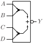
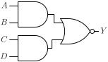

# AOI22

Inverted output AND-OR gate with two two-input AND gates

## Pin information

| Pin   | Description   |
| :-:    | :-            |
| A | Input A, connected to first AND gate |
| B | Input B, connected to first AND gate |
| C | Input C, connected to second AND gate |
| D | Input D, connected to second AND gate |
| Y | Output |
| VDD | Power supply |
| VSS | Ground |


## Logic function and Truth table

### Logic function (Python)
<div align="center">
Y = ~((A & B) | (C & D))
</div>

### Logic function (Boolean)
\\[ Y = \overline{(A \cdot B) + (C \cdot D)} \\]

### Truth Table for Y


| A | B | C | D | Y |
| :--- | :--- | :--- | :--- | :--- |
| 0 | - | 0 | - | 1 | 
| 0 | - | - | 0 | 1 | 
| - | 0 | 0 | - | 1 | 
| - | 0 | - | 0 | 1 | 
| 1 | 1 | - | - | 0 | 
| - | - | 1 | 1 | 0 | 


## Symbol

<div align="center">

</div>

## Schematic

<div align="center">

</div>

## Cell variants

| Cell name <br> | Width <br> [unit sites] | Area <br> [\\(\mu m^2\\)] |
| :-        | :-:   | :-:   |
| [AOI22_DL](#aoi22_dl) | TBD | TBD |
| [AOI22_D1](#aoi22_d1) | TBD | TBD |


### AOI22_DL

#### Hierarchical SPICE netlist
```spice
.subckt AOI22_DL A B C D Y VDD VSS
XMN0 n0 D VSS VSS sg13_lv_nmos w=5e-07 l=1.3e-07 ad={5e-07*3.1e-07} as={5e-07*3.1e-07} pd={2*(5e-07+3.1e-07)} ps={2*(5e-07+3.1e-07)} 
XMN1 Y C n0 VSS sg13_lv_nmos w=5e-07 l=1.3e-07 ad={5e-07*3.1e-07} as={5e-07*3.1e-07} pd={2*(5e-07+3.1e-07)} ps={2*(5e-07+3.1e-07)} 
XMN2 n1 B VSS VSS sg13_lv_nmos w=5e-07 l=1.3e-07 ad={5e-07*3.1e-07} as={5e-07*3.1e-07} pd={2*(5e-07+3.1e-07)} ps={2*(5e-07+3.1e-07)} 
XMN3 Y A n1 VSS sg13_lv_nmos w=5e-07 l=1.3e-07 ad={5e-07*3.1e-07} as={5e-07*3.1e-07} pd={2*(5e-07+3.1e-07)} ps={2*(5e-07+3.1e-07)} 
XMP0 n2 A VDD VDD sg13_lv_pmos w=7.5e-07 l=1.3e-07 ad={7.5e-07*3.1e-07} as={7.5e-07*3.1e-07} pd={2*(7.5e-07+3.1e-07)} ps={2*(7.5e-07+3.1e-07)} 
XMP1 n2 B VDD VDD sg13_lv_pmos w=7.5e-07 l=1.3e-07 ad={7.5e-07*3.1e-07} as={7.5e-07*3.1e-07} pd={2*(7.5e-07+3.1e-07)} ps={2*(7.5e-07+3.1e-07)} 
XMP2 Y C n2 VDD sg13_lv_pmos w=7.5e-07 l=1.3e-07 ad={7.5e-07*3.1e-07} as={7.5e-07*3.1e-07} pd={2*(7.5e-07+3.1e-07)} ps={2*(7.5e-07+3.1e-07)} 
XMP3 Y D n2 VDD sg13_lv_pmos w=7.5e-07 l=1.3e-07 ad={7.5e-07*3.1e-07} as={7.5e-07*3.1e-07} pd={2*(7.5e-07+3.1e-07)} ps={2*(7.5e-07+3.1e-07)} 
.ends
```

#### Flat SPICE netlist
```spice
.subckt AOI22_DL A B C D Y VDD VSS
XMN0 n0 D VSS VSS sg13_lv_nmos w=5e-07 l=1.3e-07 ad=1.55e-13 as=1.55e-13 pd=1.62e-06 ps=1.62e-06 
XMN1 Y C n0 VSS sg13_lv_nmos w=5e-07 l=1.3e-07 ad=1.55e-13 as=1.55e-13 pd=1.62e-06 ps=1.62e-06 
XMN2 n1 B VSS VSS sg13_lv_nmos w=5e-07 l=1.3e-07 ad=1.55e-13 as=1.55e-13 pd=1.62e-06 ps=1.62e-06 
XMN3 Y A n1 VSS sg13_lv_nmos w=5e-07 l=1.3e-07 ad=1.55e-13 as=1.55e-13 pd=1.62e-06 ps=1.62e-06 
XMP0 n2 A VDD VDD sg13_lv_pmos w=7.5e-07 l=1.3e-07 ad=2.325e-13 as=2.325e-13 pd=2.12e-06 ps=2.12e-06 
XMP1 n2 B VDD VDD sg13_lv_pmos w=7.5e-07 l=1.3e-07 ad=2.325e-13 as=2.325e-13 pd=2.12e-06 ps=2.12e-06 
XMP2 Y C n2 VDD sg13_lv_pmos w=7.5e-07 l=1.3e-07 ad=2.325e-13 as=2.325e-13 pd=2.12e-06 ps=2.12e-06 
XMP3 Y D n2 VDD sg13_lv_pmos w=7.5e-07 l=1.3e-07 ad=2.325e-13 as=2.325e-13 pd=2.12e-06 ps=2.12e-06 
.ends
```

#### CDL netlist
```cdl
.SUBCKT AOI22_DL A B C D Y VDD VSS
*.PININFO C:I B:I D:I A:I Y:O VDD:B VSS:B 
MN0 n0 D VSS VSS sg13_lv_nmos w=5e-07 l=1.3e-07 
MN1 Y C n0 VSS sg13_lv_nmos w=5e-07 l=1.3e-07 
MN2 n1 B VSS VSS sg13_lv_nmos w=5e-07 l=1.3e-07 
MN3 Y A n1 VSS sg13_lv_nmos w=5e-07 l=1.3e-07 
MP0 n2 A VDD VDD sg13_lv_pmos w=7.5e-07 l=1.3e-07 
MP1 n2 B VDD VDD sg13_lv_pmos w=7.5e-07 l=1.3e-07 
MP2 Y C n2 VDD sg13_lv_pmos w=7.5e-07 l=1.3e-07 
MP3 Y D n2 VDD sg13_lv_pmos w=7.5e-07 l=1.3e-07 
.ENDS
```

#### Layout

<div align="center">

</div>

### AOI22_D1

#### Hierarchical SPICE netlist
```spice
.subckt AOI22_D1 A B C D Y VDD VSS
XMN0 n0 D VSS VSS sg13_lv_nmos w=9e-07 l=1.3e-07 ad={9e-07*3.1e-07} as={9e-07*3.1e-07} pd={2*(9e-07+3.1e-07)} ps={2*(9e-07+3.1e-07)} 
XMN1 Y C n0 VSS sg13_lv_nmos w=9e-07 l=1.3e-07 ad={9e-07*3.1e-07} as={9e-07*3.1e-07} pd={2*(9e-07+3.1e-07)} ps={2*(9e-07+3.1e-07)} 
XMN2 n1 B VSS VSS sg13_lv_nmos w=9e-07 l=1.3e-07 ad={9e-07*3.1e-07} as={9e-07*3.1e-07} pd={2*(9e-07+3.1e-07)} ps={2*(9e-07+3.1e-07)} 
XMN3 Y A n1 VSS sg13_lv_nmos w=9e-07 l=1.3e-07 ad={9e-07*3.1e-07} as={9e-07*3.1e-07} pd={2*(9e-07+3.1e-07)} ps={2*(9e-07+3.1e-07)} 
XMP0 n2 A VDD VDD sg13_lv_pmos w=1.28e-06 l=1.3e-07 ad={1.28e-06*3.1e-07} as={1.28e-06*3.1e-07} pd={2*(1.28e-06+3.1e-07)} ps={2*(1.28e-06+3.1e-07)} 
XMP1 n2 B VDD VDD sg13_lv_pmos w=1.28e-06 l=1.3e-07 ad={1.28e-06*3.1e-07} as={1.28e-06*3.1e-07} pd={2*(1.28e-06+3.1e-07)} ps={2*(1.28e-06+3.1e-07)} 
XMP2 Y C n2 VDD sg13_lv_pmos w=1.28e-06 l=1.3e-07 ad={1.28e-06*3.1e-07} as={1.28e-06*3.1e-07} pd={2*(1.28e-06+3.1e-07)} ps={2*(1.28e-06+3.1e-07)} 
XMP3 Y D n2 VDD sg13_lv_pmos w=1.28e-06 l=1.3e-07 ad={1.28e-06*3.1e-07} as={1.28e-06*3.1e-07} pd={2*(1.28e-06+3.1e-07)} ps={2*(1.28e-06+3.1e-07)} 
.ends
```

#### Flat SPICE netlist
```spice
.subckt AOI22_D1 A B C D Y VDD VSS
XMN0 n0 D VSS VSS sg13_lv_nmos w=9e-07 l=1.3e-07 ad=2.79e-13 as=2.79e-13 pd=2.42e-06 ps=2.42e-06 
XMN1 Y C n0 VSS sg13_lv_nmos w=9e-07 l=1.3e-07 ad=2.79e-13 as=2.79e-13 pd=2.42e-06 ps=2.42e-06 
XMN2 n1 B VSS VSS sg13_lv_nmos w=9e-07 l=1.3e-07 ad=2.79e-13 as=2.79e-13 pd=2.42e-06 ps=2.42e-06 
XMN3 Y A n1 VSS sg13_lv_nmos w=9e-07 l=1.3e-07 ad=2.79e-13 as=2.79e-13 pd=2.42e-06 ps=2.42e-06 
XMP0 n2 A VDD VDD sg13_lv_pmos w=1.28e-06 l=1.3e-07 ad=3.968e-13 as=3.968e-13 pd=3.18e-06 ps=3.18e-06 
XMP1 n2 B VDD VDD sg13_lv_pmos w=1.28e-06 l=1.3e-07 ad=3.968e-13 as=3.968e-13 pd=3.18e-06 ps=3.18e-06 
XMP2 Y C n2 VDD sg13_lv_pmos w=1.28e-06 l=1.3e-07 ad=3.968e-13 as=3.968e-13 pd=3.18e-06 ps=3.18e-06 
XMP3 Y D n2 VDD sg13_lv_pmos w=1.28e-06 l=1.3e-07 ad=3.968e-13 as=3.968e-13 pd=3.18e-06 ps=3.18e-06 
.ends
```

#### CDL netlist
```cdl
.SUBCKT AOI22_D1 A B C D Y VDD VSS
*.PININFO C:I B:I D:I A:I Y:O VDD:B VSS:B 
MN0 n0 D VSS VSS sg13_lv_nmos w=9e-07 l=1.3e-07 
MN1 Y C n0 VSS sg13_lv_nmos w=9e-07 l=1.3e-07 
MN2 n1 B VSS VSS sg13_lv_nmos w=9e-07 l=1.3e-07 
MN3 Y A n1 VSS sg13_lv_nmos w=9e-07 l=1.3e-07 
MP0 n2 A VDD VDD sg13_lv_pmos w=1.28e-06 l=1.3e-07 
MP1 n2 B VDD VDD sg13_lv_pmos w=1.28e-06 l=1.3e-07 
MP2 Y C n2 VDD sg13_lv_pmos w=1.28e-06 l=1.3e-07 
MP3 Y D n2 VDD sg13_lv_pmos w=1.28e-06 l=1.3e-07 
.ENDS
```

#### Layout

<div align="center">

</div>

## Pin capacitance
No pin capacitance data


## Static power
No static power data


## Dynamic power
No dynamic power data


## Delay
No delay data

