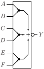
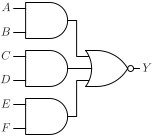

# AOI222

Inverted output AND-OR gate with three two-input AND gates

## Pin information

| Pin   | Description   |
| :-:    | :-            |
| A | Input A, connected to first AND gate |
| B | Input B, connected to first AND gate |
| C | Input C, connected to second AND gate |
| D | Input D, connected to second AND gate |
| E | Input E, connected to third AND gate |
| F | Input F, connected to third AND gate |
| Y | Output |
| VDD | Power supply |
| VSS | Ground |


## Logic function and Truth table

### Logic function (Python)
<div align="center">
Y = ~((A & B) | (C & D) | (E & F))
</div>

### Logic function (Boolean)
\\[ Y = \overline{(A \cdot B) + (C \cdot D) + (E \cdot F)} \\]

### Truth Table for Y


| A | B | C | D | E | F | Y |
| :--- | :--- | :--- | :--- | :--- | :--- | :--- |
| 0 | - | 0 | - | 0 | - | 1 | 
| 0 | - | 0 | - | - | 0 | 1 | 
| 0 | - | - | 0 | 0 | - | 1 | 
| 0 | - | - | 0 | - | 0 | 1 | 
| - | 0 | 0 | - | 0 | - | 1 | 
| - | 0 | 0 | - | - | 0 | 1 | 
| - | 0 | - | 0 | 0 | - | 1 | 
| - | 0 | - | 0 | - | 0 | 1 | 
| 1 | 1 | - | - | - | - | 0 | 
| - | - | 1 | 1 | - | - | 0 | 
| - | - | - | - | 1 | 1 | 0 | 


## Symbol

<div align="center">

</div>

## Schematic

<div align="center">

</div>

## Cell variants

| Cell name <br> | Width <br> [unit sites] | Area <br> [\\(\mu m^2\\)] |
| :-        | :-:   | :-:   |
| [AOI222_DL](#aoi222_dl) | TBD | TBD |
| [AOI222_D1](#aoi222_d1) | TBD | TBD |


### AOI222_DL

#### Hierarchical SPICE netlist
```spice
.subckt AOI222_DL A B C D E F Y VDD VSS
XMN0 nc D VSS VSS sg13_lv_nmos w=5e-07 l=1.3e-07 ad={5e-07*3.1e-07} as={5e-07*3.1e-07} pd={2*(5e-07+3.1e-07)} ps={2*(5e-07+3.1e-07)} 
XMN1 Y C nc VSS sg13_lv_nmos w=5e-07 l=1.3e-07 ad={5e-07*3.1e-07} as={5e-07*3.1e-07} pd={2*(5e-07+3.1e-07)} ps={2*(5e-07+3.1e-07)} 
XMN2 na B VSS VSS sg13_lv_nmos w=5e-07 l=1.3e-07 ad={5e-07*3.1e-07} as={5e-07*3.1e-07} pd={2*(5e-07+3.1e-07)} ps={2*(5e-07+3.1e-07)} 
XMN3 Y A na VSS sg13_lv_nmos w=5e-07 l=1.3e-07 ad={5e-07*3.1e-07} as={5e-07*3.1e-07} pd={2*(5e-07+3.1e-07)} ps={2*(5e-07+3.1e-07)} 
XMN4 Y E ne VSS sg13_lv_nmos w=5e-07 l=1.3e-07 ad={5e-07*3.1e-07} as={5e-07*3.1e-07} pd={2*(5e-07+3.1e-07)} ps={2*(5e-07+3.1e-07)} 
XMN5 ne F VSS VSS sg13_lv_nmos w=5e-07 l=1.3e-07 ad={5e-07*3.1e-07} as={5e-07*3.1e-07} pd={2*(5e-07+3.1e-07)} ps={2*(5e-07+3.1e-07)} 
XMP0 nab A VDD VDD sg13_lv_pmos w=1e-06 l=1.3e-07 ad={1e-06*3.1e-07} as={1e-06*3.1e-07} pd={2*(1e-06+3.1e-07)} ps={2*(1e-06+3.1e-07)} 
XMP1 nab B VDD VDD sg13_lv_pmos w=1e-06 l=1.3e-07 ad={1e-06*3.1e-07} as={1e-06*3.1e-07} pd={2*(1e-06+3.1e-07)} ps={2*(1e-06+3.1e-07)} 
XMP2 ncd C nab VDD sg13_lv_pmos w=1e-06 l=1.3e-07 ad={1e-06*3.1e-07} as={1e-06*3.1e-07} pd={2*(1e-06+3.1e-07)} ps={2*(1e-06+3.1e-07)} 
XMP3 ncd D nab VDD sg13_lv_pmos w=1e-06 l=1.3e-07 ad={1e-06*3.1e-07} as={1e-06*3.1e-07} pd={2*(1e-06+3.1e-07)} ps={2*(1e-06+3.1e-07)} 
XMP4 Y E ncd VDD sg13_lv_pmos w=1e-06 l=1.3e-07 ad={1e-06*3.1e-07} as={1e-06*3.1e-07} pd={2*(1e-06+3.1e-07)} ps={2*(1e-06+3.1e-07)} 
XMP5 Y F ncd VDD sg13_lv_pmos w=1e-06 l=1.3e-07 ad={1e-06*3.1e-07} as={1e-06*3.1e-07} pd={2*(1e-06+3.1e-07)} ps={2*(1e-06+3.1e-07)} 
.ends
```

#### Flat SPICE netlist
```spice
.subckt AOI222_DL A B C D E F Y VDD VSS
XMN0 n0 D VSS VSS sg13_lv_nmos w=5e-07 l=1.3e-07 ad=1.55e-13 as=1.55e-13 pd=1.62e-06 ps=1.62e-06 
XMN1 Y C n0 VSS sg13_lv_nmos w=5e-07 l=1.3e-07 ad=1.55e-13 as=1.55e-13 pd=1.62e-06 ps=1.62e-06 
XMN2 n1 B VSS VSS sg13_lv_nmos w=5e-07 l=1.3e-07 ad=1.55e-13 as=1.55e-13 pd=1.62e-06 ps=1.62e-06 
XMN3 Y A n1 VSS sg13_lv_nmos w=5e-07 l=1.3e-07 ad=1.55e-13 as=1.55e-13 pd=1.62e-06 ps=1.62e-06 
XMN4 Y E n2 VSS sg13_lv_nmos w=5e-07 l=1.3e-07 ad=1.55e-13 as=1.55e-13 pd=1.62e-06 ps=1.62e-06 
XMN5 n2 F VSS VSS sg13_lv_nmos w=5e-07 l=1.3e-07 ad=1.55e-13 as=1.55e-13 pd=1.62e-06 ps=1.62e-06 
XMP0 n3 A VDD VDD sg13_lv_pmos w=1e-06 l=1.3e-07 ad=3.1e-13 as=3.1e-13 pd=2.62e-06 ps=2.62e-06 
XMP1 n3 B VDD VDD sg13_lv_pmos w=1e-06 l=1.3e-07 ad=3.1e-13 as=3.1e-13 pd=2.62e-06 ps=2.62e-06 
XMP2 n4 C n3 VDD sg13_lv_pmos w=1e-06 l=1.3e-07 ad=3.1e-13 as=3.1e-13 pd=2.62e-06 ps=2.62e-06 
XMP3 n4 D n3 VDD sg13_lv_pmos w=1e-06 l=1.3e-07 ad=3.1e-13 as=3.1e-13 pd=2.62e-06 ps=2.62e-06 
XMP4 Y E n4 VDD sg13_lv_pmos w=1e-06 l=1.3e-07 ad=3.1e-13 as=3.1e-13 pd=2.62e-06 ps=2.62e-06 
XMP5 Y F n4 VDD sg13_lv_pmos w=1e-06 l=1.3e-07 ad=3.1e-13 as=3.1e-13 pd=2.62e-06 ps=2.62e-06 
.ends
```

#### CDL netlist
```cdl
.SUBCKT AOI222_DL A B C D E F Y VDD VSS
*.PININFO A:I B:I C:I D:I E:I F:I Y:O VDD:B VSS:B 
MN0 n0 D VSS VSS sg13_lv_nmos w=5e-07 l=1.3e-07 
MN1 Y C n0 VSS sg13_lv_nmos w=5e-07 l=1.3e-07 
MN2 n1 B VSS VSS sg13_lv_nmos w=5e-07 l=1.3e-07 
MN3 Y A n1 VSS sg13_lv_nmos w=5e-07 l=1.3e-07 
MN4 Y E n2 VSS sg13_lv_nmos w=5e-07 l=1.3e-07 
MN5 n2 F VSS VSS sg13_lv_nmos w=5e-07 l=1.3e-07 
MP0 n3 A VDD VDD sg13_lv_pmos w=1e-06 l=1.3e-07 
MP1 n3 B VDD VDD sg13_lv_pmos w=1e-06 l=1.3e-07 
MP2 n4 C n3 VDD sg13_lv_pmos w=1e-06 l=1.3e-07 
MP3 n4 D n3 VDD sg13_lv_pmos w=1e-06 l=1.3e-07 
MP4 Y E n4 VDD sg13_lv_pmos w=1e-06 l=1.3e-07 
MP5 Y F n4 VDD sg13_lv_pmos w=1e-06 l=1.3e-07 
.ENDS
```

#### Layout

<div align="center">

</div>

### AOI222_D1

#### Hierarchical SPICE netlist
```spice
.subckt AOI222_D1 A B C D E F Y VDD VSS
XMN0 nc D VSS VSS sg13_lv_nmos w=9e-07 l=1.3e-07 ad={9e-07*3.1e-07} as={9e-07*3.1e-07} pd={2*(9e-07+3.1e-07)} ps={2*(9e-07+3.1e-07)} 
XMN1 Y C nc VSS sg13_lv_nmos w=9e-07 l=1.3e-07 ad={9e-07*3.1e-07} as={9e-07*3.1e-07} pd={2*(9e-07+3.1e-07)} ps={2*(9e-07+3.1e-07)} 
XMN2 na B VSS VSS sg13_lv_nmos w=9e-07 l=1.3e-07 ad={9e-07*3.1e-07} as={9e-07*3.1e-07} pd={2*(9e-07+3.1e-07)} ps={2*(9e-07+3.1e-07)} 
XMN3 Y A na VSS sg13_lv_nmos w=9e-07 l=1.3e-07 ad={9e-07*3.1e-07} as={9e-07*3.1e-07} pd={2*(9e-07+3.1e-07)} ps={2*(9e-07+3.1e-07)} 
XMN4 Y E ne VSS sg13_lv_nmos w=9e-07 l=1.3e-07 ad={9e-07*3.1e-07} as={9e-07*3.1e-07} pd={2*(9e-07+3.1e-07)} ps={2*(9e-07+3.1e-07)} 
XMN5 ne F VSS VSS sg13_lv_nmos w=9e-07 l=1.3e-07 ad={9e-07*3.1e-07} as={9e-07*3.1e-07} pd={2*(9e-07+3.1e-07)} ps={2*(9e-07+3.1e-07)} 
XMP0 nab A VDD VDD sg13_lv_pmos w=1.6e-06 l=1.3e-07 ad={1.6e-06*3.1e-07} as={1.6e-06*3.1e-07} pd={2*(1.6e-06+3.1e-07)} ps={2*(1.6e-06+3.1e-07)} 
XMP1 nab B VDD VDD sg13_lv_pmos w=1.6e-06 l=1.3e-07 ad={1.6e-06*3.1e-07} as={1.6e-06*3.1e-07} pd={2*(1.6e-06+3.1e-07)} ps={2*(1.6e-06+3.1e-07)} 
XMP2 ncd C nab VDD sg13_lv_pmos w=1.6e-06 l=1.3e-07 ad={1.6e-06*3.1e-07} as={1.6e-06*3.1e-07} pd={2*(1.6e-06+3.1e-07)} ps={2*(1.6e-06+3.1e-07)} 
XMP3 ncd D nab VDD sg13_lv_pmos w=1.6e-06 l=1.3e-07 ad={1.6e-06*3.1e-07} as={1.6e-06*3.1e-07} pd={2*(1.6e-06+3.1e-07)} ps={2*(1.6e-06+3.1e-07)} 
XMP4 Y E ncd VDD sg13_lv_pmos w=1.6e-06 l=1.3e-07 ad={1.6e-06*3.1e-07} as={1.6e-06*3.1e-07} pd={2*(1.6e-06+3.1e-07)} ps={2*(1.6e-06+3.1e-07)} 
XMP5 Y F ncd VDD sg13_lv_pmos w=1.6e-06 l=1.3e-07 ad={1.6e-06*3.1e-07} as={1.6e-06*3.1e-07} pd={2*(1.6e-06+3.1e-07)} ps={2*(1.6e-06+3.1e-07)} 
.ends
```

#### Flat SPICE netlist
```spice
.subckt AOI222_D1 A B C D E F Y VDD VSS
XMN0 n0 D VSS VSS sg13_lv_nmos w=9e-07 l=1.3e-07 ad=2.79e-13 as=2.79e-13 pd=2.42e-06 ps=2.42e-06 
XMN1 Y C n0 VSS sg13_lv_nmos w=9e-07 l=1.3e-07 ad=2.79e-13 as=2.79e-13 pd=2.42e-06 ps=2.42e-06 
XMN2 n1 B VSS VSS sg13_lv_nmos w=9e-07 l=1.3e-07 ad=2.79e-13 as=2.79e-13 pd=2.42e-06 ps=2.42e-06 
XMN3 Y A n1 VSS sg13_lv_nmos w=9e-07 l=1.3e-07 ad=2.79e-13 as=2.79e-13 pd=2.42e-06 ps=2.42e-06 
XMN4 Y E n2 VSS sg13_lv_nmos w=9e-07 l=1.3e-07 ad=2.79e-13 as=2.79e-13 pd=2.42e-06 ps=2.42e-06 
XMN5 n2 F VSS VSS sg13_lv_nmos w=9e-07 l=1.3e-07 ad=2.79e-13 as=2.79e-13 pd=2.42e-06 ps=2.42e-06 
XMP0 n3 A VDD VDD sg13_lv_pmos w=1.6e-06 l=1.3e-07 ad=4.96e-13 as=4.96e-13 pd=3.82e-06 ps=3.82e-06 
XMP1 n3 B VDD VDD sg13_lv_pmos w=1.6e-06 l=1.3e-07 ad=4.96e-13 as=4.96e-13 pd=3.82e-06 ps=3.82e-06 
XMP2 n4 C n3 VDD sg13_lv_pmos w=1.6e-06 l=1.3e-07 ad=4.96e-13 as=4.96e-13 pd=3.82e-06 ps=3.82e-06 
XMP3 n4 D n3 VDD sg13_lv_pmos w=1.6e-06 l=1.3e-07 ad=4.96e-13 as=4.96e-13 pd=3.82e-06 ps=3.82e-06 
XMP4 Y E n4 VDD sg13_lv_pmos w=1.6e-06 l=1.3e-07 ad=4.96e-13 as=4.96e-13 pd=3.82e-06 ps=3.82e-06 
XMP5 Y F n4 VDD sg13_lv_pmos w=1.6e-06 l=1.3e-07 ad=4.96e-13 as=4.96e-13 pd=3.82e-06 ps=3.82e-06 
.ends
```

#### CDL netlist
```cdl
.SUBCKT AOI222_D1 A B C D E F Y VDD VSS
*.PININFO A:I B:I C:I D:I E:I F:I Y:O VDD:B VSS:B 
MN0 n0 D VSS VSS sg13_lv_nmos w=9e-07 l=1.3e-07 
MN1 Y C n0 VSS sg13_lv_nmos w=9e-07 l=1.3e-07 
MN2 n1 B VSS VSS sg13_lv_nmos w=9e-07 l=1.3e-07 
MN3 Y A n1 VSS sg13_lv_nmos w=9e-07 l=1.3e-07 
MN4 Y E n2 VSS sg13_lv_nmos w=9e-07 l=1.3e-07 
MN5 n2 F VSS VSS sg13_lv_nmos w=9e-07 l=1.3e-07 
MP0 n3 A VDD VDD sg13_lv_pmos w=1.6e-06 l=1.3e-07 
MP1 n3 B VDD VDD sg13_lv_pmos w=1.6e-06 l=1.3e-07 
MP2 n4 C n3 VDD sg13_lv_pmos w=1.6e-06 l=1.3e-07 
MP3 n4 D n3 VDD sg13_lv_pmos w=1.6e-06 l=1.3e-07 
MP4 Y E n4 VDD sg13_lv_pmos w=1.6e-06 l=1.3e-07 
MP5 Y F n4 VDD sg13_lv_pmos w=1.6e-06 l=1.3e-07 
.ENDS
```

#### Layout

<div align="center">

</div>

## Pin capacitance
No pin capacitance data


## Static power
No static power data


## Dynamic power
No dynamic power data


## Delay
No delay data

