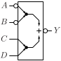
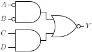

# AOI2N2

Inverted output AND-OR gate with two two-input AND gates. One AND gate has inverted inputs.

## Pin information

| Pin   | Description   |
| :-:    | :-            |
| A | Input A, inverted and connected to first AND gate |
| B | Input B, inverted and connected to first AND gate |
| C | Input C,  connected to second AND gate |
| D | Input D,  connected to second AND gate |
| Y | Output |
| VDD | Power supply |
| VSS | Ground |


## Logic function and Truth table

### Logic function (Python)
<div align="center">
Y = ~((~A & ~B) | (C & D))
</div>

### Logic function (Boolean)
\\[ Y = \overline{(\overline{A} \cdot \overline{B}) + (C \cdot B)} \\]

### Truth Table for Y


| A | B | C | Y |
| :--- | :--- | :--- | :--- |
| 1 | - | 0 | 1 | 
| - | 1 | 0 | 1 | 
| - | - | 1 | 0 | 
| 0 | 0 | - | 0 | 


## Symbol

<div align="center">

</div>

## Schematic

<div align="center">

</div>

## Cell variants

| Cell name <br> | Width <br> [unit sites] | Area <br> [\\(\mu m^2\\)] |
| :-        | :-:   | :-:   |
| [AOI2N1_DL](#aoi2n1_dl) | TBD | TBD |
| [AOI2N2_D1](#aoi2n2_d1) | TBD | TBD |


### AOI2N1_DL

#### Hierarchical SPICE netlist
```spice
.subckt AOI2N1_DL A B C Y VDD VSS
XMN0 n0 A VSS VSS sg13_lv_nmos w=1.5e-07 l=1.3e-07 ad={1.5e-07*3.1e-07} as={1.5e-07*3.1e-07} pd={2*(1.5e-07+3.1e-07)} ps={2*(1.5e-07+3.1e-07)} 
XMN1 n0 B VSS VSS sg13_lv_nmos w=1.5e-07 l=1.3e-07 ad={1.5e-07*3.1e-07} as={1.5e-07*3.1e-07} pd={2*(1.5e-07+3.1e-07)} ps={2*(1.5e-07+3.1e-07)} 
XMN2 Y n0 VSS VSS sg13_lv_nmos w=3.2e-07 l=1.3e-07 ad={3.2e-07*3.1e-07} as={3.2e-07*3.1e-07} pd={2*(3.2e-07+3.1e-07)} ps={2*(3.2e-07+3.1e-07)} 
XMN3 Y C VSS VSS sg13_lv_nmos w=3.2e-07 l=1.3e-07 ad={3.2e-07*3.1e-07} as={3.2e-07*3.1e-07} pd={2*(3.2e-07+3.1e-07)} ps={2*(3.2e-07+3.1e-07)} 
XMP0 n1 A VDD VDD sg13_lv_pmos w=3e-07 l=1.3e-07 ad={3e-07*3.1e-07} as={3e-07*3.1e-07} pd={2*(3e-07+3.1e-07)} ps={2*(3e-07+3.1e-07)} 
XMP1 n1 B n0 VDD sg13_lv_pmos w=3e-07 l=1.3e-07 ad={3e-07*3.1e-07} as={3e-07*3.1e-07} pd={2*(3e-07+3.1e-07)} ps={2*(3e-07+3.1e-07)} 
XMP2 Y C n2 VDD sg13_lv_pmos w=6.4e-07 l=1.3e-07 ad={6.4e-07*3.1e-07} as={6.4e-07*3.1e-07} pd={2*(6.4e-07+3.1e-07)} ps={2*(6.4e-07+3.1e-07)} 
XMP3 n2 n0 VDD VDD sg13_lv_pmos w=6.4e-07 l=1.3e-07 ad={6.4e-07*3.1e-07} as={6.4e-07*3.1e-07} pd={2*(6.4e-07+3.1e-07)} ps={2*(6.4e-07+3.1e-07)} 
.ends
```

#### Flat SPICE netlist
```spice
.subckt AOI2N1_DL A B C Y VDD VSS
XMN0 n0 A VSS VSS sg13_lv_nmos w=1.5e-07 l=1.3e-07 ad=4.65e-14 as=4.65e-14 pd=9.2e-07 ps=9.2e-07 
XMN1 n0 B VSS VSS sg13_lv_nmos w=1.5e-07 l=1.3e-07 ad=4.65e-14 as=4.65e-14 pd=9.2e-07 ps=9.2e-07 
XMN2 Y n0 VSS VSS sg13_lv_nmos w=3.2e-07 l=1.3e-07 ad=9.92e-14 as=9.92e-14 pd=1.26e-06 ps=1.26e-06 
XMN3 Y C VSS VSS sg13_lv_nmos w=3.2e-07 l=1.3e-07 ad=9.92e-14 as=9.92e-14 pd=1.26e-06 ps=1.26e-06 
XMP0 n1 A VDD VDD sg13_lv_pmos w=3e-07 l=1.3e-07 ad=9.3e-14 as=9.3e-14 pd=1.22e-06 ps=1.22e-06 
XMP1 n1 B n0 VDD sg13_lv_pmos w=3e-07 l=1.3e-07 ad=9.3e-14 as=9.3e-14 pd=1.22e-06 ps=1.22e-06 
XMP2 Y C n2 VDD sg13_lv_pmos w=6.4e-07 l=1.3e-07 ad=1.984e-13 as=1.984e-13 pd=1.9e-06 ps=1.9e-06 
XMP3 n2 n0 VDD VDD sg13_lv_pmos w=6.4e-07 l=1.3e-07 ad=1.984e-13 as=1.984e-13 pd=1.9e-06 ps=1.9e-06 
.ends
```

#### CDL netlist
```cdl
.SUBCKT AOI2N1_DL A B C Y VDD VSS
*.PININFO C:I B:I A:I Y:O VDD:B VSS:B 
MN0 n0 A VSS VSS sg13_lv_nmos w=1.5e-07 l=1.3e-07 
MN1 n0 B VSS VSS sg13_lv_nmos w=1.5e-07 l=1.3e-07 
MN2 Y n0 VSS VSS sg13_lv_nmos w=3.2e-07 l=1.3e-07 
MN3 Y C VSS VSS sg13_lv_nmos w=3.2e-07 l=1.3e-07 
MP0 n1 A VDD VDD sg13_lv_pmos w=3e-07 l=1.3e-07 
MP1 n1 B n0 VDD sg13_lv_pmos w=3e-07 l=1.3e-07 
MP2 Y C n2 VDD sg13_lv_pmos w=6.4e-07 l=1.3e-07 
MP3 n2 n0 VDD VDD sg13_lv_pmos w=6.4e-07 l=1.3e-07 
.ENDS
```

#### Layout

<div align="center">

</div>

### AOI2N2_D1

#### Hierarchical SPICE netlist
```spice
.subckt AOI2N2_D1 A B C D Y VDD VSS
XMN0 n0 A VSS VSS sg13_lv_nmos w=2.5e-07 l=1.3e-07 ad={2.5e-07*3.1e-07} as={2.5e-07*3.1e-07} pd={2*(2.5e-07+3.1e-07)} ps={2*(2.5e-07+3.1e-07)} 
XMN1 n0 B VSS VSS sg13_lv_nmos w=2.5e-07 l=1.3e-07 ad={2.5e-07*3.1e-07} as={2.5e-07*3.1e-07} pd={2*(2.5e-07+3.1e-07)} ps={2*(2.5e-07+3.1e-07)} 
XMN2 Y n0 VSS VSS sg13_lv_nmos w=6.4e-07 l=1.3e-07 ad={6.4e-07*3.1e-07} as={6.4e-07*3.1e-07} pd={2*(6.4e-07+3.1e-07)} ps={2*(6.4e-07+3.1e-07)} 
XMN3 Y D n1 VSS sg13_lv_nmos w=6.4e-07 l=1.3e-07 ad={6.4e-07*3.1e-07} as={6.4e-07*3.1e-07} pd={2*(6.4e-07+3.1e-07)} ps={2*(6.4e-07+3.1e-07)} 
XMN4 n1 C VSS VSS sg13_lv_nmos w=6.4e-07 l=1.3e-07 ad={6.4e-07*3.1e-07} as={6.4e-07*3.1e-07} pd={2*(6.4e-07+3.1e-07)} ps={2*(6.4e-07+3.1e-07)} 
XMP0 n4 A VDD VDD sg13_lv_pmos w=5e-07 l=1.3e-07 ad={5e-07*3.1e-07} as={5e-07*3.1e-07} pd={2*(5e-07+3.1e-07)} ps={2*(5e-07+3.1e-07)} 
XMP1 n0 B n4 VDD sg13_lv_pmos w=5e-07 l=1.3e-07 ad={5e-07*3.1e-07} as={5e-07*3.1e-07} pd={2*(5e-07+3.1e-07)} ps={2*(5e-07+3.1e-07)} 
XMP2 n2 n0 VDD VDD sg13_lv_pmos w=1.28e-06 l=1.3e-07 ad={1.28e-06*3.1e-07} as={1.28e-06*3.1e-07} pd={2*(1.28e-06+3.1e-07)} ps={2*(1.28e-06+3.1e-07)} 
XMP3 Y C n2 VDD sg13_lv_pmos w=1.28e-06 l=1.3e-07 ad={1.28e-06*3.1e-07} as={1.28e-06*3.1e-07} pd={2*(1.28e-06+3.1e-07)} ps={2*(1.28e-06+3.1e-07)} 
XMP4 Y D n2 VDD sg13_lv_pmos w=1.28e-06 l=1.3e-07 ad={1.28e-06*3.1e-07} as={1.28e-06*3.1e-07} pd={2*(1.28e-06+3.1e-07)} ps={2*(1.28e-06+3.1e-07)} 
.ends
```

#### Flat SPICE netlist
```spice
.subckt AOI2N2_D1 A B C D Y VDD VSS
XMN0 n0 A VSS VSS sg13_lv_nmos w=2.5e-07 l=1.3e-07 ad=7.75e-14 as=7.75e-14 pd=1.12e-06 ps=1.12e-06 
XMN1 n0 B VSS VSS sg13_lv_nmos w=2.5e-07 l=1.3e-07 ad=7.75e-14 as=7.75e-14 pd=1.12e-06 ps=1.12e-06 
XMN2 Y n0 VSS VSS sg13_lv_nmos w=6.4e-07 l=1.3e-07 ad=1.984e-13 as=1.984e-13 pd=1.9e-06 ps=1.9e-06 
XMN3 Y D n1 VSS sg13_lv_nmos w=6.4e-07 l=1.3e-07 ad=1.984e-13 as=1.984e-13 pd=1.9e-06 ps=1.9e-06 
XMN4 n1 C VSS VSS sg13_lv_nmos w=6.4e-07 l=1.3e-07 ad=1.984e-13 as=1.984e-13 pd=1.9e-06 ps=1.9e-06 
XMP0 n2 A VDD VDD sg13_lv_pmos w=5e-07 l=1.3e-07 ad=1.55e-13 as=1.55e-13 pd=1.62e-06 ps=1.62e-06 
XMP1 n0 B n2 VDD sg13_lv_pmos w=5e-07 l=1.3e-07 ad=1.55e-13 as=1.55e-13 pd=1.62e-06 ps=1.62e-06 
XMP2 n3 n0 VDD VDD sg13_lv_pmos w=1.28e-06 l=1.3e-07 ad=3.968e-13 as=3.968e-13 pd=3.18e-06 ps=3.18e-06 
XMP3 Y C n3 VDD sg13_lv_pmos w=1.28e-06 l=1.3e-07 ad=3.968e-13 as=3.968e-13 pd=3.18e-06 ps=3.18e-06 
XMP4 Y D n3 VDD sg13_lv_pmos w=1.28e-06 l=1.3e-07 ad=3.968e-13 as=3.968e-13 pd=3.18e-06 ps=3.18e-06 
.ends
```

#### CDL netlist
```cdl
.SUBCKT AOI2N2_D1 A B C D Y VDD VSS
*.PININFO C:I B:I D:I A:I Y:O VDD:B VSS:B 
MN0 n0 A VSS VSS sg13_lv_nmos w=2.5e-07 l=1.3e-07 
MN1 n0 B VSS VSS sg13_lv_nmos w=2.5e-07 l=1.3e-07 
MN2 Y n0 VSS VSS sg13_lv_nmos w=6.4e-07 l=1.3e-07 
MN3 Y D n1 VSS sg13_lv_nmos w=6.4e-07 l=1.3e-07 
MN4 n1 C VSS VSS sg13_lv_nmos w=6.4e-07 l=1.3e-07 
MP0 n2 A VDD VDD sg13_lv_pmos w=5e-07 l=1.3e-07 
MP1 n0 B n2 VDD sg13_lv_pmos w=5e-07 l=1.3e-07 
MP2 n3 n0 VDD VDD sg13_lv_pmos w=1.28e-06 l=1.3e-07 
MP3 Y C n3 VDD sg13_lv_pmos w=1.28e-06 l=1.3e-07 
MP4 Y D n3 VDD sg13_lv_pmos w=1.28e-06 l=1.3e-07 
.ENDS
```

#### Layout

<div align="center">

</div>

## Pin capacitance
No pin capacitance data


## Static power
No static power data


## Dynamic power
No dynamic power data


## Delay
No delay data

