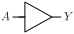

# BUF

Standard buffer

## Pin information

| Pin   | Description   |
| :-:    | :-            |
| A | Buffer input |
| Y | Output |
| VDD | Power supply |
| VSS | Ground |


## Logic function and Truth table

### Logic function (Python)
<div align="center">
Y = A
</div>

### Logic function (Boolean)
\\[ Y = A \\]

### Truth Table for Y


| A | Y |
| :--- | :--- |
| 1 | 1 | 
| 0 | 0 | 


## Symbol

<div align="center">

</div>

## Schematic

<div align="center">

</div>

## Cell variants

| Cell name <br> | Width <br> [unit sites] | Area <br> [\\(\mu m^2\\)] |
| :-        | :-:   | :-:   |
| [BUF_DL](#buf_dl) | TBD | TBD |
| [BUF_D1](#buf_d1) | TBD | TBD |
| [BUF_D2](#buf_d2) | TBD | TBD |
| [BUF_D3](#buf_d3) | TBD | TBD |
| [BUF_D4](#buf_d4) | TBD | TBD |
| [BUF_D6](#buf_d6) | TBD | TBD |
| [BUF_D8](#buf_d8) | TBD | TBD |
| [BUF_D12](#buf_d12) | TBD | TBD |


### BUF_DL

#### Hierarchical SPICE netlist
```spice
.subckt BUF_DL A Y VDD VSS
Xinv1 A AN VDD VSS inv_par WN=1.5e-07 WP=2e-07 
Xinv2 AN Y VDD VSS inv_par WN=3.2e-07 WP=6.6e-07 
.ends
```

#### Flat SPICE netlist
```spice
.subckt BUF_DL A Y VDD VSS
XMN0 n0 A VSS VSS sg13_lv_nmos w=1.5e-07 l=1.3e-07 ad=4.65e-14 as=4.65e-14 pd=9.2e-07 ps=9.2e-07 ng=1 
XMP0 n0 A VDD VDD sg13_lv_pmos w=2e-07 l=1.3e-07 ad=6.2e-14 as=6.2e-14 pd=1.02e-06 ps=1.02e-06 ng=1 
XMN1 Y n0 VSS VSS sg13_lv_nmos w=3.2e-07 l=1.3e-07 ad=9.92e-14 as=9.92e-14 pd=1.26e-06 ps=1.26e-06 ng=1 
XMP1 Y n0 VDD VDD sg13_lv_pmos w=6.6e-07 l=1.3e-07 ad=2.046e-13 as=2.046e-13 pd=1.94e-06 ps=1.94e-06 ng=1 
.ends
```

#### CDL netlist
```cdl
.SUBCKT BUF_DL A Y VDD VSS
*.PININFO A:I Y:O VDD:B VSS:B 
MN0 n0 A VSS VSS sg13_lv_nmos w=1.5e-07 l=1.3e-07 ng=1 
MP0 n0 A VDD VDD sg13_lv_pmos w=2e-07 l=1.3e-07 ng=1 
MN1 Y n0 VSS VSS sg13_lv_nmos w=3.2e-07 l=1.3e-07 ng=1 
MP1 Y n0 VDD VDD sg13_lv_pmos w=6.6e-07 l=1.3e-07 ng=1 
.ENDS
```

#### Layout

<div align="center">

</div>

### BUF_D1

#### Hierarchical SPICE netlist
```spice
.subckt BUF_D1 A Y VDD VSS
Xinv1 A AN VDD VSS inv_par WN=2e-07 WP=3e-07 
Xinv2 AN Y VDD VSS inv_par WN=6.4e-07 WP=9.8e-07 
.ends
```

#### Flat SPICE netlist
```spice
.subckt BUF_D1 A Y VDD VSS
XMN0 n0 A VSS VSS sg13_lv_nmos w=2e-07 l=1.3e-07 ad=6.2e-14 as=6.2e-14 pd=1.02e-06 ps=1.02e-06 ng=1 
XMP0 n0 A VDD VDD sg13_lv_pmos w=3e-07 l=1.3e-07 ad=9.3e-14 as=9.3e-14 pd=1.22e-06 ps=1.22e-06 ng=1 
XMN1 Y n0 VSS VSS sg13_lv_nmos w=6.4e-07 l=1.3e-07 ad=1.984e-13 as=1.984e-13 pd=1.9e-06 ps=1.9e-06 ng=1 
XMP1 Y n0 VDD VDD sg13_lv_pmos w=9.8e-07 l=1.3e-07 ad=3.038e-13 as=3.038e-13 pd=2.58e-06 ps=2.58e-06 ng=1 
.ends
```

#### CDL netlist
```cdl
.SUBCKT BUF_D1 A Y VDD VSS
*.PININFO A:I Y:O VDD:B VSS:B 
MN0 n0 A VSS VSS sg13_lv_nmos w=2e-07 l=1.3e-07 ng=1 
MP0 n0 A VDD VDD sg13_lv_pmos w=3e-07 l=1.3e-07 ng=1 
MN1 Y n0 VSS VSS sg13_lv_nmos w=6.4e-07 l=1.3e-07 ng=1 
MP1 Y n0 VDD VDD sg13_lv_pmos w=9.8e-07 l=1.3e-07 ng=1 
.ENDS
```

#### Layout

<div align="center">

</div>

### BUF_D2

#### Hierarchical SPICE netlist
```spice
.subckt BUF_D2 A Y VDD VSS
Xinv1 A AN VDD VSS inv_par WN=4e-07 WP=6e-07 
Xinv2 AN Y VDD VSS inv_par WN=1.07e-06 WP=1.6e-06 
.ends
```

#### Flat SPICE netlist
```spice
.subckt BUF_D2 A Y VDD VSS
XMN0 n0 A VSS VSS sg13_lv_nmos w=4e-07 l=1.3e-07 ad=1.24e-13 as=1.24e-13 pd=1.42e-06 ps=1.42e-06 ng=1 
XMP0 n0 A VDD VDD sg13_lv_pmos w=6e-07 l=1.3e-07 ad=1.86e-13 as=1.86e-13 pd=1.82e-06 ps=1.82e-06 ng=1 
XMN1 Y n0 VSS VSS sg13_lv_nmos w=1.07e-06 l=1.3e-07 ad=3.317e-13 as=3.317e-13 pd=2.76e-06 ps=2.76e-06 ng=1 
XMP1 Y n0 VDD VDD sg13_lv_pmos w=1.6e-06 l=1.3e-07 ad=4.96e-13 as=4.96e-13 pd=3.82e-06 ps=3.82e-06 ng=1 
.ends
```

#### CDL netlist
```cdl
.SUBCKT BUF_D2 A Y VDD VSS
*.PININFO A:I Y:O VDD:B VSS:B 
MN0 n0 A VSS VSS sg13_lv_nmos w=4e-07 l=1.3e-07 ng=1 
MP0 n0 A VDD VDD sg13_lv_pmos w=6e-07 l=1.3e-07 ng=1 
MN1 Y n0 VSS VSS sg13_lv_nmos w=1.07e-06 l=1.3e-07 ng=1 
MP1 Y n0 VDD VDD sg13_lv_pmos w=1.6e-06 l=1.3e-07 ng=1 
.ENDS
```

#### Layout

<div align="center">

</div>

### BUF_D3

#### Hierarchical SPICE netlist
```spice
.subckt BUF_D3 A Y VDD VSS
Xinv1 A AN VDD VSS inv_par WN=5.6e-07 WP=8.4e-07 
Xinv2 AN Y VDD VSS inv_par WN=1.5e-06 WP=2.2e-06 NGN=2 NGP=2 
.ends
```

#### Flat SPICE netlist
```spice
.subckt BUF_D3 A Y VDD VSS
XMN0 n0 A VSS VSS sg13_lv_nmos w=5.6e-07 l=1.3e-07 ad=1.736e-13 as=1.736e-13 pd=1.74e-06 ps=1.74e-06 ng=1 
XMP0 n0 A VDD VDD sg13_lv_pmos w=8.4e-07 l=1.3e-07 ad=2.604e-13 as=2.604e-13 pd=2.3e-06 ps=2.3e-06 ng=1 
XMN1 Y n0 VSS VSS sg13_lv_nmos w=1.5e-06 l=1.3e-07 ad=4.65e-13 as=4.65e-13 pd=3.62e-06 ps=3.62e-06 ng=2 
XMP1 Y n0 VDD VDD sg13_lv_pmos w=2.2e-06 l=1.3e-07 ad=6.82e-13 as=6.82e-13 pd=5.02e-06 ps=5.02e-06 ng=2 
.ends
```

#### CDL netlist
```cdl
.SUBCKT BUF_D3 A Y VDD VSS
*.PININFO A:I Y:O VDD:B VSS:B 
MN0 n0 A VSS VSS sg13_lv_nmos w=5.6e-07 l=1.3e-07 ng=1 
MP0 n0 A VDD VDD sg13_lv_pmos w=8.4e-07 l=1.3e-07 ng=1 
MN1 Y n0 VSS VSS sg13_lv_nmos w=1.5e-06 l=1.3e-07 ng=2 
MP1 Y n0 VDD VDD sg13_lv_pmos w=2.2e-06 l=1.3e-07 ng=2 
.ENDS
```

#### Layout

<div align="center">

</div>

### BUF_D4

#### Hierarchical SPICE netlist
```spice
.subckt BUF_D4 A Y VDD VSS
Xinv1 A AN VDD VSS inv_par WN=7.4e-07 WP=1.2e-06 
Xinv2 AN Y VDD VSS inv_par WN=2.14e-06 WP=3.2e-06 NGN=3 NGP=3 
.ends
```

#### Flat SPICE netlist
```spice
.subckt BUF_D4 A Y VDD VSS
XMN0 n0 A VSS VSS sg13_lv_nmos w=7.4e-07 l=1.3e-07 ad=2.294e-13 as=2.294e-13 pd=2.1e-06 ps=2.1e-06 ng=1 
XMP0 n0 A VDD VDD sg13_lv_pmos w=1.2e-06 l=1.3e-07 ad=3.72e-13 as=3.72e-13 pd=3.02e-06 ps=3.02e-06 ng=1 
XMN1 Y n0 VSS VSS sg13_lv_nmos w=2.14e-06 l=1.3e-07 ad=6.634e-13 as=6.634e-13 pd=4.9e-06 ps=4.9e-06 ng=3 
XMP1 Y n0 VDD VDD sg13_lv_pmos w=3.2e-06 l=1.3e-07 ad=9.92e-13 as=9.92e-13 pd=7.02e-06 ps=7.02e-06 ng=3 
.ends
```

#### CDL netlist
```cdl
.SUBCKT BUF_D4 A Y VDD VSS
*.PININFO A:I Y:O VDD:B VSS:B 
MN0 n0 A VSS VSS sg13_lv_nmos w=7.4e-07 l=1.3e-07 ng=1 
MP0 n0 A VDD VDD sg13_lv_pmos w=1.2e-06 l=1.3e-07 ng=1 
MN1 Y n0 VSS VSS sg13_lv_nmos w=2.14e-06 l=1.3e-07 ng=3 
MP1 Y n0 VDD VDD sg13_lv_pmos w=3.2e-06 l=1.3e-07 ng=3 
.ENDS
```

#### Layout

<div align="center">

</div>

### BUF_D6

#### Hierarchical SPICE netlist
```spice
.subckt BUF_D6 A Y VDD VSS
Xinv1 A AN VDD VSS inv_par WN=1e-06 WP=1.5e-06 
Xinv2 AN Y VDD VSS inv_par WN=2.6e-06 WP=4e-06 NGN=3 NGP=3 
.ends
```

#### Flat SPICE netlist
```spice
.subckt BUF_D6 A Y VDD VSS
XMN0 n0 A VSS VSS sg13_lv_nmos w=1e-06 l=1.3e-07 ad=3.1e-13 as=3.1e-13 pd=2.62e-06 ps=2.62e-06 ng=1 
XMP0 n0 A VDD VDD sg13_lv_pmos w=1.5e-06 l=1.3e-07 ad=4.65e-13 as=4.65e-13 pd=3.62e-06 ps=3.62e-06 ng=1 
XMN1 Y n0 VSS VSS sg13_lv_nmos w=2.6e-06 l=1.3e-07 ad=8.06e-13 as=8.06e-13 pd=5.82e-06 ps=5.82e-06 ng=3 
XMP1 Y n0 VDD VDD sg13_lv_pmos w=4e-06 l=1.3e-07 ad=1.24e-12 as=1.24e-12 pd=8.62e-06 ps=8.62e-06 ng=3 
.ends
```

#### CDL netlist
```cdl
.SUBCKT BUF_D6 A Y VDD VSS
*.PININFO A:I Y:O VDD:B VSS:B 
MN0 n0 A VSS VSS sg13_lv_nmos w=1e-06 l=1.3e-07 ng=1 
MP0 n0 A VDD VDD sg13_lv_pmos w=1.5e-06 l=1.3e-07 ng=1 
MN1 Y n0 VSS VSS sg13_lv_nmos w=2.6e-06 l=1.3e-07 ng=3 
MP1 Y n0 VDD VDD sg13_lv_pmos w=4e-06 l=1.3e-07 ng=3 
.ENDS
```

#### Layout

<div align="center">

</div>

### BUF_D8

#### Hierarchical SPICE netlist
```spice
.subckt BUF_D8 A Y VDD VSS
Xinv1 A AN VDD VSS inv_par WN=1.6e-06 WP=2.4e-06 NGN=2 NGP=2 
Xinv2 AN Y VDD VSS inv_par WN=4.28e-06 WP=6.4e-06 NGN=5 NGP=5 
.ends
```

#### Flat SPICE netlist
```spice
.subckt BUF_D8 A Y VDD VSS
XMN0 n0 A VSS VSS sg13_lv_nmos w=1.6e-06 l=1.3e-07 ad=4.96e-13 as=4.96e-13 pd=3.82e-06 ps=3.82e-06 ng=2 
XMP0 n0 A VDD VDD sg13_lv_pmos w=2.4e-06 l=1.3e-07 ad=7.44e-13 as=7.44e-13 pd=5.42e-06 ps=5.42e-06 ng=2 
XMN1 Y n0 VSS VSS sg13_lv_nmos w=4.28e-06 l=1.3e-07 ad=1.327e-12 as=1.327e-12 pd=9.18e-06 ps=9.18e-06 ng=5 
XMP1 Y n0 VDD VDD sg13_lv_pmos w=6.4e-06 l=1.3e-07 ad=1.984e-12 as=1.984e-12 pd=1.342e-05 ps=1.342e-05 ng=5 
.ends
```

#### CDL netlist
```cdl
.SUBCKT BUF_D8 A Y VDD VSS
*.PININFO A:I Y:O VDD:B VSS:B 
MN0 n0 A VSS VSS sg13_lv_nmos w=1.6e-06 l=1.3e-07 ng=2 
MP0 n0 A VDD VDD sg13_lv_pmos w=2.4e-06 l=1.3e-07 ng=2 
MN1 Y n0 VSS VSS sg13_lv_nmos w=4.28e-06 l=1.3e-07 ng=5 
MP1 Y n0 VDD VDD sg13_lv_pmos w=6.4e-06 l=1.3e-07 ng=5 
.ENDS
```

#### Layout

<div align="center">

</div>

### BUF_D12

#### Hierarchical SPICE netlist
```spice
.subckt BUF_D12 A Y VDD VSS
Xinv1 A AN VDD VSS inv_par WN=2.4e-06 WP=3.6e-06 NGN=3 NGP=3 
Xinv2 AN Y VDD VSS inv_par WN=6.4249999999999995e-06 WP=9.6e-06 NGN=7 NGP=7 
.ends
```

#### Flat SPICE netlist
```spice
.subckt BUF_D12 A Y VDD VSS
XMN0 n0 A VSS VSS sg13_lv_nmos w=2.4e-06 l=1.3e-07 ad=7.44e-13 as=7.44e-13 pd=5.42e-06 ps=5.42e-06 ng=3 
XMP0 n0 A VDD VDD sg13_lv_pmos w=3.6e-06 l=1.3e-07 ad=1.116e-12 as=1.116e-12 pd=7.82e-06 ps=7.82e-06 ng=3 
XMN1 Y n0 VSS VSS sg13_lv_nmos w=6.425e-06 l=1.3e-07 ad=1.992e-12 as=1.992e-12 pd=1.347e-05 ps=1.347e-05 ng=7 
XMP1 Y n0 VDD VDD sg13_lv_pmos w=9.6e-06 l=1.3e-07 ad=2.976e-12 as=2.976e-12 pd=1.982e-05 ps=1.982e-05 ng=7 
.ends
```

#### CDL netlist
```cdl
.SUBCKT BUF_D12 A Y VDD VSS
*.PININFO A:I Y:O VDD:B VSS:B 
MN0 n0 A VSS VSS sg13_lv_nmos w=2.4e-06 l=1.3e-07 ng=3 
MP0 n0 A VDD VDD sg13_lv_pmos w=3.6e-06 l=1.3e-07 ng=3 
MN1 Y n0 VSS VSS sg13_lv_nmos w=6.425e-06 l=1.3e-07 ng=7 
MP1 Y n0 VDD VDD sg13_lv_pmos w=9.6e-06 l=1.3e-07 ng=7 
.ENDS
```

#### Layout

<div align="center">

</div>

## Pin capacitance
No pin capacitance data


## Static power
No static power data


## Dynamic power
No dynamic power data


## Delay
No delay data

