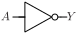

# CLKINV

Inverter for clock signals

## Pin information

| Pin   | Description   |
| :-:    | :-            |
| A | Buffer input |
| Y | Output |
| VDD | Power supply |
| VSS | Ground |


## Logic function and Truth table

### Logic function (Python)
<div align="center">
Y = ~A
</div>

### Logic function (Boolean)
\\[ Y = \overline{A} \\]

### Truth Table for Y


| A | Y |
| :--- | :--- |
| 0 | 1 | 
| 1 | 0 | 


## Symbol

<div align="center">

</div>

## Schematic

<div align="center">

</div>

## Cell variants

| Cell name <br> | Width <br> [unit sites] | Area <br> [\\(\mu m^2\\)] |
| :-        | :-:   | :-:   |
| [CLKINV_D1](#clkinv_d1) | TBD | TBD |
| [CLKINV_D2](#clkinv_d2) | TBD | TBD |
| [CLKINV_D4](#clkinv_d4) | TBD | TBD |
| [CLKINV_D8](#clkinv_d8) | TBD | TBD |
| [CLKINV_D16](#clkinv_d16) | TBD | TBD |


### CLKINV_D1

#### Hierarchical SPICE netlist
```spice
.subckt CLKINV_D1 A Y VDD VSS
Xinv1 A Y VDD VSS inv_par WN=3.4e-07 WP=9.8e-07 
.ends
```

#### Flat SPICE netlist
```spice
.subckt CLKINV_D1 A Y VDD VSS
XMN0 Y A VSS VSS sg13_lv_nmos w=3.4e-07 l=1.3e-07 ad=1.054e-13 as=1.054e-13 pd=1.3e-06 ps=1.3e-06 ng=1 
XMP0 Y A VDD VDD sg13_lv_pmos w=9.8e-07 l=1.3e-07 ad=3.038e-13 as=3.038e-13 pd=2.58e-06 ps=2.58e-06 ng=1 
.ends
```

#### CDL netlist
```cdl
.SUBCKT CLKINV_D1 A Y VDD VSS
*.PININFO A:I Y:O VDD:B VSS:B 
MN0 Y A VSS VSS sg13_lv_nmos w=3.4e-07 l=1.3e-07 ng=1 
MP0 Y A VDD VDD sg13_lv_pmos w=9.8e-07 l=1.3e-07 ng=1 
.ENDS
```

#### Layout

<div align="center">

</div>

### CLKINV_D2

#### Hierarchical SPICE netlist
```spice
.subckt CLKINV_D2 A Y VDD VSS
Xinv1 A Y VDD VSS inv_par WN=5e-07 WP=1.5e-06 
.ends
```

#### Flat SPICE netlist
```spice
.subckt CLKINV_D2 A Y VDD VSS
XMN0 Y A VSS VSS sg13_lv_nmos w=5e-07 l=1.3e-07 ad=1.55e-13 as=1.55e-13 pd=1.62e-06 ps=1.62e-06 ng=1 
XMP0 Y A VDD VDD sg13_lv_pmos w=1.5e-06 l=1.3e-07 ad=4.65e-13 as=4.65e-13 pd=3.62e-06 ps=3.62e-06 ng=1 
.ends
```

#### CDL netlist
```cdl
.SUBCKT CLKINV_D2 A Y VDD VSS
*.PININFO A:I Y:O VDD:B VSS:B 
MN0 Y A VSS VSS sg13_lv_nmos w=5e-07 l=1.3e-07 ng=1 
MP0 Y A VDD VDD sg13_lv_pmos w=1.5e-06 l=1.3e-07 ng=1 
.ENDS
```

#### Layout

<div align="center">

</div>

### CLKINV_D4

#### Hierarchical SPICE netlist
```spice
.subckt CLKINV_D4 A Y VDD VSS
Xinv1 A Y VDD VSS inv_par WN=1e-06 WP=3e-06 NGN=2 NGP=2 
.ends
```

#### Flat SPICE netlist
```spice
.subckt CLKINV_D4 A Y VDD VSS
XMN0 Y A VSS VSS sg13_lv_nmos w=1e-06 l=1.3e-07 ad=3.1e-13 as=3.1e-13 pd=2.62e-06 ps=2.62e-06 ng=2 
XMP0 Y A VDD VDD sg13_lv_pmos w=3e-06 l=1.3e-07 ad=9.3e-13 as=9.3e-13 pd=6.62e-06 ps=6.62e-06 ng=2 
.ends
```

#### CDL netlist
```cdl
.SUBCKT CLKINV_D4 A Y VDD VSS
*.PININFO A:I Y:O VDD:B VSS:B 
MN0 Y A VSS VSS sg13_lv_nmos w=1e-06 l=1.3e-07 ng=2 
MP0 Y A VDD VDD sg13_lv_pmos w=3e-06 l=1.3e-07 ng=2 
.ENDS
```

#### Layout

<div align="center">

</div>

### CLKINV_D8

#### Hierarchical SPICE netlist
```spice
.subckt CLKINV_D8 A Y VDD VSS
Xinv1 A Y VDD VSS inv_par WN=2e-06 WP=6e-06 NGN=4 NGP=4 
.ends
```

#### Flat SPICE netlist
```spice
.subckt CLKINV_D8 A Y VDD VSS
XMN0 Y A VSS VSS sg13_lv_nmos w=2e-06 l=1.3e-07 ad=6.2e-13 as=6.2e-13 pd=4.62e-06 ps=4.62e-06 ng=4 
XMP0 Y A VDD VDD sg13_lv_pmos w=6e-06 l=1.3e-07 ad=1.86e-12 as=1.86e-12 pd=1.262e-05 ps=1.262e-05 ng=4 
.ends
```

#### CDL netlist
```cdl
.SUBCKT CLKINV_D8 A Y VDD VSS
*.PININFO A:I Y:O VDD:B VSS:B 
MN0 Y A VSS VSS sg13_lv_nmos w=2e-06 l=1.3e-07 ng=4 
MP0 Y A VDD VDD sg13_lv_pmos w=6e-06 l=1.3e-07 ng=4 
.ENDS
```

#### Layout

<div align="center">

</div>

### CLKINV_D16

#### Hierarchical SPICE netlist
```spice
.subckt CLKINV_D16 A Y VDD VSS
Xinv1 A Y VDD VSS inv_par WN=4e-06 WP=1.2e-05 NGN=8 NGP=8 
.ends
```

#### Flat SPICE netlist
```spice
.subckt CLKINV_D16 A Y VDD VSS
XMN0 Y A VSS VSS sg13_lv_nmos w=4e-06 l=1.3e-07 ad=1.24e-12 as=1.24e-12 pd=8.62e-06 ps=8.62e-06 ng=8 
XMP0 Y A VDD VDD sg13_lv_pmos w=1.2e-05 l=1.3e-07 ad=3.72e-12 as=3.72e-12 pd=2.462e-05 ps=2.462e-05 ng=8 
.ends
```

#### CDL netlist
```cdl
.SUBCKT CLKINV_D16 A Y VDD VSS
*.PININFO A:I Y:O VDD:B VSS:B 
MN0 Y A VSS VSS sg13_lv_nmos w=4e-06 l=1.3e-07 ng=8 
MP0 Y A VDD VDD sg13_lv_pmos w=1.2e-05 l=1.3e-07 ng=8 
.ENDS
```

#### Layout

<div align="center">

</div>

## Pin capacitance
No pin capacitance data


## Static power
No static power data


## Dynamic power
No dynamic power data


## Delay
No delay data

