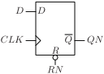
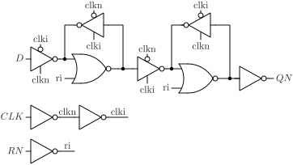

# DFARQN

D flip-flop with asynchronous reset and output QN.

## Pin information

| Pin   | Description   |
| :-:    | :-            |
| D | Data input |
| CLK | Clock |
| RN | Asynchronous reset, inverted |
| QN | Data output, inverted |
| VDD | Power supply |
| VSS | Ground |


## Truth table

| CLK | D | RN | QN | Description | 
| :--- | :--- | :--- | :--- | :--- | 
| ↑ | 0 | 1 | 1 | Write 0 | 
| ↑ | 1 | 1 | 0 | Write 1 | 
| - | - | 0 | 1 | Clear | 


## Symbol

<div align="center">

</div>

## Schematic

<div align="center">

</div>

## Verification simulation waveform

<picture>
  <source media="(prefers-color-scheme: dark)" srcset="https://svg.wavedrom.com/%7B%22signal%22%3A%5B%7B%22name%22%3A%22CLK%22%2C%22wave%22%3A%220.10101....0....1....0....10..%22%7D%2C%7B%22name%22%3A%22D%22%2C%22wave%22%3A%220..1.0..1010101..01010101.....%22%7D%2C%7B%22name%22%3A%22RN%22%2C%22wave%22%3A%221...........................01%22%7D%2C%7B%22name%22%3A%22QN%22%2C%22wave%22%3A%220.1.0.1.........0...........1.%22%7D%5D%2C%22config%22%3A%7B%22skin%22%3A%22dark%22%7D%7D">
  
</picture>

## Cell variants

| Cell name <br> | Width <br> [unit sites] | Area <br> [\\(\mu m^2\\)] |
| :-        | :-:   | :-:   |
| [DFARQN_DL](#dfarqn_dl) | TBD | TBD |
| [DFARQN_D1](#dfarqn_d1) | TBD | TBD |


### DFARQN_DL

#### Hierarchical SPICE netlist
```spice
.subckt DFARQN_DL D CLK QN RN VDD VSS
Xinv_clkn CLK clkn VDD VSS inv_par WN=2e-07 WP=3e-07 
Xinv_clki clkn clki VDD VSS inv_par WN=2e-07 WP=3e-07 
Xinv_r RN ri VDD VSS inv_par WN=2e-07 WP=3e-07 
Xinvz_in D clkn clki dn VDD VSS invz2_par WN=1.5e-07 WP=2.3e-07 
Xnor_ml dn ri di VDD VSS nor2_par WN=3e-07 WP=3e-07 
Xinvz_mfb di clki clkn dn VDD VSS invz_par WN=1.5e-07 WP=2.3e-07 WEAK=1 
Xinvz_ms di clki clkn qin VDD VSS invz_par WN=2e-07 WP=3e-07 
Xnor_sl qin ri qi VDD VSS nor2_par WN=3e-07 WP=3e-07 
Xinvz_sfb qi clkn clki qin VDD VSS invz_par WN=1.5e-07 WP=1.5e-07 
Xinv_QN qi QN VDD VSS inv_par WN=3.2e-07 WP=4.9e-07 
.ends
```

#### Flat SPICE netlist
```spice
.subckt DFARQN_DL D CLK QN RN VDD VSS
XMN0 n0 CLK VSS VSS sg13_lv_nmos w=2e-07 l=1.3e-07 ad=6.2e-14 as=6.2e-14 pd=1.02e-06 ps=1.02e-06 ng=1 
XMP0 n0 CLK VDD VDD sg13_lv_pmos w=3e-07 l=1.3e-07 ad=9.3e-14 as=9.3e-14 pd=1.22e-06 ps=1.22e-06 ng=1 
XMN1 n1 n0 VSS VSS sg13_lv_nmos w=2e-07 l=1.3e-07 ad=6.2e-14 as=6.2e-14 pd=1.02e-06 ps=1.02e-06 ng=1 
XMP1 n1 n0 VDD VDD sg13_lv_pmos w=3e-07 l=1.3e-07 ad=9.3e-14 as=9.3e-14 pd=1.22e-06 ps=1.22e-06 ng=1 
XMN2 n2 RN VSS VSS sg13_lv_nmos w=2e-07 l=1.3e-07 ad=6.2e-14 as=6.2e-14 pd=1.02e-06 ps=1.02e-06 ng=1 
XMP2 n2 RN VDD VDD sg13_lv_pmos w=3e-07 l=1.3e-07 ad=9.3e-14 as=9.3e-14 pd=1.22e-06 ps=1.22e-06 ng=1 
XMN3 n3 D n4 VSS sg13_lv_nmos w=1.5e-07 l=1.3e-07 ad=4.65e-14 as=4.65e-14 pd=9.2e-07 ps=9.2e-07 ng=1 
XMN4 n4 n0 VSS VSS sg13_lv_nmos w=1.5e-07 l=1.3e-07 ad=4.65e-14 as=4.65e-14 pd=9.2e-07 ps=9.2e-07 ng=1 
XMP3 n3 D n5 VDD sg13_lv_pmos w=2.3e-07 l=1.3e-07 ad=7.13e-14 as=7.13e-14 pd=1.08e-06 ps=1.08e-06 ng=1 
XMP4 n5 n1 VDD VDD sg13_lv_pmos w=2.3e-07 l=1.3e-07 ad=7.13e-14 as=7.13e-14 pd=1.08e-06 ps=1.08e-06 ng=1 
XMN5 n6 n3 VSS VSS sg13_lv_nmos w=3e-07 l=1.3e-07 ad=9.3e-14 as=9.3e-14 pd=1.22e-06 ps=1.22e-06 ng=1 
XMN6 n6 n2 VSS VSS sg13_lv_nmos w=3e-07 l=1.3e-07 ad=9.3e-14 as=9.3e-14 pd=1.22e-06 ps=1.22e-06 ng=1 
XMP5 n7 n3 VDD VDD sg13_lv_pmos w=3e-07 l=1.3e-07 ad=9.3e-14 as=9.3e-14 pd=1.22e-06 ps=1.22e-06 ng=1 
XMP6 n6 n2 n7 VDD sg13_lv_pmos w=3e-07 l=1.3e-07 ad=9.3e-14 as=9.3e-14 pd=1.22e-06 ps=1.22e-06 ng=1 
XMN7 n3 n1 n8 VSS sg13_lv_nmos w=1.5e-07 l=1.3e-07 ad=4.65e-14 as=4.65e-14 pd=9.2e-07 ps=9.2e-07 ng=1 
XMN8 n8 n6 VSS VSS sg13_lv_nmos w=1.5e-07 l=1.3e-07 ad=4.65e-14 as=4.65e-14 pd=9.2e-07 ps=9.2e-07 ng=1 
XMP7 n3 n0 n9 VDD sg13_lv_pmos w=2.3e-07 l=1.3e-07 ad=7.13e-14 as=7.13e-14 pd=1.08e-06 ps=1.08e-06 ng=1 
XMP8 n9 n6 VDD VDD sg13_lv_pmos w=2.3e-07 l=1.3e-07 ad=7.13e-14 as=7.13e-14 pd=1.08e-06 ps=1.08e-06 ng=1 
XMN9 n10 n1 n11 VSS sg13_lv_nmos w=2e-07 l=1.3e-07 ad=6.2e-14 as=6.2e-14 pd=1.02e-06 ps=1.02e-06 ng=1 
XMN10 n11 n6 VSS VSS sg13_lv_nmos w=2e-07 l=1.3e-07 ad=6.2e-14 as=6.2e-14 pd=1.02e-06 ps=1.02e-06 ng=1 
XMP9 n10 n0 n12 VDD sg13_lv_pmos w=3e-07 l=1.3e-07 ad=9.3e-14 as=9.3e-14 pd=1.22e-06 ps=1.22e-06 ng=1 
XMP10 n12 n6 VDD VDD sg13_lv_pmos w=3e-07 l=1.3e-07 ad=9.3e-14 as=9.3e-14 pd=1.22e-06 ps=1.22e-06 ng=1 
XMN11 n13 n10 VSS VSS sg13_lv_nmos w=3e-07 l=1.3e-07 ad=9.3e-14 as=9.3e-14 pd=1.22e-06 ps=1.22e-06 ng=1 
XMN12 n13 n2 VSS VSS sg13_lv_nmos w=3e-07 l=1.3e-07 ad=9.3e-14 as=9.3e-14 pd=1.22e-06 ps=1.22e-06 ng=1 
XMP11 n14 n10 VDD VDD sg13_lv_pmos w=3e-07 l=1.3e-07 ad=9.3e-14 as=9.3e-14 pd=1.22e-06 ps=1.22e-06 ng=1 
XMP12 n13 n2 n14 VDD sg13_lv_pmos w=3e-07 l=1.3e-07 ad=9.3e-14 as=9.3e-14 pd=1.22e-06 ps=1.22e-06 ng=1 
XMN13 n10 n0 n15 VSS sg13_lv_nmos w=1.5e-07 l=1.3e-07 ad=4.65e-14 as=4.65e-14 pd=9.2e-07 ps=9.2e-07 ng=1 
XMN14 n15 n13 VSS VSS sg13_lv_nmos w=1.5e-07 l=1.3e-07 ad=4.65e-14 as=4.65e-14 pd=9.2e-07 ps=9.2e-07 ng=1 
XMP13 n10 n1 n16 VDD sg13_lv_pmos w=1.5e-07 l=1.3e-07 ad=4.65e-14 as=4.65e-14 pd=9.2e-07 ps=9.2e-07 ng=1 
XMP14 n16 n13 VDD VDD sg13_lv_pmos w=1.5e-07 l=1.3e-07 ad=4.65e-14 as=4.65e-14 pd=9.2e-07 ps=9.2e-07 ng=1 
XMN15 QN n13 VSS VSS sg13_lv_nmos w=3.2e-07 l=1.3e-07 ad=9.92e-14 as=9.92e-14 pd=1.26e-06 ps=1.26e-06 ng=1 
XMP15 QN n13 VDD VDD sg13_lv_pmos w=4.9e-07 l=1.3e-07 ad=1.519e-13 as=1.519e-13 pd=1.6e-06 ps=1.6e-06 ng=1 
.ends
```

#### CDL netlist
```cdl
.SUBCKT DFARQN_DL D CLK QN RN VDD VSS
*.PININFO CLK:I D:I RN:I QN:O VDD:B VSS:B 
MN0 n0 CLK VSS VSS sg13_lv_nmos w=2e-07 l=1.3e-07 ng=1 
MP0 n0 CLK VDD VDD sg13_lv_pmos w=3e-07 l=1.3e-07 ng=1 
MN1 n1 n0 VSS VSS sg13_lv_nmos w=2e-07 l=1.3e-07 ng=1 
MP1 n1 n0 VDD VDD sg13_lv_pmos w=3e-07 l=1.3e-07 ng=1 
MN2 n2 RN VSS VSS sg13_lv_nmos w=2e-07 l=1.3e-07 ng=1 
MP2 n2 RN VDD VDD sg13_lv_pmos w=3e-07 l=1.3e-07 ng=1 
MN3 n3 D n4 VSS sg13_lv_nmos w=1.5e-07 l=1.3e-07 ng=1 
MN4 n4 n0 VSS VSS sg13_lv_nmos w=1.5e-07 l=1.3e-07 ng=1 
MP3 n3 D n5 VDD sg13_lv_pmos w=2.3e-07 l=1.3e-07 ng=1 
MP4 n5 n1 VDD VDD sg13_lv_pmos w=2.3e-07 l=1.3e-07 ng=1 
MN5 n6 n3 VSS VSS sg13_lv_nmos w=3e-07 l=1.3e-07 ng=1 
MN6 n6 n2 VSS VSS sg13_lv_nmos w=3e-07 l=1.3e-07 ng=1 
MP5 n7 n3 VDD VDD sg13_lv_pmos w=3e-07 l=1.3e-07 ng=1 
MP6 n6 n2 n7 VDD sg13_lv_pmos w=3e-07 l=1.3e-07 ng=1 
MN7 n3 n1 n8 VSS sg13_lv_nmos w=1.5e-07 l=1.3e-07 ng=1 
MN8 n8 n6 VSS VSS sg13_lv_nmos w=1.5e-07 l=1.3e-07 ng=1 
MP7 n3 n0 n9 VDD sg13_lv_pmos w=2.3e-07 l=1.3e-07 ng=1 
MP8 n9 n6 VDD VDD sg13_lv_pmos w=2.3e-07 l=1.3e-07 ng=1 
MN9 n10 n1 n11 VSS sg13_lv_nmos w=2e-07 l=1.3e-07 ng=1 
MN10 n11 n6 VSS VSS sg13_lv_nmos w=2e-07 l=1.3e-07 ng=1 
MP9 n10 n0 n12 VDD sg13_lv_pmos w=3e-07 l=1.3e-07 ng=1 
MP10 n12 n6 VDD VDD sg13_lv_pmos w=3e-07 l=1.3e-07 ng=1 
MN11 n13 n10 VSS VSS sg13_lv_nmos w=3e-07 l=1.3e-07 ng=1 
MN12 n13 n2 VSS VSS sg13_lv_nmos w=3e-07 l=1.3e-07 ng=1 
MP11 n14 n10 VDD VDD sg13_lv_pmos w=3e-07 l=1.3e-07 ng=1 
MP12 n13 n2 n14 VDD sg13_lv_pmos w=3e-07 l=1.3e-07 ng=1 
MN13 n10 n0 n15 VSS sg13_lv_nmos w=1.5e-07 l=1.3e-07 ng=1 
MN14 n15 n13 VSS VSS sg13_lv_nmos w=1.5e-07 l=1.3e-07 ng=1 
MP13 n10 n1 n16 VDD sg13_lv_pmos w=1.5e-07 l=1.3e-07 ng=1 
MP14 n16 n13 VDD VDD sg13_lv_pmos w=1.5e-07 l=1.3e-07 ng=1 
MN15 QN n13 VSS VSS sg13_lv_nmos w=3.2e-07 l=1.3e-07 ng=1 
MP15 QN n13 VDD VDD sg13_lv_pmos w=4.9e-07 l=1.3e-07 ng=1 
.ENDS
```

#### Layout

<div align="center">

</div>

### DFARQN_D1

#### Hierarchical SPICE netlist
```spice
.subckt DFARQN_D1 D CLK QN RN VDD VSS
Xinv_clkn CLK clkn VDD VSS inv_par WN=3e-07 WP=4.5e-07 
Xinv_clki clkn clki VDD VSS inv_par WN=2e-07 WP=3e-07 
Xinv_r RN ri VDD VSS inv_par WN=2e-07 WP=3e-07 
Xinvz_in D clkn clki dn VDD VSS invz2_par WN=1.5e-07 WP=2.3e-07 
Xnor_ml dn ri di VDD VSS nor2_par WN=3e-07 WP=4e-07 
Xinvz_mfb di clki clkn dn VDD VSS invz_par WN=1.5e-07 WP=2.3e-07 WEAK=1 
Xinvz_ms di clki clkn qin VDD VSS invz_par WN=5e-07 WP=7.5e-07 
Xnor_sl qin ri qi VDD VSS nor2_par WN=4.5e-07 WP=4.5e-07 
Xinvz_sfb qi clkn clki qin VDD VSS invz_par WN=1.5e-07 WP=1.5e-07 
Xinv_QN qi QN VDD VSS inv_par WN=6.4e-07 WP=9.8e-07 
.ends
```

#### Flat SPICE netlist
```spice
.subckt DFARQN_D1 D CLK QN RN VDD VSS
XMN0 n0 CLK VSS VSS sg13_lv_nmos w=3e-07 l=1.3e-07 ad=9.3e-14 as=9.3e-14 pd=1.22e-06 ps=1.22e-06 ng=1 
XMP0 n0 CLK VDD VDD sg13_lv_pmos w=4.5e-07 l=1.3e-07 ad=1.395e-13 as=1.395e-13 pd=1.52e-06 ps=1.52e-06 ng=1 
XMN1 n1 n0 VSS VSS sg13_lv_nmos w=2e-07 l=1.3e-07 ad=6.2e-14 as=6.2e-14 pd=1.02e-06 ps=1.02e-06 ng=1 
XMP1 n1 n0 VDD VDD sg13_lv_pmos w=3e-07 l=1.3e-07 ad=9.3e-14 as=9.3e-14 pd=1.22e-06 ps=1.22e-06 ng=1 
XMN2 n2 RN VSS VSS sg13_lv_nmos w=2e-07 l=1.3e-07 ad=6.2e-14 as=6.2e-14 pd=1.02e-06 ps=1.02e-06 ng=1 
XMP2 n2 RN VDD VDD sg13_lv_pmos w=3e-07 l=1.3e-07 ad=9.3e-14 as=9.3e-14 pd=1.22e-06 ps=1.22e-06 ng=1 
XMN3 n3 D n4 VSS sg13_lv_nmos w=1.5e-07 l=1.3e-07 ad=4.65e-14 as=4.65e-14 pd=9.2e-07 ps=9.2e-07 ng=1 
XMN4 n4 n0 VSS VSS sg13_lv_nmos w=1.5e-07 l=1.3e-07 ad=4.65e-14 as=4.65e-14 pd=9.2e-07 ps=9.2e-07 ng=1 
XMP3 n3 D n5 VDD sg13_lv_pmos w=2.3e-07 l=1.3e-07 ad=7.13e-14 as=7.13e-14 pd=1.08e-06 ps=1.08e-06 ng=1 
XMP4 n5 n1 VDD VDD sg13_lv_pmos w=2.3e-07 l=1.3e-07 ad=7.13e-14 as=7.13e-14 pd=1.08e-06 ps=1.08e-06 ng=1 
XMN5 n6 n3 VSS VSS sg13_lv_nmos w=3e-07 l=1.3e-07 ad=9.3e-14 as=9.3e-14 pd=1.22e-06 ps=1.22e-06 ng=1 
XMN6 n6 n2 VSS VSS sg13_lv_nmos w=3e-07 l=1.3e-07 ad=9.3e-14 as=9.3e-14 pd=1.22e-06 ps=1.22e-06 ng=1 
XMP5 n7 n3 VDD VDD sg13_lv_pmos w=4e-07 l=1.3e-07 ad=1.24e-13 as=1.24e-13 pd=1.42e-06 ps=1.42e-06 ng=1 
XMP6 n6 n2 n7 VDD sg13_lv_pmos w=4e-07 l=1.3e-07 ad=1.24e-13 as=1.24e-13 pd=1.42e-06 ps=1.42e-06 ng=1 
XMN7 n3 n1 n8 VSS sg13_lv_nmos w=1.5e-07 l=1.3e-07 ad=4.65e-14 as=4.65e-14 pd=9.2e-07 ps=9.2e-07 ng=1 
XMN8 n8 n6 VSS VSS sg13_lv_nmos w=1.5e-07 l=1.3e-07 ad=4.65e-14 as=4.65e-14 pd=9.2e-07 ps=9.2e-07 ng=1 
XMP7 n3 n0 n9 VDD sg13_lv_pmos w=2.3e-07 l=1.3e-07 ad=7.13e-14 as=7.13e-14 pd=1.08e-06 ps=1.08e-06 ng=1 
XMP8 n9 n6 VDD VDD sg13_lv_pmos w=2.3e-07 l=1.3e-07 ad=7.13e-14 as=7.13e-14 pd=1.08e-06 ps=1.08e-06 ng=1 
XMN9 n10 n1 n11 VSS sg13_lv_nmos w=5e-07 l=1.3e-07 ad=1.55e-13 as=1.55e-13 pd=1.62e-06 ps=1.62e-06 ng=1 
XMN10 n11 n6 VSS VSS sg13_lv_nmos w=5e-07 l=1.3e-07 ad=1.55e-13 as=1.55e-13 pd=1.62e-06 ps=1.62e-06 ng=1 
XMP9 n10 n0 n12 VDD sg13_lv_pmos w=7.5e-07 l=1.3e-07 ad=2.325e-13 as=2.325e-13 pd=2.12e-06 ps=2.12e-06 ng=1 
XMP10 n12 n6 VDD VDD sg13_lv_pmos w=7.5e-07 l=1.3e-07 ad=2.325e-13 as=2.325e-13 pd=2.12e-06 ps=2.12e-06 ng=1 
XMN11 n13 n10 VSS VSS sg13_lv_nmos w=4.5e-07 l=1.3e-07 ad=1.395e-13 as=1.395e-13 pd=1.52e-06 ps=1.52e-06 ng=1 
XMN12 n13 n2 VSS VSS sg13_lv_nmos w=4.5e-07 l=1.3e-07 ad=1.395e-13 as=1.395e-13 pd=1.52e-06 ps=1.52e-06 ng=1 
XMP11 n14 n10 VDD VDD sg13_lv_pmos w=4.5e-07 l=1.3e-07 ad=1.395e-13 as=1.395e-13 pd=1.52e-06 ps=1.52e-06 ng=1 
XMP12 n13 n2 n14 VDD sg13_lv_pmos w=4.5e-07 l=1.3e-07 ad=1.395e-13 as=1.395e-13 pd=1.52e-06 ps=1.52e-06 ng=1 
XMN13 n10 n0 n15 VSS sg13_lv_nmos w=1.5e-07 l=1.3e-07 ad=4.65e-14 as=4.65e-14 pd=9.2e-07 ps=9.2e-07 ng=1 
XMN14 n15 n13 VSS VSS sg13_lv_nmos w=1.5e-07 l=1.3e-07 ad=4.65e-14 as=4.65e-14 pd=9.2e-07 ps=9.2e-07 ng=1 
XMP13 n10 n1 n16 VDD sg13_lv_pmos w=1.5e-07 l=1.3e-07 ad=4.65e-14 as=4.65e-14 pd=9.2e-07 ps=9.2e-07 ng=1 
XMP14 n16 n13 VDD VDD sg13_lv_pmos w=1.5e-07 l=1.3e-07 ad=4.65e-14 as=4.65e-14 pd=9.2e-07 ps=9.2e-07 ng=1 
XMN15 QN n13 VSS VSS sg13_lv_nmos w=6.4e-07 l=1.3e-07 ad=1.984e-13 as=1.984e-13 pd=1.9e-06 ps=1.9e-06 ng=1 
XMP15 QN n13 VDD VDD sg13_lv_pmos w=9.8e-07 l=1.3e-07 ad=3.038e-13 as=3.038e-13 pd=2.58e-06 ps=2.58e-06 ng=1 
.ends
```

#### CDL netlist
```cdl
.SUBCKT DFARQN_D1 D CLK QN RN VDD VSS
*.PININFO CLK:I D:I RN:I QN:O VDD:B VSS:B 
MN0 n0 CLK VSS VSS sg13_lv_nmos w=3e-07 l=1.3e-07 ng=1 
MP0 n0 CLK VDD VDD sg13_lv_pmos w=4.5e-07 l=1.3e-07 ng=1 
MN1 n1 n0 VSS VSS sg13_lv_nmos w=2e-07 l=1.3e-07 ng=1 
MP1 n1 n0 VDD VDD sg13_lv_pmos w=3e-07 l=1.3e-07 ng=1 
MN2 n2 RN VSS VSS sg13_lv_nmos w=2e-07 l=1.3e-07 ng=1 
MP2 n2 RN VDD VDD sg13_lv_pmos w=3e-07 l=1.3e-07 ng=1 
MN3 n3 D n4 VSS sg13_lv_nmos w=1.5e-07 l=1.3e-07 ng=1 
MN4 n4 n0 VSS VSS sg13_lv_nmos w=1.5e-07 l=1.3e-07 ng=1 
MP3 n3 D n5 VDD sg13_lv_pmos w=2.3e-07 l=1.3e-07 ng=1 
MP4 n5 n1 VDD VDD sg13_lv_pmos w=2.3e-07 l=1.3e-07 ng=1 
MN5 n6 n3 VSS VSS sg13_lv_nmos w=3e-07 l=1.3e-07 ng=1 
MN6 n6 n2 VSS VSS sg13_lv_nmos w=3e-07 l=1.3e-07 ng=1 
MP5 n7 n3 VDD VDD sg13_lv_pmos w=4e-07 l=1.3e-07 ng=1 
MP6 n6 n2 n7 VDD sg13_lv_pmos w=4e-07 l=1.3e-07 ng=1 
MN7 n3 n1 n8 VSS sg13_lv_nmos w=1.5e-07 l=1.3e-07 ng=1 
MN8 n8 n6 VSS VSS sg13_lv_nmos w=1.5e-07 l=1.3e-07 ng=1 
MP7 n3 n0 n9 VDD sg13_lv_pmos w=2.3e-07 l=1.3e-07 ng=1 
MP8 n9 n6 VDD VDD sg13_lv_pmos w=2.3e-07 l=1.3e-07 ng=1 
MN9 n10 n1 n11 VSS sg13_lv_nmos w=5e-07 l=1.3e-07 ng=1 
MN10 n11 n6 VSS VSS sg13_lv_nmos w=5e-07 l=1.3e-07 ng=1 
MP9 n10 n0 n12 VDD sg13_lv_pmos w=7.5e-07 l=1.3e-07 ng=1 
MP10 n12 n6 VDD VDD sg13_lv_pmos w=7.5e-07 l=1.3e-07 ng=1 
MN11 n13 n10 VSS VSS sg13_lv_nmos w=4.5e-07 l=1.3e-07 ng=1 
MN12 n13 n2 VSS VSS sg13_lv_nmos w=4.5e-07 l=1.3e-07 ng=1 
MP11 n14 n10 VDD VDD sg13_lv_pmos w=4.5e-07 l=1.3e-07 ng=1 
MP12 n13 n2 n14 VDD sg13_lv_pmos w=4.5e-07 l=1.3e-07 ng=1 
MN13 n10 n0 n15 VSS sg13_lv_nmos w=1.5e-07 l=1.3e-07 ng=1 
MN14 n15 n13 VSS VSS sg13_lv_nmos w=1.5e-07 l=1.3e-07 ng=1 
MP13 n10 n1 n16 VDD sg13_lv_pmos w=1.5e-07 l=1.3e-07 ng=1 
MP14 n16 n13 VDD VDD sg13_lv_pmos w=1.5e-07 l=1.3e-07 ng=1 
MN15 QN n13 VSS VSS sg13_lv_nmos w=6.4e-07 l=1.3e-07 ng=1 
MP15 QN n13 VDD VDD sg13_lv_pmos w=9.8e-07 l=1.3e-07 ng=1 
.ENDS
```

#### Layout

<div align="center">

</div>

## Pin capacitance
No pin capacitance data


## Static power
No static power data


## Dynamic power
No dynamic power data


## Delay
No delay data

