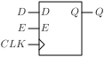
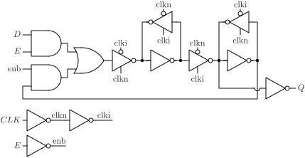

# DFEQ

D flip-flop with enable and output Q.

## Pin information

| Pin   | Description   |
| :-:    | :-            |
| D | Data input |
| CLK | Clock |
| E | Enable |
| Q | Data output |
| VDD | Power supply |
| VSS | Ground |


## Truth table

| CLK | D | E | Q | Description | 
| :--- | :--- | :--- | :--- | :--- | 
| ↑ | 0 | 1 | 0 | Write 0 | 
| ↑ | 1 | 1 | 1 | Write 1 | 
| ↑ | - | 0 | Q | Write disabled | 


## Symbol

<div align="center">

</div>

## Schematic

<div align="center">

</div>

## Verification simulation waveform

<picture>
  <source media="(prefers-color-scheme: dark)" srcset="https://svg.wavedrom.com/%7B%22signal%22%3A%5B%7B%22name%22%3A%22CLK%22%2C%22wave%22%3A%220.10101....0....1....0....101%22%7D%2C%7B%22name%22%3A%22D%22%2C%22wave%22%3A%220..1.0..1010101..010101010.1.%22%7D%2C%7B%22name%22%3A%22E%22%2C%22wave%22%3A%221........................0...%22%7D%2C%7B%22name%22%3A%22Q%22%2C%22wave%22%3A%221.0.1.0.........1............%22%7D%5D%2C%22config%22%3A%7B%22skin%22%3A%22dark%22%7D%7D">
  
</picture>

## Cell variants

| Cell name <br> | Width <br> [unit sites] | Area <br> [\\(\mu m^2\\)] |
| :-        | :-:   | :-:   |
| [DFEQ_DL](#dfeq_dl) | TBD | TBD |
| [DFEQ_D1](#dfeq_d1) | TBD | TBD |
| [DFEQ_D2](#dfeq_d2) | TBD | TBD |


### DFEQ_DL

#### Hierarchical SPICE netlist
```spice
.subckt DFEQ_DL D E CLK Q VDD VSS
Xinv_clkn CLK clkn VDD VSS inv_par WN=2e-07 WP=3e-07 
Xinv_clki clkn clki VDD VSS inv_par WN=1.5e-07 WP=2.5e-07 
Xinv_enb E enb VDD VSS inv_par WN=1.5e-07 WP=2.5e-07 
XMN0 nde E VSS VSS sg13_lv_nmos w=1.5e-07 l=1.3e-07 ad={1.5e-07*3.1e-07} as={1.5e-07*3.1e-07} pd={2*(1.5e-07+3.1e-07)} ps={2*(1.5e-07+3.1e-07)} 
XMN1 net_pdn D nde VSS sg13_lv_nmos w=1.5e-07 l=1.3e-07 ad={1.5e-07*3.1e-07} as={1.5e-07*3.1e-07} pd={2*(1.5e-07+3.1e-07)} ps={2*(1.5e-07+3.1e-07)} 
XMN2 nenbqi enb VSS VSS sg13_lv_nmos w=1.5e-07 l=1.3e-07 ad={1.5e-07*3.1e-07} as={1.5e-07*3.1e-07} pd={2*(1.5e-07+3.1e-07)} ps={2*(1.5e-07+3.1e-07)} 
XMN3 net_pdn qi nenbqi VSS sg13_lv_nmos w=1.5e-07 l=1.3e-07 ad={1.5e-07*3.1e-07} as={1.5e-07*3.1e-07} pd={2*(1.5e-07+3.1e-07)} ps={2*(1.5e-07+3.1e-07)} 
XMN4 dn clkn net_pdn VSS sg13_lv_nmos w=1.5e-07 l=1.3e-07 ad={1.5e-07*3.1e-07} as={1.5e-07*3.1e-07} pd={2*(1.5e-07+3.1e-07)} ps={2*(1.5e-07+3.1e-07)} 
XMP0 neqi E VDD VDD sg13_lv_pmos w=2e-07 l=1.3e-07 ad={2e-07*3.1e-07} as={2e-07*3.1e-07} pd={2*(2e-07+3.1e-07)} ps={2*(2e-07+3.1e-07)} 
XMP1 net_pun qi neqi VDD sg13_lv_pmos w=2e-07 l=1.3e-07 ad={2e-07*3.1e-07} as={2e-07*3.1e-07} pd={2*(2e-07+3.1e-07)} ps={2*(2e-07+3.1e-07)} 
XMP2 nenbd enb VDD VDD sg13_lv_pmos w=2e-07 l=1.3e-07 ad={2e-07*3.1e-07} as={2e-07*3.1e-07} pd={2*(2e-07+3.1e-07)} ps={2*(2e-07+3.1e-07)} 
XMP3 net_pun D nenbd VDD sg13_lv_pmos w=2e-07 l=1.3e-07 ad={2e-07*3.1e-07} as={2e-07*3.1e-07} pd={2*(2e-07+3.1e-07)} ps={2*(2e-07+3.1e-07)} 
XMP4 dn clki net_pun VDD sg13_lv_pmos w=2e-07 l=1.3e-07 ad={2e-07*3.1e-07} as={2e-07*3.1e-07} pd={2*(2e-07+3.1e-07)} ps={2*(2e-07+3.1e-07)} 
Xinv_ml dn di VDD VSS inv_par WN=2e-07 WP=3e-07 
Xinvz_mfb di clki clkn dn VDD VSS invz_par WN=1.5e-07 WP=2.5e-07 WEAK=1 
Xinvz_ms di clki clkn qin VDD VSS invz_par WN=4e-07 WP=6e-07 
Xinv_sl qin qi VDD VSS inv_par WN=2e-07 WP=3e-07 
Xinvz_sfb qi clkn clki qin VDD VSS invz_par WN=1.5e-07 WP=1.5e-07 
Xinv_Q qin Q VDD VSS inv_par WN=3.2e-07 WP=4.9e-07 
.ends
```

#### Flat SPICE netlist
```spice
.subckt DFEQ_DL D E CLK Q VDD VSS
XMN0 n0 CLK VSS VSS sg13_lv_nmos w=2e-07 l=1.3e-07 ad=6.2e-14 as=6.2e-14 pd=1.02e-06 ps=1.02e-06 ng=1 
XMP0 n0 CLK VDD VDD sg13_lv_pmos w=3e-07 l=1.3e-07 ad=9.3e-14 as=9.3e-14 pd=1.22e-06 ps=1.22e-06 ng=1 
XMN1 n1 n0 VSS VSS sg13_lv_nmos w=1.5e-07 l=1.3e-07 ad=4.65e-14 as=4.65e-14 pd=9.2e-07 ps=9.2e-07 ng=1 
XMP1 n1 n0 VDD VDD sg13_lv_pmos w=2.5e-07 l=1.3e-07 ad=7.75e-14 as=7.75e-14 pd=1.12e-06 ps=1.12e-06 ng=1 
XMN2 n2 E VSS VSS sg13_lv_nmos w=1.5e-07 l=1.3e-07 ad=4.65e-14 as=4.65e-14 pd=9.2e-07 ps=9.2e-07 ng=1 
XMP2 n2 E VDD VDD sg13_lv_pmos w=2.5e-07 l=1.3e-07 ad=7.75e-14 as=7.75e-14 pd=1.12e-06 ps=1.12e-06 ng=1 
XMN3 n3 E VSS VSS sg13_lv_nmos w=1.5e-07 l=1.3e-07 ad=4.65e-14 as=4.65e-14 pd=9.2e-07 ps=9.2e-07 
XMN4 n4 D n3 VSS sg13_lv_nmos w=1.5e-07 l=1.3e-07 ad=4.65e-14 as=4.65e-14 pd=9.2e-07 ps=9.2e-07 
XMN5 n5 n2 VSS VSS sg13_lv_nmos w=1.5e-07 l=1.3e-07 ad=4.65e-14 as=4.65e-14 pd=9.2e-07 ps=9.2e-07 
XMN6 n4 n6 n5 VSS sg13_lv_nmos w=1.5e-07 l=1.3e-07 ad=4.65e-14 as=4.65e-14 pd=9.2e-07 ps=9.2e-07 
XMN7 n7 n0 n4 VSS sg13_lv_nmos w=1.5e-07 l=1.3e-07 ad=4.65e-14 as=4.65e-14 pd=9.2e-07 ps=9.2e-07 
XMP3 n8 E VDD VDD sg13_lv_pmos w=2e-07 l=1.3e-07 ad=6.2e-14 as=6.2e-14 pd=1.02e-06 ps=1.02e-06 
XMP4 n9 n6 n8 VDD sg13_lv_pmos w=2e-07 l=1.3e-07 ad=6.2e-14 as=6.2e-14 pd=1.02e-06 ps=1.02e-06 
XMP5 n10 n2 VDD VDD sg13_lv_pmos w=2e-07 l=1.3e-07 ad=6.2e-14 as=6.2e-14 pd=1.02e-06 ps=1.02e-06 
XMP6 n9 D n10 VDD sg13_lv_pmos w=2e-07 l=1.3e-07 ad=6.2e-14 as=6.2e-14 pd=1.02e-06 ps=1.02e-06 
XMP7 n7 n1 n9 VDD sg13_lv_pmos w=2e-07 l=1.3e-07 ad=6.2e-14 as=6.2e-14 pd=1.02e-06 ps=1.02e-06 
XMN8 n11 n7 VSS VSS sg13_lv_nmos w=2e-07 l=1.3e-07 ad=6.2e-14 as=6.2e-14 pd=1.02e-06 ps=1.02e-06 ng=1 
XMP8 n11 n7 VDD VDD sg13_lv_pmos w=3e-07 l=1.3e-07 ad=9.3e-14 as=9.3e-14 pd=1.22e-06 ps=1.22e-06 ng=1 
XMN9 n7 n1 n12 VSS sg13_lv_nmos w=1.5e-07 l=1.3e-07 ad=4.65e-14 as=4.65e-14 pd=9.2e-07 ps=9.2e-07 ng=1 
XMN10 n12 n11 VSS VSS sg13_lv_nmos w=1.5e-07 l=1.3e-07 ad=4.65e-14 as=4.65e-14 pd=9.2e-07 ps=9.2e-07 ng=1 
XMP9 n7 n0 n13 VDD sg13_lv_pmos w=2.5e-07 l=1.3e-07 ad=7.75e-14 as=7.75e-14 pd=1.12e-06 ps=1.12e-06 ng=1 
XMP10 n13 n11 VDD VDD sg13_lv_pmos w=2.5e-07 l=1.3e-07 ad=7.75e-14 as=7.75e-14 pd=1.12e-06 ps=1.12e-06 ng=1 
XMN11 n14 n1 n15 VSS sg13_lv_nmos w=4e-07 l=1.3e-07 ad=1.24e-13 as=1.24e-13 pd=1.42e-06 ps=1.42e-06 ng=1 
XMN12 n15 n11 VSS VSS sg13_lv_nmos w=4e-07 l=1.3e-07 ad=1.24e-13 as=1.24e-13 pd=1.42e-06 ps=1.42e-06 ng=1 
XMP11 n14 n0 n16 VDD sg13_lv_pmos w=6e-07 l=1.3e-07 ad=1.86e-13 as=1.86e-13 pd=1.82e-06 ps=1.82e-06 ng=1 
XMP12 n16 n11 VDD VDD sg13_lv_pmos w=6e-07 l=1.3e-07 ad=1.86e-13 as=1.86e-13 pd=1.82e-06 ps=1.82e-06 ng=1 
XMN13 n6 n14 VSS VSS sg13_lv_nmos w=2e-07 l=1.3e-07 ad=6.2e-14 as=6.2e-14 pd=1.02e-06 ps=1.02e-06 ng=1 
XMP13 n6 n14 VDD VDD sg13_lv_pmos w=3e-07 l=1.3e-07 ad=9.3e-14 as=9.3e-14 pd=1.22e-06 ps=1.22e-06 ng=1 
XMN14 n14 n0 n17 VSS sg13_lv_nmos w=1.5e-07 l=1.3e-07 ad=4.65e-14 as=4.65e-14 pd=9.2e-07 ps=9.2e-07 ng=1 
XMN15 n17 n6 VSS VSS sg13_lv_nmos w=1.5e-07 l=1.3e-07 ad=4.65e-14 as=4.65e-14 pd=9.2e-07 ps=9.2e-07 ng=1 
XMP14 n14 n1 n18 VDD sg13_lv_pmos w=1.5e-07 l=1.3e-07 ad=4.65e-14 as=4.65e-14 pd=9.2e-07 ps=9.2e-07 ng=1 
XMP15 n18 n6 VDD VDD sg13_lv_pmos w=1.5e-07 l=1.3e-07 ad=4.65e-14 as=4.65e-14 pd=9.2e-07 ps=9.2e-07 ng=1 
XMN16 Q n14 VSS VSS sg13_lv_nmos w=3.2e-07 l=1.3e-07 ad=9.92e-14 as=9.92e-14 pd=1.26e-06 ps=1.26e-06 ng=1 
XMP16 Q n14 VDD VDD sg13_lv_pmos w=4.9e-07 l=1.3e-07 ad=1.519e-13 as=1.519e-13 pd=1.6e-06 ps=1.6e-06 ng=1 
.ends
```

#### CDL netlist
```cdl
.SUBCKT DFEQ_DL D E CLK Q VDD VSS
*.PININFO CLK:I D:I E:I Q:O VDD:B VSS:B 
MN0 n0 CLK VSS VSS sg13_lv_nmos w=2e-07 l=1.3e-07 ng=1 
MP0 n0 CLK VDD VDD sg13_lv_pmos w=3e-07 l=1.3e-07 ng=1 
MN1 n1 n0 VSS VSS sg13_lv_nmos w=1.5e-07 l=1.3e-07 ng=1 
MP1 n1 n0 VDD VDD sg13_lv_pmos w=2.5e-07 l=1.3e-07 ng=1 
MN2 n2 E VSS VSS sg13_lv_nmos w=1.5e-07 l=1.3e-07 ng=1 
MP2 n2 E VDD VDD sg13_lv_pmos w=2.5e-07 l=1.3e-07 ng=1 
MN3 n3 E VSS VSS sg13_lv_nmos w=1.5e-07 l=1.3e-07 
MN4 n4 D n3 VSS sg13_lv_nmos w=1.5e-07 l=1.3e-07 
MN5 n5 n2 VSS VSS sg13_lv_nmos w=1.5e-07 l=1.3e-07 
MN6 n4 n6 n5 VSS sg13_lv_nmos w=1.5e-07 l=1.3e-07 
MN7 n7 n0 n4 VSS sg13_lv_nmos w=1.5e-07 l=1.3e-07 
MP3 n8 E VDD VDD sg13_lv_pmos w=2e-07 l=1.3e-07 
MP4 n9 n6 n8 VDD sg13_lv_pmos w=2e-07 l=1.3e-07 
MP5 n10 n2 VDD VDD sg13_lv_pmos w=2e-07 l=1.3e-07 
MP6 n9 D n10 VDD sg13_lv_pmos w=2e-07 l=1.3e-07 
MP7 n7 n1 n9 VDD sg13_lv_pmos w=2e-07 l=1.3e-07 
MN8 n11 n7 VSS VSS sg13_lv_nmos w=2e-07 l=1.3e-07 ng=1 
MP8 n11 n7 VDD VDD sg13_lv_pmos w=3e-07 l=1.3e-07 ng=1 
MN9 n7 n1 n12 VSS sg13_lv_nmos w=1.5e-07 l=1.3e-07 ng=1 
MN10 n12 n11 VSS VSS sg13_lv_nmos w=1.5e-07 l=1.3e-07 ng=1 
MP9 n7 n0 n13 VDD sg13_lv_pmos w=2.5e-07 l=1.3e-07 ng=1 
MP10 n13 n11 VDD VDD sg13_lv_pmos w=2.5e-07 l=1.3e-07 ng=1 
MN11 n14 n1 n15 VSS sg13_lv_nmos w=4e-07 l=1.3e-07 ng=1 
MN12 n15 n11 VSS VSS sg13_lv_nmos w=4e-07 l=1.3e-07 ng=1 
MP11 n14 n0 n16 VDD sg13_lv_pmos w=6e-07 l=1.3e-07 ng=1 
MP12 n16 n11 VDD VDD sg13_lv_pmos w=6e-07 l=1.3e-07 ng=1 
MN13 n6 n14 VSS VSS sg13_lv_nmos w=2e-07 l=1.3e-07 ng=1 
MP13 n6 n14 VDD VDD sg13_lv_pmos w=3e-07 l=1.3e-07 ng=1 
MN14 n14 n0 n17 VSS sg13_lv_nmos w=1.5e-07 l=1.3e-07 ng=1 
MN15 n17 n6 VSS VSS sg13_lv_nmos w=1.5e-07 l=1.3e-07 ng=1 
MP14 n14 n1 n18 VDD sg13_lv_pmos w=1.5e-07 l=1.3e-07 ng=1 
MP15 n18 n6 VDD VDD sg13_lv_pmos w=1.5e-07 l=1.3e-07 ng=1 
MN16 Q n14 VSS VSS sg13_lv_nmos w=3.2e-07 l=1.3e-07 ng=1 
MP16 Q n14 VDD VDD sg13_lv_pmos w=4.9e-07 l=1.3e-07 ng=1 
.ENDS
```

#### Layout

<div align="center">

</div>

### DFEQ_D1

#### Hierarchical SPICE netlist
```spice
.subckt DFEQ_D1 D E CLK Q VDD VSS
Xinv_clkn CLK clkn VDD VSS inv_par WN=3e-07 WP=4.5e-07 
Xinv_clki clkn clki VDD VSS inv_par WN=1.5e-07 WP=2.5e-07 
Xinv_enb E enb VDD VSS inv_par WN=1.5e-07 WP=2.5e-07 
XMN0 nde E VSS VSS sg13_lv_nmos w=1.5e-07 l=1.3e-07 ad={1.5e-07*3.1e-07} as={1.5e-07*3.1e-07} pd={2*(1.5e-07+3.1e-07)} ps={2*(1.5e-07+3.1e-07)} 
XMN1 net_pdn D nde VSS sg13_lv_nmos w=1.5e-07 l=1.3e-07 ad={1.5e-07*3.1e-07} as={1.5e-07*3.1e-07} pd={2*(1.5e-07+3.1e-07)} ps={2*(1.5e-07+3.1e-07)} 
XMN2 nenbqi enb VSS VSS sg13_lv_nmos w=1.5e-07 l=1.3e-07 ad={1.5e-07*3.1e-07} as={1.5e-07*3.1e-07} pd={2*(1.5e-07+3.1e-07)} ps={2*(1.5e-07+3.1e-07)} 
XMN3 net_pdn qi nenbqi VSS sg13_lv_nmos w=1.5e-07 l=1.3e-07 ad={1.5e-07*3.1e-07} as={1.5e-07*3.1e-07} pd={2*(1.5e-07+3.1e-07)} ps={2*(1.5e-07+3.1e-07)} 
XMN4 dn clkn net_pdn VSS sg13_lv_nmos w=1.5e-07 l=1.3e-07 ad={1.5e-07*3.1e-07} as={1.5e-07*3.1e-07} pd={2*(1.5e-07+3.1e-07)} ps={2*(1.5e-07+3.1e-07)} 
XMP0 neqi E VDD VDD sg13_lv_pmos w=2e-07 l=1.3e-07 ad={2e-07*3.1e-07} as={2e-07*3.1e-07} pd={2*(2e-07+3.1e-07)} ps={2*(2e-07+3.1e-07)} 
XMP1 net_pun qi neqi VDD sg13_lv_pmos w=2e-07 l=1.3e-07 ad={2e-07*3.1e-07} as={2e-07*3.1e-07} pd={2*(2e-07+3.1e-07)} ps={2*(2e-07+3.1e-07)} 
XMP2 nenbd enb VDD VDD sg13_lv_pmos w=2e-07 l=1.3e-07 ad={2e-07*3.1e-07} as={2e-07*3.1e-07} pd={2*(2e-07+3.1e-07)} ps={2*(2e-07+3.1e-07)} 
XMP3 net_pun D nenbd VDD sg13_lv_pmos w=2e-07 l=1.3e-07 ad={2e-07*3.1e-07} as={2e-07*3.1e-07} pd={2*(2e-07+3.1e-07)} ps={2*(2e-07+3.1e-07)} 
XMP4 dn clki net_pun VDD sg13_lv_pmos w=2e-07 l=1.3e-07 ad={2e-07*3.1e-07} as={2e-07*3.1e-07} pd={2*(2e-07+3.1e-07)} ps={2*(2e-07+3.1e-07)} 
Xinv_ml dn di VDD VSS inv_par WN=2e-07 WP=3e-07 
Xinvz_mfb di clki clkn dn VDD VSS invz_par WN=1.5e-07 WP=2.5e-07 WEAK=1 
Xinvz_ms di clki clkn qin VDD VSS invz_par WN=6.2e-07 WP=9e-07 
Xinv_sl qin qi VDD VSS inv_par WN=2.5e-07 WP=4.5e-07 
Xinvz_sfb qi clkn clki qin VDD VSS invz_par WN=1.5e-07 WP=1.5e-07 
Xinv_Q qin Q VDD VSS inv_par WN=6.4e-07 WP=9.8e-07 
.ends
```

#### Flat SPICE netlist
```spice
.subckt DFEQ_D1 D E CLK Q VDD VSS
XMN0 n0 CLK VSS VSS sg13_lv_nmos w=3e-07 l=1.3e-07 ad=9.3e-14 as=9.3e-14 pd=1.22e-06 ps=1.22e-06 ng=1 
XMP0 n0 CLK VDD VDD sg13_lv_pmos w=4.5e-07 l=1.3e-07 ad=1.395e-13 as=1.395e-13 pd=1.52e-06 ps=1.52e-06 ng=1 
XMN1 n1 n0 VSS VSS sg13_lv_nmos w=1.5e-07 l=1.3e-07 ad=4.65e-14 as=4.65e-14 pd=9.2e-07 ps=9.2e-07 ng=1 
XMP1 n1 n0 VDD VDD sg13_lv_pmos w=2.5e-07 l=1.3e-07 ad=7.75e-14 as=7.75e-14 pd=1.12e-06 ps=1.12e-06 ng=1 
XMN2 n2 E VSS VSS sg13_lv_nmos w=1.5e-07 l=1.3e-07 ad=4.65e-14 as=4.65e-14 pd=9.2e-07 ps=9.2e-07 ng=1 
XMP2 n2 E VDD VDD sg13_lv_pmos w=2.5e-07 l=1.3e-07 ad=7.75e-14 as=7.75e-14 pd=1.12e-06 ps=1.12e-06 ng=1 
XMN3 n3 E VSS VSS sg13_lv_nmos w=1.5e-07 l=1.3e-07 ad=4.65e-14 as=4.65e-14 pd=9.2e-07 ps=9.2e-07 
XMN4 n4 D n3 VSS sg13_lv_nmos w=1.5e-07 l=1.3e-07 ad=4.65e-14 as=4.65e-14 pd=9.2e-07 ps=9.2e-07 
XMN5 n5 n2 VSS VSS sg13_lv_nmos w=1.5e-07 l=1.3e-07 ad=4.65e-14 as=4.65e-14 pd=9.2e-07 ps=9.2e-07 
XMN6 n4 n6 n5 VSS sg13_lv_nmos w=1.5e-07 l=1.3e-07 ad=4.65e-14 as=4.65e-14 pd=9.2e-07 ps=9.2e-07 
XMN7 n7 n0 n4 VSS sg13_lv_nmos w=1.5e-07 l=1.3e-07 ad=4.65e-14 as=4.65e-14 pd=9.2e-07 ps=9.2e-07 
XMP3 n8 E VDD VDD sg13_lv_pmos w=2e-07 l=1.3e-07 ad=6.2e-14 as=6.2e-14 pd=1.02e-06 ps=1.02e-06 
XMP4 n9 n6 n8 VDD sg13_lv_pmos w=2e-07 l=1.3e-07 ad=6.2e-14 as=6.2e-14 pd=1.02e-06 ps=1.02e-06 
XMP5 n10 n2 VDD VDD sg13_lv_pmos w=2e-07 l=1.3e-07 ad=6.2e-14 as=6.2e-14 pd=1.02e-06 ps=1.02e-06 
XMP6 n9 D n10 VDD sg13_lv_pmos w=2e-07 l=1.3e-07 ad=6.2e-14 as=6.2e-14 pd=1.02e-06 ps=1.02e-06 
XMP7 n7 n1 n9 VDD sg13_lv_pmos w=2e-07 l=1.3e-07 ad=6.2e-14 as=6.2e-14 pd=1.02e-06 ps=1.02e-06 
XMN8 n11 n7 VSS VSS sg13_lv_nmos w=2e-07 l=1.3e-07 ad=6.2e-14 as=6.2e-14 pd=1.02e-06 ps=1.02e-06 ng=1 
XMP8 n11 n7 VDD VDD sg13_lv_pmos w=3e-07 l=1.3e-07 ad=9.3e-14 as=9.3e-14 pd=1.22e-06 ps=1.22e-06 ng=1 
XMN9 n7 n1 n12 VSS sg13_lv_nmos w=1.5e-07 l=1.3e-07 ad=4.65e-14 as=4.65e-14 pd=9.2e-07 ps=9.2e-07 ng=1 
XMN10 n12 n11 VSS VSS sg13_lv_nmos w=1.5e-07 l=1.3e-07 ad=4.65e-14 as=4.65e-14 pd=9.2e-07 ps=9.2e-07 ng=1 
XMP9 n7 n0 n13 VDD sg13_lv_pmos w=2.5e-07 l=1.3e-07 ad=7.75e-14 as=7.75e-14 pd=1.12e-06 ps=1.12e-06 ng=1 
XMP10 n13 n11 VDD VDD sg13_lv_pmos w=2.5e-07 l=1.3e-07 ad=7.75e-14 as=7.75e-14 pd=1.12e-06 ps=1.12e-06 ng=1 
XMN11 n14 n1 n15 VSS sg13_lv_nmos w=6.2e-07 l=1.3e-07 ad=1.922e-13 as=1.922e-13 pd=1.86e-06 ps=1.86e-06 ng=1 
XMN12 n15 n11 VSS VSS sg13_lv_nmos w=6.2e-07 l=1.3e-07 ad=1.922e-13 as=1.922e-13 pd=1.86e-06 ps=1.86e-06 ng=1 
XMP11 n14 n0 n16 VDD sg13_lv_pmos w=9e-07 l=1.3e-07 ad=2.79e-13 as=2.79e-13 pd=2.42e-06 ps=2.42e-06 ng=1 
XMP12 n16 n11 VDD VDD sg13_lv_pmos w=9e-07 l=1.3e-07 ad=2.79e-13 as=2.79e-13 pd=2.42e-06 ps=2.42e-06 ng=1 
XMN13 n6 n14 VSS VSS sg13_lv_nmos w=2.5e-07 l=1.3e-07 ad=7.75e-14 as=7.75e-14 pd=1.12e-06 ps=1.12e-06 ng=1 
XMP13 n6 n14 VDD VDD sg13_lv_pmos w=4.5e-07 l=1.3e-07 ad=1.395e-13 as=1.395e-13 pd=1.52e-06 ps=1.52e-06 ng=1 
XMN14 n14 n0 n17 VSS sg13_lv_nmos w=1.5e-07 l=1.3e-07 ad=4.65e-14 as=4.65e-14 pd=9.2e-07 ps=9.2e-07 ng=1 
XMN15 n17 n6 VSS VSS sg13_lv_nmos w=1.5e-07 l=1.3e-07 ad=4.65e-14 as=4.65e-14 pd=9.2e-07 ps=9.2e-07 ng=1 
XMP14 n14 n1 n18 VDD sg13_lv_pmos w=1.5e-07 l=1.3e-07 ad=4.65e-14 as=4.65e-14 pd=9.2e-07 ps=9.2e-07 ng=1 
XMP15 n18 n6 VDD VDD sg13_lv_pmos w=1.5e-07 l=1.3e-07 ad=4.65e-14 as=4.65e-14 pd=9.2e-07 ps=9.2e-07 ng=1 
XMN16 Q n14 VSS VSS sg13_lv_nmos w=6.4e-07 l=1.3e-07 ad=1.984e-13 as=1.984e-13 pd=1.9e-06 ps=1.9e-06 ng=1 
XMP16 Q n14 VDD VDD sg13_lv_pmos w=9.8e-07 l=1.3e-07 ad=3.038e-13 as=3.038e-13 pd=2.58e-06 ps=2.58e-06 ng=1 
.ends
```

#### CDL netlist
```cdl
.SUBCKT DFEQ_D1 D E CLK Q VDD VSS
*.PININFO CLK:I D:I E:I Q:O VDD:B VSS:B 
MN0 n0 CLK VSS VSS sg13_lv_nmos w=3e-07 l=1.3e-07 ng=1 
MP0 n0 CLK VDD VDD sg13_lv_pmos w=4.5e-07 l=1.3e-07 ng=1 
MN1 n1 n0 VSS VSS sg13_lv_nmos w=1.5e-07 l=1.3e-07 ng=1 
MP1 n1 n0 VDD VDD sg13_lv_pmos w=2.5e-07 l=1.3e-07 ng=1 
MN2 n2 E VSS VSS sg13_lv_nmos w=1.5e-07 l=1.3e-07 ng=1 
MP2 n2 E VDD VDD sg13_lv_pmos w=2.5e-07 l=1.3e-07 ng=1 
MN3 n3 E VSS VSS sg13_lv_nmos w=1.5e-07 l=1.3e-07 
MN4 n4 D n3 VSS sg13_lv_nmos w=1.5e-07 l=1.3e-07 
MN5 n5 n2 VSS VSS sg13_lv_nmos w=1.5e-07 l=1.3e-07 
MN6 n4 n6 n5 VSS sg13_lv_nmos w=1.5e-07 l=1.3e-07 
MN7 n7 n0 n4 VSS sg13_lv_nmos w=1.5e-07 l=1.3e-07 
MP3 n8 E VDD VDD sg13_lv_pmos w=2e-07 l=1.3e-07 
MP4 n9 n6 n8 VDD sg13_lv_pmos w=2e-07 l=1.3e-07 
MP5 n10 n2 VDD VDD sg13_lv_pmos w=2e-07 l=1.3e-07 
MP6 n9 D n10 VDD sg13_lv_pmos w=2e-07 l=1.3e-07 
MP7 n7 n1 n9 VDD sg13_lv_pmos w=2e-07 l=1.3e-07 
MN8 n11 n7 VSS VSS sg13_lv_nmos w=2e-07 l=1.3e-07 ng=1 
MP8 n11 n7 VDD VDD sg13_lv_pmos w=3e-07 l=1.3e-07 ng=1 
MN9 n7 n1 n12 VSS sg13_lv_nmos w=1.5e-07 l=1.3e-07 ng=1 
MN10 n12 n11 VSS VSS sg13_lv_nmos w=1.5e-07 l=1.3e-07 ng=1 
MP9 n7 n0 n13 VDD sg13_lv_pmos w=2.5e-07 l=1.3e-07 ng=1 
MP10 n13 n11 VDD VDD sg13_lv_pmos w=2.5e-07 l=1.3e-07 ng=1 
MN11 n14 n1 n15 VSS sg13_lv_nmos w=6.2e-07 l=1.3e-07 ng=1 
MN12 n15 n11 VSS VSS sg13_lv_nmos w=6.2e-07 l=1.3e-07 ng=1 
MP11 n14 n0 n16 VDD sg13_lv_pmos w=9e-07 l=1.3e-07 ng=1 
MP12 n16 n11 VDD VDD sg13_lv_pmos w=9e-07 l=1.3e-07 ng=1 
MN13 n6 n14 VSS VSS sg13_lv_nmos w=2.5e-07 l=1.3e-07 ng=1 
MP13 n6 n14 VDD VDD sg13_lv_pmos w=4.5e-07 l=1.3e-07 ng=1 
MN14 n14 n0 n17 VSS sg13_lv_nmos w=1.5e-07 l=1.3e-07 ng=1 
MN15 n17 n6 VSS VSS sg13_lv_nmos w=1.5e-07 l=1.3e-07 ng=1 
MP14 n14 n1 n18 VDD sg13_lv_pmos w=1.5e-07 l=1.3e-07 ng=1 
MP15 n18 n6 VDD VDD sg13_lv_pmos w=1.5e-07 l=1.3e-07 ng=1 
MN16 Q n14 VSS VSS sg13_lv_nmos w=6.4e-07 l=1.3e-07 ng=1 
MP16 Q n14 VDD VDD sg13_lv_pmos w=9.8e-07 l=1.3e-07 ng=1 
.ENDS
```

#### Layout

<div align="center">

</div>

### DFEQ_D2

#### Hierarchical SPICE netlist
```spice
.subckt DFEQ_D2 D E CLK Q VDD VSS
Xinv_clkn CLK clkn VDD VSS inv_par WN=6.4e-07 WP=9.8e-07 
Xinv_clki clkn clki VDD VSS inv_par WN=3.2e-07 WP=4.9e-07 
Xinv_enb E enb VDD VSS inv_par WN=1.5e-07 WP=2.5e-07 
XMN0 nde E VSS VSS sg13_lv_nmos w=2.5e-07 l=1.3e-07 ad={2.5e-07*3.1e-07} as={2.5e-07*3.1e-07} pd={2*(2.5e-07+3.1e-07)} ps={2*(2.5e-07+3.1e-07)} 
XMN1 net_pdn D nde VSS sg13_lv_nmos w=2.5e-07 l=1.3e-07 ad={2.5e-07*3.1e-07} as={2.5e-07*3.1e-07} pd={2*(2.5e-07+3.1e-07)} ps={2*(2.5e-07+3.1e-07)} 
XMN2 nenbqi enb VSS VSS sg13_lv_nmos w=2.5e-07 l=1.3e-07 ad={2.5e-07*3.1e-07} as={2.5e-07*3.1e-07} pd={2*(2.5e-07+3.1e-07)} ps={2*(2.5e-07+3.1e-07)} 
XMN3 net_pdn qi nenbqi VSS sg13_lv_nmos w=2.5e-07 l=1.3e-07 ad={2.5e-07*3.1e-07} as={2.5e-07*3.1e-07} pd={2*(2.5e-07+3.1e-07)} ps={2*(2.5e-07+3.1e-07)} 
XMN4 dn clkn net_pdn VSS sg13_lv_nmos w=2.5e-07 l=1.3e-07 ad={2.5e-07*3.1e-07} as={2.5e-07*3.1e-07} pd={2*(2.5e-07+3.1e-07)} ps={2*(2.5e-07+3.1e-07)} 
XMP0 neqi E VDD VDD sg13_lv_pmos w=4e-07 l=1.3e-07 ad={4e-07*3.1e-07} as={4e-07*3.1e-07} pd={2*(4e-07+3.1e-07)} ps={2*(4e-07+3.1e-07)} 
XMP1 net_pun qi neqi VDD sg13_lv_pmos w=4e-07 l=1.3e-07 ad={4e-07*3.1e-07} as={4e-07*3.1e-07} pd={2*(4e-07+3.1e-07)} ps={2*(4e-07+3.1e-07)} 
XMP2 nenbd enb VDD VDD sg13_lv_pmos w=4e-07 l=1.3e-07 ad={4e-07*3.1e-07} as={4e-07*3.1e-07} pd={2*(4e-07+3.1e-07)} ps={2*(4e-07+3.1e-07)} 
XMP3 net_pun D nenbd VDD sg13_lv_pmos w=4e-07 l=1.3e-07 ad={4e-07*3.1e-07} as={4e-07*3.1e-07} pd={2*(4e-07+3.1e-07)} ps={2*(4e-07+3.1e-07)} 
XMP4 dn clki net_pun VDD sg13_lv_pmos w=4e-07 l=1.3e-07 ad={4e-07*3.1e-07} as={4e-07*3.1e-07} pd={2*(4e-07+3.1e-07)} ps={2*(4e-07+3.1e-07)} 
Xinv_ml dn di VDD VSS inv_par WN=4.5e-07 WP=7e-07 
Xinvz_mfb di clki clkn dn VDD VSS invz_par WN=1.5e-07 WP=2.5e-07 WEAK=1 
Xinvz_ms1 di clki clkn qin VDD VSS invz_par WN=6e-07 WP=9e-07 
Xinvz_ms2 di clki clkn qin VDD VSS invz_par WN=6e-07 WP=9e-07 
Xinv_sl qin qi VDD VSS inv_par WN=6.5e-07 WP=9e-07 
Xinvz_sfb qi clkn clki qin VDD VSS invz_par WN=1.5e-07 WP=1.5e-07 
Xinv_Q qin Q VDD VSS inv_par WN=1.07e-06 WP=1.6e-06 
.ends
```

#### Flat SPICE netlist
```spice
.subckt DFEQ_D2 D E CLK Q VDD VSS
XMN0 n0 CLK VSS VSS sg13_lv_nmos w=6.4e-07 l=1.3e-07 ad=1.984e-13 as=1.984e-13 pd=1.9e-06 ps=1.9e-06 ng=1 
XMP0 n0 CLK VDD VDD sg13_lv_pmos w=9.8e-07 l=1.3e-07 ad=3.038e-13 as=3.038e-13 pd=2.58e-06 ps=2.58e-06 ng=1 
XMN1 n1 n0 VSS VSS sg13_lv_nmos w=3.2e-07 l=1.3e-07 ad=9.92e-14 as=9.92e-14 pd=1.26e-06 ps=1.26e-06 ng=1 
XMP1 n1 n0 VDD VDD sg13_lv_pmos w=4.9e-07 l=1.3e-07 ad=1.519e-13 as=1.519e-13 pd=1.6e-06 ps=1.6e-06 ng=1 
XMN2 n2 E VSS VSS sg13_lv_nmos w=1.5e-07 l=1.3e-07 ad=4.65e-14 as=4.65e-14 pd=9.2e-07 ps=9.2e-07 ng=1 
XMP2 n2 E VDD VDD sg13_lv_pmos w=2.5e-07 l=1.3e-07 ad=7.75e-14 as=7.75e-14 pd=1.12e-06 ps=1.12e-06 ng=1 
XMN3 n3 E VSS VSS sg13_lv_nmos w=2.5e-07 l=1.3e-07 ad=7.75e-14 as=7.75e-14 pd=1.12e-06 ps=1.12e-06 
XMN4 n4 D n3 VSS sg13_lv_nmos w=2.5e-07 l=1.3e-07 ad=7.75e-14 as=7.75e-14 pd=1.12e-06 ps=1.12e-06 
XMN5 n5 n2 VSS VSS sg13_lv_nmos w=2.5e-07 l=1.3e-07 ad=7.75e-14 as=7.75e-14 pd=1.12e-06 ps=1.12e-06 
XMN6 n4 n6 n5 VSS sg13_lv_nmos w=2.5e-07 l=1.3e-07 ad=7.75e-14 as=7.75e-14 pd=1.12e-06 ps=1.12e-06 
XMN7 n7 n0 n4 VSS sg13_lv_nmos w=2.5e-07 l=1.3e-07 ad=7.75e-14 as=7.75e-14 pd=1.12e-06 ps=1.12e-06 
XMP3 n8 E VDD VDD sg13_lv_pmos w=4e-07 l=1.3e-07 ad=1.24e-13 as=1.24e-13 pd=1.42e-06 ps=1.42e-06 
XMP4 n9 n6 n8 VDD sg13_lv_pmos w=4e-07 l=1.3e-07 ad=1.24e-13 as=1.24e-13 pd=1.42e-06 ps=1.42e-06 
XMP5 n10 n2 VDD VDD sg13_lv_pmos w=4e-07 l=1.3e-07 ad=1.24e-13 as=1.24e-13 pd=1.42e-06 ps=1.42e-06 
XMP6 n9 D n10 VDD sg13_lv_pmos w=4e-07 l=1.3e-07 ad=1.24e-13 as=1.24e-13 pd=1.42e-06 ps=1.42e-06 
XMP7 n7 n1 n9 VDD sg13_lv_pmos w=4e-07 l=1.3e-07 ad=1.24e-13 as=1.24e-13 pd=1.42e-06 ps=1.42e-06 
XMN8 n11 n7 VSS VSS sg13_lv_nmos w=4.5e-07 l=1.3e-07 ad=1.395e-13 as=1.395e-13 pd=1.52e-06 ps=1.52e-06 ng=1 
XMP8 n11 n7 VDD VDD sg13_lv_pmos w=7e-07 l=1.3e-07 ad=2.17e-13 as=2.17e-13 pd=2.02e-06 ps=2.02e-06 ng=1 
XMN9 n7 n1 n12 VSS sg13_lv_nmos w=1.5e-07 l=1.3e-07 ad=4.65e-14 as=4.65e-14 pd=9.2e-07 ps=9.2e-07 ng=1 
XMN10 n12 n11 VSS VSS sg13_lv_nmos w=1.5e-07 l=1.3e-07 ad=4.65e-14 as=4.65e-14 pd=9.2e-07 ps=9.2e-07 ng=1 
XMP9 n7 n0 n13 VDD sg13_lv_pmos w=2.5e-07 l=1.3e-07 ad=7.75e-14 as=7.75e-14 pd=1.12e-06 ps=1.12e-06 ng=1 
XMP10 n13 n11 VDD VDD sg13_lv_pmos w=2.5e-07 l=1.3e-07 ad=7.75e-14 as=7.75e-14 pd=1.12e-06 ps=1.12e-06 ng=1 
XMN11 n14 n1 n15 VSS sg13_lv_nmos w=6e-07 l=1.3e-07 ad=1.86e-13 as=1.86e-13 pd=1.82e-06 ps=1.82e-06 ng=1 
XMN12 n15 n11 VSS VSS sg13_lv_nmos w=6e-07 l=1.3e-07 ad=1.86e-13 as=1.86e-13 pd=1.82e-06 ps=1.82e-06 ng=1 
XMP11 n14 n0 n16 VDD sg13_lv_pmos w=9e-07 l=1.3e-07 ad=2.79e-13 as=2.79e-13 pd=2.42e-06 ps=2.42e-06 ng=1 
XMP12 n16 n11 VDD VDD sg13_lv_pmos w=9e-07 l=1.3e-07 ad=2.79e-13 as=2.79e-13 pd=2.42e-06 ps=2.42e-06 ng=1 
XMN13 n14 n1 n17 VSS sg13_lv_nmos w=6e-07 l=1.3e-07 ad=1.86e-13 as=1.86e-13 pd=1.82e-06 ps=1.82e-06 ng=1 
XMN14 n17 n11 VSS VSS sg13_lv_nmos w=6e-07 l=1.3e-07 ad=1.86e-13 as=1.86e-13 pd=1.82e-06 ps=1.82e-06 ng=1 
XMP13 n14 n0 n18 VDD sg13_lv_pmos w=9e-07 l=1.3e-07 ad=2.79e-13 as=2.79e-13 pd=2.42e-06 ps=2.42e-06 ng=1 
XMP14 n18 n11 VDD VDD sg13_lv_pmos w=9e-07 l=1.3e-07 ad=2.79e-13 as=2.79e-13 pd=2.42e-06 ps=2.42e-06 ng=1 
XMN15 n6 n14 VSS VSS sg13_lv_nmos w=6.5e-07 l=1.3e-07 ad=2.015e-13 as=2.015e-13 pd=1.92e-06 ps=1.92e-06 ng=1 
XMP15 n6 n14 VDD VDD sg13_lv_pmos w=9e-07 l=1.3e-07 ad=2.79e-13 as=2.79e-13 pd=2.42e-06 ps=2.42e-06 ng=1 
XMN16 n14 n0 n19 VSS sg13_lv_nmos w=1.5e-07 l=1.3e-07 ad=4.65e-14 as=4.65e-14 pd=9.2e-07 ps=9.2e-07 ng=1 
XMN17 n19 n6 VSS VSS sg13_lv_nmos w=1.5e-07 l=1.3e-07 ad=4.65e-14 as=4.65e-14 pd=9.2e-07 ps=9.2e-07 ng=1 
XMP16 n14 n1 n20 VDD sg13_lv_pmos w=1.5e-07 l=1.3e-07 ad=4.65e-14 as=4.65e-14 pd=9.2e-07 ps=9.2e-07 ng=1 
XMP17 n20 n6 VDD VDD sg13_lv_pmos w=1.5e-07 l=1.3e-07 ad=4.65e-14 as=4.65e-14 pd=9.2e-07 ps=9.2e-07 ng=1 
XMN18 Q n14 VSS VSS sg13_lv_nmos w=1.07e-06 l=1.3e-07 ad=3.317e-13 as=3.317e-13 pd=2.76e-06 ps=2.76e-06 ng=1 
XMP18 Q n14 VDD VDD sg13_lv_pmos w=1.6e-06 l=1.3e-07 ad=4.96e-13 as=4.96e-13 pd=3.82e-06 ps=3.82e-06 ng=1 
.ends
```

#### CDL netlist
```cdl
.SUBCKT DFEQ_D2 D E CLK Q VDD VSS
*.PININFO CLK:I D:I E:I Q:O VDD:B VSS:B 
MN0 n0 CLK VSS VSS sg13_lv_nmos w=6.4e-07 l=1.3e-07 ng=1 
MP0 n0 CLK VDD VDD sg13_lv_pmos w=9.8e-07 l=1.3e-07 ng=1 
MN1 n1 n0 VSS VSS sg13_lv_nmos w=3.2e-07 l=1.3e-07 ng=1 
MP1 n1 n0 VDD VDD sg13_lv_pmos w=4.9e-07 l=1.3e-07 ng=1 
MN2 n2 E VSS VSS sg13_lv_nmos w=1.5e-07 l=1.3e-07 ng=1 
MP2 n2 E VDD VDD sg13_lv_pmos w=2.5e-07 l=1.3e-07 ng=1 
MN3 n3 E VSS VSS sg13_lv_nmos w=2.5e-07 l=1.3e-07 
MN4 n4 D n3 VSS sg13_lv_nmos w=2.5e-07 l=1.3e-07 
MN5 n5 n2 VSS VSS sg13_lv_nmos w=2.5e-07 l=1.3e-07 
MN6 n4 n6 n5 VSS sg13_lv_nmos w=2.5e-07 l=1.3e-07 
MN7 n7 n0 n4 VSS sg13_lv_nmos w=2.5e-07 l=1.3e-07 
MP3 n8 E VDD VDD sg13_lv_pmos w=4e-07 l=1.3e-07 
MP4 n9 n6 n8 VDD sg13_lv_pmos w=4e-07 l=1.3e-07 
MP5 n10 n2 VDD VDD sg13_lv_pmos w=4e-07 l=1.3e-07 
MP6 n9 D n10 VDD sg13_lv_pmos w=4e-07 l=1.3e-07 
MP7 n7 n1 n9 VDD sg13_lv_pmos w=4e-07 l=1.3e-07 
MN8 n11 n7 VSS VSS sg13_lv_nmos w=4.5e-07 l=1.3e-07 ng=1 
MP8 n11 n7 VDD VDD sg13_lv_pmos w=7e-07 l=1.3e-07 ng=1 
MN9 n7 n1 n12 VSS sg13_lv_nmos w=1.5e-07 l=1.3e-07 ng=1 
MN10 n12 n11 VSS VSS sg13_lv_nmos w=1.5e-07 l=1.3e-07 ng=1 
MP9 n7 n0 n13 VDD sg13_lv_pmos w=2.5e-07 l=1.3e-07 ng=1 
MP10 n13 n11 VDD VDD sg13_lv_pmos w=2.5e-07 l=1.3e-07 ng=1 
MN11 n14 n1 n15 VSS sg13_lv_nmos w=6e-07 l=1.3e-07 ng=1 
MN12 n15 n11 VSS VSS sg13_lv_nmos w=6e-07 l=1.3e-07 ng=1 
MP11 n14 n0 n16 VDD sg13_lv_pmos w=9e-07 l=1.3e-07 ng=1 
MP12 n16 n11 VDD VDD sg13_lv_pmos w=9e-07 l=1.3e-07 ng=1 
MN13 n14 n1 n17 VSS sg13_lv_nmos w=6e-07 l=1.3e-07 ng=1 
MN14 n17 n11 VSS VSS sg13_lv_nmos w=6e-07 l=1.3e-07 ng=1 
MP13 n14 n0 n18 VDD sg13_lv_pmos w=9e-07 l=1.3e-07 ng=1 
MP14 n18 n11 VDD VDD sg13_lv_pmos w=9e-07 l=1.3e-07 ng=1 
MN15 n6 n14 VSS VSS sg13_lv_nmos w=6.5e-07 l=1.3e-07 ng=1 
MP15 n6 n14 VDD VDD sg13_lv_pmos w=9e-07 l=1.3e-07 ng=1 
MN16 n14 n0 n19 VSS sg13_lv_nmos w=1.5e-07 l=1.3e-07 ng=1 
MN17 n19 n6 VSS VSS sg13_lv_nmos w=1.5e-07 l=1.3e-07 ng=1 
MP16 n14 n1 n20 VDD sg13_lv_pmos w=1.5e-07 l=1.3e-07 ng=1 
MP17 n20 n6 VDD VDD sg13_lv_pmos w=1.5e-07 l=1.3e-07 ng=1 
MN18 Q n14 VSS VSS sg13_lv_nmos w=1.07e-06 l=1.3e-07 ng=1 
MP18 Q n14 VDD VDD sg13_lv_pmos w=1.6e-06 l=1.3e-07 ng=1 
.ENDS
```

#### Layout

<div align="center">

</div>

## Pin capacitance
No pin capacitance data


## Static power
No static power data


## Dynamic power
No dynamic power data


## Delay
No delay data

