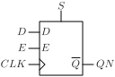
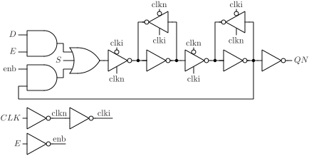

# DFESQN

D flip-flop with enable, synchronous set and output QN.

## Pin information

| Pin   | Description   |
| :-:    | :-            |
| D | Data input |
| CLK | Clock |
| E | Enable |
| S | Synchronous set |
| QN | Data output, inverted |
| VDD | Power supply |
| VSS | Ground |


## Truth table

| CLK | D | E | S | QN | Description | 
| :--- | :--- | :--- | :--- | :--- | :--- | 
| ↑ | 0 | 1 | 0 | 1 | Write 0 | 
| ↑ | 1 | 1 | 0 | 0 | Write 1 | 
| ↑ | - | 0 | 0 | QN | Write disabled | 
| ↑ | - | - | 1 | 0 | Set | 


## Symbol

<div align="center">

</div>

## Schematic

<div align="center">

</div>

## Verification simulation waveform

<picture>
  <source media="(prefers-color-scheme: dark)" srcset="https://svg.wavedrom.com/%7B%22signal%22%3A%5B%7B%22name%22%3A%22CLK%22%2C%22wave%22%3A%220.10101....0....1....0....101010.10.%22%7D%2C%7B%22name%22%3A%22D%22%2C%22wave%22%3A%220..1.0..1010101..010101010.1.0......%22%7D%2C%7B%22name%22%3A%22E%22%2C%22wave%22%3A%221........................0...1......%22%7D%2C%7B%22name%22%3A%22S%22%2C%22wave%22%3A%220...............................1..0%22%7D%2C%7B%22name%22%3A%22QN%22%2C%22wave%22%3A%220.1.0.1.........0.............1..0..%22%7D%5D%2C%22config%22%3A%7B%22skin%22%3A%22dark%22%7D%7D">
  
</picture>

## Cell variants

| Cell name <br> | Width <br> [unit sites] | Area <br> [\\(\mu m^2\\)] |
| :-        | :-:   | :-:   |
| [DFESQN_DL](#dfesqn_dl) | TBD | TBD |
| [DFESQN_D1](#dfesqn_d1) | TBD | TBD |
| [DFESQN_D2](#dfesqn_d2) | TBD | TBD |


### DFESQN_DL

#### Hierarchical SPICE netlist
```spice
.subckt DFESQN_DL D E S CLK QN VDD VSS
Xinv_clkn CLK clkn VDD VSS inv_par WN=3e-07 WP=4.5e-07 
Xinv_clki clkn clki VDD VSS inv_par WN=1.5e-07 WP=2.5e-07 
Xinv_enb E enb VDD VSS inv_par WN=1.5e-07 WP=2.3e-07 
XMNS net_pdn S VSS VSS sg13_lv_nmos w=1.5e-07 l=1.3e-07 ad={1.5e-07*3.1e-07} as={1.5e-07*3.1e-07} pd={2*(1.5e-07+3.1e-07)} ps={2*(1.5e-07+3.1e-07)} 
XMN0 nde E VSS VSS sg13_lv_nmos w=1.5e-07 l=1.3e-07 ad={1.5e-07*3.1e-07} as={1.5e-07*3.1e-07} pd={2*(1.5e-07+3.1e-07)} ps={2*(1.5e-07+3.1e-07)} 
XMN1 net_pdn D nde VSS sg13_lv_nmos w=1.5e-07 l=1.3e-07 ad={1.5e-07*3.1e-07} as={1.5e-07*3.1e-07} pd={2*(1.5e-07+3.1e-07)} ps={2*(1.5e-07+3.1e-07)} 
XMN2 nenbqi enb VSS VSS sg13_lv_nmos w=1.5e-07 l=1.3e-07 ad={1.5e-07*3.1e-07} as={1.5e-07*3.1e-07} pd={2*(1.5e-07+3.1e-07)} ps={2*(1.5e-07+3.1e-07)} 
XMN3 net_pdn qi nenbqi VSS sg13_lv_nmos w=1.5e-07 l=1.3e-07 ad={1.5e-07*3.1e-07} as={1.5e-07*3.1e-07} pd={2*(1.5e-07+3.1e-07)} ps={2*(1.5e-07+3.1e-07)} 
XMN4 dn clkn net_pdn VSS sg13_lv_nmos w=1.5e-07 l=1.3e-07 ad={1.5e-07*3.1e-07} as={1.5e-07*3.1e-07} pd={2*(1.5e-07+3.1e-07)} ps={2*(1.5e-07+3.1e-07)} 
XMPS nvdd S VDD VDD sg13_lv_pmos w=2e-07 l=1.3e-07 ad={2e-07*3.1e-07} as={2e-07*3.1e-07} pd={2*(2e-07+3.1e-07)} ps={2*(2e-07+3.1e-07)} 
XMP0 neqi E nvdd VDD sg13_lv_pmos w=2e-07 l=1.3e-07 ad={2e-07*3.1e-07} as={2e-07*3.1e-07} pd={2*(2e-07+3.1e-07)} ps={2*(2e-07+3.1e-07)} 
XMP1 net_pun qi neqi VDD sg13_lv_pmos w=2e-07 l=1.3e-07 ad={2e-07*3.1e-07} as={2e-07*3.1e-07} pd={2*(2e-07+3.1e-07)} ps={2*(2e-07+3.1e-07)} 
XMP2 nenbd enb nvdd VDD sg13_lv_pmos w=2e-07 l=1.3e-07 ad={2e-07*3.1e-07} as={2e-07*3.1e-07} pd={2*(2e-07+3.1e-07)} ps={2*(2e-07+3.1e-07)} 
XMP3 net_pun D nenbd VDD sg13_lv_pmos w=2e-07 l=1.3e-07 ad={2e-07*3.1e-07} as={2e-07*3.1e-07} pd={2*(2e-07+3.1e-07)} ps={2*(2e-07+3.1e-07)} 
XMP4 dn clki net_pun VDD sg13_lv_pmos w=2e-07 l=1.3e-07 ad={2e-07*3.1e-07} as={2e-07*3.1e-07} pd={2*(2e-07+3.1e-07)} ps={2*(2e-07+3.1e-07)} 
Xinv_ml dn di VDD VSS inv_par WN=2e-07 WP=4e-07 
Xinvz_mfb di clki clkn dn VDD VSS invz_par WN=1.5e-07 WP=3e-07 WEAK=1 
Xinvz_ms di clki clkn qin VDD VSS invz_par WN=6e-07 WP=9e-07 
Xinv_sl qin qi VDD VSS inv_par WN=3e-07 WP=5e-07 
Xinvz_sfb qi clkn clki qin VDD VSS invz_par WN=1.5e-07 WP=1.5e-07 
Xinv_QN qi QN VDD VSS inv_par WN=3.2e-07 WP=4.9e-07 
.ends
```

#### Flat SPICE netlist
```spice
.subckt DFESQN_DL D E S CLK QN VDD VSS
XMN0 n0 CLK VSS VSS sg13_lv_nmos w=3e-07 l=1.3e-07 ad=9.3e-14 as=9.3e-14 pd=1.22e-06 ps=1.22e-06 ng=1 
XMP0 n0 CLK VDD VDD sg13_lv_pmos w=4.5e-07 l=1.3e-07 ad=1.395e-13 as=1.395e-13 pd=1.52e-06 ps=1.52e-06 ng=1 
XMN1 n1 n0 VSS VSS sg13_lv_nmos w=1.5e-07 l=1.3e-07 ad=4.65e-14 as=4.65e-14 pd=9.2e-07 ps=9.2e-07 ng=1 
XMP1 n1 n0 VDD VDD sg13_lv_pmos w=2.5e-07 l=1.3e-07 ad=7.75e-14 as=7.75e-14 pd=1.12e-06 ps=1.12e-06 ng=1 
XMN2 n2 E VSS VSS sg13_lv_nmos w=1.5e-07 l=1.3e-07 ad=4.65e-14 as=4.65e-14 pd=9.2e-07 ps=9.2e-07 ng=1 
XMP2 n2 E VDD VDD sg13_lv_pmos w=2.3e-07 l=1.3e-07 ad=7.13e-14 as=7.13e-14 pd=1.08e-06 ps=1.08e-06 ng=1 
XMN3 n3 S VSS VSS sg13_lv_nmos w=1.5e-07 l=1.3e-07 ad=4.65e-14 as=4.65e-14 pd=9.2e-07 ps=9.2e-07 
XMN4 n4 E VSS VSS sg13_lv_nmos w=1.5e-07 l=1.3e-07 ad=4.65e-14 as=4.65e-14 pd=9.2e-07 ps=9.2e-07 
XMN5 n3 D n4 VSS sg13_lv_nmos w=1.5e-07 l=1.3e-07 ad=4.65e-14 as=4.65e-14 pd=9.2e-07 ps=9.2e-07 
XMN6 n5 n2 VSS VSS sg13_lv_nmos w=1.5e-07 l=1.3e-07 ad=4.65e-14 as=4.65e-14 pd=9.2e-07 ps=9.2e-07 
XMN7 n3 n6 n5 VSS sg13_lv_nmos w=1.5e-07 l=1.3e-07 ad=4.65e-14 as=4.65e-14 pd=9.2e-07 ps=9.2e-07 
XMN8 n7 n0 n3 VSS sg13_lv_nmos w=1.5e-07 l=1.3e-07 ad=4.65e-14 as=4.65e-14 pd=9.2e-07 ps=9.2e-07 
XMP3 n8 S VDD VDD sg13_lv_pmos w=2e-07 l=1.3e-07 ad=6.2e-14 as=6.2e-14 pd=1.02e-06 ps=1.02e-06 
XMP4 n9 E n8 VDD sg13_lv_pmos w=2e-07 l=1.3e-07 ad=6.2e-14 as=6.2e-14 pd=1.02e-06 ps=1.02e-06 
XMP5 n10 n6 n9 VDD sg13_lv_pmos w=2e-07 l=1.3e-07 ad=6.2e-14 as=6.2e-14 pd=1.02e-06 ps=1.02e-06 
XMP6 n11 n2 n8 VDD sg13_lv_pmos w=2e-07 l=1.3e-07 ad=6.2e-14 as=6.2e-14 pd=1.02e-06 ps=1.02e-06 
XMP7 n10 D n11 VDD sg13_lv_pmos w=2e-07 l=1.3e-07 ad=6.2e-14 as=6.2e-14 pd=1.02e-06 ps=1.02e-06 
XMP8 n7 n1 n10 VDD sg13_lv_pmos w=2e-07 l=1.3e-07 ad=6.2e-14 as=6.2e-14 pd=1.02e-06 ps=1.02e-06 
XMN9 n12 n7 VSS VSS sg13_lv_nmos w=2e-07 l=1.3e-07 ad=6.2e-14 as=6.2e-14 pd=1.02e-06 ps=1.02e-06 ng=1 
XMP9 n12 n7 VDD VDD sg13_lv_pmos w=4e-07 l=1.3e-07 ad=1.24e-13 as=1.24e-13 pd=1.42e-06 ps=1.42e-06 ng=1 
XMN10 n7 n1 n13 VSS sg13_lv_nmos w=1.5e-07 l=1.3e-07 ad=4.65e-14 as=4.65e-14 pd=9.2e-07 ps=9.2e-07 ng=1 
XMN11 n13 n12 VSS VSS sg13_lv_nmos w=1.5e-07 l=1.3e-07 ad=4.65e-14 as=4.65e-14 pd=9.2e-07 ps=9.2e-07 ng=1 
XMP10 n7 n0 n14 VDD sg13_lv_pmos w=3e-07 l=1.3e-07 ad=9.3e-14 as=9.3e-14 pd=1.22e-06 ps=1.22e-06 ng=1 
XMP11 n14 n12 VDD VDD sg13_lv_pmos w=3e-07 l=1.3e-07 ad=9.3e-14 as=9.3e-14 pd=1.22e-06 ps=1.22e-06 ng=1 
XMN12 n15 n1 n16 VSS sg13_lv_nmos w=6e-07 l=1.3e-07 ad=1.86e-13 as=1.86e-13 pd=1.82e-06 ps=1.82e-06 ng=1 
XMN13 n16 n12 VSS VSS sg13_lv_nmos w=6e-07 l=1.3e-07 ad=1.86e-13 as=1.86e-13 pd=1.82e-06 ps=1.82e-06 ng=1 
XMP12 n15 n0 n17 VDD sg13_lv_pmos w=9e-07 l=1.3e-07 ad=2.79e-13 as=2.79e-13 pd=2.42e-06 ps=2.42e-06 ng=1 
XMP13 n17 n12 VDD VDD sg13_lv_pmos w=9e-07 l=1.3e-07 ad=2.79e-13 as=2.79e-13 pd=2.42e-06 ps=2.42e-06 ng=1 
XMN14 n6 n15 VSS VSS sg13_lv_nmos w=3e-07 l=1.3e-07 ad=9.3e-14 as=9.3e-14 pd=1.22e-06 ps=1.22e-06 ng=1 
XMP14 n6 n15 VDD VDD sg13_lv_pmos w=5e-07 l=1.3e-07 ad=1.55e-13 as=1.55e-13 pd=1.62e-06 ps=1.62e-06 ng=1 
XMN15 n15 n0 n18 VSS sg13_lv_nmos w=1.5e-07 l=1.3e-07 ad=4.65e-14 as=4.65e-14 pd=9.2e-07 ps=9.2e-07 ng=1 
XMN16 n18 n6 VSS VSS sg13_lv_nmos w=1.5e-07 l=1.3e-07 ad=4.65e-14 as=4.65e-14 pd=9.2e-07 ps=9.2e-07 ng=1 
XMP15 n15 n1 n19 VDD sg13_lv_pmos w=1.5e-07 l=1.3e-07 ad=4.65e-14 as=4.65e-14 pd=9.2e-07 ps=9.2e-07 ng=1 
XMP16 n19 n6 VDD VDD sg13_lv_pmos w=1.5e-07 l=1.3e-07 ad=4.65e-14 as=4.65e-14 pd=9.2e-07 ps=9.2e-07 ng=1 
XMN17 QN n6 VSS VSS sg13_lv_nmos w=3.2e-07 l=1.3e-07 ad=9.92e-14 as=9.92e-14 pd=1.26e-06 ps=1.26e-06 ng=1 
XMP17 QN n6 VDD VDD sg13_lv_pmos w=4.9e-07 l=1.3e-07 ad=1.519e-13 as=1.519e-13 pd=1.6e-06 ps=1.6e-06 ng=1 
.ends
```

#### CDL netlist
```cdl
.SUBCKT DFESQN_DL D E S CLK QN VDD VSS
*.PININFO CLK:I D:I E:I S:I QN:O VDD:B VSS:B 
MN0 n0 CLK VSS VSS sg13_lv_nmos w=3e-07 l=1.3e-07 ng=1 
MP0 n0 CLK VDD VDD sg13_lv_pmos w=4.5e-07 l=1.3e-07 ng=1 
MN1 n1 n0 VSS VSS sg13_lv_nmos w=1.5e-07 l=1.3e-07 ng=1 
MP1 n1 n0 VDD VDD sg13_lv_pmos w=2.5e-07 l=1.3e-07 ng=1 
MN2 n2 E VSS VSS sg13_lv_nmos w=1.5e-07 l=1.3e-07 ng=1 
MP2 n2 E VDD VDD sg13_lv_pmos w=2.3e-07 l=1.3e-07 ng=1 
MN3 n3 S VSS VSS sg13_lv_nmos w=1.5e-07 l=1.3e-07 
MN4 n4 E VSS VSS sg13_lv_nmos w=1.5e-07 l=1.3e-07 
MN5 n3 D n4 VSS sg13_lv_nmos w=1.5e-07 l=1.3e-07 
MN6 n5 n2 VSS VSS sg13_lv_nmos w=1.5e-07 l=1.3e-07 
MN7 n3 n6 n5 VSS sg13_lv_nmos w=1.5e-07 l=1.3e-07 
MN8 n7 n0 n3 VSS sg13_lv_nmos w=1.5e-07 l=1.3e-07 
MP3 n8 S VDD VDD sg13_lv_pmos w=2e-07 l=1.3e-07 
MP4 n9 E n8 VDD sg13_lv_pmos w=2e-07 l=1.3e-07 
MP5 n10 n6 n9 VDD sg13_lv_pmos w=2e-07 l=1.3e-07 
MP6 n11 n2 n8 VDD sg13_lv_pmos w=2e-07 l=1.3e-07 
MP7 n10 D n11 VDD sg13_lv_pmos w=2e-07 l=1.3e-07 
MP8 n7 n1 n10 VDD sg13_lv_pmos w=2e-07 l=1.3e-07 
MN9 n12 n7 VSS VSS sg13_lv_nmos w=2e-07 l=1.3e-07 ng=1 
MP9 n12 n7 VDD VDD sg13_lv_pmos w=4e-07 l=1.3e-07 ng=1 
MN10 n7 n1 n13 VSS sg13_lv_nmos w=1.5e-07 l=1.3e-07 ng=1 
MN11 n13 n12 VSS VSS sg13_lv_nmos w=1.5e-07 l=1.3e-07 ng=1 
MP10 n7 n0 n14 VDD sg13_lv_pmos w=3e-07 l=1.3e-07 ng=1 
MP11 n14 n12 VDD VDD sg13_lv_pmos w=3e-07 l=1.3e-07 ng=1 
MN12 n15 n1 n16 VSS sg13_lv_nmos w=6e-07 l=1.3e-07 ng=1 
MN13 n16 n12 VSS VSS sg13_lv_nmos w=6e-07 l=1.3e-07 ng=1 
MP12 n15 n0 n17 VDD sg13_lv_pmos w=9e-07 l=1.3e-07 ng=1 
MP13 n17 n12 VDD VDD sg13_lv_pmos w=9e-07 l=1.3e-07 ng=1 
MN14 n6 n15 VSS VSS sg13_lv_nmos w=3e-07 l=1.3e-07 ng=1 
MP14 n6 n15 VDD VDD sg13_lv_pmos w=5e-07 l=1.3e-07 ng=1 
MN15 n15 n0 n18 VSS sg13_lv_nmos w=1.5e-07 l=1.3e-07 ng=1 
MN16 n18 n6 VSS VSS sg13_lv_nmos w=1.5e-07 l=1.3e-07 ng=1 
MP15 n15 n1 n19 VDD sg13_lv_pmos w=1.5e-07 l=1.3e-07 ng=1 
MP16 n19 n6 VDD VDD sg13_lv_pmos w=1.5e-07 l=1.3e-07 ng=1 
MN17 QN n6 VSS VSS sg13_lv_nmos w=3.2e-07 l=1.3e-07 ng=1 
MP17 QN n6 VDD VDD sg13_lv_pmos w=4.9e-07 l=1.3e-07 ng=1 
.ENDS
```

#### Layout

<div align="center">

</div>

### DFESQN_D1

#### Hierarchical SPICE netlist
```spice
.subckt DFESQN_D1 D E S CLK QN VDD VSS
Xinv_clkn CLK clkn VDD VSS inv_par WN=3e-07 WP=4.5e-07 
Xinv_clki clkn clki VDD VSS inv_par WN=1.5e-07 WP=2.5e-07 
Xinv_enb E enb VDD VSS inv_par WN=1.5e-07 WP=2.3e-07 
XMNS net_pdn S VSS VSS sg13_lv_nmos w=1.5e-07 l=1.3e-07 ad={1.5e-07*3.1e-07} as={1.5e-07*3.1e-07} pd={2*(1.5e-07+3.1e-07)} ps={2*(1.5e-07+3.1e-07)} 
XMN0 nde E VSS VSS sg13_lv_nmos w=1.5e-07 l=1.3e-07 ad={1.5e-07*3.1e-07} as={1.5e-07*3.1e-07} pd={2*(1.5e-07+3.1e-07)} ps={2*(1.5e-07+3.1e-07)} 
XMN1 net_pdn D nde VSS sg13_lv_nmos w=1.5e-07 l=1.3e-07 ad={1.5e-07*3.1e-07} as={1.5e-07*3.1e-07} pd={2*(1.5e-07+3.1e-07)} ps={2*(1.5e-07+3.1e-07)} 
XMN2 nenbqi enb VSS VSS sg13_lv_nmos w=1.5e-07 l=1.3e-07 ad={1.5e-07*3.1e-07} as={1.5e-07*3.1e-07} pd={2*(1.5e-07+3.1e-07)} ps={2*(1.5e-07+3.1e-07)} 
XMN3 net_pdn qi nenbqi VSS sg13_lv_nmos w=1.5e-07 l=1.3e-07 ad={1.5e-07*3.1e-07} as={1.5e-07*3.1e-07} pd={2*(1.5e-07+3.1e-07)} ps={2*(1.5e-07+3.1e-07)} 
XMN4 dn clkn net_pdn VSS sg13_lv_nmos w=1.5e-07 l=1.3e-07 ad={1.5e-07*3.1e-07} as={1.5e-07*3.1e-07} pd={2*(1.5e-07+3.1e-07)} ps={2*(1.5e-07+3.1e-07)} 
XMPS nvdd S VDD VDD sg13_lv_pmos w=2e-07 l=1.3e-07 ad={2e-07*3.1e-07} as={2e-07*3.1e-07} pd={2*(2e-07+3.1e-07)} ps={2*(2e-07+3.1e-07)} 
XMP0 neqi E nvdd VDD sg13_lv_pmos w=2e-07 l=1.3e-07 ad={2e-07*3.1e-07} as={2e-07*3.1e-07} pd={2*(2e-07+3.1e-07)} ps={2*(2e-07+3.1e-07)} 
XMP1 net_pun qi neqi VDD sg13_lv_pmos w=2e-07 l=1.3e-07 ad={2e-07*3.1e-07} as={2e-07*3.1e-07} pd={2*(2e-07+3.1e-07)} ps={2*(2e-07+3.1e-07)} 
XMP2 nenbd enb nvdd VDD sg13_lv_pmos w=2e-07 l=1.3e-07 ad={2e-07*3.1e-07} as={2e-07*3.1e-07} pd={2*(2e-07+3.1e-07)} ps={2*(2e-07+3.1e-07)} 
XMP3 net_pun D nenbd VDD sg13_lv_pmos w=2e-07 l=1.3e-07 ad={2e-07*3.1e-07} as={2e-07*3.1e-07} pd={2*(2e-07+3.1e-07)} ps={2*(2e-07+3.1e-07)} 
XMP4 dn clki net_pun VDD sg13_lv_pmos w=2e-07 l=1.3e-07 ad={2e-07*3.1e-07} as={2e-07*3.1e-07} pd={2*(2e-07+3.1e-07)} ps={2*(2e-07+3.1e-07)} 
Xinv_ml dn di VDD VSS inv_par WN=2e-07 WP=4e-07 
Xinvz_mfb di clki clkn dn VDD VSS invz_par WN=1.5e-07 WP=3e-07 WEAK=1 
Xinvz_ms di clki clkn qin VDD VSS invz_par WN=6e-07 WP=9e-07 
Xinv_sl qin qi VDD VSS inv_par WN=3e-07 WP=5e-07 
Xinvz_sfb qi clkn clki qin VDD VSS invz_par WN=1.5e-07 WP=1.5e-07 
Xinv_QN qi QN VDD VSS inv_par WN=6.4e-07 WP=9.8e-07 
.ends
```

#### Flat SPICE netlist
```spice
.subckt DFESQN_D1 D E S CLK QN VDD VSS
XMN0 n0 CLK VSS VSS sg13_lv_nmos w=3e-07 l=1.3e-07 ad=9.3e-14 as=9.3e-14 pd=1.22e-06 ps=1.22e-06 ng=1 
XMP0 n0 CLK VDD VDD sg13_lv_pmos w=4.5e-07 l=1.3e-07 ad=1.395e-13 as=1.395e-13 pd=1.52e-06 ps=1.52e-06 ng=1 
XMN1 n1 n0 VSS VSS sg13_lv_nmos w=1.5e-07 l=1.3e-07 ad=4.65e-14 as=4.65e-14 pd=9.2e-07 ps=9.2e-07 ng=1 
XMP1 n1 n0 VDD VDD sg13_lv_pmos w=2.5e-07 l=1.3e-07 ad=7.75e-14 as=7.75e-14 pd=1.12e-06 ps=1.12e-06 ng=1 
XMN2 n2 E VSS VSS sg13_lv_nmos w=1.5e-07 l=1.3e-07 ad=4.65e-14 as=4.65e-14 pd=9.2e-07 ps=9.2e-07 ng=1 
XMP2 n2 E VDD VDD sg13_lv_pmos w=2.3e-07 l=1.3e-07 ad=7.13e-14 as=7.13e-14 pd=1.08e-06 ps=1.08e-06 ng=1 
XMN3 n3 S VSS VSS sg13_lv_nmos w=1.5e-07 l=1.3e-07 ad=4.65e-14 as=4.65e-14 pd=9.2e-07 ps=9.2e-07 
XMN4 n4 E VSS VSS sg13_lv_nmos w=1.5e-07 l=1.3e-07 ad=4.65e-14 as=4.65e-14 pd=9.2e-07 ps=9.2e-07 
XMN5 n3 D n4 VSS sg13_lv_nmos w=1.5e-07 l=1.3e-07 ad=4.65e-14 as=4.65e-14 pd=9.2e-07 ps=9.2e-07 
XMN6 n5 n2 VSS VSS sg13_lv_nmos w=1.5e-07 l=1.3e-07 ad=4.65e-14 as=4.65e-14 pd=9.2e-07 ps=9.2e-07 
XMN7 n3 n6 n5 VSS sg13_lv_nmos w=1.5e-07 l=1.3e-07 ad=4.65e-14 as=4.65e-14 pd=9.2e-07 ps=9.2e-07 
XMN8 n7 n0 n3 VSS sg13_lv_nmos w=1.5e-07 l=1.3e-07 ad=4.65e-14 as=4.65e-14 pd=9.2e-07 ps=9.2e-07 
XMP3 n8 S VDD VDD sg13_lv_pmos w=2e-07 l=1.3e-07 ad=6.2e-14 as=6.2e-14 pd=1.02e-06 ps=1.02e-06 
XMP4 n9 E n8 VDD sg13_lv_pmos w=2e-07 l=1.3e-07 ad=6.2e-14 as=6.2e-14 pd=1.02e-06 ps=1.02e-06 
XMP5 n10 n6 n9 VDD sg13_lv_pmos w=2e-07 l=1.3e-07 ad=6.2e-14 as=6.2e-14 pd=1.02e-06 ps=1.02e-06 
XMP6 n11 n2 n8 VDD sg13_lv_pmos w=2e-07 l=1.3e-07 ad=6.2e-14 as=6.2e-14 pd=1.02e-06 ps=1.02e-06 
XMP7 n10 D n11 VDD sg13_lv_pmos w=2e-07 l=1.3e-07 ad=6.2e-14 as=6.2e-14 pd=1.02e-06 ps=1.02e-06 
XMP8 n7 n1 n10 VDD sg13_lv_pmos w=2e-07 l=1.3e-07 ad=6.2e-14 as=6.2e-14 pd=1.02e-06 ps=1.02e-06 
XMN9 n12 n7 VSS VSS sg13_lv_nmos w=2e-07 l=1.3e-07 ad=6.2e-14 as=6.2e-14 pd=1.02e-06 ps=1.02e-06 ng=1 
XMP9 n12 n7 VDD VDD sg13_lv_pmos w=4e-07 l=1.3e-07 ad=1.24e-13 as=1.24e-13 pd=1.42e-06 ps=1.42e-06 ng=1 
XMN10 n7 n1 n13 VSS sg13_lv_nmos w=1.5e-07 l=1.3e-07 ad=4.65e-14 as=4.65e-14 pd=9.2e-07 ps=9.2e-07 ng=1 
XMN11 n13 n12 VSS VSS sg13_lv_nmos w=1.5e-07 l=1.3e-07 ad=4.65e-14 as=4.65e-14 pd=9.2e-07 ps=9.2e-07 ng=1 
XMP10 n7 n0 n14 VDD sg13_lv_pmos w=3e-07 l=1.3e-07 ad=9.3e-14 as=9.3e-14 pd=1.22e-06 ps=1.22e-06 ng=1 
XMP11 n14 n12 VDD VDD sg13_lv_pmos w=3e-07 l=1.3e-07 ad=9.3e-14 as=9.3e-14 pd=1.22e-06 ps=1.22e-06 ng=1 
XMN12 n15 n1 n16 VSS sg13_lv_nmos w=6e-07 l=1.3e-07 ad=1.86e-13 as=1.86e-13 pd=1.82e-06 ps=1.82e-06 ng=1 
XMN13 n16 n12 VSS VSS sg13_lv_nmos w=6e-07 l=1.3e-07 ad=1.86e-13 as=1.86e-13 pd=1.82e-06 ps=1.82e-06 ng=1 
XMP12 n15 n0 n17 VDD sg13_lv_pmos w=9e-07 l=1.3e-07 ad=2.79e-13 as=2.79e-13 pd=2.42e-06 ps=2.42e-06 ng=1 
XMP13 n17 n12 VDD VDD sg13_lv_pmos w=9e-07 l=1.3e-07 ad=2.79e-13 as=2.79e-13 pd=2.42e-06 ps=2.42e-06 ng=1 
XMN14 n6 n15 VSS VSS sg13_lv_nmos w=3e-07 l=1.3e-07 ad=9.3e-14 as=9.3e-14 pd=1.22e-06 ps=1.22e-06 ng=1 
XMP14 n6 n15 VDD VDD sg13_lv_pmos w=5e-07 l=1.3e-07 ad=1.55e-13 as=1.55e-13 pd=1.62e-06 ps=1.62e-06 ng=1 
XMN15 n15 n0 n18 VSS sg13_lv_nmos w=1.5e-07 l=1.3e-07 ad=4.65e-14 as=4.65e-14 pd=9.2e-07 ps=9.2e-07 ng=1 
XMN16 n18 n6 VSS VSS sg13_lv_nmos w=1.5e-07 l=1.3e-07 ad=4.65e-14 as=4.65e-14 pd=9.2e-07 ps=9.2e-07 ng=1 
XMP15 n15 n1 n19 VDD sg13_lv_pmos w=1.5e-07 l=1.3e-07 ad=4.65e-14 as=4.65e-14 pd=9.2e-07 ps=9.2e-07 ng=1 
XMP16 n19 n6 VDD VDD sg13_lv_pmos w=1.5e-07 l=1.3e-07 ad=4.65e-14 as=4.65e-14 pd=9.2e-07 ps=9.2e-07 ng=1 
XMN17 QN n6 VSS VSS sg13_lv_nmos w=6.4e-07 l=1.3e-07 ad=1.984e-13 as=1.984e-13 pd=1.9e-06 ps=1.9e-06 ng=1 
XMP17 QN n6 VDD VDD sg13_lv_pmos w=9.8e-07 l=1.3e-07 ad=3.038e-13 as=3.038e-13 pd=2.58e-06 ps=2.58e-06 ng=1 
.ends
```

#### CDL netlist
```cdl
.SUBCKT DFESQN_D1 D E S CLK QN VDD VSS
*.PININFO CLK:I D:I E:I S:I QN:O VDD:B VSS:B 
MN0 n0 CLK VSS VSS sg13_lv_nmos w=3e-07 l=1.3e-07 ng=1 
MP0 n0 CLK VDD VDD sg13_lv_pmos w=4.5e-07 l=1.3e-07 ng=1 
MN1 n1 n0 VSS VSS sg13_lv_nmos w=1.5e-07 l=1.3e-07 ng=1 
MP1 n1 n0 VDD VDD sg13_lv_pmos w=2.5e-07 l=1.3e-07 ng=1 
MN2 n2 E VSS VSS sg13_lv_nmos w=1.5e-07 l=1.3e-07 ng=1 
MP2 n2 E VDD VDD sg13_lv_pmos w=2.3e-07 l=1.3e-07 ng=1 
MN3 n3 S VSS VSS sg13_lv_nmos w=1.5e-07 l=1.3e-07 
MN4 n4 E VSS VSS sg13_lv_nmos w=1.5e-07 l=1.3e-07 
MN5 n3 D n4 VSS sg13_lv_nmos w=1.5e-07 l=1.3e-07 
MN6 n5 n2 VSS VSS sg13_lv_nmos w=1.5e-07 l=1.3e-07 
MN7 n3 n6 n5 VSS sg13_lv_nmos w=1.5e-07 l=1.3e-07 
MN8 n7 n0 n3 VSS sg13_lv_nmos w=1.5e-07 l=1.3e-07 
MP3 n8 S VDD VDD sg13_lv_pmos w=2e-07 l=1.3e-07 
MP4 n9 E n8 VDD sg13_lv_pmos w=2e-07 l=1.3e-07 
MP5 n10 n6 n9 VDD sg13_lv_pmos w=2e-07 l=1.3e-07 
MP6 n11 n2 n8 VDD sg13_lv_pmos w=2e-07 l=1.3e-07 
MP7 n10 D n11 VDD sg13_lv_pmos w=2e-07 l=1.3e-07 
MP8 n7 n1 n10 VDD sg13_lv_pmos w=2e-07 l=1.3e-07 
MN9 n12 n7 VSS VSS sg13_lv_nmos w=2e-07 l=1.3e-07 ng=1 
MP9 n12 n7 VDD VDD sg13_lv_pmos w=4e-07 l=1.3e-07 ng=1 
MN10 n7 n1 n13 VSS sg13_lv_nmos w=1.5e-07 l=1.3e-07 ng=1 
MN11 n13 n12 VSS VSS sg13_lv_nmos w=1.5e-07 l=1.3e-07 ng=1 
MP10 n7 n0 n14 VDD sg13_lv_pmos w=3e-07 l=1.3e-07 ng=1 
MP11 n14 n12 VDD VDD sg13_lv_pmos w=3e-07 l=1.3e-07 ng=1 
MN12 n15 n1 n16 VSS sg13_lv_nmos w=6e-07 l=1.3e-07 ng=1 
MN13 n16 n12 VSS VSS sg13_lv_nmos w=6e-07 l=1.3e-07 ng=1 
MP12 n15 n0 n17 VDD sg13_lv_pmos w=9e-07 l=1.3e-07 ng=1 
MP13 n17 n12 VDD VDD sg13_lv_pmos w=9e-07 l=1.3e-07 ng=1 
MN14 n6 n15 VSS VSS sg13_lv_nmos w=3e-07 l=1.3e-07 ng=1 
MP14 n6 n15 VDD VDD sg13_lv_pmos w=5e-07 l=1.3e-07 ng=1 
MN15 n15 n0 n18 VSS sg13_lv_nmos w=1.5e-07 l=1.3e-07 ng=1 
MN16 n18 n6 VSS VSS sg13_lv_nmos w=1.5e-07 l=1.3e-07 ng=1 
MP15 n15 n1 n19 VDD sg13_lv_pmos w=1.5e-07 l=1.3e-07 ng=1 
MP16 n19 n6 VDD VDD sg13_lv_pmos w=1.5e-07 l=1.3e-07 ng=1 
MN17 QN n6 VSS VSS sg13_lv_nmos w=6.4e-07 l=1.3e-07 ng=1 
MP17 QN n6 VDD VDD sg13_lv_pmos w=9.8e-07 l=1.3e-07 ng=1 
.ENDS
```

#### Layout

<div align="center">

</div>

### DFESQN_D2

#### Hierarchical SPICE netlist
```spice
.subckt DFESQN_D2 D E S CLK QN VDD VSS
Xinv_clkn CLK clkn VDD VSS inv_par WN=6.4e-07 WP=9.8e-07 
Xinv_clki clkn clki VDD VSS inv_par WN=3e-07 WP=5e-07 
Xinv_enb E enb VDD VSS inv_par WN=1.5e-07 WP=3e-07 
XMNS net_pdn S VSS VSS sg13_lv_nmos w=3e-07 l=1.3e-07 ad={3e-07*3.1e-07} as={3e-07*3.1e-07} pd={2*(3e-07+3.1e-07)} ps={2*(3e-07+3.1e-07)} 
XMN0 nde E VSS VSS sg13_lv_nmos w=3e-07 l=1.3e-07 ad={3e-07*3.1e-07} as={3e-07*3.1e-07} pd={2*(3e-07+3.1e-07)} ps={2*(3e-07+3.1e-07)} 
XMN1 net_pdn D nde VSS sg13_lv_nmos w=3e-07 l=1.3e-07 ad={3e-07*3.1e-07} as={3e-07*3.1e-07} pd={2*(3e-07+3.1e-07)} ps={2*(3e-07+3.1e-07)} 
XMN2 nenbqi enb VSS VSS sg13_lv_nmos w=3e-07 l=1.3e-07 ad={3e-07*3.1e-07} as={3e-07*3.1e-07} pd={2*(3e-07+3.1e-07)} ps={2*(3e-07+3.1e-07)} 
XMN3 net_pdn qi nenbqi VSS sg13_lv_nmos w=3e-07 l=1.3e-07 ad={3e-07*3.1e-07} as={3e-07*3.1e-07} pd={2*(3e-07+3.1e-07)} ps={2*(3e-07+3.1e-07)} 
XMN4 dn clkn net_pdn VSS sg13_lv_nmos w=3e-07 l=1.3e-07 ad={3e-07*3.1e-07} as={3e-07*3.1e-07} pd={2*(3e-07+3.1e-07)} ps={2*(3e-07+3.1e-07)} 
XMPS nvdd S VDD VDD sg13_lv_pmos w=4.2e-07 l=1.3e-07 ad={4.2e-07*3.1e-07} as={4.2e-07*3.1e-07} pd={2*(4.2e-07+3.1e-07)} ps={2*(4.2e-07+3.1e-07)} 
XMP0 neqi E nvdd VDD sg13_lv_pmos w=4.2e-07 l=1.3e-07 ad={4.2e-07*3.1e-07} as={4.2e-07*3.1e-07} pd={2*(4.2e-07+3.1e-07)} ps={2*(4.2e-07+3.1e-07)} 
XMP1 net_pun qi neqi VDD sg13_lv_pmos w=4.2e-07 l=1.3e-07 ad={4.2e-07*3.1e-07} as={4.2e-07*3.1e-07} pd={2*(4.2e-07+3.1e-07)} ps={2*(4.2e-07+3.1e-07)} 
XMP2 nenbd enb nvdd VDD sg13_lv_pmos w=4.2e-07 l=1.3e-07 ad={4.2e-07*3.1e-07} as={4.2e-07*3.1e-07} pd={2*(4.2e-07+3.1e-07)} ps={2*(4.2e-07+3.1e-07)} 
XMP3 net_pun D nenbd VDD sg13_lv_pmos w=4.2e-07 l=1.3e-07 ad={4.2e-07*3.1e-07} as={4.2e-07*3.1e-07} pd={2*(4.2e-07+3.1e-07)} ps={2*(4.2e-07+3.1e-07)} 
XMP4 dn clki net_pun VDD sg13_lv_pmos w=4.2e-07 l=1.3e-07 ad={4.2e-07*3.1e-07} as={4.2e-07*3.1e-07} pd={2*(4.2e-07+3.1e-07)} ps={2*(4.2e-07+3.1e-07)} 
Xinv_ml dn di VDD VSS inv_par WN=4e-07 WP=6e-07 
Xinvz_mfb di clki clkn dn VDD VSS invz_par WN=1.5e-07 WP=2.3e-07 WEAK=1 
Xinvz1_ms di clki clkn qin VDD VSS invz_par WN=6.4e-07 WP=9.8e-07 
Xinvz2_ms di clki clkn qin VDD VSS invz_par WN=6.4e-07 WP=9.8e-07 
Xinv_sl qin qi VDD VSS inv_par WN=6.4e-07 WP=9.8e-07 
Xinvz_sfb qi clkn clki qin VDD VSS invz_par WN=1.5e-07 WP=1.5e-07 
Xinv_QN qi QN VDD VSS inv_par WN=1.07e-06 WP=1.6e-06 
.ends
```

#### Flat SPICE netlist
```spice
.subckt DFESQN_D2 D E S CLK QN VDD VSS
XMN0 n0 CLK VSS VSS sg13_lv_nmos w=6.4e-07 l=1.3e-07 ad=1.984e-13 as=1.984e-13 pd=1.9e-06 ps=1.9e-06 ng=1 
XMP0 n0 CLK VDD VDD sg13_lv_pmos w=9.8e-07 l=1.3e-07 ad=3.038e-13 as=3.038e-13 pd=2.58e-06 ps=2.58e-06 ng=1 
XMN1 n1 n0 VSS VSS sg13_lv_nmos w=3e-07 l=1.3e-07 ad=9.3e-14 as=9.3e-14 pd=1.22e-06 ps=1.22e-06 ng=1 
XMP1 n1 n0 VDD VDD sg13_lv_pmos w=5e-07 l=1.3e-07 ad=1.55e-13 as=1.55e-13 pd=1.62e-06 ps=1.62e-06 ng=1 
XMN2 n2 E VSS VSS sg13_lv_nmos w=1.5e-07 l=1.3e-07 ad=4.65e-14 as=4.65e-14 pd=9.2e-07 ps=9.2e-07 ng=1 
XMP2 n2 E VDD VDD sg13_lv_pmos w=3e-07 l=1.3e-07 ad=9.3e-14 as=9.3e-14 pd=1.22e-06 ps=1.22e-06 ng=1 
XMN3 n3 S VSS VSS sg13_lv_nmos w=3e-07 l=1.3e-07 ad=9.3e-14 as=9.3e-14 pd=1.22e-06 ps=1.22e-06 
XMN4 n4 E VSS VSS sg13_lv_nmos w=3e-07 l=1.3e-07 ad=9.3e-14 as=9.3e-14 pd=1.22e-06 ps=1.22e-06 
XMN5 n3 D n4 VSS sg13_lv_nmos w=3e-07 l=1.3e-07 ad=9.3e-14 as=9.3e-14 pd=1.22e-06 ps=1.22e-06 
XMN6 n5 n2 VSS VSS sg13_lv_nmos w=3e-07 l=1.3e-07 ad=9.3e-14 as=9.3e-14 pd=1.22e-06 ps=1.22e-06 
XMN7 n3 n6 n5 VSS sg13_lv_nmos w=3e-07 l=1.3e-07 ad=9.3e-14 as=9.3e-14 pd=1.22e-06 ps=1.22e-06 
XMN8 n7 n0 n3 VSS sg13_lv_nmos w=3e-07 l=1.3e-07 ad=9.3e-14 as=9.3e-14 pd=1.22e-06 ps=1.22e-06 
XMP3 n8 S VDD VDD sg13_lv_pmos w=4.2e-07 l=1.3e-07 ad=1.302e-13 as=1.302e-13 pd=1.46e-06 ps=1.46e-06 
XMP4 n9 E n8 VDD sg13_lv_pmos w=4.2e-07 l=1.3e-07 ad=1.302e-13 as=1.302e-13 pd=1.46e-06 ps=1.46e-06 
XMP5 n10 n6 n9 VDD sg13_lv_pmos w=4.2e-07 l=1.3e-07 ad=1.302e-13 as=1.302e-13 pd=1.46e-06 ps=1.46e-06 
XMP6 n11 n2 n8 VDD sg13_lv_pmos w=4.2e-07 l=1.3e-07 ad=1.302e-13 as=1.302e-13 pd=1.46e-06 ps=1.46e-06 
XMP7 n10 D n11 VDD sg13_lv_pmos w=4.2e-07 l=1.3e-07 ad=1.302e-13 as=1.302e-13 pd=1.46e-06 ps=1.46e-06 
XMP8 n7 n1 n10 VDD sg13_lv_pmos w=4.2e-07 l=1.3e-07 ad=1.302e-13 as=1.302e-13 pd=1.46e-06 ps=1.46e-06 
XMN9 n12 n7 VSS VSS sg13_lv_nmos w=4e-07 l=1.3e-07 ad=1.24e-13 as=1.24e-13 pd=1.42e-06 ps=1.42e-06 ng=1 
XMP9 n12 n7 VDD VDD sg13_lv_pmos w=6e-07 l=1.3e-07 ad=1.86e-13 as=1.86e-13 pd=1.82e-06 ps=1.82e-06 ng=1 
XMN10 n7 n1 n13 VSS sg13_lv_nmos w=1.5e-07 l=1.3e-07 ad=4.65e-14 as=4.65e-14 pd=9.2e-07 ps=9.2e-07 ng=1 
XMN11 n13 n12 VSS VSS sg13_lv_nmos w=1.5e-07 l=1.3e-07 ad=4.65e-14 as=4.65e-14 pd=9.2e-07 ps=9.2e-07 ng=1 
XMP10 n7 n0 n14 VDD sg13_lv_pmos w=2.3e-07 l=1.3e-07 ad=7.13e-14 as=7.13e-14 pd=1.08e-06 ps=1.08e-06 ng=1 
XMP11 n14 n12 VDD VDD sg13_lv_pmos w=2.3e-07 l=1.3e-07 ad=7.13e-14 as=7.13e-14 pd=1.08e-06 ps=1.08e-06 ng=1 
XMN12 n15 n1 n16 VSS sg13_lv_nmos w=6.4e-07 l=1.3e-07 ad=1.984e-13 as=1.984e-13 pd=1.9e-06 ps=1.9e-06 ng=1 
XMN13 n16 n12 VSS VSS sg13_lv_nmos w=6.4e-07 l=1.3e-07 ad=1.984e-13 as=1.984e-13 pd=1.9e-06 ps=1.9e-06 ng=1 
XMP12 n15 n0 n17 VDD sg13_lv_pmos w=9.8e-07 l=1.3e-07 ad=3.038e-13 as=3.038e-13 pd=2.58e-06 ps=2.58e-06 ng=1 
XMP13 n17 n12 VDD VDD sg13_lv_pmos w=9.8e-07 l=1.3e-07 ad=3.038e-13 as=3.038e-13 pd=2.58e-06 ps=2.58e-06 ng=1 
XMN14 n15 n1 n18 VSS sg13_lv_nmos w=6.4e-07 l=1.3e-07 ad=1.984e-13 as=1.984e-13 pd=1.9e-06 ps=1.9e-06 ng=1 
XMN15 n18 n12 VSS VSS sg13_lv_nmos w=6.4e-07 l=1.3e-07 ad=1.984e-13 as=1.984e-13 pd=1.9e-06 ps=1.9e-06 ng=1 
XMP14 n15 n0 n19 VDD sg13_lv_pmos w=9.8e-07 l=1.3e-07 ad=3.038e-13 as=3.038e-13 pd=2.58e-06 ps=2.58e-06 ng=1 
XMP15 n19 n12 VDD VDD sg13_lv_pmos w=9.8e-07 l=1.3e-07 ad=3.038e-13 as=3.038e-13 pd=2.58e-06 ps=2.58e-06 ng=1 
XMN16 n6 n15 VSS VSS sg13_lv_nmos w=6.4e-07 l=1.3e-07 ad=1.984e-13 as=1.984e-13 pd=1.9e-06 ps=1.9e-06 ng=1 
XMP16 n6 n15 VDD VDD sg13_lv_pmos w=9.8e-07 l=1.3e-07 ad=3.038e-13 as=3.038e-13 pd=2.58e-06 ps=2.58e-06 ng=1 
XMN17 n15 n0 n20 VSS sg13_lv_nmos w=1.5e-07 l=1.3e-07 ad=4.65e-14 as=4.65e-14 pd=9.2e-07 ps=9.2e-07 ng=1 
XMN18 n20 n6 VSS VSS sg13_lv_nmos w=1.5e-07 l=1.3e-07 ad=4.65e-14 as=4.65e-14 pd=9.2e-07 ps=9.2e-07 ng=1 
XMP17 n15 n1 n21 VDD sg13_lv_pmos w=1.5e-07 l=1.3e-07 ad=4.65e-14 as=4.65e-14 pd=9.2e-07 ps=9.2e-07 ng=1 
XMP18 n21 n6 VDD VDD sg13_lv_pmos w=1.5e-07 l=1.3e-07 ad=4.65e-14 as=4.65e-14 pd=9.2e-07 ps=9.2e-07 ng=1 
XMN19 QN n6 VSS VSS sg13_lv_nmos w=1.07e-06 l=1.3e-07 ad=3.317e-13 as=3.317e-13 pd=2.76e-06 ps=2.76e-06 ng=1 
XMP19 QN n6 VDD VDD sg13_lv_pmos w=1.6e-06 l=1.3e-07 ad=4.96e-13 as=4.96e-13 pd=3.82e-06 ps=3.82e-06 ng=1 
.ends
```

#### CDL netlist
```cdl
.SUBCKT DFESQN_D2 D E S CLK QN VDD VSS
*.PININFO CLK:I D:I E:I S:I QN:O VDD:B VSS:B 
MN0 n0 CLK VSS VSS sg13_lv_nmos w=6.4e-07 l=1.3e-07 ng=1 
MP0 n0 CLK VDD VDD sg13_lv_pmos w=9.8e-07 l=1.3e-07 ng=1 
MN1 n1 n0 VSS VSS sg13_lv_nmos w=3e-07 l=1.3e-07 ng=1 
MP1 n1 n0 VDD VDD sg13_lv_pmos w=5e-07 l=1.3e-07 ng=1 
MN2 n2 E VSS VSS sg13_lv_nmos w=1.5e-07 l=1.3e-07 ng=1 
MP2 n2 E VDD VDD sg13_lv_pmos w=3e-07 l=1.3e-07 ng=1 
MN3 n3 S VSS VSS sg13_lv_nmos w=3e-07 l=1.3e-07 
MN4 n4 E VSS VSS sg13_lv_nmos w=3e-07 l=1.3e-07 
MN5 n3 D n4 VSS sg13_lv_nmos w=3e-07 l=1.3e-07 
MN6 n5 n2 VSS VSS sg13_lv_nmos w=3e-07 l=1.3e-07 
MN7 n3 n6 n5 VSS sg13_lv_nmos w=3e-07 l=1.3e-07 
MN8 n7 n0 n3 VSS sg13_lv_nmos w=3e-07 l=1.3e-07 
MP3 n8 S VDD VDD sg13_lv_pmos w=4.2e-07 l=1.3e-07 
MP4 n9 E n8 VDD sg13_lv_pmos w=4.2e-07 l=1.3e-07 
MP5 n10 n6 n9 VDD sg13_lv_pmos w=4.2e-07 l=1.3e-07 
MP6 n11 n2 n8 VDD sg13_lv_pmos w=4.2e-07 l=1.3e-07 
MP7 n10 D n11 VDD sg13_lv_pmos w=4.2e-07 l=1.3e-07 
MP8 n7 n1 n10 VDD sg13_lv_pmos w=4.2e-07 l=1.3e-07 
MN9 n12 n7 VSS VSS sg13_lv_nmos w=4e-07 l=1.3e-07 ng=1 
MP9 n12 n7 VDD VDD sg13_lv_pmos w=6e-07 l=1.3e-07 ng=1 
MN10 n7 n1 n13 VSS sg13_lv_nmos w=1.5e-07 l=1.3e-07 ng=1 
MN11 n13 n12 VSS VSS sg13_lv_nmos w=1.5e-07 l=1.3e-07 ng=1 
MP10 n7 n0 n14 VDD sg13_lv_pmos w=2.3e-07 l=1.3e-07 ng=1 
MP11 n14 n12 VDD VDD sg13_lv_pmos w=2.3e-07 l=1.3e-07 ng=1 
MN12 n15 n1 n16 VSS sg13_lv_nmos w=6.4e-07 l=1.3e-07 ng=1 
MN13 n16 n12 VSS VSS sg13_lv_nmos w=6.4e-07 l=1.3e-07 ng=1 
MP12 n15 n0 n17 VDD sg13_lv_pmos w=9.8e-07 l=1.3e-07 ng=1 
MP13 n17 n12 VDD VDD sg13_lv_pmos w=9.8e-07 l=1.3e-07 ng=1 
MN14 n15 n1 n18 VSS sg13_lv_nmos w=6.4e-07 l=1.3e-07 ng=1 
MN15 n18 n12 VSS VSS sg13_lv_nmos w=6.4e-07 l=1.3e-07 ng=1 
MP14 n15 n0 n19 VDD sg13_lv_pmos w=9.8e-07 l=1.3e-07 ng=1 
MP15 n19 n12 VDD VDD sg13_lv_pmos w=9.8e-07 l=1.3e-07 ng=1 
MN16 n6 n15 VSS VSS sg13_lv_nmos w=6.4e-07 l=1.3e-07 ng=1 
MP16 n6 n15 VDD VDD sg13_lv_pmos w=9.8e-07 l=1.3e-07 ng=1 
MN17 n15 n0 n20 VSS sg13_lv_nmos w=1.5e-07 l=1.3e-07 ng=1 
MN18 n20 n6 VSS VSS sg13_lv_nmos w=1.5e-07 l=1.3e-07 ng=1 
MP17 n15 n1 n21 VDD sg13_lv_pmos w=1.5e-07 l=1.3e-07 ng=1 
MP18 n21 n6 VDD VDD sg13_lv_pmos w=1.5e-07 l=1.3e-07 ng=1 
MN19 QN n6 VSS VSS sg13_lv_nmos w=1.07e-06 l=1.3e-07 ng=1 
MP19 QN n6 VDD VDD sg13_lv_pmos w=1.6e-06 l=1.3e-07 ng=1 
.ENDS
```

#### Layout

<div align="center">

</div>

## Pin capacitance
No pin capacitance data


## Static power
No static power data


## Dynamic power
No dynamic power data


## Delay
No delay data

