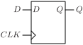
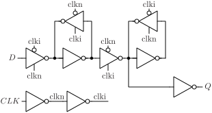

# DFQ

D flip-flop with output Q.

## Pin information

| Pin   | Description   |
| :-:    | :-            |
| D | Data input |
| CLK | Clock |
| Q | Data output |
| VDD | Power supply |
| VSS | Ground |


## Truth table

| CLK | D | Q | Description | 
| :--- | :--- | :--- | :--- | 
| ↑ | 0 | 0 | Write 0 | 
| ↑ | 1 | 1 | Write 1 | 


## Symbol

<div align="center">

</div>

## Schematic

<div align="center">

</div>

## Cell variants

| Cell name <br> | Width <br> [unit sites] | Area <br> [\\(\mu m^2\\)] |
| :-        | :-:   | :-:   |
| [DFQ_DL](#dfq_dl) | TBD | TBD |
| [DFQ_D1](#dfq_d1) | TBD | TBD |
| [DFQ_D2](#dfq_d2) | TBD | TBD |
| [DFQ_D4](#dfq_d4) | TBD | TBD |


### DFQ_DL

#### Hierarchical SPICE netlist
```spice
.subckt DFQ_DL D CLK Q VDD VSS
Xinv_clkn CLK clkn VDD VSS inv_par WN=2e-07 WP=3e-07 
Xinv_clki clkn clki VDD VSS inv_par WN=2e-07 WP=3e-07 
Xinvz_in D clkn clki dn VDD VSS invz2_par WN=1.5e-07 WP=2.3e-07 
Xinv_ml dn di VDD VSS inv_par WN=2e-07 WP=3e-07 
Xinvz_mfb di clki clkn dn VDD VSS invz_par WN=1.5e-07 WP=2.3e-07 WEAK=1 
Xinvz_ms di clki clkn qin VDD VSS invz_par WN=4e-07 WP=6e-07 
Xinv_sl qin qi VDD VSS inv_par WN=2e-07 WP=3e-07 
Xinvz_sfb qi clkn clki qin VDD VSS invz_par WN=1.5e-07 WP=1.5e-07 
Xinv_Q qin Q VDD VSS inv_par WN=3.2e-07 WP=4.9e-07 
.ends
```

#### Flat SPICE netlist
```spice
.subckt DFQ_DL D CLK Q VDD VSS
XMN0 n0 CLK VSS VSS sg13_lv_nmos w=2e-07 l=1.3e-07 ad=6.2e-14 as=6.2e-14 pd=1.02e-06 ps=1.02e-06 ng=1 
XMP0 n0 CLK VDD VDD sg13_lv_pmos w=3e-07 l=1.3e-07 ad=9.3e-14 as=9.3e-14 pd=1.22e-06 ps=1.22e-06 ng=1 
XMN1 n1 n0 VSS VSS sg13_lv_nmos w=2e-07 l=1.3e-07 ad=6.2e-14 as=6.2e-14 pd=1.02e-06 ps=1.02e-06 ng=1 
XMP1 n1 n0 VDD VDD sg13_lv_pmos w=3e-07 l=1.3e-07 ad=9.3e-14 as=9.3e-14 pd=1.22e-06 ps=1.22e-06 ng=1 
XMN2 n2 D n3 VSS sg13_lv_nmos w=1.5e-07 l=1.3e-07 ad=4.65e-14 as=4.65e-14 pd=9.2e-07 ps=9.2e-07 ng=1 
XMN3 n3 n0 VSS VSS sg13_lv_nmos w=1.5e-07 l=1.3e-07 ad=4.65e-14 as=4.65e-14 pd=9.2e-07 ps=9.2e-07 ng=1 
XMP2 n2 D n4 VDD sg13_lv_pmos w=2.3e-07 l=1.3e-07 ad=7.13e-14 as=7.13e-14 pd=1.08e-06 ps=1.08e-06 ng=1 
XMP3 n4 n1 VDD VDD sg13_lv_pmos w=2.3e-07 l=1.3e-07 ad=7.13e-14 as=7.13e-14 pd=1.08e-06 ps=1.08e-06 ng=1 
XMN4 n5 n2 VSS VSS sg13_lv_nmos w=2e-07 l=1.3e-07 ad=6.2e-14 as=6.2e-14 pd=1.02e-06 ps=1.02e-06 ng=1 
XMP4 n5 n2 VDD VDD sg13_lv_pmos w=3e-07 l=1.3e-07 ad=9.3e-14 as=9.3e-14 pd=1.22e-06 ps=1.22e-06 ng=1 
XMN5 n2 n1 n6 VSS sg13_lv_nmos w=1.5e-07 l=1.3e-07 ad=4.65e-14 as=4.65e-14 pd=9.2e-07 ps=9.2e-07 ng=1 
XMN6 n6 n5 VSS VSS sg13_lv_nmos w=1.5e-07 l=1.3e-07 ad=4.65e-14 as=4.65e-14 pd=9.2e-07 ps=9.2e-07 ng=1 
XMP5 n2 n0 n7 VDD sg13_lv_pmos w=2.3e-07 l=1.3e-07 ad=7.13e-14 as=7.13e-14 pd=1.08e-06 ps=1.08e-06 ng=1 
XMP6 n7 n5 VDD VDD sg13_lv_pmos w=2.3e-07 l=1.3e-07 ad=7.13e-14 as=7.13e-14 pd=1.08e-06 ps=1.08e-06 ng=1 
XMN7 n8 n1 n9 VSS sg13_lv_nmos w=4e-07 l=1.3e-07 ad=1.24e-13 as=1.24e-13 pd=1.42e-06 ps=1.42e-06 ng=1 
XMN8 n9 n5 VSS VSS sg13_lv_nmos w=4e-07 l=1.3e-07 ad=1.24e-13 as=1.24e-13 pd=1.42e-06 ps=1.42e-06 ng=1 
XMP7 n8 n0 n10 VDD sg13_lv_pmos w=6e-07 l=1.3e-07 ad=1.86e-13 as=1.86e-13 pd=1.82e-06 ps=1.82e-06 ng=1 
XMP8 n10 n5 VDD VDD sg13_lv_pmos w=6e-07 l=1.3e-07 ad=1.86e-13 as=1.86e-13 pd=1.82e-06 ps=1.82e-06 ng=1 
XMN9 n11 n8 VSS VSS sg13_lv_nmos w=2e-07 l=1.3e-07 ad=6.2e-14 as=6.2e-14 pd=1.02e-06 ps=1.02e-06 ng=1 
XMP9 n11 n8 VDD VDD sg13_lv_pmos w=3e-07 l=1.3e-07 ad=9.3e-14 as=9.3e-14 pd=1.22e-06 ps=1.22e-06 ng=1 
XMN10 n8 n0 n12 VSS sg13_lv_nmos w=1.5e-07 l=1.3e-07 ad=4.65e-14 as=4.65e-14 pd=9.2e-07 ps=9.2e-07 ng=1 
XMN11 n12 n11 VSS VSS sg13_lv_nmos w=1.5e-07 l=1.3e-07 ad=4.65e-14 as=4.65e-14 pd=9.2e-07 ps=9.2e-07 ng=1 
XMP10 n8 n1 n13 VDD sg13_lv_pmos w=1.5e-07 l=1.3e-07 ad=4.65e-14 as=4.65e-14 pd=9.2e-07 ps=9.2e-07 ng=1 
XMP11 n13 n11 VDD VDD sg13_lv_pmos w=1.5e-07 l=1.3e-07 ad=4.65e-14 as=4.65e-14 pd=9.2e-07 ps=9.2e-07 ng=1 
XMN12 Q n8 VSS VSS sg13_lv_nmos w=3.2e-07 l=1.3e-07 ad=9.92e-14 as=9.92e-14 pd=1.26e-06 ps=1.26e-06 ng=1 
XMP12 Q n8 VDD VDD sg13_lv_pmos w=4.9e-07 l=1.3e-07 ad=1.519e-13 as=1.519e-13 pd=1.6e-06 ps=1.6e-06 ng=1 
.ends
```

#### CDL netlist
```cdl
.SUBCKT DFQ_DL D CLK Q VDD VSS
*.PININFO D:I CLK:I Q:O VDD:B VSS:B 
MN0 n0 CLK VSS VSS sg13_lv_nmos w=2e-07 l=1.3e-07 ng=1 
MP0 n0 CLK VDD VDD sg13_lv_pmos w=3e-07 l=1.3e-07 ng=1 
MN1 n1 n0 VSS VSS sg13_lv_nmos w=2e-07 l=1.3e-07 ng=1 
MP1 n1 n0 VDD VDD sg13_lv_pmos w=3e-07 l=1.3e-07 ng=1 
MN2 n2 D n3 VSS sg13_lv_nmos w=1.5e-07 l=1.3e-07 ng=1 
MN3 n3 n0 VSS VSS sg13_lv_nmos w=1.5e-07 l=1.3e-07 ng=1 
MP2 n2 D n4 VDD sg13_lv_pmos w=2.3e-07 l=1.3e-07 ng=1 
MP3 n4 n1 VDD VDD sg13_lv_pmos w=2.3e-07 l=1.3e-07 ng=1 
MN4 n5 n2 VSS VSS sg13_lv_nmos w=2e-07 l=1.3e-07 ng=1 
MP4 n5 n2 VDD VDD sg13_lv_pmos w=3e-07 l=1.3e-07 ng=1 
MN5 n2 n1 n6 VSS sg13_lv_nmos w=1.5e-07 l=1.3e-07 ng=1 
MN6 n6 n5 VSS VSS sg13_lv_nmos w=1.5e-07 l=1.3e-07 ng=1 
MP5 n2 n0 n7 VDD sg13_lv_pmos w=2.3e-07 l=1.3e-07 ng=1 
MP6 n7 n5 VDD VDD sg13_lv_pmos w=2.3e-07 l=1.3e-07 ng=1 
MN7 n8 n1 n9 VSS sg13_lv_nmos w=4e-07 l=1.3e-07 ng=1 
MN8 n9 n5 VSS VSS sg13_lv_nmos w=4e-07 l=1.3e-07 ng=1 
MP7 n8 n0 n10 VDD sg13_lv_pmos w=6e-07 l=1.3e-07 ng=1 
MP8 n10 n5 VDD VDD sg13_lv_pmos w=6e-07 l=1.3e-07 ng=1 
MN9 n11 n8 VSS VSS sg13_lv_nmos w=2e-07 l=1.3e-07 ng=1 
MP9 n11 n8 VDD VDD sg13_lv_pmos w=3e-07 l=1.3e-07 ng=1 
MN10 n8 n0 n12 VSS sg13_lv_nmos w=1.5e-07 l=1.3e-07 ng=1 
MN11 n12 n11 VSS VSS sg13_lv_nmos w=1.5e-07 l=1.3e-07 ng=1 
MP10 n8 n1 n13 VDD sg13_lv_pmos w=1.5e-07 l=1.3e-07 ng=1 
MP11 n13 n11 VDD VDD sg13_lv_pmos w=1.5e-07 l=1.3e-07 ng=1 
MN12 Q n8 VSS VSS sg13_lv_nmos w=3.2e-07 l=1.3e-07 ng=1 
MP12 Q n8 VDD VDD sg13_lv_pmos w=4.9e-07 l=1.3e-07 ng=1 
.ENDS
```

#### Layout

<div align="center">

</div>

### DFQ_D1

#### Hierarchical SPICE netlist
```spice
.subckt DFQ_D1 D CLK Q VDD VSS
Xinv_clkn CLK clkn VDD VSS inv_par WN=3e-07 WP=4.5e-07 
Xinv_clki clkn clki VDD VSS inv_par WN=2e-07 WP=3e-07 
Xinvz_in D clkn clki dn VDD VSS invz2_par WN=1.5e-07 WP=2.3e-07 
Xinv_ml dn di VDD VSS inv_par WN=2e-07 WP=3e-07 
Xinvz_mfb di clki clkn dn VDD VSS invz_par WN=1.5e-07 WP=2.3e-07 WEAK=1 
Xinvz_ms di clki clkn qin VDD VSS invz_par WN=5e-07 WP=7.5e-07 
Xinv_sl qin qi VDD VSS inv_par WN=2e-07 WP=3e-07 
Xinvz_sfb qi clkn clki qin VDD VSS invz_par WN=1.5e-07 WP=1.5e-07 
Xinv_Q qin Q VDD VSS inv_par WN=6.4e-07 WP=9.8e-07 
.ends
```

#### Flat SPICE netlist
```spice
.subckt DFQ_D1 D CLK Q VDD VSS
XMN0 n0 CLK VSS VSS sg13_lv_nmos w=3e-07 l=1.3e-07 ad=9.3e-14 as=9.3e-14 pd=1.22e-06 ps=1.22e-06 ng=1 
XMP0 n0 CLK VDD VDD sg13_lv_pmos w=4.5e-07 l=1.3e-07 ad=1.395e-13 as=1.395e-13 pd=1.52e-06 ps=1.52e-06 ng=1 
XMN1 n1 n0 VSS VSS sg13_lv_nmos w=2e-07 l=1.3e-07 ad=6.2e-14 as=6.2e-14 pd=1.02e-06 ps=1.02e-06 ng=1 
XMP1 n1 n0 VDD VDD sg13_lv_pmos w=3e-07 l=1.3e-07 ad=9.3e-14 as=9.3e-14 pd=1.22e-06 ps=1.22e-06 ng=1 
XMN2 n2 D n3 VSS sg13_lv_nmos w=1.5e-07 l=1.3e-07 ad=4.65e-14 as=4.65e-14 pd=9.2e-07 ps=9.2e-07 ng=1 
XMN3 n3 n0 VSS VSS sg13_lv_nmos w=1.5e-07 l=1.3e-07 ad=4.65e-14 as=4.65e-14 pd=9.2e-07 ps=9.2e-07 ng=1 
XMP2 n2 D n4 VDD sg13_lv_pmos w=2.3e-07 l=1.3e-07 ad=7.13e-14 as=7.13e-14 pd=1.08e-06 ps=1.08e-06 ng=1 
XMP3 n4 n1 VDD VDD sg13_lv_pmos w=2.3e-07 l=1.3e-07 ad=7.13e-14 as=7.13e-14 pd=1.08e-06 ps=1.08e-06 ng=1 
XMN4 n5 n2 VSS VSS sg13_lv_nmos w=2e-07 l=1.3e-07 ad=6.2e-14 as=6.2e-14 pd=1.02e-06 ps=1.02e-06 ng=1 
XMP4 n5 n2 VDD VDD sg13_lv_pmos w=3e-07 l=1.3e-07 ad=9.3e-14 as=9.3e-14 pd=1.22e-06 ps=1.22e-06 ng=1 
XMN5 n2 n1 n6 VSS sg13_lv_nmos w=1.5e-07 l=1.3e-07 ad=4.65e-14 as=4.65e-14 pd=9.2e-07 ps=9.2e-07 ng=1 
XMN6 n6 n5 VSS VSS sg13_lv_nmos w=1.5e-07 l=1.3e-07 ad=4.65e-14 as=4.65e-14 pd=9.2e-07 ps=9.2e-07 ng=1 
XMP5 n2 n0 n7 VDD sg13_lv_pmos w=2.3e-07 l=1.3e-07 ad=7.13e-14 as=7.13e-14 pd=1.08e-06 ps=1.08e-06 ng=1 
XMP6 n7 n5 VDD VDD sg13_lv_pmos w=2.3e-07 l=1.3e-07 ad=7.13e-14 as=7.13e-14 pd=1.08e-06 ps=1.08e-06 ng=1 
XMN7 n8 n1 n9 VSS sg13_lv_nmos w=5e-07 l=1.3e-07 ad=1.55e-13 as=1.55e-13 pd=1.62e-06 ps=1.62e-06 ng=1 
XMN8 n9 n5 VSS VSS sg13_lv_nmos w=5e-07 l=1.3e-07 ad=1.55e-13 as=1.55e-13 pd=1.62e-06 ps=1.62e-06 ng=1 
XMP7 n8 n0 n10 VDD sg13_lv_pmos w=7.5e-07 l=1.3e-07 ad=2.325e-13 as=2.325e-13 pd=2.12e-06 ps=2.12e-06 ng=1 
XMP8 n10 n5 VDD VDD sg13_lv_pmos w=7.5e-07 l=1.3e-07 ad=2.325e-13 as=2.325e-13 pd=2.12e-06 ps=2.12e-06 ng=1 
XMN9 n11 n8 VSS VSS sg13_lv_nmos w=2e-07 l=1.3e-07 ad=6.2e-14 as=6.2e-14 pd=1.02e-06 ps=1.02e-06 ng=1 
XMP9 n11 n8 VDD VDD sg13_lv_pmos w=3e-07 l=1.3e-07 ad=9.3e-14 as=9.3e-14 pd=1.22e-06 ps=1.22e-06 ng=1 
XMN10 n8 n0 n12 VSS sg13_lv_nmos w=1.5e-07 l=1.3e-07 ad=4.65e-14 as=4.65e-14 pd=9.2e-07 ps=9.2e-07 ng=1 
XMN11 n12 n11 VSS VSS sg13_lv_nmos w=1.5e-07 l=1.3e-07 ad=4.65e-14 as=4.65e-14 pd=9.2e-07 ps=9.2e-07 ng=1 
XMP10 n8 n1 n13 VDD sg13_lv_pmos w=1.5e-07 l=1.3e-07 ad=4.65e-14 as=4.65e-14 pd=9.2e-07 ps=9.2e-07 ng=1 
XMP11 n13 n11 VDD VDD sg13_lv_pmos w=1.5e-07 l=1.3e-07 ad=4.65e-14 as=4.65e-14 pd=9.2e-07 ps=9.2e-07 ng=1 
XMN12 Q n8 VSS VSS sg13_lv_nmos w=6.4e-07 l=1.3e-07 ad=1.984e-13 as=1.984e-13 pd=1.9e-06 ps=1.9e-06 ng=1 
XMP12 Q n8 VDD VDD sg13_lv_pmos w=9.8e-07 l=1.3e-07 ad=3.038e-13 as=3.038e-13 pd=2.58e-06 ps=2.58e-06 ng=1 
.ends
```

#### CDL netlist
```cdl
.SUBCKT DFQ_D1 D CLK Q VDD VSS
*.PININFO D:I CLK:I Q:O VDD:B VSS:B 
MN0 n0 CLK VSS VSS sg13_lv_nmos w=3e-07 l=1.3e-07 ng=1 
MP0 n0 CLK VDD VDD sg13_lv_pmos w=4.5e-07 l=1.3e-07 ng=1 
MN1 n1 n0 VSS VSS sg13_lv_nmos w=2e-07 l=1.3e-07 ng=1 
MP1 n1 n0 VDD VDD sg13_lv_pmos w=3e-07 l=1.3e-07 ng=1 
MN2 n2 D n3 VSS sg13_lv_nmos w=1.5e-07 l=1.3e-07 ng=1 
MN3 n3 n0 VSS VSS sg13_lv_nmos w=1.5e-07 l=1.3e-07 ng=1 
MP2 n2 D n4 VDD sg13_lv_pmos w=2.3e-07 l=1.3e-07 ng=1 
MP3 n4 n1 VDD VDD sg13_lv_pmos w=2.3e-07 l=1.3e-07 ng=1 
MN4 n5 n2 VSS VSS sg13_lv_nmos w=2e-07 l=1.3e-07 ng=1 
MP4 n5 n2 VDD VDD sg13_lv_pmos w=3e-07 l=1.3e-07 ng=1 
MN5 n2 n1 n6 VSS sg13_lv_nmos w=1.5e-07 l=1.3e-07 ng=1 
MN6 n6 n5 VSS VSS sg13_lv_nmos w=1.5e-07 l=1.3e-07 ng=1 
MP5 n2 n0 n7 VDD sg13_lv_pmos w=2.3e-07 l=1.3e-07 ng=1 
MP6 n7 n5 VDD VDD sg13_lv_pmos w=2.3e-07 l=1.3e-07 ng=1 
MN7 n8 n1 n9 VSS sg13_lv_nmos w=5e-07 l=1.3e-07 ng=1 
MN8 n9 n5 VSS VSS sg13_lv_nmos w=5e-07 l=1.3e-07 ng=1 
MP7 n8 n0 n10 VDD sg13_lv_pmos w=7.5e-07 l=1.3e-07 ng=1 
MP8 n10 n5 VDD VDD sg13_lv_pmos w=7.5e-07 l=1.3e-07 ng=1 
MN9 n11 n8 VSS VSS sg13_lv_nmos w=2e-07 l=1.3e-07 ng=1 
MP9 n11 n8 VDD VDD sg13_lv_pmos w=3e-07 l=1.3e-07 ng=1 
MN10 n8 n0 n12 VSS sg13_lv_nmos w=1.5e-07 l=1.3e-07 ng=1 
MN11 n12 n11 VSS VSS sg13_lv_nmos w=1.5e-07 l=1.3e-07 ng=1 
MP10 n8 n1 n13 VDD sg13_lv_pmos w=1.5e-07 l=1.3e-07 ng=1 
MP11 n13 n11 VDD VDD sg13_lv_pmos w=1.5e-07 l=1.3e-07 ng=1 
MN12 Q n8 VSS VSS sg13_lv_nmos w=6.4e-07 l=1.3e-07 ng=1 
MP12 Q n8 VDD VDD sg13_lv_pmos w=9.8e-07 l=1.3e-07 ng=1 
.ENDS
```

#### Layout

<div align="center">

</div>

### DFQ_D2

#### Hierarchical SPICE netlist
```spice
.subckt DFQ_D2 D CLK Q VDD VSS
Xinv_clkn CLK clkn VDD VSS inv_par WN=4.2e-07 WP=6.3e-07 
Xinv_clki clkn clki VDD VSS inv_par WN=3.2e-07 WP=4.8e-07 
Xinvz_in D clkn clki dn VDD VSS invz_par WN=2e-07 WP=3e-07 
Xinv_ml dn di VDD VSS inv_par WN=3e-07 WP=4.5e-07 
Xinvz_mfb di clki clkn dn VDD VSS invz_par WN=1.5e-07 WP=2.3e-07 WEAK=1 
Xinvz_ms di clki clkn qin VDD VSS invz_par WN=9e-07 WP=1.35e-06 
Xinv_sl qin qi VDD VSS inv_par WN=2e-07 WP=2e-07 
Xinvz_sfb qi clkn clki qin VDD VSS invz_par WN=1.5e-07 WP=1.5e-07 
Xinv_Q qin Q VDD VSS inv_par WN=1.07e-06 WP=1.6e-06 
.ends
```

#### Flat SPICE netlist
```spice
.subckt DFQ_D2 D CLK Q VDD VSS
XMN0 n0 CLK VSS VSS sg13_lv_nmos w=4.2e-07 l=1.3e-07 ad=1.302e-13 as=1.302e-13 pd=1.46e-06 ps=1.46e-06 ng=1 
XMP0 n0 CLK VDD VDD sg13_lv_pmos w=6.3e-07 l=1.3e-07 ad=1.953e-13 as=1.953e-13 pd=1.88e-06 ps=1.88e-06 ng=1 
XMN1 n1 n0 VSS VSS sg13_lv_nmos w=3.2e-07 l=1.3e-07 ad=9.92e-14 as=9.92e-14 pd=1.26e-06 ps=1.26e-06 ng=1 
XMP1 n1 n0 VDD VDD sg13_lv_pmos w=4.8e-07 l=1.3e-07 ad=1.488e-13 as=1.488e-13 pd=1.58e-06 ps=1.58e-06 ng=1 
XMN2 n2 n0 n3 VSS sg13_lv_nmos w=2e-07 l=1.3e-07 ad=6.2e-14 as=6.2e-14 pd=1.02e-06 ps=1.02e-06 ng=1 
XMN3 n3 D VSS VSS sg13_lv_nmos w=2e-07 l=1.3e-07 ad=6.2e-14 as=6.2e-14 pd=1.02e-06 ps=1.02e-06 ng=1 
XMP2 n2 n1 n4 VDD sg13_lv_pmos w=3e-07 l=1.3e-07 ad=9.3e-14 as=9.3e-14 pd=1.22e-06 ps=1.22e-06 ng=1 
XMP3 n4 D VDD VDD sg13_lv_pmos w=3e-07 l=1.3e-07 ad=9.3e-14 as=9.3e-14 pd=1.22e-06 ps=1.22e-06 ng=1 
XMN4 n5 n2 VSS VSS sg13_lv_nmos w=3e-07 l=1.3e-07 ad=9.3e-14 as=9.3e-14 pd=1.22e-06 ps=1.22e-06 ng=1 
XMP4 n5 n2 VDD VDD sg13_lv_pmos w=4.5e-07 l=1.3e-07 ad=1.395e-13 as=1.395e-13 pd=1.52e-06 ps=1.52e-06 ng=1 
XMN5 n2 n1 n6 VSS sg13_lv_nmos w=1.5e-07 l=1.3e-07 ad=4.65e-14 as=4.65e-14 pd=9.2e-07 ps=9.2e-07 ng=1 
XMN6 n6 n5 VSS VSS sg13_lv_nmos w=1.5e-07 l=1.3e-07 ad=4.65e-14 as=4.65e-14 pd=9.2e-07 ps=9.2e-07 ng=1 
XMP5 n2 n0 n7 VDD sg13_lv_pmos w=2.3e-07 l=1.3e-07 ad=7.13e-14 as=7.13e-14 pd=1.08e-06 ps=1.08e-06 ng=1 
XMP6 n7 n5 VDD VDD sg13_lv_pmos w=2.3e-07 l=1.3e-07 ad=7.13e-14 as=7.13e-14 pd=1.08e-06 ps=1.08e-06 ng=1 
XMN7 n8 n1 n9 VSS sg13_lv_nmos w=9e-07 l=1.3e-07 ad=2.79e-13 as=2.79e-13 pd=2.42e-06 ps=2.42e-06 ng=1 
XMN8 n9 n5 VSS VSS sg13_lv_nmos w=9e-07 l=1.3e-07 ad=2.79e-13 as=2.79e-13 pd=2.42e-06 ps=2.42e-06 ng=1 
XMP7 n8 n0 n10 VDD sg13_lv_pmos w=1.35e-06 l=1.3e-07 ad=4.185e-13 as=4.185e-13 pd=3.32e-06 ps=3.32e-06 ng=1 
XMP8 n10 n5 VDD VDD sg13_lv_pmos w=1.35e-06 l=1.3e-07 ad=4.185e-13 as=4.185e-13 pd=3.32e-06 ps=3.32e-06 ng=1 
XMN9 n11 n8 VSS VSS sg13_lv_nmos w=2e-07 l=1.3e-07 ad=6.2e-14 as=6.2e-14 pd=1.02e-06 ps=1.02e-06 ng=1 
XMP9 n11 n8 VDD VDD sg13_lv_pmos w=2e-07 l=1.3e-07 ad=6.2e-14 as=6.2e-14 pd=1.02e-06 ps=1.02e-06 ng=1 
XMN10 n8 n0 n12 VSS sg13_lv_nmos w=1.5e-07 l=1.3e-07 ad=4.65e-14 as=4.65e-14 pd=9.2e-07 ps=9.2e-07 ng=1 
XMN11 n12 n11 VSS VSS sg13_lv_nmos w=1.5e-07 l=1.3e-07 ad=4.65e-14 as=4.65e-14 pd=9.2e-07 ps=9.2e-07 ng=1 
XMP10 n8 n1 n13 VDD sg13_lv_pmos w=1.5e-07 l=1.3e-07 ad=4.65e-14 as=4.65e-14 pd=9.2e-07 ps=9.2e-07 ng=1 
XMP11 n13 n11 VDD VDD sg13_lv_pmos w=1.5e-07 l=1.3e-07 ad=4.65e-14 as=4.65e-14 pd=9.2e-07 ps=9.2e-07 ng=1 
XMN12 Q n8 VSS VSS sg13_lv_nmos w=1.07e-06 l=1.3e-07 ad=3.317e-13 as=3.317e-13 pd=2.76e-06 ps=2.76e-06 ng=1 
XMP12 Q n8 VDD VDD sg13_lv_pmos w=1.6e-06 l=1.3e-07 ad=4.96e-13 as=4.96e-13 pd=3.82e-06 ps=3.82e-06 ng=1 
.ends
```

#### CDL netlist
```cdl
.SUBCKT DFQ_D2 D CLK Q VDD VSS
*.PININFO D:I CLK:I Q:O VDD:B VSS:B 
MN0 n0 CLK VSS VSS sg13_lv_nmos w=4.2e-07 l=1.3e-07 ng=1 
MP0 n0 CLK VDD VDD sg13_lv_pmos w=6.3e-07 l=1.3e-07 ng=1 
MN1 n1 n0 VSS VSS sg13_lv_nmos w=3.2e-07 l=1.3e-07 ng=1 
MP1 n1 n0 VDD VDD sg13_lv_pmos w=4.8e-07 l=1.3e-07 ng=1 
MN2 n2 n0 n3 VSS sg13_lv_nmos w=2e-07 l=1.3e-07 ng=1 
MN3 n3 D VSS VSS sg13_lv_nmos w=2e-07 l=1.3e-07 ng=1 
MP2 n2 n1 n4 VDD sg13_lv_pmos w=3e-07 l=1.3e-07 ng=1 
MP3 n4 D VDD VDD sg13_lv_pmos w=3e-07 l=1.3e-07 ng=1 
MN4 n5 n2 VSS VSS sg13_lv_nmos w=3e-07 l=1.3e-07 ng=1 
MP4 n5 n2 VDD VDD sg13_lv_pmos w=4.5e-07 l=1.3e-07 ng=1 
MN5 n2 n1 n6 VSS sg13_lv_nmos w=1.5e-07 l=1.3e-07 ng=1 
MN6 n6 n5 VSS VSS sg13_lv_nmos w=1.5e-07 l=1.3e-07 ng=1 
MP5 n2 n0 n7 VDD sg13_lv_pmos w=2.3e-07 l=1.3e-07 ng=1 
MP6 n7 n5 VDD VDD sg13_lv_pmos w=2.3e-07 l=1.3e-07 ng=1 
MN7 n8 n1 n9 VSS sg13_lv_nmos w=9e-07 l=1.3e-07 ng=1 
MN8 n9 n5 VSS VSS sg13_lv_nmos w=9e-07 l=1.3e-07 ng=1 
MP7 n8 n0 n10 VDD sg13_lv_pmos w=1.35e-06 l=1.3e-07 ng=1 
MP8 n10 n5 VDD VDD sg13_lv_pmos w=1.35e-06 l=1.3e-07 ng=1 
MN9 n11 n8 VSS VSS sg13_lv_nmos w=2e-07 l=1.3e-07 ng=1 
MP9 n11 n8 VDD VDD sg13_lv_pmos w=2e-07 l=1.3e-07 ng=1 
MN10 n8 n0 n12 VSS sg13_lv_nmos w=1.5e-07 l=1.3e-07 ng=1 
MN11 n12 n11 VSS VSS sg13_lv_nmos w=1.5e-07 l=1.3e-07 ng=1 
MP10 n8 n1 n13 VDD sg13_lv_pmos w=1.5e-07 l=1.3e-07 ng=1 
MP11 n13 n11 VDD VDD sg13_lv_pmos w=1.5e-07 l=1.3e-07 ng=1 
MN12 Q n8 VSS VSS sg13_lv_nmos w=1.07e-06 l=1.3e-07 ng=1 
MP12 Q n8 VDD VDD sg13_lv_pmos w=1.6e-06 l=1.3e-07 ng=1 
.ENDS
```

#### Layout

<div align="center">

</div>

### DFQ_D4

#### Hierarchical SPICE netlist
```spice
.subckt DFQ_D4 D CLK Q VDD VSS
Xinv_clkn CLK clkn VDD VSS inv_par WN=7.5e-07 WP=1.12e-06 
Xinv_clki clkn clki VDD VSS inv_par WN=5.5e-07 WP=8.3e-07 
Xinvz_in D clkn clki dn VDD VSS invz_par WN=4e-07 WP=6e-07 
Xinv_ml dn di VDD VSS inv_par WN=6.5e-07 WP=9.8e-07 
Xinvz_mfb di clki clkn dn VDD VSS invz_par WN=1.5e-07 WP=2.3e-07 WEAK=1 
Xinvz_ms di clki clkn qin VDD VSS invz_par WN=2e-06 WP=3e-06 NGN=2 NGP=2 
Xinv_sl qin qi VDD VSS inv_par WN=3e-07 WP=3e-07 
Xinvz_sfb qi clkn clki qin VDD VSS invz_par WN=1.5e-07 WP=1.5e-07 
Xinv_Q qin Q VDD VSS inv_par WN=2.14e-06 WP=3.2e-06 NGN=3 NGP=3 
.ends
```

#### Flat SPICE netlist
```spice
.subckt DFQ_D4 D CLK Q VDD VSS
XMN0 n0 CLK VSS VSS sg13_lv_nmos w=7.5e-07 l=1.3e-07 ad=2.325e-13 as=2.325e-13 pd=2.12e-06 ps=2.12e-06 ng=1 
XMP0 n0 CLK VDD VDD sg13_lv_pmos w=1.12e-06 l=1.3e-07 ad=3.472e-13 as=3.472e-13 pd=2.86e-06 ps=2.86e-06 ng=1 
XMN1 n1 n0 VSS VSS sg13_lv_nmos w=5.5e-07 l=1.3e-07 ad=1.705e-13 as=1.705e-13 pd=1.72e-06 ps=1.72e-06 ng=1 
XMP1 n1 n0 VDD VDD sg13_lv_pmos w=8.3e-07 l=1.3e-07 ad=2.573e-13 as=2.573e-13 pd=2.28e-06 ps=2.28e-06 ng=1 
XMN2 n2 n0 n3 VSS sg13_lv_nmos w=4e-07 l=1.3e-07 ad=1.24e-13 as=1.24e-13 pd=1.42e-06 ps=1.42e-06 ng=1 
XMN3 n3 D VSS VSS sg13_lv_nmos w=4e-07 l=1.3e-07 ad=1.24e-13 as=1.24e-13 pd=1.42e-06 ps=1.42e-06 ng=1 
XMP2 n2 n1 n4 VDD sg13_lv_pmos w=6e-07 l=1.3e-07 ad=1.86e-13 as=1.86e-13 pd=1.82e-06 ps=1.82e-06 ng=1 
XMP3 n4 D VDD VDD sg13_lv_pmos w=6e-07 l=1.3e-07 ad=1.86e-13 as=1.86e-13 pd=1.82e-06 ps=1.82e-06 ng=1 
XMN4 n5 n2 VSS VSS sg13_lv_nmos w=6.5e-07 l=1.3e-07 ad=2.015e-13 as=2.015e-13 pd=1.92e-06 ps=1.92e-06 ng=1 
XMP4 n5 n2 VDD VDD sg13_lv_pmos w=9.8e-07 l=1.3e-07 ad=3.038e-13 as=3.038e-13 pd=2.58e-06 ps=2.58e-06 ng=1 
XMN5 n2 n1 n6 VSS sg13_lv_nmos w=1.5e-07 l=1.3e-07 ad=4.65e-14 as=4.65e-14 pd=9.2e-07 ps=9.2e-07 ng=1 
XMN6 n6 n5 VSS VSS sg13_lv_nmos w=1.5e-07 l=1.3e-07 ad=4.65e-14 as=4.65e-14 pd=9.2e-07 ps=9.2e-07 ng=1 
XMP5 n2 n0 n7 VDD sg13_lv_pmos w=2.3e-07 l=1.3e-07 ad=7.13e-14 as=7.13e-14 pd=1.08e-06 ps=1.08e-06 ng=1 
XMP6 n7 n5 VDD VDD sg13_lv_pmos w=2.3e-07 l=1.3e-07 ad=7.13e-14 as=7.13e-14 pd=1.08e-06 ps=1.08e-06 ng=1 
XMN7 n8 n1 n9 VSS sg13_lv_nmos w=2e-06 l=1.3e-07 ad=6.2e-13 as=6.2e-13 pd=4.62e-06 ps=4.62e-06 ng=2 
XMN8 n9 n5 VSS VSS sg13_lv_nmos w=2e-06 l=1.3e-07 ad=6.2e-13 as=6.2e-13 pd=4.62e-06 ps=4.62e-06 ng=2 
XMP7 n8 n0 n10 VDD sg13_lv_pmos w=3e-06 l=1.3e-07 ad=9.3e-13 as=9.3e-13 pd=6.62e-06 ps=6.62e-06 ng=2 
XMP8 n10 n5 VDD VDD sg13_lv_pmos w=3e-06 l=1.3e-07 ad=9.3e-13 as=9.3e-13 pd=6.62e-06 ps=6.62e-06 ng=2 
XMN9 n11 n8 VSS VSS sg13_lv_nmos w=3e-07 l=1.3e-07 ad=9.3e-14 as=9.3e-14 pd=1.22e-06 ps=1.22e-06 ng=1 
XMP9 n11 n8 VDD VDD sg13_lv_pmos w=3e-07 l=1.3e-07 ad=9.3e-14 as=9.3e-14 pd=1.22e-06 ps=1.22e-06 ng=1 
XMN10 n8 n0 n12 VSS sg13_lv_nmos w=1.5e-07 l=1.3e-07 ad=4.65e-14 as=4.65e-14 pd=9.2e-07 ps=9.2e-07 ng=1 
XMN11 n12 n11 VSS VSS sg13_lv_nmos w=1.5e-07 l=1.3e-07 ad=4.65e-14 as=4.65e-14 pd=9.2e-07 ps=9.2e-07 ng=1 
XMP10 n8 n1 n13 VDD sg13_lv_pmos w=1.5e-07 l=1.3e-07 ad=4.65e-14 as=4.65e-14 pd=9.2e-07 ps=9.2e-07 ng=1 
XMP11 n13 n11 VDD VDD sg13_lv_pmos w=1.5e-07 l=1.3e-07 ad=4.65e-14 as=4.65e-14 pd=9.2e-07 ps=9.2e-07 ng=1 
XMN12 Q n8 VSS VSS sg13_lv_nmos w=2.14e-06 l=1.3e-07 ad=6.634e-13 as=6.634e-13 pd=4.9e-06 ps=4.9e-06 ng=3 
XMP12 Q n8 VDD VDD sg13_lv_pmos w=3.2e-06 l=1.3e-07 ad=9.92e-13 as=9.92e-13 pd=7.02e-06 ps=7.02e-06 ng=3 
.ends
```

#### CDL netlist
```cdl
.SUBCKT DFQ_D4 D CLK Q VDD VSS
*.PININFO D:I CLK:I Q:O VDD:B VSS:B 
MN0 n0 CLK VSS VSS sg13_lv_nmos w=7.5e-07 l=1.3e-07 ng=1 
MP0 n0 CLK VDD VDD sg13_lv_pmos w=1.12e-06 l=1.3e-07 ng=1 
MN1 n1 n0 VSS VSS sg13_lv_nmos w=5.5e-07 l=1.3e-07 ng=1 
MP1 n1 n0 VDD VDD sg13_lv_pmos w=8.3e-07 l=1.3e-07 ng=1 
MN2 n2 n0 n3 VSS sg13_lv_nmos w=4e-07 l=1.3e-07 ng=1 
MN3 n3 D VSS VSS sg13_lv_nmos w=4e-07 l=1.3e-07 ng=1 
MP2 n2 n1 n4 VDD sg13_lv_pmos w=6e-07 l=1.3e-07 ng=1 
MP3 n4 D VDD VDD sg13_lv_pmos w=6e-07 l=1.3e-07 ng=1 
MN4 n5 n2 VSS VSS sg13_lv_nmos w=6.5e-07 l=1.3e-07 ng=1 
MP4 n5 n2 VDD VDD sg13_lv_pmos w=9.8e-07 l=1.3e-07 ng=1 
MN5 n2 n1 n6 VSS sg13_lv_nmos w=1.5e-07 l=1.3e-07 ng=1 
MN6 n6 n5 VSS VSS sg13_lv_nmos w=1.5e-07 l=1.3e-07 ng=1 
MP5 n2 n0 n7 VDD sg13_lv_pmos w=2.3e-07 l=1.3e-07 ng=1 
MP6 n7 n5 VDD VDD sg13_lv_pmos w=2.3e-07 l=1.3e-07 ng=1 
MN7 n8 n1 n9 VSS sg13_lv_nmos w=2e-06 l=1.3e-07 ng=2 
MN8 n9 n5 VSS VSS sg13_lv_nmos w=2e-06 l=1.3e-07 ng=2 
MP7 n8 n0 n10 VDD sg13_lv_pmos w=3e-06 l=1.3e-07 ng=2 
MP8 n10 n5 VDD VDD sg13_lv_pmos w=3e-06 l=1.3e-07 ng=2 
MN9 n11 n8 VSS VSS sg13_lv_nmos w=3e-07 l=1.3e-07 ng=1 
MP9 n11 n8 VDD VDD sg13_lv_pmos w=3e-07 l=1.3e-07 ng=1 
MN10 n8 n0 n12 VSS sg13_lv_nmos w=1.5e-07 l=1.3e-07 ng=1 
MN11 n12 n11 VSS VSS sg13_lv_nmos w=1.5e-07 l=1.3e-07 ng=1 
MP10 n8 n1 n13 VDD sg13_lv_pmos w=1.5e-07 l=1.3e-07 ng=1 
MP11 n13 n11 VDD VDD sg13_lv_pmos w=1.5e-07 l=1.3e-07 ng=1 
MN12 Q n8 VSS VSS sg13_lv_nmos w=2.14e-06 l=1.3e-07 ng=3 
MP12 Q n8 VDD VDD sg13_lv_pmos w=3.2e-06 l=1.3e-07 ng=3 
.ENDS
```

#### Layout

<div align="center">

</div>

## Pin capacitance
No pin capacitance data


## Static power
No static power data


## Dynamic power
No dynamic power data


## Delay
No delay data

