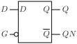
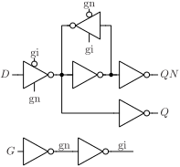

# DLN

D latch with inverted control signal.

## Pin information

| Pin   | Description   |
| :-:    | :-            |
| D | Data input |
| GN | Latch input, inverted |
| Q | Data output |
| QN | Data output, inverted |
| VDD | Power supply |
| VSS | Ground |


## Truth table

| GN | D | Q | QN | Description | 
| :--- | :--- | :--- | :--- | :--- | 
| 0 | D | D | ~D | Transparent | 
| 1 | - | Q | QN | Latch | 


## Symbol

<div align="center">

</div>

## Schematic

<div align="center">

</div>

## Cell variants

| Cell name <br> | Width <br> [unit sites] | Area <br> [\\(\mu m^2\\)] |
| :-        | :-:   | :-:   |
| [DLN_DL](#dln_dl) | TBD | TBD |
| [DLN_D1](#dln_d1) | TBD | TBD |
| [DLN_D2](#dln_d2) | TBD | TBD |


### DLN_DL

#### Hierarchical SPICE netlist
```spice
.subckt DLN_DL D GN Q QN VDD VSS
Xinv_g GN g VDD VSS inv_par WN=2e-07 WP=3e-07 
Xinv_gn g gn VDD VSS inv_par WN=1.5e-07 WP=2.3e-07 
Xinvz1 qi gn g qin VDD VSS invz_par WN=1.5e-07 WP=2.3e-07 WEAK=1 
Xinvz2 D g gn qin VDD VSS invz_par WN=5e-07 WP=8e-07 
Xinv_Q qin Q VDD VSS inv_par WN=3.2e-07 WP=4.9e-07 
Xinv_qi qin qi VDD VSS inv_par WN=2e-07 WP=3e-07 
Xinv_QN qi QN VDD VSS inv_par WN=3.2e-07 WP=4.9e-07 
.ends
```

#### Flat SPICE netlist
```spice
.subckt DLN_DL D GN Q QN VDD VSS
XMN0 n0 GN VSS VSS sg13_lv_nmos w=2e-07 l=1.3e-07 ad=6.2e-14 as=6.2e-14 pd=1.02e-06 ps=1.02e-06 ng=1 
XMP0 n0 GN VDD VDD sg13_lv_pmos w=3e-07 l=1.3e-07 ad=9.3e-14 as=9.3e-14 pd=1.22e-06 ps=1.22e-06 ng=1 
XMN1 n1 n0 VSS VSS sg13_lv_nmos w=1.5e-07 l=1.3e-07 ad=4.65e-14 as=4.65e-14 pd=9.2e-07 ps=9.2e-07 ng=1 
XMP1 n1 n0 VDD VDD sg13_lv_pmos w=2.3e-07 l=1.3e-07 ad=7.13e-14 as=7.13e-14 pd=1.08e-06 ps=1.08e-06 ng=1 
XMN2 n2 n1 n3 VSS sg13_lv_nmos w=1.5e-07 l=1.3e-07 ad=4.65e-14 as=4.65e-14 pd=9.2e-07 ps=9.2e-07 ng=1 
XMN3 n3 n4 VSS VSS sg13_lv_nmos w=1.5e-07 l=1.3e-07 ad=4.65e-14 as=4.65e-14 pd=9.2e-07 ps=9.2e-07 ng=1 
XMP2 n2 n0 n5 VDD sg13_lv_pmos w=2.3e-07 l=1.3e-07 ad=7.13e-14 as=7.13e-14 pd=1.08e-06 ps=1.08e-06 ng=1 
XMP3 n5 n4 VDD VDD sg13_lv_pmos w=2.3e-07 l=1.3e-07 ad=7.13e-14 as=7.13e-14 pd=1.08e-06 ps=1.08e-06 ng=1 
XMN4 n2 n0 n6 VSS sg13_lv_nmos w=5e-07 l=1.3e-07 ad=1.55e-13 as=1.55e-13 pd=1.62e-06 ps=1.62e-06 ng=1 
XMN5 n6 D VSS VSS sg13_lv_nmos w=5e-07 l=1.3e-07 ad=1.55e-13 as=1.55e-13 pd=1.62e-06 ps=1.62e-06 ng=1 
XMP4 n2 n1 n7 VDD sg13_lv_pmos w=8e-07 l=1.3e-07 ad=2.48e-13 as=2.48e-13 pd=2.22e-06 ps=2.22e-06 ng=1 
XMP5 n7 D VDD VDD sg13_lv_pmos w=8e-07 l=1.3e-07 ad=2.48e-13 as=2.48e-13 pd=2.22e-06 ps=2.22e-06 ng=1 
XMN6 Q n2 VSS VSS sg13_lv_nmos w=3.2e-07 l=1.3e-07 ad=9.92e-14 as=9.92e-14 pd=1.26e-06 ps=1.26e-06 ng=1 
XMP6 Q n2 VDD VDD sg13_lv_pmos w=4.9e-07 l=1.3e-07 ad=1.519e-13 as=1.519e-13 pd=1.6e-06 ps=1.6e-06 ng=1 
XMN7 n4 n2 VSS VSS sg13_lv_nmos w=2e-07 l=1.3e-07 ad=6.2e-14 as=6.2e-14 pd=1.02e-06 ps=1.02e-06 ng=1 
XMP7 n4 n2 VDD VDD sg13_lv_pmos w=3e-07 l=1.3e-07 ad=9.3e-14 as=9.3e-14 pd=1.22e-06 ps=1.22e-06 ng=1 
XMN8 QN n4 VSS VSS sg13_lv_nmos w=3.2e-07 l=1.3e-07 ad=9.92e-14 as=9.92e-14 pd=1.26e-06 ps=1.26e-06 ng=1 
XMP8 QN n4 VDD VDD sg13_lv_pmos w=4.9e-07 l=1.3e-07 ad=1.519e-13 as=1.519e-13 pd=1.6e-06 ps=1.6e-06 ng=1 
.ends
```

#### CDL netlist
```cdl
.SUBCKT DLN_DL D GN Q QN VDD VSS
*.PININFO D:I GN:I Q:O QN:O VDD:B VSS:B 
MN0 n0 GN VSS VSS sg13_lv_nmos w=2e-07 l=1.3e-07 ng=1 
MP0 n0 GN VDD VDD sg13_lv_pmos w=3e-07 l=1.3e-07 ng=1 
MN1 n1 n0 VSS VSS sg13_lv_nmos w=1.5e-07 l=1.3e-07 ng=1 
MP1 n1 n0 VDD VDD sg13_lv_pmos w=2.3e-07 l=1.3e-07 ng=1 
MN2 n2 n1 n3 VSS sg13_lv_nmos w=1.5e-07 l=1.3e-07 ng=1 
MN3 n3 n4 VSS VSS sg13_lv_nmos w=1.5e-07 l=1.3e-07 ng=1 
MP2 n2 n0 n5 VDD sg13_lv_pmos w=2.3e-07 l=1.3e-07 ng=1 
MP3 n5 n4 VDD VDD sg13_lv_pmos w=2.3e-07 l=1.3e-07 ng=1 
MN4 n2 n0 n6 VSS sg13_lv_nmos w=5e-07 l=1.3e-07 ng=1 
MN5 n6 D VSS VSS sg13_lv_nmos w=5e-07 l=1.3e-07 ng=1 
MP4 n2 n1 n7 VDD sg13_lv_pmos w=8e-07 l=1.3e-07 ng=1 
MP5 n7 D VDD VDD sg13_lv_pmos w=8e-07 l=1.3e-07 ng=1 
MN6 Q n2 VSS VSS sg13_lv_nmos w=3.2e-07 l=1.3e-07 ng=1 
MP6 Q n2 VDD VDD sg13_lv_pmos w=4.9e-07 l=1.3e-07 ng=1 
MN7 n4 n2 VSS VSS sg13_lv_nmos w=2e-07 l=1.3e-07 ng=1 
MP7 n4 n2 VDD VDD sg13_lv_pmos w=3e-07 l=1.3e-07 ng=1 
MN8 QN n4 VSS VSS sg13_lv_nmos w=3.2e-07 l=1.3e-07 ng=1 
MP8 QN n4 VDD VDD sg13_lv_pmos w=4.9e-07 l=1.3e-07 ng=1 
.ENDS
```

#### Layout

<div align="center">

</div>

### DLN_D1

#### Hierarchical SPICE netlist
```spice
.subckt DLN_D1 D GN Q QN VDD VSS
Xinv_g GN g VDD VSS inv_par WN=2.5e-07 WP=4e-07 
Xinv_gn g gn VDD VSS inv_par WN=1.5e-07 WP=2.3e-07 
Xinvz1 qi gn g qin VDD VSS invz_par WN=1.5e-07 WP=2.3e-07 WEAK=1 
Xinvz2 D g gn qin VDD VSS invz_par WN=5e-07 WP=8e-07 
Xinv_Q qin Q VDD VSS inv_par WN=6.4e-07 WP=9.8e-07 
Xinv_qi qin qi VDD VSS inv_par WN=2e-07 WP=3e-07 
Xinv_QN qi QN VDD VSS inv_par WN=6.4e-07 WP=9.8e-07 
.ends
```

#### Flat SPICE netlist
```spice
.subckt DLN_D1 D GN Q QN VDD VSS
XMN0 n0 GN VSS VSS sg13_lv_nmos w=2.5e-07 l=1.3e-07 ad=7.75e-14 as=7.75e-14 pd=1.12e-06 ps=1.12e-06 ng=1 
XMP0 n0 GN VDD VDD sg13_lv_pmos w=4e-07 l=1.3e-07 ad=1.24e-13 as=1.24e-13 pd=1.42e-06 ps=1.42e-06 ng=1 
XMN1 n1 n0 VSS VSS sg13_lv_nmos w=1.5e-07 l=1.3e-07 ad=4.65e-14 as=4.65e-14 pd=9.2e-07 ps=9.2e-07 ng=1 
XMP1 n1 n0 VDD VDD sg13_lv_pmos w=2.3e-07 l=1.3e-07 ad=7.13e-14 as=7.13e-14 pd=1.08e-06 ps=1.08e-06 ng=1 
XMN2 n2 n1 n3 VSS sg13_lv_nmos w=1.5e-07 l=1.3e-07 ad=4.65e-14 as=4.65e-14 pd=9.2e-07 ps=9.2e-07 ng=1 
XMN3 n3 n4 VSS VSS sg13_lv_nmos w=1.5e-07 l=1.3e-07 ad=4.65e-14 as=4.65e-14 pd=9.2e-07 ps=9.2e-07 ng=1 
XMP2 n2 n0 n5 VDD sg13_lv_pmos w=2.3e-07 l=1.3e-07 ad=7.13e-14 as=7.13e-14 pd=1.08e-06 ps=1.08e-06 ng=1 
XMP3 n5 n4 VDD VDD sg13_lv_pmos w=2.3e-07 l=1.3e-07 ad=7.13e-14 as=7.13e-14 pd=1.08e-06 ps=1.08e-06 ng=1 
XMN4 n2 n0 n6 VSS sg13_lv_nmos w=5e-07 l=1.3e-07 ad=1.55e-13 as=1.55e-13 pd=1.62e-06 ps=1.62e-06 ng=1 
XMN5 n6 D VSS VSS sg13_lv_nmos w=5e-07 l=1.3e-07 ad=1.55e-13 as=1.55e-13 pd=1.62e-06 ps=1.62e-06 ng=1 
XMP4 n2 n1 n7 VDD sg13_lv_pmos w=8e-07 l=1.3e-07 ad=2.48e-13 as=2.48e-13 pd=2.22e-06 ps=2.22e-06 ng=1 
XMP5 n7 D VDD VDD sg13_lv_pmos w=8e-07 l=1.3e-07 ad=2.48e-13 as=2.48e-13 pd=2.22e-06 ps=2.22e-06 ng=1 
XMN6 Q n2 VSS VSS sg13_lv_nmos w=6.4e-07 l=1.3e-07 ad=1.984e-13 as=1.984e-13 pd=1.9e-06 ps=1.9e-06 ng=1 
XMP6 Q n2 VDD VDD sg13_lv_pmos w=9.8e-07 l=1.3e-07 ad=3.038e-13 as=3.038e-13 pd=2.58e-06 ps=2.58e-06 ng=1 
XMN7 n4 n2 VSS VSS sg13_lv_nmos w=2e-07 l=1.3e-07 ad=6.2e-14 as=6.2e-14 pd=1.02e-06 ps=1.02e-06 ng=1 
XMP7 n4 n2 VDD VDD sg13_lv_pmos w=3e-07 l=1.3e-07 ad=9.3e-14 as=9.3e-14 pd=1.22e-06 ps=1.22e-06 ng=1 
XMN8 QN n4 VSS VSS sg13_lv_nmos w=6.4e-07 l=1.3e-07 ad=1.984e-13 as=1.984e-13 pd=1.9e-06 ps=1.9e-06 ng=1 
XMP8 QN n4 VDD VDD sg13_lv_pmos w=9.8e-07 l=1.3e-07 ad=3.038e-13 as=3.038e-13 pd=2.58e-06 ps=2.58e-06 ng=1 
.ends
```

#### CDL netlist
```cdl
.SUBCKT DLN_D1 D GN Q QN VDD VSS
*.PININFO D:I GN:I Q:O QN:O VDD:B VSS:B 
MN0 n0 GN VSS VSS sg13_lv_nmos w=2.5e-07 l=1.3e-07 ng=1 
MP0 n0 GN VDD VDD sg13_lv_pmos w=4e-07 l=1.3e-07 ng=1 
MN1 n1 n0 VSS VSS sg13_lv_nmos w=1.5e-07 l=1.3e-07 ng=1 
MP1 n1 n0 VDD VDD sg13_lv_pmos w=2.3e-07 l=1.3e-07 ng=1 
MN2 n2 n1 n3 VSS sg13_lv_nmos w=1.5e-07 l=1.3e-07 ng=1 
MN3 n3 n4 VSS VSS sg13_lv_nmos w=1.5e-07 l=1.3e-07 ng=1 
MP2 n2 n0 n5 VDD sg13_lv_pmos w=2.3e-07 l=1.3e-07 ng=1 
MP3 n5 n4 VDD VDD sg13_lv_pmos w=2.3e-07 l=1.3e-07 ng=1 
MN4 n2 n0 n6 VSS sg13_lv_nmos w=5e-07 l=1.3e-07 ng=1 
MN5 n6 D VSS VSS sg13_lv_nmos w=5e-07 l=1.3e-07 ng=1 
MP4 n2 n1 n7 VDD sg13_lv_pmos w=8e-07 l=1.3e-07 ng=1 
MP5 n7 D VDD VDD sg13_lv_pmos w=8e-07 l=1.3e-07 ng=1 
MN6 Q n2 VSS VSS sg13_lv_nmos w=6.4e-07 l=1.3e-07 ng=1 
MP6 Q n2 VDD VDD sg13_lv_pmos w=9.8e-07 l=1.3e-07 ng=1 
MN7 n4 n2 VSS VSS sg13_lv_nmos w=2e-07 l=1.3e-07 ng=1 
MP7 n4 n2 VDD VDD sg13_lv_pmos w=3e-07 l=1.3e-07 ng=1 
MN8 QN n4 VSS VSS sg13_lv_nmos w=6.4e-07 l=1.3e-07 ng=1 
MP8 QN n4 VDD VDD sg13_lv_pmos w=9.8e-07 l=1.3e-07 ng=1 
.ENDS
```

#### Layout

<div align="center">

</div>

### DLN_D2

#### Hierarchical SPICE netlist
```spice
.subckt DLN_D2 D GN Q QN VDD VSS
Xinv_g GN g VDD VSS inv_par WN=3e-07 WP=5e-07 
Xinv_gn g gn VDD VSS inv_par WN=2.5e-07 WP=4e-07 
Xinvz1 qi gn g qin VDD VSS invz_par WN=1.5e-07 WP=2.3e-07 WEAK=1 
Xinvz2 D g gn qin VDD VSS invz_par WN=8.3e-07 WP=1.25e-06 
Xinv_Q qin Q VDD VSS inv_par WN=1.07e-06 WP=1.6e-06 
Xinv_qi qin qi VDD VSS inv_par WN=3.5e-07 WP=5e-07 
Xinv_QN qi QN VDD VSS inv_par WN=1.07e-06 WP=1.6e-06 
.ends
```

#### Flat SPICE netlist
```spice
.subckt DLN_D2 D GN Q QN VDD VSS
XMN0 n0 GN VSS VSS sg13_lv_nmos w=3e-07 l=1.3e-07 ad=9.3e-14 as=9.3e-14 pd=1.22e-06 ps=1.22e-06 ng=1 
XMP0 n0 GN VDD VDD sg13_lv_pmos w=5e-07 l=1.3e-07 ad=1.55e-13 as=1.55e-13 pd=1.62e-06 ps=1.62e-06 ng=1 
XMN1 n1 n0 VSS VSS sg13_lv_nmos w=2.5e-07 l=1.3e-07 ad=7.75e-14 as=7.75e-14 pd=1.12e-06 ps=1.12e-06 ng=1 
XMP1 n1 n0 VDD VDD sg13_lv_pmos w=4e-07 l=1.3e-07 ad=1.24e-13 as=1.24e-13 pd=1.42e-06 ps=1.42e-06 ng=1 
XMN2 n2 n1 n3 VSS sg13_lv_nmos w=1.5e-07 l=1.3e-07 ad=4.65e-14 as=4.65e-14 pd=9.2e-07 ps=9.2e-07 ng=1 
XMN3 n3 n4 VSS VSS sg13_lv_nmos w=1.5e-07 l=1.3e-07 ad=4.65e-14 as=4.65e-14 pd=9.2e-07 ps=9.2e-07 ng=1 
XMP2 n2 n0 n5 VDD sg13_lv_pmos w=2.3e-07 l=1.3e-07 ad=7.13e-14 as=7.13e-14 pd=1.08e-06 ps=1.08e-06 ng=1 
XMP3 n5 n4 VDD VDD sg13_lv_pmos w=2.3e-07 l=1.3e-07 ad=7.13e-14 as=7.13e-14 pd=1.08e-06 ps=1.08e-06 ng=1 
XMN4 n2 n0 n6 VSS sg13_lv_nmos w=8.3e-07 l=1.3e-07 ad=2.573e-13 as=2.573e-13 pd=2.28e-06 ps=2.28e-06 ng=1 
XMN5 n6 D VSS VSS sg13_lv_nmos w=8.3e-07 l=1.3e-07 ad=2.573e-13 as=2.573e-13 pd=2.28e-06 ps=2.28e-06 ng=1 
XMP4 n2 n1 n7 VDD sg13_lv_pmos w=1.25e-06 l=1.3e-07 ad=3.875e-13 as=3.875e-13 pd=3.12e-06 ps=3.12e-06 ng=1 
XMP5 n7 D VDD VDD sg13_lv_pmos w=1.25e-06 l=1.3e-07 ad=3.875e-13 as=3.875e-13 pd=3.12e-06 ps=3.12e-06 ng=1 
XMN6 Q n2 VSS VSS sg13_lv_nmos w=1.07e-06 l=1.3e-07 ad=3.317e-13 as=3.317e-13 pd=2.76e-06 ps=2.76e-06 ng=1 
XMP6 Q n2 VDD VDD sg13_lv_pmos w=1.6e-06 l=1.3e-07 ad=4.96e-13 as=4.96e-13 pd=3.82e-06 ps=3.82e-06 ng=1 
XMN7 n4 n2 VSS VSS sg13_lv_nmos w=3.5e-07 l=1.3e-07 ad=1.085e-13 as=1.085e-13 pd=1.32e-06 ps=1.32e-06 ng=1 
XMP7 n4 n2 VDD VDD sg13_lv_pmos w=5e-07 l=1.3e-07 ad=1.55e-13 as=1.55e-13 pd=1.62e-06 ps=1.62e-06 ng=1 
XMN8 QN n4 VSS VSS sg13_lv_nmos w=1.07e-06 l=1.3e-07 ad=3.317e-13 as=3.317e-13 pd=2.76e-06 ps=2.76e-06 ng=1 
XMP8 QN n4 VDD VDD sg13_lv_pmos w=1.6e-06 l=1.3e-07 ad=4.96e-13 as=4.96e-13 pd=3.82e-06 ps=3.82e-06 ng=1 
.ends
```

#### CDL netlist
```cdl
.SUBCKT DLN_D2 D GN Q QN VDD VSS
*.PININFO D:I GN:I Q:O QN:O VDD:B VSS:B 
MN0 n0 GN VSS VSS sg13_lv_nmos w=3e-07 l=1.3e-07 ng=1 
MP0 n0 GN VDD VDD sg13_lv_pmos w=5e-07 l=1.3e-07 ng=1 
MN1 n1 n0 VSS VSS sg13_lv_nmos w=2.5e-07 l=1.3e-07 ng=1 
MP1 n1 n0 VDD VDD sg13_lv_pmos w=4e-07 l=1.3e-07 ng=1 
MN2 n2 n1 n3 VSS sg13_lv_nmos w=1.5e-07 l=1.3e-07 ng=1 
MN3 n3 n4 VSS VSS sg13_lv_nmos w=1.5e-07 l=1.3e-07 ng=1 
MP2 n2 n0 n5 VDD sg13_lv_pmos w=2.3e-07 l=1.3e-07 ng=1 
MP3 n5 n4 VDD VDD sg13_lv_pmos w=2.3e-07 l=1.3e-07 ng=1 
MN4 n2 n0 n6 VSS sg13_lv_nmos w=8.3e-07 l=1.3e-07 ng=1 
MN5 n6 D VSS VSS sg13_lv_nmos w=8.3e-07 l=1.3e-07 ng=1 
MP4 n2 n1 n7 VDD sg13_lv_pmos w=1.25e-06 l=1.3e-07 ng=1 
MP5 n7 D VDD VDD sg13_lv_pmos w=1.25e-06 l=1.3e-07 ng=1 
MN6 Q n2 VSS VSS sg13_lv_nmos w=1.07e-06 l=1.3e-07 ng=1 
MP6 Q n2 VDD VDD sg13_lv_pmos w=1.6e-06 l=1.3e-07 ng=1 
MN7 n4 n2 VSS VSS sg13_lv_nmos w=3.5e-07 l=1.3e-07 ng=1 
MP7 n4 n2 VDD VDD sg13_lv_pmos w=5e-07 l=1.3e-07 ng=1 
MN8 QN n4 VSS VSS sg13_lv_nmos w=1.07e-06 l=1.3e-07 ng=1 
MP8 QN n4 VDD VDD sg13_lv_pmos w=1.6e-06 l=1.3e-07 ng=1 
.ENDS
```

#### Layout

<div align="center">

</div>

## Pin capacitance
No pin capacitance data


## Static power
No static power data


## Dynamic power
No dynamic power data


## Delay
No delay data

