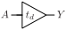
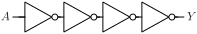
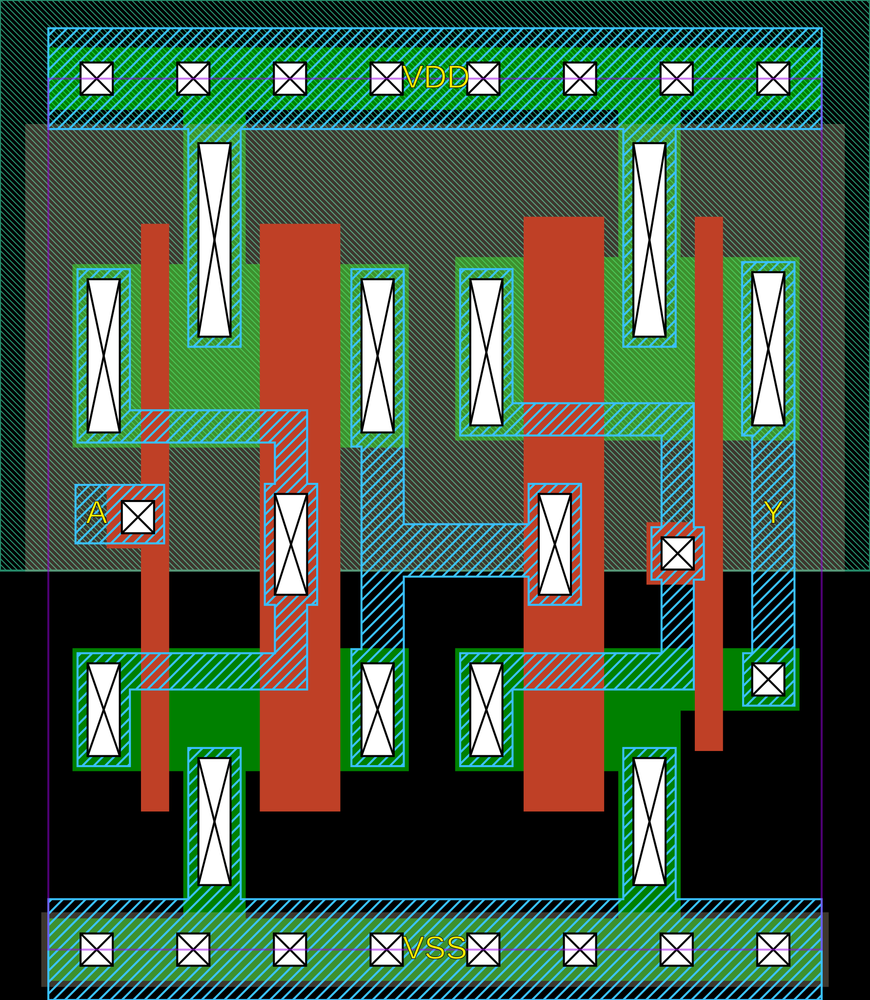
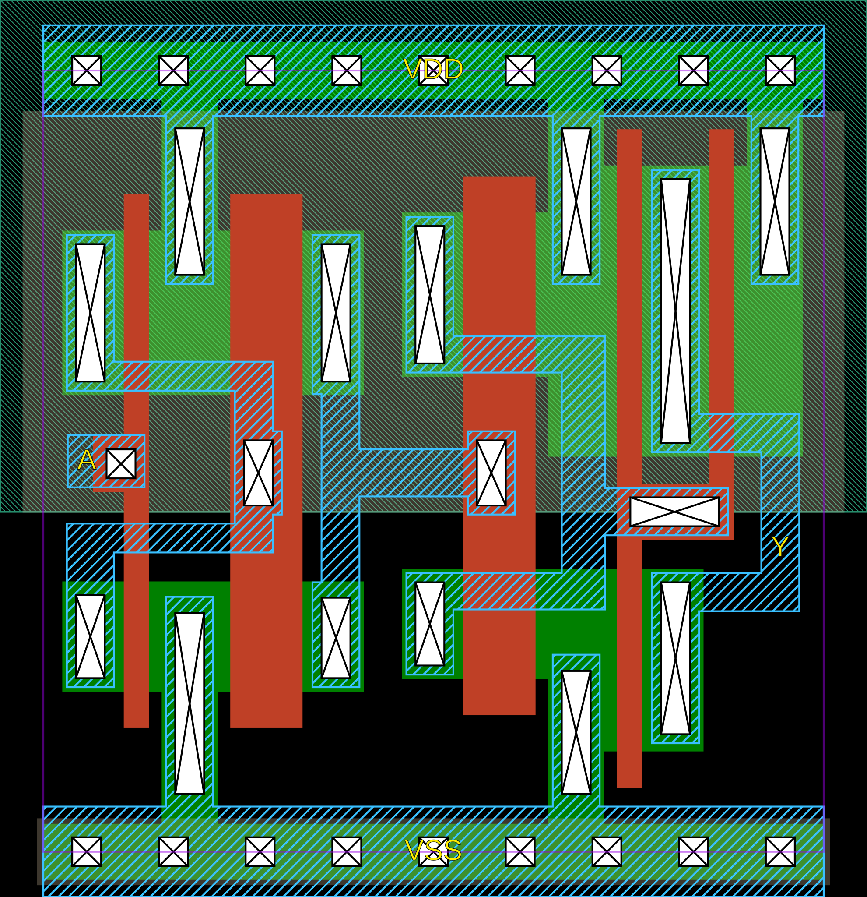

# DLY3

Delay cell with 3x delay

## Pin information

| Pin   | Description   |
| :-:    | :-            |
| A | Input |
| Y | Output |
| VDD | Power supply |
| VSS | Ground |


## Logic function and Truth table

### Logic function (Python)
<div align="center">
Y = A
</div>

### Logic function (Boolean)
\\[ Y = A \\]

### Truth Table for Y


| A | Y |
| :--- | :--- |
| 1 | 1 | 
| 0 | 0 | 


## Symbol

<div align="center">

</div>

## Schematic

<div align="center">

</div>

## Cell variants

| Cell name <br> | Width <br> [unit sites] | Area <br> [\\(\mu m^2\\)] |
| :-        | :-:   | :-:   |
| [DLY3_D1](#dly3_d1) | 8 | 16.5888 |
| [DLY3_D4](#dly3_d4) | 9 | 18.6624 |


### DLY3_D1

#### Hierarchical SPICE netlist
```spice
.subckt DLY3_D1 A Y VDD VSS
Xinv1 A n0 VDD VSS inv_par WN=6e-07 WP=9e-07 
Xinv2 n0 n1 VDD VSS inv_par WN=6e-07 WP=9e-07 L=3.9e-07 
Xinv3 n1 n2 VDD VSS inv_par WN=6e-07 WP=9e-07 L=3.9e-07 
Xinv4 n2 Y VDD VSS inv_par WN=3e-07 WP=9e-07 
.ends
```

#### Flat SPICE netlist
```spice
.subckt DLY3_D1 A Y VDD VSS
XMN0 n0 A VSS VSS sg13_lv_nmos w=6e-07 l=1.3e-07 ad=1.86e-13 as=1.86e-13 pd=1.82e-06 ps=1.82e-06 ng=1 
XMP0 n0 A VDD VDD sg13_lv_pmos w=9e-07 l=1.3e-07 ad=2.79e-13 as=2.79e-13 pd=2.42e-06 ps=2.42e-06 ng=1 
XMN1 n1 n0 VSS VSS sg13_lv_nmos w=6e-07 l=3.9e-07 ad=1.86e-13 as=1.86e-13 pd=1.82e-06 ps=1.82e-06 ng=1 
XMP1 n1 n0 VDD VDD sg13_lv_pmos w=9e-07 l=3.9e-07 ad=2.79e-13 as=2.79e-13 pd=2.42e-06 ps=2.42e-06 ng=1 
XMN2 n2 n1 VSS VSS sg13_lv_nmos w=6e-07 l=3.9e-07 ad=1.86e-13 as=1.86e-13 pd=1.82e-06 ps=1.82e-06 ng=1 
XMP2 n2 n1 VDD VDD sg13_lv_pmos w=9e-07 l=3.9e-07 ad=2.79e-13 as=2.79e-13 pd=2.42e-06 ps=2.42e-06 ng=1 
XMN3 Y n2 VSS VSS sg13_lv_nmos w=3e-07 l=1.3e-07 ad=9.3e-14 as=9.3e-14 pd=1.22e-06 ps=1.22e-06 ng=1 
XMP3 Y n2 VDD VDD sg13_lv_pmos w=9e-07 l=1.3e-07 ad=2.79e-13 as=2.79e-13 pd=2.42e-06 ps=2.42e-06 ng=1 
.ends
```

#### CDL netlist
```cdl
.SUBCKT DLY3_D1 A Y VDD VSS
*.PININFO A:I Y:O VDD:B VSS:B 
MN0 n0 A VSS VSS sg13_lv_nmos w=6e-07 l=1.3e-07 ng=1 
MP0 n0 A VDD VDD sg13_lv_pmos w=9e-07 l=1.3e-07 ng=1 
MN1 n1 n0 VSS VSS sg13_lv_nmos w=6e-07 l=3.9e-07 ng=1 
MP1 n1 n0 VDD VDD sg13_lv_pmos w=9e-07 l=3.9e-07 ng=1 
MN2 n2 n1 VSS VSS sg13_lv_nmos w=6e-07 l=3.9e-07 ng=1 
MP2 n2 n1 VDD VDD sg13_lv_pmos w=9e-07 l=3.9e-07 ng=1 
MN3 Y n2 VSS VSS sg13_lv_nmos w=3e-07 l=1.3e-07 ng=1 
MP3 Y n2 VDD VDD sg13_lv_pmos w=9e-07 l=1.3e-07 ng=1 
.ENDS
```

#### Layout

<div align="center">

</div>

### DLY3_D4

#### Hierarchical SPICE netlist
```spice
.subckt DLY3_D4 A Y VDD VSS
Xinv1 A n0 VDD VSS inv_par WN=6e-07 WP=9e-07 
Xinv2 n0 n1 VDD VSS inv_par WN=6e-07 WP=9e-07 L=3.9e-07 
Xinv3 n1 n2 VDD VSS inv_par WN=6e-07 WP=9e-07 L=3.9e-07 
Xinv4 n2 Y VDD VSS inv_par WN=1e-06 WP=3.2e-06 NGN=2 NGP=2 
.ends
```

#### Flat SPICE netlist
```spice
.subckt DLY3_D4 A Y VDD VSS
XMN0 n0 A VSS VSS sg13_lv_nmos w=6e-07 l=1.3e-07 ad=1.86e-13 as=1.86e-13 pd=1.82e-06 ps=1.82e-06 ng=1 
XMP0 n0 A VDD VDD sg13_lv_pmos w=9e-07 l=1.3e-07 ad=2.79e-13 as=2.79e-13 pd=2.42e-06 ps=2.42e-06 ng=1 
XMN1 n1 n0 VSS VSS sg13_lv_nmos w=6e-07 l=3.9e-07 ad=1.86e-13 as=1.86e-13 pd=1.82e-06 ps=1.82e-06 ng=1 
XMP1 n1 n0 VDD VDD sg13_lv_pmos w=9e-07 l=3.9e-07 ad=2.79e-13 as=2.79e-13 pd=2.42e-06 ps=2.42e-06 ng=1 
XMN2 n2 n1 VSS VSS sg13_lv_nmos w=6e-07 l=3.9e-07 ad=1.86e-13 as=1.86e-13 pd=1.82e-06 ps=1.82e-06 ng=1 
XMP2 n2 n1 VDD VDD sg13_lv_pmos w=9e-07 l=3.9e-07 ad=2.79e-13 as=2.79e-13 pd=2.42e-06 ps=2.42e-06 ng=1 
XMN3 Y n2 VSS VSS sg13_lv_nmos w=1e-06 l=1.3e-07 ad=3.1e-13 as=3.1e-13 pd=2.62e-06 ps=2.62e-06 ng=2 
XMP3 Y n2 VDD VDD sg13_lv_pmos w=3.2e-06 l=1.3e-07 ad=9.92e-13 as=9.92e-13 pd=7.02e-06 ps=7.02e-06 ng=2 
.ends
```

#### CDL netlist
```cdl
.SUBCKT DLY3_D4 A Y VDD VSS
*.PININFO A:I Y:O VDD:B VSS:B 
MN0 n0 A VSS VSS sg13_lv_nmos w=6e-07 l=1.3e-07 ng=1 
MP0 n0 A VDD VDD sg13_lv_pmos w=9e-07 l=1.3e-07 ng=1 
MN1 n1 n0 VSS VSS sg13_lv_nmos w=6e-07 l=3.9e-07 ng=1 
MP1 n1 n0 VDD VDD sg13_lv_pmos w=9e-07 l=3.9e-07 ng=1 
MN2 n2 n1 VSS VSS sg13_lv_nmos w=6e-07 l=3.9e-07 ng=1 
MP2 n2 n1 VDD VDD sg13_lv_pmos w=9e-07 l=3.9e-07 ng=1 
MN3 Y n2 VSS VSS sg13_lv_nmos w=1e-06 l=1.3e-07 ng=2 
MP3 Y n2 VDD VDD sg13_lv_pmos w=3.2e-06 l=1.3e-07 ng=2 
.ENDS
```

#### Layout

<div align="center">

</div>

## Pin capacitance
No pin capacitance data


## Static power
No static power data


## Dynamic power
No dynamic power data


## Delay
No delay data

