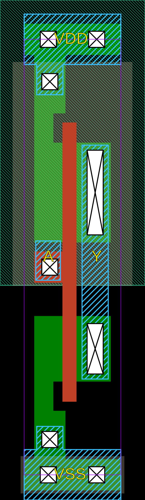

# INV

Standard inverter

<em>Generated on : 15-10-2026 19:50:12</em>

## Pin information

| Pin   | Description   |
| :-:    | :-            |
| A | Inverter input |
| Y | Output |
| VDD | Power supply |
| VSS | Ground |


## Logic function and Truth table

### Logic function (Python)
<div align="center">
Y = ~A
</div>

### Logic function (Boolean)
\\[ Y = ~A \\]

### Truth Table for Y


| A | Y |
| :--- | :--- |
| 0 | 1 | 
| 1 | 0 | 


## Symbol

<div align="center">

</div>

## Schematic

<div align="center">

</div>

## Cell variants

| Cell name <br> | Width <br> [unit sites] | Area <br> [\\(\mu m^2\\)] |
| :-        | :-:   | :-:   |
| [INV_DL](#inv_dl) | TBD | TBD |
| [INV_D1](#inv_d1) | TBD | TBD |
| [INV_D2](#inv_d2) | TBD | TBD |
| [INV_D4](#inv_d4) | TBD | TBD |
| [INV_D8](#inv_d8) | TBD | TBD |
| [INV_D12](#inv_d12) | TBD | TBD |
| [INV_D14](#inv_d14) | TBD | TBD |
| [INV_D16](#inv_d16) | TBD | TBD |


### INV_DL

#### Hierarchical SPICE netlist
```spice
.subckt INV_DL A Y VDD VSS
Xinvl A Y VDD VSS inv_par WN=3.2e-07 WP=6.6e-07 
.ends
```

#### Flat SPICE netlist
```spice
.subckt INV_DL A Y VDD VSS
XMN0 Y A VSS VSS sg13_lv_nmos w=3.2e-07 l=1.3e-07 ad=9.92e-14 as=9.92e-14 pd=1.26e-06 ps=1.26e-06 ng=1 
XMP0 Y A VDD VDD sg13_lv_pmos w=6.6e-07 l=1.3e-07 ad=2.046e-13 as=2.046e-13 pd=1.94e-06 ps=1.94e-06 ng=1 
.ends
```

#### CDL netlist
```cdl
.SUBCKT INV_DL A Y VDD VSS
*.PININFO A:I Y:O VDD:B VSS:B 
MN0 Y A VSS VSS sg13_lv_nmos w=3.2e-07 l=1.3e-07 ng=1 
MP0 Y A VDD VDD sg13_lv_pmos w=6.6e-07 l=1.3e-07 ng=1 
.ENDS
```

#### Layout

<div align="center">

</div>

### INV_D1

#### Hierarchical SPICE netlist
```spice
.subckt INV_D1 A Y VDD VSS
Xinv1 A Y VDD VSS inv_par WN=6.4e-07 WP=9.8e-07 
.ends
```

#### Flat SPICE netlist
```spice
.subckt INV_D1 A Y VDD VSS
XMN0 Y A VSS VSS sg13_lv_nmos w=6.4e-07 l=1.3e-07 ad=1.984e-13 as=1.984e-13 pd=1.9e-06 ps=1.9e-06 ng=1 
XMP0 Y A VDD VDD sg13_lv_pmos w=9.8e-07 l=1.3e-07 ad=3.038e-13 as=3.038e-13 pd=2.58e-06 ps=2.58e-06 ng=1 
.ends
```

#### CDL netlist
```cdl
.SUBCKT INV_D1 A Y VDD VSS
*.PININFO A:I Y:O VDD:B VSS:B 
MN0 Y A VSS VSS sg13_lv_nmos w=6.4e-07 l=1.3e-07 ng=1 
MP0 Y A VDD VDD sg13_lv_pmos w=9.8e-07 l=1.3e-07 ng=1 
.ENDS
```

#### Layout

<div align="center">

</div>

### INV_D2

#### Hierarchical SPICE netlist
```spice
.subckt INV_D2 A Y VDD VSS
Xinv2 A Y VDD VSS inv_par WN=1.07e-06 WP=1.6e-06 
.ends
```

#### Flat SPICE netlist
```spice
.subckt INV_D2 A Y VDD VSS
XMN0 Y A VSS VSS sg13_lv_nmos w=1.07e-06 l=1.3e-07 ad=3.317e-13 as=3.317e-13 pd=2.76e-06 ps=2.76e-06 ng=1 
XMP0 Y A VDD VDD sg13_lv_pmos w=1.6e-06 l=1.3e-07 ad=4.96e-13 as=4.96e-13 pd=3.82e-06 ps=3.82e-06 ng=1 
.ends
```

#### CDL netlist
```cdl
.SUBCKT INV_D2 A Y VDD VSS
*.PININFO A:I Y:O VDD:B VSS:B 
MN0 Y A VSS VSS sg13_lv_nmos w=1.07e-06 l=1.3e-07 ng=1 
MP0 Y A VDD VDD sg13_lv_pmos w=1.6e-06 l=1.3e-07 ng=1 
.ENDS
```

#### Layout

<div align="center">

</div>

### INV_D4

#### Hierarchical SPICE netlist
```spice
.subckt INV_D4 A Y VDD VSS
Xinv4 A Y VDD VSS inv_par WN=2.14e-06 WP=3.2e-06 NGN=2 NGP=2 
.ends
```

#### Flat SPICE netlist
```spice
.subckt INV_D4 A Y VDD VSS
XMN0 Y A VSS VSS sg13_lv_nmos w=2.14e-06 l=1.3e-07 ad=6.634e-13 as=6.634e-13 pd=4.9e-06 ps=4.9e-06 ng=2 
XMP0 Y A VDD VDD sg13_lv_pmos w=3.2e-06 l=1.3e-07 ad=9.92e-13 as=9.92e-13 pd=7.02e-06 ps=7.02e-06 ng=2 
.ends
```

#### CDL netlist
```cdl
.SUBCKT INV_D4 A Y VDD VSS
*.PININFO A:I Y:O VDD:B VSS:B 
MN0 Y A VSS VSS sg13_lv_nmos w=2.14e-06 l=1.3e-07 ng=2 
MP0 Y A VDD VDD sg13_lv_pmos w=3.2e-06 l=1.3e-07 ng=2 
.ENDS
```

#### Layout

<div align="center">

</div>

### INV_D8

#### Hierarchical SPICE netlist
```spice
.subckt INV_D8 A Y VDD VSS
Xinv8 A Y VDD VSS inv_par WN=4.28e-06 WP=6.4e-06 NGN=4 NGP=4 
.ends
```

#### Flat SPICE netlist
```spice
.subckt INV_D8 A Y VDD VSS
XMN0 Y A VSS VSS sg13_lv_nmos w=4.28e-06 l=1.3e-07 ad=1.327e-12 as=1.327e-12 pd=9.18e-06 ps=9.18e-06 ng=4 
XMP0 Y A VDD VDD sg13_lv_pmos w=6.4e-06 l=1.3e-07 ad=1.984e-12 as=1.984e-12 pd=1.342e-05 ps=1.342e-05 ng=4 
.ends
```

#### CDL netlist
```cdl
.SUBCKT INV_D8 A Y VDD VSS
*.PININFO A:I Y:O VDD:B VSS:B 
MN0 Y A VSS VSS sg13_lv_nmos w=4.28e-06 l=1.3e-07 ng=4 
MP0 Y A VDD VDD sg13_lv_pmos w=6.4e-06 l=1.3e-07 ng=4 
.ENDS
```

#### Layout

<div align="center">

</div>

### INV_D12

#### Hierarchical SPICE netlist
```spice
.subckt INV_D12 A Y VDD VSS
Xinv12 A Y VDD VSS inv_par WN=6.4199999999999995e-06 WP=9.6e-06 NGN=6 NGP=6 
.ends
```

#### Flat SPICE netlist
```spice
.subckt INV_D12 A Y VDD VSS
XMN0 Y A VSS VSS sg13_lv_nmos w=6.42e-06 l=1.3e-07 ad=1.99e-12 as=1.99e-12 pd=1.346e-05 ps=1.346e-05 ng=6 
XMP0 Y A VDD VDD sg13_lv_pmos w=9.6e-06 l=1.3e-07 ad=2.976e-12 as=2.976e-12 pd=1.982e-05 ps=1.982e-05 ng=6 
.ends
```

#### CDL netlist
```cdl
.SUBCKT INV_D12 A Y VDD VSS
*.PININFO A:I Y:O VDD:B VSS:B 
MN0 Y A VSS VSS sg13_lv_nmos w=6.42e-06 l=1.3e-07 ng=6 
MP0 Y A VDD VDD sg13_lv_pmos w=9.6e-06 l=1.3e-07 ng=6 
.ENDS
```

#### Layout

<div align="center">

</div>

### INV_D14

#### Hierarchical SPICE netlist
```spice
.subckt INV_D14 A Y VDD VSS
Xinv14 A Y VDD VSS inv_par WN=7.4899999999999994e-06 WP=1.12e-05 NGN=7 NGP=7 
.ends
```

#### Flat SPICE netlist
```spice
.subckt INV_D14 A Y VDD VSS
XMN0 Y A VSS VSS sg13_lv_nmos w=7.49e-06 l=1.3e-07 ad=2.322e-12 as=2.322e-12 pd=1.56e-05 ps=1.56e-05 ng=7 
XMP0 Y A VDD VDD sg13_lv_pmos w=1.12e-05 l=1.3e-07 ad=3.472e-12 as=3.472e-12 pd=2.302e-05 ps=2.302e-05 ng=7 
.ends
```

#### CDL netlist
```cdl
.SUBCKT INV_D14 A Y VDD VSS
*.PININFO A:I Y:O VDD:B VSS:B 
MN0 Y A VSS VSS sg13_lv_nmos w=7.49e-06 l=1.3e-07 ng=7 
MP0 Y A VDD VDD sg13_lv_pmos w=1.12e-05 l=1.3e-07 ng=7 
.ENDS
```

#### Layout

<div align="center">

</div>

### INV_D16

#### Hierarchical SPICE netlist
```spice
.subckt INV_D16 A Y VDD VSS
Xinv16 A Y VDD VSS inv_par WN=8.56e-06 WP=1.28e-05 NGN=8 NGP=8 
.ends
```

#### Flat SPICE netlist
```spice
.subckt INV_D16 A Y VDD VSS
XMN0 Y A VSS VSS sg13_lv_nmos w=8.56e-06 l=1.3e-07 ad=2.654e-12 as=2.654e-12 pd=1.774e-05 ps=1.774e-05 ng=8 
XMP0 Y A VDD VDD sg13_lv_pmos w=1.28e-05 l=1.3e-07 ad=3.968e-12 as=3.968e-12 pd=2.622e-05 ps=2.622e-05 ng=8 
.ends
```

#### CDL netlist
```cdl
.SUBCKT INV_D16 A Y VDD VSS
*.PININFO A:I Y:O VDD:B VSS:B 
MN0 Y A VSS VSS sg13_lv_nmos w=8.56e-06 l=1.3e-07 ng=8 
MP0 Y A VDD VDD sg13_lv_pmos w=1.28e-05 l=1.3e-07 ng=8 
.ENDS
```

#### Layout

<div align="center">

</div>

## Pin capacitance
No pin capacitance data


## Static power
No static power data


## Dynamic power
No dynamic power data


## Delay
No delay data

