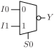
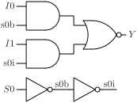

# MUX2N

Two input multiplexer with inverted output.

## Pin information

| Pin   | Description   |
| :-:    | :-            |
| I0 | Input 0 |
| I1 | Input 1 |
| S0 | Select control signal |
| YN | Output, inverted |
| VDD | Power supply |
| VSS | Ground |


## Logic function and Truth table

### Logic function (Python)
<div align="center">
Y = ~((I0 & ~S0) | (I1 & S0))
</div>

### Logic function (Boolean)
\\[ Y = \overline{ (I0 \cdot \overline{S0} + I1 \cdot S0) } \\]

### Truth Table for YN


| I0 | I1 | S0 | YN |
| :--- | :--- | :--- | :--- |
| - | 0 | 1 | 1 | 
| 0 | - | 0 | 1 | 
| 1 | - | 0 | 0 | 
| - | 1 | 1 | 0 | 


## Symbol

<div align="center">

</div>

## Schematic

<div align="center">

</div>

## Cell variants

| Cell name <br> | Width <br> [unit sites] | Area <br> [\\(\mu m^2\\)] |
| :-        | :-:   | :-:   |
| [MUX2N_DL](#mux2n_dl) | TBD | TBD |
| [MUX2N_D1](#mux2n_d1) | TBD | TBD |


### MUX2N_DL

#### Hierarchical SPICE netlist
```spice
.subckt MUX2N_DL I0 I1 S0 YN VDD VSS
Xinv_S0 S0 S0B VDD VSS inv_par WN=1.5e-07 WP=2.3e-07 
Xinvz_I0 I0 S0B S0 YN VDD VSS invz_par WN=3.2e-07 WP=4.800000000000001e-07 
Xinvz_I1 I1 S0 S0B YN VDD VSS invz_par WN=3.2e-07 WP=4.800000000000001e-07 
.ends
```

#### Flat SPICE netlist
```spice
.subckt MUX2N_DL I0 I1 S0 YN VDD VSS
XMN0 n0 S0 VSS VSS sg13_lv_nmos w=1.5e-07 l=1.3e-07 ad=4.65e-14 as=4.65e-14 pd=9.2e-07 ps=9.2e-07 ng=1 
XMP0 n0 S0 VDD VDD sg13_lv_pmos w=2.3e-07 l=1.3e-07 ad=7.13e-14 as=7.13e-14 pd=1.08e-06 ps=1.08e-06 ng=1 
XMN1 YN n0 n1 VSS sg13_lv_nmos w=3.2e-07 l=1.3e-07 ad=9.92e-14 as=9.92e-14 pd=1.26e-06 ps=1.26e-06 ng=1 
XMN2 n1 I0 VSS VSS sg13_lv_nmos w=3.2e-07 l=1.3e-07 ad=9.92e-14 as=9.92e-14 pd=1.26e-06 ps=1.26e-06 ng=1 
XMP1 YN S0 n2 VDD sg13_lv_pmos w=4.8e-07 l=1.3e-07 ad=1.488e-13 as=1.488e-13 pd=1.58e-06 ps=1.58e-06 ng=1 
XMP2 n2 I0 VDD VDD sg13_lv_pmos w=4.8e-07 l=1.3e-07 ad=1.488e-13 as=1.488e-13 pd=1.58e-06 ps=1.58e-06 ng=1 
XMN3 YN S0 n3 VSS sg13_lv_nmos w=3.2e-07 l=1.3e-07 ad=9.92e-14 as=9.92e-14 pd=1.26e-06 ps=1.26e-06 ng=1 
XMN4 n3 I1 VSS VSS sg13_lv_nmos w=3.2e-07 l=1.3e-07 ad=9.92e-14 as=9.92e-14 pd=1.26e-06 ps=1.26e-06 ng=1 
XMP3 YN n0 n4 VDD sg13_lv_pmos w=4.8e-07 l=1.3e-07 ad=1.488e-13 as=1.488e-13 pd=1.58e-06 ps=1.58e-06 ng=1 
XMP4 n4 I1 VDD VDD sg13_lv_pmos w=4.8e-07 l=1.3e-07 ad=1.488e-13 as=1.488e-13 pd=1.58e-06 ps=1.58e-06 ng=1 
.ends
```

#### CDL netlist
```cdl
.SUBCKT MUX2N_DL I0 I1 S0 YN VDD VSS
*.PININFO I0:I I1:I S0:I YN:O VDD:B VSS:B 
MN0 n0 S0 VSS VSS sg13_lv_nmos w=1.5e-07 l=1.3e-07 ng=1 
MP0 n0 S0 VDD VDD sg13_lv_pmos w=2.3e-07 l=1.3e-07 ng=1 
MN1 YN n0 n1 VSS sg13_lv_nmos w=3.2e-07 l=1.3e-07 ng=1 
MN2 n1 I0 VSS VSS sg13_lv_nmos w=3.2e-07 l=1.3e-07 ng=1 
MP1 YN S0 n2 VDD sg13_lv_pmos w=4.8e-07 l=1.3e-07 ng=1 
MP2 n2 I0 VDD VDD sg13_lv_pmos w=4.8e-07 l=1.3e-07 ng=1 
MN3 YN S0 n3 VSS sg13_lv_nmos w=3.2e-07 l=1.3e-07 ng=1 
MN4 n3 I1 VSS VSS sg13_lv_nmos w=3.2e-07 l=1.3e-07 ng=1 
MP3 YN n0 n4 VDD sg13_lv_pmos w=4.8e-07 l=1.3e-07 ng=1 
MP4 n4 I1 VDD VDD sg13_lv_pmos w=4.8e-07 l=1.3e-07 ng=1 
.ENDS
```

#### Layout

<div align="center">

</div>

### MUX2N_D1

#### Hierarchical SPICE netlist
```spice
.subckt MUX2N_D1 I0 I1 S0 YN VDD VSS
Xinv_S0 S0 S0B VDD VSS inv_par WN=2.4e-07 WP=3.5999999999999994e-07 
Xinvz_I0 I0 S0B S0 YN VDD VSS invz_par WN=6.4e-07 WP=9.600000000000001e-07 
Xinvz_I1 I1 S0 S0B YN VDD VSS invz_par WN=6.4e-07 WP=9.600000000000001e-07 
.ends
```

#### Flat SPICE netlist
```spice
.subckt MUX2N_D1 I0 I1 S0 YN VDD VSS
XMN0 n0 S0 VSS VSS sg13_lv_nmos w=2.4e-07 l=1.3e-07 ad=7.44e-14 as=7.44e-14 pd=1.1e-06 ps=1.1e-06 ng=1 
XMP0 n0 S0 VDD VDD sg13_lv_pmos w=3.6e-07 l=1.3e-07 ad=1.116e-13 as=1.116e-13 pd=1.34e-06 ps=1.34e-06 ng=1 
XMN1 YN n0 n1 VSS sg13_lv_nmos w=6.4e-07 l=1.3e-07 ad=1.984e-13 as=1.984e-13 pd=1.9e-06 ps=1.9e-06 ng=1 
XMN2 n1 I0 VSS VSS sg13_lv_nmos w=6.4e-07 l=1.3e-07 ad=1.984e-13 as=1.984e-13 pd=1.9e-06 ps=1.9e-06 ng=1 
XMP1 YN S0 n2 VDD sg13_lv_pmos w=9.6e-07 l=1.3e-07 ad=2.976e-13 as=2.976e-13 pd=2.54e-06 ps=2.54e-06 ng=1 
XMP2 n2 I0 VDD VDD sg13_lv_pmos w=9.6e-07 l=1.3e-07 ad=2.976e-13 as=2.976e-13 pd=2.54e-06 ps=2.54e-06 ng=1 
XMN3 YN S0 n3 VSS sg13_lv_nmos w=6.4e-07 l=1.3e-07 ad=1.984e-13 as=1.984e-13 pd=1.9e-06 ps=1.9e-06 ng=1 
XMN4 n3 I1 VSS VSS sg13_lv_nmos w=6.4e-07 l=1.3e-07 ad=1.984e-13 as=1.984e-13 pd=1.9e-06 ps=1.9e-06 ng=1 
XMP3 YN n0 n4 VDD sg13_lv_pmos w=9.6e-07 l=1.3e-07 ad=2.976e-13 as=2.976e-13 pd=2.54e-06 ps=2.54e-06 ng=1 
XMP4 n4 I1 VDD VDD sg13_lv_pmos w=9.6e-07 l=1.3e-07 ad=2.976e-13 as=2.976e-13 pd=2.54e-06 ps=2.54e-06 ng=1 
.ends
```

#### CDL netlist
```cdl
.SUBCKT MUX2N_D1 I0 I1 S0 YN VDD VSS
*.PININFO I0:I I1:I S0:I YN:O VDD:B VSS:B 
MN0 n0 S0 VSS VSS sg13_lv_nmos w=2.4e-07 l=1.3e-07 ng=1 
MP0 n0 S0 VDD VDD sg13_lv_pmos w=3.6e-07 l=1.3e-07 ng=1 
MN1 YN n0 n1 VSS sg13_lv_nmos w=6.4e-07 l=1.3e-07 ng=1 
MN2 n1 I0 VSS VSS sg13_lv_nmos w=6.4e-07 l=1.3e-07 ng=1 
MP1 YN S0 n2 VDD sg13_lv_pmos w=9.6e-07 l=1.3e-07 ng=1 
MP2 n2 I0 VDD VDD sg13_lv_pmos w=9.6e-07 l=1.3e-07 ng=1 
MN3 YN S0 n3 VSS sg13_lv_nmos w=6.4e-07 l=1.3e-07 ng=1 
MN4 n3 I1 VSS VSS sg13_lv_nmos w=6.4e-07 l=1.3e-07 ng=1 
MP3 YN n0 n4 VDD sg13_lv_pmos w=9.6e-07 l=1.3e-07 ng=1 
MP4 n4 I1 VDD VDD sg13_lv_pmos w=9.6e-07 l=1.3e-07 ng=1 
.ENDS
```

#### Layout

<div align="center">

</div>

## Pin capacitance
No pin capacitance data


## Static power
No static power data


## Dynamic power
No dynamic power data


## Delay
No delay data

