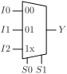
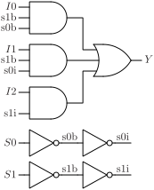

# MUX3

Three input multiplexer.

## Pin information

| Pin   | Description   |
| :-:    | :-            |
| I0 | Input 0 |
| I1 | Input 1 |
| I2 | Input 2 |
| S0 | Select control signal bit 0 |
| S1 | Select control signal bit 1 |
| Y | Output |
| VDD | Power supply |
| VSS | Ground |


## Logic function and Truth table

### Logic function (Python)
<div align="center">
Y = (I0 & ~S0 & ~S1) | (I1 & S0 & ~S1) | (I2 & S1)
</div>

### Logic function (Boolean)
\\[ Y = (I0 \cdot \overline{S0} \cdot \overline{S1} + I1 \cdot S0 \cdot \overline{S1} + I2 \cdot S1) \\]

### Truth Table for Y


| I0 | I1 | I2 | S0 | S1 | Y |
| :--- | :--- | :--- | :--- | :--- | :--- |
| - | - | 1 | - | 1 | 1 | 
| - | 1 | - | 1 | 0 | 1 | 
| 1 | - | - | 0 | 0 | 1 | 
| - | - | 0 | - | 1 | 0 | 
| 0 | - | - | 0 | 0 | 0 | 
| - | 0 | - | 1 | 0 | 0 | 


## Symbol

<div align="center">

</div>

## Schematic

<div align="center">

</div>

## Cell variants

| Cell name <br> | Width <br> [unit sites] | Area <br> [\\(\mu m^2\\)] |
| :-        | :-:   | :-:   |
| [MUX3_DL](#mux3_dl) | TBD | TBD |
| [MUX3_D1](#mux3_d1) | TBD | TBD |


### MUX3_DL

#### Hierarchical SPICE netlist
```spice
.subckt MUX3_DL I0 I1 I2 S0 S1 Y VDD VSS
Xinv_S0 S0 S0B VDD VSS inv_par WN=1.5e-07 WP=2.3e-07 
Xinv_S1 S1 S1B VDD VSS inv_par WN=1.5e-07 WP=2.3e-07 
Xinv_y NY Y VDD VSS inv_par WN=3.2e-07 WP=4.9e-07 
Xinvz_I0 I0 S0B S0 intNY VDD VSS invz_par WN=3e-07 WP=4.5e-07 
Xinvz_I1 I1 S0 S0B intNY VDD VSS invz_par WN=3e-07 WP=4.5e-07 
Xinvz_I2 I2 S1 S1B NY VDD VSS invz_par WN=2.3e-07 WP=3e-07 
Xtgate intNY NY S1B S1 VDD VSS tgate_par WN=3e-07 WP=4.5e-07 
.ends
```

#### Flat SPICE netlist
```spice
.subckt MUX3_DL I0 I1 I2 S0 S1 Y VDD VSS
XMN0 n0 S0 VSS VSS sg13_lv_nmos w=1.5e-07 l=1.3e-07 ad=4.65e-14 as=4.65e-14 pd=9.2e-07 ps=9.2e-07 ng=1 
XMP0 n0 S0 VDD VDD sg13_lv_pmos w=2.3e-07 l=1.3e-07 ad=7.13e-14 as=7.13e-14 pd=1.08e-06 ps=1.08e-06 ng=1 
XMN1 n1 S1 VSS VSS sg13_lv_nmos w=1.5e-07 l=1.3e-07 ad=4.65e-14 as=4.65e-14 pd=9.2e-07 ps=9.2e-07 ng=1 
XMP1 n1 S1 VDD VDD sg13_lv_pmos w=2.3e-07 l=1.3e-07 ad=7.13e-14 as=7.13e-14 pd=1.08e-06 ps=1.08e-06 ng=1 
XMN2 Y n2 VSS VSS sg13_lv_nmos w=3.2e-07 l=1.3e-07 ad=9.92e-14 as=9.92e-14 pd=1.26e-06 ps=1.26e-06 ng=1 
XMP2 Y n2 VDD VDD sg13_lv_pmos w=4.9e-07 l=1.3e-07 ad=1.519e-13 as=1.519e-13 pd=1.6e-06 ps=1.6e-06 ng=1 
XMN3 n3 n0 n4 VSS sg13_lv_nmos w=3e-07 l=1.3e-07 ad=9.3e-14 as=9.3e-14 pd=1.22e-06 ps=1.22e-06 ng=1 
XMN4 n4 I0 VSS VSS sg13_lv_nmos w=3e-07 l=1.3e-07 ad=9.3e-14 as=9.3e-14 pd=1.22e-06 ps=1.22e-06 ng=1 
XMP3 n3 S0 n5 VDD sg13_lv_pmos w=4.5e-07 l=1.3e-07 ad=1.395e-13 as=1.395e-13 pd=1.52e-06 ps=1.52e-06 ng=1 
XMP4 n5 I0 VDD VDD sg13_lv_pmos w=4.5e-07 l=1.3e-07 ad=1.395e-13 as=1.395e-13 pd=1.52e-06 ps=1.52e-06 ng=1 
XMN5 n3 S0 n6 VSS sg13_lv_nmos w=3e-07 l=1.3e-07 ad=9.3e-14 as=9.3e-14 pd=1.22e-06 ps=1.22e-06 ng=1 
XMN6 n6 I1 VSS VSS sg13_lv_nmos w=3e-07 l=1.3e-07 ad=9.3e-14 as=9.3e-14 pd=1.22e-06 ps=1.22e-06 ng=1 
XMP5 n3 n0 n7 VDD sg13_lv_pmos w=4.5e-07 l=1.3e-07 ad=1.395e-13 as=1.395e-13 pd=1.52e-06 ps=1.52e-06 ng=1 
XMP6 n7 I1 VDD VDD sg13_lv_pmos w=4.5e-07 l=1.3e-07 ad=1.395e-13 as=1.395e-13 pd=1.52e-06 ps=1.52e-06 ng=1 
XMN7 n2 S1 n8 VSS sg13_lv_nmos w=2.3e-07 l=1.3e-07 ad=7.13e-14 as=7.13e-14 pd=1.08e-06 ps=1.08e-06 ng=1 
XMN8 n8 I2 VSS VSS sg13_lv_nmos w=2.3e-07 l=1.3e-07 ad=7.13e-14 as=7.13e-14 pd=1.08e-06 ps=1.08e-06 ng=1 
XMP7 n2 n1 n9 VDD sg13_lv_pmos w=3e-07 l=1.3e-07 ad=9.3e-14 as=9.3e-14 pd=1.22e-06 ps=1.22e-06 ng=1 
XMP8 n9 I2 VDD VDD sg13_lv_pmos w=3e-07 l=1.3e-07 ad=9.3e-14 as=9.3e-14 pd=1.22e-06 ps=1.22e-06 ng=1 
XMN9 n3 n1 n2 VSS sg13_lv_nmos w=3e-07 l=1.3e-07 ad=9.3e-14 as=9.3e-14 pd=1.22e-06 ps=1.22e-06 ng=1 
XMP9 n3 S1 n2 VDD sg13_lv_pmos w=4.5e-07 l=1.3e-07 ad=1.395e-13 as=1.395e-13 pd=1.52e-06 ps=1.52e-06 ng=1 
.ends
```

#### CDL netlist
```cdl
.SUBCKT MUX3_DL I0 I1 I2 S0 S1 Y VDD VSS
*.PININFO I1:I I0:I I2:I S1:I S0:I Y:O VDD:B VSS:B 
MN0 n0 S0 VSS VSS sg13_lv_nmos w=1.5e-07 l=1.3e-07 ng=1 
MP0 n0 S0 VDD VDD sg13_lv_pmos w=2.3e-07 l=1.3e-07 ng=1 
MN1 n1 S1 VSS VSS sg13_lv_nmos w=1.5e-07 l=1.3e-07 ng=1 
MP1 n1 S1 VDD VDD sg13_lv_pmos w=2.3e-07 l=1.3e-07 ng=1 
MN2 Y n2 VSS VSS sg13_lv_nmos w=3.2e-07 l=1.3e-07 ng=1 
MP2 Y n2 VDD VDD sg13_lv_pmos w=4.9e-07 l=1.3e-07 ng=1 
MN3 n3 n0 n4 VSS sg13_lv_nmos w=3e-07 l=1.3e-07 ng=1 
MN4 n4 I0 VSS VSS sg13_lv_nmos w=3e-07 l=1.3e-07 ng=1 
MP3 n3 S0 n5 VDD sg13_lv_pmos w=4.5e-07 l=1.3e-07 ng=1 
MP4 n5 I0 VDD VDD sg13_lv_pmos w=4.5e-07 l=1.3e-07 ng=1 
MN5 n3 S0 n6 VSS sg13_lv_nmos w=3e-07 l=1.3e-07 ng=1 
MN6 n6 I1 VSS VSS sg13_lv_nmos w=3e-07 l=1.3e-07 ng=1 
MP5 n3 n0 n7 VDD sg13_lv_pmos w=4.5e-07 l=1.3e-07 ng=1 
MP6 n7 I1 VDD VDD sg13_lv_pmos w=4.5e-07 l=1.3e-07 ng=1 
MN7 n2 S1 n8 VSS sg13_lv_nmos w=2.3e-07 l=1.3e-07 ng=1 
MN8 n8 I2 VSS VSS sg13_lv_nmos w=2.3e-07 l=1.3e-07 ng=1 
MP7 n2 n1 n9 VDD sg13_lv_pmos w=3e-07 l=1.3e-07 ng=1 
MP8 n9 I2 VDD VDD sg13_lv_pmos w=3e-07 l=1.3e-07 ng=1 
MN9 n3 n1 n2 VSS sg13_lv_nmos w=3e-07 l=1.3e-07 ng=1 
MP9 n3 S1 n2 VDD sg13_lv_pmos w=4.5e-07 l=1.3e-07 ng=1 
.ENDS
```

#### Layout

<div align="center">

</div>

### MUX3_D1

#### Hierarchical SPICE netlist
```spice
.subckt MUX3_D1 I0 I1 I2 S0 S1 Y VDD VSS
Xinv_S0 S0 S0B VDD VSS inv_par WN=2.5e-07 WP=4e-07 
Xinv_S1 S1 S1B VDD VSS inv_par WN=1.5e-07 WP=2.3e-07 
Xinv_y NY Y VDD VSS inv_par WN=6.4e-07 WP=9.8e-07 
Xinvz_I0 I0 S0B S0 intNY VDD VSS invz_par WN=6e-07 WP=9e-07 
Xinvz_I1 I1 S0 S0B intNY VDD VSS invz_par WN=6e-07 WP=9e-07 
Xinvz_I2 I2 S1 S1B NY VDD VSS invz_par WN=4.2999999999999996e-07 WP=6e-07 
Xtgateand3 intNY NY S1B S1 VDD VSS tgate_par WN=6e-07 WP=9e-07 
.ends
```

#### Flat SPICE netlist
```spice
.subckt MUX3_D1 I0 I1 I2 S0 S1 Y VDD VSS
XMN0 n0 S0 VSS VSS sg13_lv_nmos w=2.5e-07 l=1.3e-07 ad=7.75e-14 as=7.75e-14 pd=1.12e-06 ps=1.12e-06 ng=1 
XMP0 n0 S0 VDD VDD sg13_lv_pmos w=4e-07 l=1.3e-07 ad=1.24e-13 as=1.24e-13 pd=1.42e-06 ps=1.42e-06 ng=1 
XMN1 n1 S1 VSS VSS sg13_lv_nmos w=1.5e-07 l=1.3e-07 ad=4.65e-14 as=4.65e-14 pd=9.2e-07 ps=9.2e-07 ng=1 
XMP1 n1 S1 VDD VDD sg13_lv_pmos w=2.3e-07 l=1.3e-07 ad=7.13e-14 as=7.13e-14 pd=1.08e-06 ps=1.08e-06 ng=1 
XMN2 Y n2 VSS VSS sg13_lv_nmos w=6.4e-07 l=1.3e-07 ad=1.984e-13 as=1.984e-13 pd=1.9e-06 ps=1.9e-06 ng=1 
XMP2 Y n2 VDD VDD sg13_lv_pmos w=9.8e-07 l=1.3e-07 ad=3.038e-13 as=3.038e-13 pd=2.58e-06 ps=2.58e-06 ng=1 
XMN3 n3 n0 n4 VSS sg13_lv_nmos w=6e-07 l=1.3e-07 ad=1.86e-13 as=1.86e-13 pd=1.82e-06 ps=1.82e-06 ng=1 
XMN4 n4 I0 VSS VSS sg13_lv_nmos w=6e-07 l=1.3e-07 ad=1.86e-13 as=1.86e-13 pd=1.82e-06 ps=1.82e-06 ng=1 
XMP3 n3 S0 n5 VDD sg13_lv_pmos w=9e-07 l=1.3e-07 ad=2.79e-13 as=2.79e-13 pd=2.42e-06 ps=2.42e-06 ng=1 
XMP4 n5 I0 VDD VDD sg13_lv_pmos w=9e-07 l=1.3e-07 ad=2.79e-13 as=2.79e-13 pd=2.42e-06 ps=2.42e-06 ng=1 
XMN5 n3 S0 n6 VSS sg13_lv_nmos w=6e-07 l=1.3e-07 ad=1.86e-13 as=1.86e-13 pd=1.82e-06 ps=1.82e-06 ng=1 
XMN6 n6 I1 VSS VSS sg13_lv_nmos w=6e-07 l=1.3e-07 ad=1.86e-13 as=1.86e-13 pd=1.82e-06 ps=1.82e-06 ng=1 
XMP5 n3 n0 n7 VDD sg13_lv_pmos w=9e-07 l=1.3e-07 ad=2.79e-13 as=2.79e-13 pd=2.42e-06 ps=2.42e-06 ng=1 
XMP6 n7 I1 VDD VDD sg13_lv_pmos w=9e-07 l=1.3e-07 ad=2.79e-13 as=2.79e-13 pd=2.42e-06 ps=2.42e-06 ng=1 
XMN7 n2 S1 n8 VSS sg13_lv_nmos w=4.3e-07 l=1.3e-07 ad=1.333e-13 as=1.333e-13 pd=1.48e-06 ps=1.48e-06 ng=1 
XMN8 n8 I2 VSS VSS sg13_lv_nmos w=4.3e-07 l=1.3e-07 ad=1.333e-13 as=1.333e-13 pd=1.48e-06 ps=1.48e-06 ng=1 
XMP7 n2 n1 n9 VDD sg13_lv_pmos w=6e-07 l=1.3e-07 ad=1.86e-13 as=1.86e-13 pd=1.82e-06 ps=1.82e-06 ng=1 
XMP8 n9 I2 VDD VDD sg13_lv_pmos w=6e-07 l=1.3e-07 ad=1.86e-13 as=1.86e-13 pd=1.82e-06 ps=1.82e-06 ng=1 
XMN9 n3 n1 n2 VSS sg13_lv_nmos w=6e-07 l=1.3e-07 ad=1.86e-13 as=1.86e-13 pd=1.82e-06 ps=1.82e-06 ng=1 
XMP9 n3 S1 n2 VDD sg13_lv_pmos w=9e-07 l=1.3e-07 ad=2.79e-13 as=2.79e-13 pd=2.42e-06 ps=2.42e-06 ng=1 
.ends
```

#### CDL netlist
```cdl
.SUBCKT MUX3_D1 I0 I1 I2 S0 S1 Y VDD VSS
*.PININFO I1:I I0:I I2:I S1:I S0:I Y:O VDD:B VSS:B 
MN0 n0 S0 VSS VSS sg13_lv_nmos w=2.5e-07 l=1.3e-07 ng=1 
MP0 n0 S0 VDD VDD sg13_lv_pmos w=4e-07 l=1.3e-07 ng=1 
MN1 n1 S1 VSS VSS sg13_lv_nmos w=1.5e-07 l=1.3e-07 ng=1 
MP1 n1 S1 VDD VDD sg13_lv_pmos w=2.3e-07 l=1.3e-07 ng=1 
MN2 Y n2 VSS VSS sg13_lv_nmos w=6.4e-07 l=1.3e-07 ng=1 
MP2 Y n2 VDD VDD sg13_lv_pmos w=9.8e-07 l=1.3e-07 ng=1 
MN3 n3 n0 n4 VSS sg13_lv_nmos w=6e-07 l=1.3e-07 ng=1 
MN4 n4 I0 VSS VSS sg13_lv_nmos w=6e-07 l=1.3e-07 ng=1 
MP3 n3 S0 n5 VDD sg13_lv_pmos w=9e-07 l=1.3e-07 ng=1 
MP4 n5 I0 VDD VDD sg13_lv_pmos w=9e-07 l=1.3e-07 ng=1 
MN5 n3 S0 n6 VSS sg13_lv_nmos w=6e-07 l=1.3e-07 ng=1 
MN6 n6 I1 VSS VSS sg13_lv_nmos w=6e-07 l=1.3e-07 ng=1 
MP5 n3 n0 n7 VDD sg13_lv_pmos w=9e-07 l=1.3e-07 ng=1 
MP6 n7 I1 VDD VDD sg13_lv_pmos w=9e-07 l=1.3e-07 ng=1 
MN7 n2 S1 n8 VSS sg13_lv_nmos w=4.3e-07 l=1.3e-07 ng=1 
MN8 n8 I2 VSS VSS sg13_lv_nmos w=4.3e-07 l=1.3e-07 ng=1 
MP7 n2 n1 n9 VDD sg13_lv_pmos w=6e-07 l=1.3e-07 ng=1 
MP8 n9 I2 VDD VDD sg13_lv_pmos w=6e-07 l=1.3e-07 ng=1 
MN9 n3 n1 n2 VSS sg13_lv_nmos w=6e-07 l=1.3e-07 ng=1 
MP9 n3 S1 n2 VDD sg13_lv_pmos w=9e-07 l=1.3e-07 ng=1 
.ENDS
```

#### Layout

<div align="center">

</div>

## Pin capacitance
No pin capacitance data


## Static power
No static power data


## Dynamic power
No dynamic power data


## Delay
No delay data

