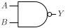

# NAND2

Two input NAND gate

## Pin information

| Pin   | Description   |
| :-:    | :-            |
| A | Input A |
| B | Input B |
| Y | Output |
| VDD | Power supply |
| VSS | Ground |


## Logic function and Truth table

### Logic function (Python)
<div align="center">
Y = ~(A & B)
</div>

### Logic function (Boolean)
\\[ Y = \overline{A \cdot B} \\]

### Truth Table for Y


| A | B | Y |
| :--- | :--- | :--- |
| 0 | - | 1 | 
| - | 0 | 1 | 
| 1 | 1 | 0 | 


## Symbol

<div align="center">

</div>

## Schematic

<div align="center">

</div>

## Cell variants

| Cell name <br> | Width <br> [unit sites] | Area <br> [\\(\mu m^2\\)] |
| :-        | :-:   | :-:   |
| [NAND2_DL](#nand2_dl) | TBD | TBD |
| [NAND2_D1](#nand2_d1) | TBD | TBD |
| [NAND2_D2](#nand2_d2) | TBD | TBD |
| [NAND2_D4](#nand2_d4) | TBD | TBD |
| [NAND2_D8](#nand2_d8) | TBD | TBD |


### NAND2_DL

#### Hierarchical SPICE netlist
```spice
.subckt NAND2_DL A B Y VDD VSS
Xnand2_dl A B Y VDD VSS nand2_par WN=4.5e-07 WP=4.9e-07 
.ends
```

#### Flat SPICE netlist
```spice
.subckt NAND2_DL A B Y VDD VSS
XMN0 n0 A VSS VSS sg13_lv_nmos w=4.5e-07 l=1.3e-07 ad=1.395e-13 as=1.395e-13 pd=1.52e-06 ps=1.52e-06 ng=1 
XMN1 Y B n0 VSS sg13_lv_nmos w=4.5e-07 l=1.3e-07 ad=1.395e-13 as=1.395e-13 pd=1.52e-06 ps=1.52e-06 ng=1 
XMP0 Y A VDD VDD sg13_lv_pmos w=4.9e-07 l=1.3e-07 ad=1.519e-13 as=1.519e-13 pd=1.6e-06 ps=1.6e-06 ng=1 
XMP1 Y B VDD VDD sg13_lv_pmos w=4.9e-07 l=1.3e-07 ad=1.519e-13 as=1.519e-13 pd=1.6e-06 ps=1.6e-06 ng=1 
.ends
```

#### CDL netlist
```cdl
.SUBCKT NAND2_DL A B Y VDD VSS
*.PININFO A:I B:I Y:O VDD:B VSS:B 
MN0 n0 A VSS VSS sg13_lv_nmos w=4.5e-07 l=1.3e-07 ng=1 
MN1 Y B n0 VSS sg13_lv_nmos w=4.5e-07 l=1.3e-07 ng=1 
MP0 Y A VDD VDD sg13_lv_pmos w=4.9e-07 l=1.3e-07 ng=1 
MP1 Y B VDD VDD sg13_lv_pmos w=4.9e-07 l=1.3e-07 ng=1 
.ENDS
```

#### Layout

<div align="center">

</div>

### NAND2_D1

#### Hierarchical SPICE netlist
```spice
.subckt NAND2_D1 A B Y VDD VSS
Xnand2 A B Y VDD VSS nand2_par WN=9e-07 WP=9.8e-07 
.ends
```

#### Flat SPICE netlist
```spice
.subckt NAND2_D1 A B Y VDD VSS
XMN0 n0 A VSS VSS sg13_lv_nmos w=9e-07 l=1.3e-07 ad=2.79e-13 as=2.79e-13 pd=2.42e-06 ps=2.42e-06 ng=1 
XMN1 Y B n0 VSS sg13_lv_nmos w=9e-07 l=1.3e-07 ad=2.79e-13 as=2.79e-13 pd=2.42e-06 ps=2.42e-06 ng=1 
XMP0 Y A VDD VDD sg13_lv_pmos w=9.8e-07 l=1.3e-07 ad=3.038e-13 as=3.038e-13 pd=2.58e-06 ps=2.58e-06 ng=1 
XMP1 Y B VDD VDD sg13_lv_pmos w=9.8e-07 l=1.3e-07 ad=3.038e-13 as=3.038e-13 pd=2.58e-06 ps=2.58e-06 ng=1 
.ends
```

#### CDL netlist
```cdl
.SUBCKT NAND2_D1 A B Y VDD VSS
*.PININFO A:I B:I Y:O VDD:B VSS:B 
MN0 n0 A VSS VSS sg13_lv_nmos w=9e-07 l=1.3e-07 ng=1 
MN1 Y B n0 VSS sg13_lv_nmos w=9e-07 l=1.3e-07 ng=1 
MP0 Y A VDD VDD sg13_lv_pmos w=9.8e-07 l=1.3e-07 ng=1 
MP1 Y B VDD VDD sg13_lv_pmos w=9.8e-07 l=1.3e-07 ng=1 
.ENDS
```

#### Layout

<div align="center">

</div>

### NAND2_D2

#### Hierarchical SPICE netlist
```spice
.subckt NAND2_D2 A B Y VDD VSS
Xnand2_pdn1 A B Y VDD VSS nand2_pdn_par WN=7.25e-07 WP=1.6e-06 
Xnand2_pdn2 A B Y VDD VSS nand2_pdn_par WN=7.25e-07 WP=1.6e-06 
Xnand2_pun1 A B Y VDD VSS nand2_pun_par WN=7.25e-07 WP=1.6e-06 
.ends
```

#### Flat SPICE netlist
```spice
.subckt NAND2_D2 A B Y VDD VSS
XMN0 n0 B VSS VSS sg13_lv_nmos w=7.25e-07 l=1.3e-07 ad=2.248e-13 as=2.248e-13 pd=2.07e-06 ps=2.07e-06 ng=1 
XMN1 Y A n0 VSS sg13_lv_nmos w=7.25e-07 l=1.3e-07 ad=2.248e-13 as=2.248e-13 pd=2.07e-06 ps=2.07e-06 ng=1 
XMN2 n1 B VSS VSS sg13_lv_nmos w=7.25e-07 l=1.3e-07 ad=2.248e-13 as=2.248e-13 pd=2.07e-06 ps=2.07e-06 ng=1 
XMN3 Y A n1 VSS sg13_lv_nmos w=7.25e-07 l=1.3e-07 ad=2.248e-13 as=2.248e-13 pd=2.07e-06 ps=2.07e-06 ng=1 
XMP0 Y A VDD VDD sg13_lv_pmos w=1.6e-06 l=1.3e-07 ad=4.96e-13 as=4.96e-13 pd=3.82e-06 ps=3.82e-06 ng=1 
XMP1 Y B VDD VDD sg13_lv_pmos w=1.6e-06 l=1.3e-07 ad=4.96e-13 as=4.96e-13 pd=3.82e-06 ps=3.82e-06 ng=1 
.ends
```

#### CDL netlist
```cdl
.SUBCKT NAND2_D2 A B Y VDD VSS
*.PININFO A:I B:I Y:O VDD:B VSS:B 
MN0 n0 B VSS VSS sg13_lv_nmos w=7.25e-07 l=1.3e-07 ng=1 
MN1 Y A n0 VSS sg13_lv_nmos w=7.25e-07 l=1.3e-07 ng=1 
MN2 n1 B VSS VSS sg13_lv_nmos w=7.25e-07 l=1.3e-07 ng=1 
MN3 Y A n1 VSS sg13_lv_nmos w=7.25e-07 l=1.3e-07 ng=1 
MP0 Y A VDD VDD sg13_lv_pmos w=1.6e-06 l=1.3e-07 ng=1 
MP1 Y B VDD VDD sg13_lv_pmos w=1.6e-06 l=1.3e-07 ng=1 
.ENDS
```

#### Layout

<div align="center">

</div>

### NAND2_D4

#### Hierarchical SPICE netlist
```spice
.subckt NAND2_D4 A B Y VDD VSS
Xnand2_pdn1 A B Y VDD VSS nand2_pdn_par WN=1.07e-06 WP=1.6e-06 
Xnand2_pdn2 A B Y VDD VSS nand2_pdn_par WN=1.07e-06 WP=1.6e-06 
Xnand2_pdn3 A B Y VDD VSS nand2_pdn_par WN=1.07e-06 WP=1.6e-06 
Xnand2_pun1 A B Y VDD VSS nand2_pun_par WN=1.07e-06 WP=1.6e-06 
Xnand2_pun2 A B Y VDD VSS nand2_pun_par WN=1.07e-06 WP=1.6e-06 
.ends
```

#### Flat SPICE netlist
```spice
.subckt NAND2_D4 A B Y VDD VSS
XMN0 n0 B VSS VSS sg13_lv_nmos w=1.07e-06 l=1.3e-07 ad=3.317e-13 as=3.317e-13 pd=2.76e-06 ps=2.76e-06 ng=1 
XMN1 Y A n0 VSS sg13_lv_nmos w=1.07e-06 l=1.3e-07 ad=3.317e-13 as=3.317e-13 pd=2.76e-06 ps=2.76e-06 ng=1 
XMN2 n1 B VSS VSS sg13_lv_nmos w=1.07e-06 l=1.3e-07 ad=3.317e-13 as=3.317e-13 pd=2.76e-06 ps=2.76e-06 ng=1 
XMN3 Y A n1 VSS sg13_lv_nmos w=1.07e-06 l=1.3e-07 ad=3.317e-13 as=3.317e-13 pd=2.76e-06 ps=2.76e-06 ng=1 
XMN4 n2 B VSS VSS sg13_lv_nmos w=1.07e-06 l=1.3e-07 ad=3.317e-13 as=3.317e-13 pd=2.76e-06 ps=2.76e-06 ng=1 
XMN5 Y A n2 VSS sg13_lv_nmos w=1.07e-06 l=1.3e-07 ad=3.317e-13 as=3.317e-13 pd=2.76e-06 ps=2.76e-06 ng=1 
XMP0 Y A VDD VDD sg13_lv_pmos w=1.6e-06 l=1.3e-07 ad=4.96e-13 as=4.96e-13 pd=3.82e-06 ps=3.82e-06 ng=1 
XMP1 Y B VDD VDD sg13_lv_pmos w=1.6e-06 l=1.3e-07 ad=4.96e-13 as=4.96e-13 pd=3.82e-06 ps=3.82e-06 ng=1 
XMP2 Y A VDD VDD sg13_lv_pmos w=1.6e-06 l=1.3e-07 ad=4.96e-13 as=4.96e-13 pd=3.82e-06 ps=3.82e-06 ng=1 
XMP3 Y B VDD VDD sg13_lv_pmos w=1.6e-06 l=1.3e-07 ad=4.96e-13 as=4.96e-13 pd=3.82e-06 ps=3.82e-06 ng=1 
.ends
```

#### CDL netlist
```cdl
.SUBCKT NAND2_D4 A B Y VDD VSS
*.PININFO A:I B:I Y:O VDD:B VSS:B 
MN0 n0 B VSS VSS sg13_lv_nmos w=1.07e-06 l=1.3e-07 ng=1 
MN1 Y A n0 VSS sg13_lv_nmos w=1.07e-06 l=1.3e-07 ng=1 
MN2 n1 B VSS VSS sg13_lv_nmos w=1.07e-06 l=1.3e-07 ng=1 
MN3 Y A n1 VSS sg13_lv_nmos w=1.07e-06 l=1.3e-07 ng=1 
MN4 n2 B VSS VSS sg13_lv_nmos w=1.07e-06 l=1.3e-07 ng=1 
MN5 Y A n2 VSS sg13_lv_nmos w=1.07e-06 l=1.3e-07 ng=1 
MP0 Y A VDD VDD sg13_lv_pmos w=1.6e-06 l=1.3e-07 ng=1 
MP1 Y B VDD VDD sg13_lv_pmos w=1.6e-06 l=1.3e-07 ng=1 
MP2 Y A VDD VDD sg13_lv_pmos w=1.6e-06 l=1.3e-07 ng=1 
MP3 Y B VDD VDD sg13_lv_pmos w=1.6e-06 l=1.3e-07 ng=1 
.ENDS
```

#### Layout

<div align="center">

</div>

### NAND2_D8

#### Hierarchical SPICE netlist
```spice
.subckt NAND2_D8 A B Y VDD VSS
Xnand2_pdn1 A B Y VDD VSS nand2_pdn_par WN=1.07e-06 WP=1.6e-06 
Xnand2_pdn2 A B Y VDD VSS nand2_pdn_par WN=1.07e-06 WP=1.6e-06 
Xnand2_pdn3 A B Y VDD VSS nand2_pdn_par WN=1.07e-06 WP=1.6e-06 
Xnand2_pdn4 A B Y VDD VSS nand2_pdn_par WN=1.07e-06 WP=1.6e-06 
Xnand2_pdn5 A B Y VDD VSS nand2_pdn_par WN=1.07e-06 WP=1.6e-06 
Xnand2_pdn6 A B Y VDD VSS nand2_pdn_par WN=1.07e-06 WP=1.6e-06 
Xnand2_pun1 A B Y VDD VSS nand2_pun_par WN=1.07e-06 WP=1.6e-06 
Xnand2_pun2 A B Y VDD VSS nand2_pun_par WN=1.07e-06 WP=1.6e-06 
Xnand2_pun3 A B Y VDD VSS nand2_pun_par WN=1.07e-06 WP=1.6e-06 
.ends
```

#### Flat SPICE netlist
```spice
.subckt NAND2_D8 A B Y VDD VSS
XMN0 n0 B VSS VSS sg13_lv_nmos w=1.07e-06 l=1.3e-07 ad=3.317e-13 as=3.317e-13 pd=2.76e-06 ps=2.76e-06 ng=1 
XMN1 Y A n0 VSS sg13_lv_nmos w=1.07e-06 l=1.3e-07 ad=3.317e-13 as=3.317e-13 pd=2.76e-06 ps=2.76e-06 ng=1 
XMN2 n1 B VSS VSS sg13_lv_nmos w=1.07e-06 l=1.3e-07 ad=3.317e-13 as=3.317e-13 pd=2.76e-06 ps=2.76e-06 ng=1 
XMN3 Y A n1 VSS sg13_lv_nmos w=1.07e-06 l=1.3e-07 ad=3.317e-13 as=3.317e-13 pd=2.76e-06 ps=2.76e-06 ng=1 
XMN4 n2 B VSS VSS sg13_lv_nmos w=1.07e-06 l=1.3e-07 ad=3.317e-13 as=3.317e-13 pd=2.76e-06 ps=2.76e-06 ng=1 
XMN5 Y A n2 VSS sg13_lv_nmos w=1.07e-06 l=1.3e-07 ad=3.317e-13 as=3.317e-13 pd=2.76e-06 ps=2.76e-06 ng=1 
XMN6 n3 B VSS VSS sg13_lv_nmos w=1.07e-06 l=1.3e-07 ad=3.317e-13 as=3.317e-13 pd=2.76e-06 ps=2.76e-06 ng=1 
XMN7 Y A n3 VSS sg13_lv_nmos w=1.07e-06 l=1.3e-07 ad=3.317e-13 as=3.317e-13 pd=2.76e-06 ps=2.76e-06 ng=1 
XMN8 n4 B VSS VSS sg13_lv_nmos w=1.07e-06 l=1.3e-07 ad=3.317e-13 as=3.317e-13 pd=2.76e-06 ps=2.76e-06 ng=1 
XMN9 Y A n4 VSS sg13_lv_nmos w=1.07e-06 l=1.3e-07 ad=3.317e-13 as=3.317e-13 pd=2.76e-06 ps=2.76e-06 ng=1 
XMN10 n5 B VSS VSS sg13_lv_nmos w=1.07e-06 l=1.3e-07 ad=3.317e-13 as=3.317e-13 pd=2.76e-06 ps=2.76e-06 ng=1 
XMN11 Y A n5 VSS sg13_lv_nmos w=1.07e-06 l=1.3e-07 ad=3.317e-13 as=3.317e-13 pd=2.76e-06 ps=2.76e-06 ng=1 
XMP0 Y A VDD VDD sg13_lv_pmos w=1.6e-06 l=1.3e-07 ad=4.96e-13 as=4.96e-13 pd=3.82e-06 ps=3.82e-06 ng=1 
XMP1 Y B VDD VDD sg13_lv_pmos w=1.6e-06 l=1.3e-07 ad=4.96e-13 as=4.96e-13 pd=3.82e-06 ps=3.82e-06 ng=1 
XMP2 Y A VDD VDD sg13_lv_pmos w=1.6e-06 l=1.3e-07 ad=4.96e-13 as=4.96e-13 pd=3.82e-06 ps=3.82e-06 ng=1 
XMP3 Y B VDD VDD sg13_lv_pmos w=1.6e-06 l=1.3e-07 ad=4.96e-13 as=4.96e-13 pd=3.82e-06 ps=3.82e-06 ng=1 
XMP4 Y A VDD VDD sg13_lv_pmos w=1.6e-06 l=1.3e-07 ad=4.96e-13 as=4.96e-13 pd=3.82e-06 ps=3.82e-06 ng=1 
XMP5 Y B VDD VDD sg13_lv_pmos w=1.6e-06 l=1.3e-07 ad=4.96e-13 as=4.96e-13 pd=3.82e-06 ps=3.82e-06 ng=1 
.ends
```

#### CDL netlist
```cdl
.SUBCKT NAND2_D8 A B Y VDD VSS
*.PININFO A:I B:I Y:O VDD:B VSS:B 
MN0 n0 B VSS VSS sg13_lv_nmos w=1.07e-06 l=1.3e-07 ng=1 
MN1 Y A n0 VSS sg13_lv_nmos w=1.07e-06 l=1.3e-07 ng=1 
MN2 n1 B VSS VSS sg13_lv_nmos w=1.07e-06 l=1.3e-07 ng=1 
MN3 Y A n1 VSS sg13_lv_nmos w=1.07e-06 l=1.3e-07 ng=1 
MN4 n2 B VSS VSS sg13_lv_nmos w=1.07e-06 l=1.3e-07 ng=1 
MN5 Y A n2 VSS sg13_lv_nmos w=1.07e-06 l=1.3e-07 ng=1 
MN6 n3 B VSS VSS sg13_lv_nmos w=1.07e-06 l=1.3e-07 ng=1 
MN7 Y A n3 VSS sg13_lv_nmos w=1.07e-06 l=1.3e-07 ng=1 
MN8 n4 B VSS VSS sg13_lv_nmos w=1.07e-06 l=1.3e-07 ng=1 
MN9 Y A n4 VSS sg13_lv_nmos w=1.07e-06 l=1.3e-07 ng=1 
MN10 n5 B VSS VSS sg13_lv_nmos w=1.07e-06 l=1.3e-07 ng=1 
MN11 Y A n5 VSS sg13_lv_nmos w=1.07e-06 l=1.3e-07 ng=1 
MP0 Y A VDD VDD sg13_lv_pmos w=1.6e-06 l=1.3e-07 ng=1 
MP1 Y B VDD VDD sg13_lv_pmos w=1.6e-06 l=1.3e-07 ng=1 
MP2 Y A VDD VDD sg13_lv_pmos w=1.6e-06 l=1.3e-07 ng=1 
MP3 Y B VDD VDD sg13_lv_pmos w=1.6e-06 l=1.3e-07 ng=1 
MP4 Y A VDD VDD sg13_lv_pmos w=1.6e-06 l=1.3e-07 ng=1 
MP5 Y B VDD VDD sg13_lv_pmos w=1.6e-06 l=1.3e-07 ng=1 
.ENDS
```

#### Layout

<div align="center">

</div>

## Pin capacitance
No pin capacitance data


## Static power
No static power data


## Dynamic power
No dynamic power data


## Delay
No delay data

