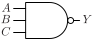

# NAND3

Three input NAND gate

## Pin information

| Pin   | Description   |
| :-:    | :-            |
| A | Input A |
| B | Input B |
| C | Input C |
| Y | Output |
| VDD | Power supply |
| VSS | Ground |


## Logic function and Truth table

### Logic function (Python)
<div align="center">
Y = ~(A & B & C)
</div>

### Logic function (Boolean)
\\[ Y = \overline{A \cdot B \cdot C} \\]

### Truth Table for Y


| A | B | C | Y |
| :--- | :--- | :--- | :--- |
| 0 | - | - | 1 | 
| - | 0 | - | 1 | 
| - | - | 0 | 1 | 
| 1 | 1 | 1 | 0 | 


## Symbol

<div align="center">

</div>

## Schematic

<div align="center">

</div>

## Cell variants

| Cell name <br> | Width <br> [unit sites] | Area <br> [\\(\mu m^2\\)] |
| :-        | :-:   | :-:   |
| [NAND3_DL](#nand3_dl) | TBD | TBD |
| [NAND3_D1](#nand3_d1) | TBD | TBD |
| [NAND3_D2](#nand3_d2) | TBD | TBD |
| [NAND3_D4](#nand3_d4) | TBD | TBD |


### NAND3_DL

#### Hierarchical SPICE netlist
```spice
.subckt NAND3_DL A B C Y VDD VSS
Xnand3 A B C Y VDD VSS nand3_par WN=5.2e-07 WP=4.9e-07 
.ends
```

#### Flat SPICE netlist
```spice
.subckt NAND3_DL A B C Y VDD VSS
XMN0 n0 C VSS VSS sg13_lv_nmos w=5.2e-07 l=1.3e-07 ad=1.612e-13 as=1.612e-13 pd=1.66e-06 ps=1.66e-06 ng=1 
XMN1 n1 B n0 VSS sg13_lv_nmos w=5.2e-07 l=1.3e-07 ad=1.612e-13 as=1.612e-13 pd=1.66e-06 ps=1.66e-06 ng=1 
XMN2 Y A n1 VSS sg13_lv_nmos w=5.2e-07 l=1.3e-07 ad=1.612e-13 as=1.612e-13 pd=1.66e-06 ps=1.66e-06 ng=1 
XMP0 Y A VDD VDD sg13_lv_pmos w=4.9e-07 l=1.3e-07 ad=1.519e-13 as=1.519e-13 pd=1.6e-06 ps=1.6e-06 ng=1 
XMP1 Y B VDD VDD sg13_lv_pmos w=4.9e-07 l=1.3e-07 ad=1.519e-13 as=1.519e-13 pd=1.6e-06 ps=1.6e-06 ng=1 
XMP2 Y C VDD VDD sg13_lv_pmos w=4.9e-07 l=1.3e-07 ad=1.519e-13 as=1.519e-13 pd=1.6e-06 ps=1.6e-06 ng=1 
.ends
```

#### CDL netlist
```cdl
.SUBCKT NAND3_DL A B C Y VDD VSS
*.PININFO C:I B:I A:I Y:O VDD:B VSS:B 
MN0 n0 C VSS VSS sg13_lv_nmos w=5.2e-07 l=1.3e-07 ng=1 
MN1 n1 B n0 VSS sg13_lv_nmos w=5.2e-07 l=1.3e-07 ng=1 
MN2 Y A n1 VSS sg13_lv_nmos w=5.2e-07 l=1.3e-07 ng=1 
MP0 Y A VDD VDD sg13_lv_pmos w=4.9e-07 l=1.3e-07 ng=1 
MP1 Y B VDD VDD sg13_lv_pmos w=4.9e-07 l=1.3e-07 ng=1 
MP2 Y C VDD VDD sg13_lv_pmos w=4.9e-07 l=1.3e-07 ng=1 
.ENDS
```

#### Layout

<div align="center">

</div>

### NAND3_D1

#### Hierarchical SPICE netlist
```spice
.subckt NAND3_D1 A B C Y VDD VSS
Xnand3 A B C Y VDD VSS nand3_par 
.ends
```

#### Flat SPICE netlist
```spice
.subckt NAND3_D1 A B C Y VDD VSS
XMN0 n0 C VSS VSS sg13_lv_nmos w=1.03e-06 l=1.3e-07 ad=3.193e-13 as=3.193e-13 pd=2.68e-06 ps=2.68e-06 ng=1 
XMN1 n1 B n0 VSS sg13_lv_nmos w=1.03e-06 l=1.3e-07 ad=3.193e-13 as=3.193e-13 pd=2.68e-06 ps=2.68e-06 ng=1 
XMN2 Y A n1 VSS sg13_lv_nmos w=1.03e-06 l=1.3e-07 ad=3.193e-13 as=3.193e-13 pd=2.68e-06 ps=2.68e-06 ng=1 
XMP0 Y A VDD VDD sg13_lv_pmos w=9.8e-07 l=1.3e-07 ad=3.038e-13 as=3.038e-13 pd=2.58e-06 ps=2.58e-06 ng=1 
XMP1 Y B VDD VDD sg13_lv_pmos w=9.8e-07 l=1.3e-07 ad=3.038e-13 as=3.038e-13 pd=2.58e-06 ps=2.58e-06 ng=1 
XMP2 Y C VDD VDD sg13_lv_pmos w=9.8e-07 l=1.3e-07 ad=3.038e-13 as=3.038e-13 pd=2.58e-06 ps=2.58e-06 ng=1 
.ends
```

#### CDL netlist
```cdl
.SUBCKT NAND3_D1 A B C Y VDD VSS
*.PININFO C:I B:I A:I Y:O VDD:B VSS:B 
MN0 n0 C VSS VSS sg13_lv_nmos w=1.03e-06 l=1.3e-07 ng=1 
MN1 n1 B n0 VSS sg13_lv_nmos w=1.03e-06 l=1.3e-07 ng=1 
MN2 Y A n1 VSS sg13_lv_nmos w=1.03e-06 l=1.3e-07 ng=1 
MP0 Y A VDD VDD sg13_lv_pmos w=9.8e-07 l=1.3e-07 ng=1 
MP1 Y B VDD VDD sg13_lv_pmos w=9.8e-07 l=1.3e-07 ng=1 
MP2 Y C VDD VDD sg13_lv_pmos w=9.8e-07 l=1.3e-07 ng=1 
.ENDS
```

#### Layout

<div align="center">

</div>

### NAND3_D2

#### Hierarchical SPICE netlist
```spice
.subckt NAND3_D2 A B C Y VDD VSS
Xnand3_1 A B C Y VDD VSS nand3_par 
Xnand3_2 A B C Y VDD VSS nand3_par 
.ends
```

#### Flat SPICE netlist
```spice
.subckt NAND3_D2 A B C Y VDD VSS
XMN0 n0 C VSS VSS sg13_lv_nmos w=1.03e-06 l=1.3e-07 ad=3.193e-13 as=3.193e-13 pd=2.68e-06 ps=2.68e-06 ng=1 
XMN1 n1 B n0 VSS sg13_lv_nmos w=1.03e-06 l=1.3e-07 ad=3.193e-13 as=3.193e-13 pd=2.68e-06 ps=2.68e-06 ng=1 
XMN2 Y A n1 VSS sg13_lv_nmos w=1.03e-06 l=1.3e-07 ad=3.193e-13 as=3.193e-13 pd=2.68e-06 ps=2.68e-06 ng=1 
XMP0 Y A VDD VDD sg13_lv_pmos w=9.8e-07 l=1.3e-07 ad=3.038e-13 as=3.038e-13 pd=2.58e-06 ps=2.58e-06 ng=1 
XMP1 Y B VDD VDD sg13_lv_pmos w=9.8e-07 l=1.3e-07 ad=3.038e-13 as=3.038e-13 pd=2.58e-06 ps=2.58e-06 ng=1 
XMP2 Y C VDD VDD sg13_lv_pmos w=9.8e-07 l=1.3e-07 ad=3.038e-13 as=3.038e-13 pd=2.58e-06 ps=2.58e-06 ng=1 
XMN3 n2 C VSS VSS sg13_lv_nmos w=1.03e-06 l=1.3e-07 ad=3.193e-13 as=3.193e-13 pd=2.68e-06 ps=2.68e-06 ng=1 
XMN4 n3 B n2 VSS sg13_lv_nmos w=1.03e-06 l=1.3e-07 ad=3.193e-13 as=3.193e-13 pd=2.68e-06 ps=2.68e-06 ng=1 
XMN5 Y A n3 VSS sg13_lv_nmos w=1.03e-06 l=1.3e-07 ad=3.193e-13 as=3.193e-13 pd=2.68e-06 ps=2.68e-06 ng=1 
XMP3 Y A VDD VDD sg13_lv_pmos w=9.8e-07 l=1.3e-07 ad=3.038e-13 as=3.038e-13 pd=2.58e-06 ps=2.58e-06 ng=1 
XMP4 Y B VDD VDD sg13_lv_pmos w=9.8e-07 l=1.3e-07 ad=3.038e-13 as=3.038e-13 pd=2.58e-06 ps=2.58e-06 ng=1 
XMP5 Y C VDD VDD sg13_lv_pmos w=9.8e-07 l=1.3e-07 ad=3.038e-13 as=3.038e-13 pd=2.58e-06 ps=2.58e-06 ng=1 
.ends
```

#### CDL netlist
```cdl
.SUBCKT NAND3_D2 A B C Y VDD VSS
*.PININFO C:I B:I A:I Y:O VDD:B VSS:B 
MN0 n0 C VSS VSS sg13_lv_nmos w=1.03e-06 l=1.3e-07 ng=1 
MN1 n1 B n0 VSS sg13_lv_nmos w=1.03e-06 l=1.3e-07 ng=1 
MN2 Y A n1 VSS sg13_lv_nmos w=1.03e-06 l=1.3e-07 ng=1 
MP0 Y A VDD VDD sg13_lv_pmos w=9.8e-07 l=1.3e-07 ng=1 
MP1 Y B VDD VDD sg13_lv_pmos w=9.8e-07 l=1.3e-07 ng=1 
MP2 Y C VDD VDD sg13_lv_pmos w=9.8e-07 l=1.3e-07 ng=1 
MN3 n2 C VSS VSS sg13_lv_nmos w=1.03e-06 l=1.3e-07 ng=1 
MN4 n3 B n2 VSS sg13_lv_nmos w=1.03e-06 l=1.3e-07 ng=1 
MN5 Y A n3 VSS sg13_lv_nmos w=1.03e-06 l=1.3e-07 ng=1 
MP3 Y A VDD VDD sg13_lv_pmos w=9.8e-07 l=1.3e-07 ng=1 
MP4 Y B VDD VDD sg13_lv_pmos w=9.8e-07 l=1.3e-07 ng=1 
MP5 Y C VDD VDD sg13_lv_pmos w=9.8e-07 l=1.3e-07 ng=1 
.ENDS
```

#### Layout

<div align="center">

</div>

### NAND3_D4

#### Hierarchical SPICE netlist
```spice
.subckt NAND3_D4 A B C Y VDD VSS
Xnand3_1 A B C Y VDD VSS nand3_par 
Xnand3_2 A B C Y VDD VSS nand3_par 
Xnand3_3 A B C Y VDD VSS nand3_par 
Xnand3_4 A B C Y VDD VSS nand3_par 
.ends
```

#### Flat SPICE netlist
```spice
.subckt NAND3_D4 A B C Y VDD VSS
XMN0 n0 C VSS VSS sg13_lv_nmos w=1.03e-06 l=1.3e-07 ad=3.193e-13 as=3.193e-13 pd=2.68e-06 ps=2.68e-06 ng=1 
XMN1 n1 B n0 VSS sg13_lv_nmos w=1.03e-06 l=1.3e-07 ad=3.193e-13 as=3.193e-13 pd=2.68e-06 ps=2.68e-06 ng=1 
XMN2 Y A n1 VSS sg13_lv_nmos w=1.03e-06 l=1.3e-07 ad=3.193e-13 as=3.193e-13 pd=2.68e-06 ps=2.68e-06 ng=1 
XMP0 Y A VDD VDD sg13_lv_pmos w=9.8e-07 l=1.3e-07 ad=3.038e-13 as=3.038e-13 pd=2.58e-06 ps=2.58e-06 ng=1 
XMP1 Y B VDD VDD sg13_lv_pmos w=9.8e-07 l=1.3e-07 ad=3.038e-13 as=3.038e-13 pd=2.58e-06 ps=2.58e-06 ng=1 
XMP2 Y C VDD VDD sg13_lv_pmos w=9.8e-07 l=1.3e-07 ad=3.038e-13 as=3.038e-13 pd=2.58e-06 ps=2.58e-06 ng=1 
XMN3 n2 C VSS VSS sg13_lv_nmos w=1.03e-06 l=1.3e-07 ad=3.193e-13 as=3.193e-13 pd=2.68e-06 ps=2.68e-06 ng=1 
XMN4 n3 B n2 VSS sg13_lv_nmos w=1.03e-06 l=1.3e-07 ad=3.193e-13 as=3.193e-13 pd=2.68e-06 ps=2.68e-06 ng=1 
XMN5 Y A n3 VSS sg13_lv_nmos w=1.03e-06 l=1.3e-07 ad=3.193e-13 as=3.193e-13 pd=2.68e-06 ps=2.68e-06 ng=1 
XMP3 Y A VDD VDD sg13_lv_pmos w=9.8e-07 l=1.3e-07 ad=3.038e-13 as=3.038e-13 pd=2.58e-06 ps=2.58e-06 ng=1 
XMP4 Y B VDD VDD sg13_lv_pmos w=9.8e-07 l=1.3e-07 ad=3.038e-13 as=3.038e-13 pd=2.58e-06 ps=2.58e-06 ng=1 
XMP5 Y C VDD VDD sg13_lv_pmos w=9.8e-07 l=1.3e-07 ad=3.038e-13 as=3.038e-13 pd=2.58e-06 ps=2.58e-06 ng=1 
XMN6 n4 C VSS VSS sg13_lv_nmos w=1.03e-06 l=1.3e-07 ad=3.193e-13 as=3.193e-13 pd=2.68e-06 ps=2.68e-06 ng=1 
XMN7 n5 B n4 VSS sg13_lv_nmos w=1.03e-06 l=1.3e-07 ad=3.193e-13 as=3.193e-13 pd=2.68e-06 ps=2.68e-06 ng=1 
XMN8 Y A n5 VSS sg13_lv_nmos w=1.03e-06 l=1.3e-07 ad=3.193e-13 as=3.193e-13 pd=2.68e-06 ps=2.68e-06 ng=1 
XMP6 Y A VDD VDD sg13_lv_pmos w=9.8e-07 l=1.3e-07 ad=3.038e-13 as=3.038e-13 pd=2.58e-06 ps=2.58e-06 ng=1 
XMP7 Y B VDD VDD sg13_lv_pmos w=9.8e-07 l=1.3e-07 ad=3.038e-13 as=3.038e-13 pd=2.58e-06 ps=2.58e-06 ng=1 
XMP8 Y C VDD VDD sg13_lv_pmos w=9.8e-07 l=1.3e-07 ad=3.038e-13 as=3.038e-13 pd=2.58e-06 ps=2.58e-06 ng=1 
XMN9 n6 C VSS VSS sg13_lv_nmos w=1.03e-06 l=1.3e-07 ad=3.193e-13 as=3.193e-13 pd=2.68e-06 ps=2.68e-06 ng=1 
XMN10 n7 B n6 VSS sg13_lv_nmos w=1.03e-06 l=1.3e-07 ad=3.193e-13 as=3.193e-13 pd=2.68e-06 ps=2.68e-06 ng=1 
XMN11 Y A n7 VSS sg13_lv_nmos w=1.03e-06 l=1.3e-07 ad=3.193e-13 as=3.193e-13 pd=2.68e-06 ps=2.68e-06 ng=1 
XMP9 Y A VDD VDD sg13_lv_pmos w=9.8e-07 l=1.3e-07 ad=3.038e-13 as=3.038e-13 pd=2.58e-06 ps=2.58e-06 ng=1 
XMP10 Y B VDD VDD sg13_lv_pmos w=9.8e-07 l=1.3e-07 ad=3.038e-13 as=3.038e-13 pd=2.58e-06 ps=2.58e-06 ng=1 
XMP11 Y C VDD VDD sg13_lv_pmos w=9.8e-07 l=1.3e-07 ad=3.038e-13 as=3.038e-13 pd=2.58e-06 ps=2.58e-06 ng=1 
.ends
```

#### CDL netlist
```cdl
.SUBCKT NAND3_D4 A B C Y VDD VSS
*.PININFO C:I B:I A:I Y:O VDD:B VSS:B 
MN0 n0 C VSS VSS sg13_lv_nmos w=1.03e-06 l=1.3e-07 ng=1 
MN1 n1 B n0 VSS sg13_lv_nmos w=1.03e-06 l=1.3e-07 ng=1 
MN2 Y A n1 VSS sg13_lv_nmos w=1.03e-06 l=1.3e-07 ng=1 
MP0 Y A VDD VDD sg13_lv_pmos w=9.8e-07 l=1.3e-07 ng=1 
MP1 Y B VDD VDD sg13_lv_pmos w=9.8e-07 l=1.3e-07 ng=1 
MP2 Y C VDD VDD sg13_lv_pmos w=9.8e-07 l=1.3e-07 ng=1 
MN3 n2 C VSS VSS sg13_lv_nmos w=1.03e-06 l=1.3e-07 ng=1 
MN4 n3 B n2 VSS sg13_lv_nmos w=1.03e-06 l=1.3e-07 ng=1 
MN5 Y A n3 VSS sg13_lv_nmos w=1.03e-06 l=1.3e-07 ng=1 
MP3 Y A VDD VDD sg13_lv_pmos w=9.8e-07 l=1.3e-07 ng=1 
MP4 Y B VDD VDD sg13_lv_pmos w=9.8e-07 l=1.3e-07 ng=1 
MP5 Y C VDD VDD sg13_lv_pmos w=9.8e-07 l=1.3e-07 ng=1 
MN6 n4 C VSS VSS sg13_lv_nmos w=1.03e-06 l=1.3e-07 ng=1 
MN7 n5 B n4 VSS sg13_lv_nmos w=1.03e-06 l=1.3e-07 ng=1 
MN8 Y A n5 VSS sg13_lv_nmos w=1.03e-06 l=1.3e-07 ng=1 
MP6 Y A VDD VDD sg13_lv_pmos w=9.8e-07 l=1.3e-07 ng=1 
MP7 Y B VDD VDD sg13_lv_pmos w=9.8e-07 l=1.3e-07 ng=1 
MP8 Y C VDD VDD sg13_lv_pmos w=9.8e-07 l=1.3e-07 ng=1 
MN9 n6 C VSS VSS sg13_lv_nmos w=1.03e-06 l=1.3e-07 ng=1 
MN10 n7 B n6 VSS sg13_lv_nmos w=1.03e-06 l=1.3e-07 ng=1 
MN11 Y A n7 VSS sg13_lv_nmos w=1.03e-06 l=1.3e-07 ng=1 
MP9 Y A VDD VDD sg13_lv_pmos w=9.8e-07 l=1.3e-07 ng=1 
MP10 Y B VDD VDD sg13_lv_pmos w=9.8e-07 l=1.3e-07 ng=1 
MP11 Y C VDD VDD sg13_lv_pmos w=9.8e-07 l=1.3e-07 ng=1 
.ENDS
```

#### Layout

<div align="center">

</div>

## Pin capacitance
No pin capacitance data


## Static power
No static power data


## Dynamic power
No dynamic power data


## Delay
No delay data

