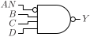

# NAND4N1

Four input NAND gate with one input inverted

## Pin information

| Pin   | Description   |
| :-:    | :-            |
| AN | Input AN, inverted |
| B | Input B |
| C | Input C |
| D | Input D |
| Y | Output |
| VDD | Power supply |
| VSS | Ground |


## Logic function and Truth table

### Logic function (Python)
<div align="center">
Y = ~(~AN & B & C & D)
</div>

### Logic function (Boolean)
\\[ Y = \overline{\overline{AN} \cdot B \cdot C \cdot D} \\]

### Truth Table for Y


| AN | B | C | D | Y |
| :--- | :--- | :--- | :--- | :--- |
| 1 | - | - | - | 1 | 
| - | 0 | - | - | 1 | 
| - | - | 0 | - | 1 | 
| - | - | - | 0 | 1 | 
| 0 | 1 | 1 | 1 | 0 | 


## Symbol

<div align="center">

</div>

## Schematic

<div align="center">

</div>

## Cell variants

| Cell name <br> | Width <br> [unit sites] | Area <br> [\\(\mu m^2\\)] |
| :-        | :-:   | :-:   |
| [NAND4N1_DL](#nand4n1_dl) | TBD | TBD |
| [NAND4N1_D1](#nand4n1_d1) | TBD | TBD |
| [NAND4N1_D2](#nand4n1_d2) | TBD | TBD |


### NAND4N1_DL

#### Hierarchical SPICE netlist
```spice
.subckt NAND4N1_DL AN B C D Y VDD VSS
Xnand4 A B C D Y VDD VSS nand4_par WN=3.6e-07 WP=3e-07 
Xinv AN A VDD VSS inv_par WN=1.5e-07 WP=2.3e-07 
.ends
```

#### Flat SPICE netlist
```spice
.subckt NAND4N1_DL AN B C D Y VDD VSS
XMN0 n0 D VSS VSS sg13_lv_nmos w=3.6e-07 l=1.3e-07 ad=1.116e-13 as=1.116e-13 pd=1.34e-06 ps=1.34e-06 ng=1 
XMN1 n1 C n0 VSS sg13_lv_nmos w=3.6e-07 l=1.3e-07 ad=1.116e-13 as=1.116e-13 pd=1.34e-06 ps=1.34e-06 ng=1 
XMN2 n2 B n1 VSS sg13_lv_nmos w=3.6e-07 l=1.3e-07 ad=1.116e-13 as=1.116e-13 pd=1.34e-06 ps=1.34e-06 ng=1 
XMN3 Y n3 n2 VSS sg13_lv_nmos w=3.6e-07 l=1.3e-07 ad=1.116e-13 as=1.116e-13 pd=1.34e-06 ps=1.34e-06 ng=1 
XMP0 Y n3 VDD VDD sg13_lv_pmos w=3e-07 l=1.3e-07 ad=9.3e-14 as=9.3e-14 pd=1.22e-06 ps=1.22e-06 ng=1 
XMP1 Y B VDD VDD sg13_lv_pmos w=3e-07 l=1.3e-07 ad=9.3e-14 as=9.3e-14 pd=1.22e-06 ps=1.22e-06 ng=1 
XMP2 Y C VDD VDD sg13_lv_pmos w=3e-07 l=1.3e-07 ad=9.3e-14 as=9.3e-14 pd=1.22e-06 ps=1.22e-06 ng=1 
XMP3 Y D VDD VDD sg13_lv_pmos w=3e-07 l=1.3e-07 ad=9.3e-14 as=9.3e-14 pd=1.22e-06 ps=1.22e-06 ng=1 
XMN4 n3 AN VSS VSS sg13_lv_nmos w=1.5e-07 l=1.3e-07 ad=4.65e-14 as=4.65e-14 pd=9.2e-07 ps=9.2e-07 ng=1 
XMP4 n3 AN VDD VDD sg13_lv_pmos w=2.3e-07 l=1.3e-07 ad=7.13e-14 as=7.13e-14 pd=1.08e-06 ps=1.08e-06 ng=1 
.ends
```

#### CDL netlist
```cdl
.SUBCKT NAND4N1_DL AN B C D Y VDD VSS
*.PININFO AN:I B:I C:I D:I Y:O VDD:B VSS:B 
MN0 n0 D VSS VSS sg13_lv_nmos w=3.6e-07 l=1.3e-07 ng=1 
MN1 n1 C n0 VSS sg13_lv_nmos w=3.6e-07 l=1.3e-07 ng=1 
MN2 n2 B n1 VSS sg13_lv_nmos w=3.6e-07 l=1.3e-07 ng=1 
MN3 Y n3 n2 VSS sg13_lv_nmos w=3.6e-07 l=1.3e-07 ng=1 
MP0 Y n3 VDD VDD sg13_lv_pmos w=3e-07 l=1.3e-07 ng=1 
MP1 Y B VDD VDD sg13_lv_pmos w=3e-07 l=1.3e-07 ng=1 
MP2 Y C VDD VDD sg13_lv_pmos w=3e-07 l=1.3e-07 ng=1 
MP3 Y D VDD VDD sg13_lv_pmos w=3e-07 l=1.3e-07 ng=1 
MN4 n3 AN VSS VSS sg13_lv_nmos w=1.5e-07 l=1.3e-07 ng=1 
MP4 n3 AN VDD VDD sg13_lv_pmos w=2.3e-07 l=1.3e-07 ng=1 
.ENDS
```

#### Layout

<div align="center">

</div>

### NAND4N1_D1

#### Hierarchical SPICE netlist
```spice
.subckt NAND4N1_D1 AN B C D Y VDD VSS
Xnand4 A B C D Y VDD VSS NAND4_D1 
Xinv AN A VDD VSS inv_par WN=2e-07 WP=3e-07 
.ends
```

#### Flat SPICE netlist
```spice
.subckt NAND4N1_D1 AN B C D Y VDD VSS
XMN0 n0 D VSS VSS sg13_lv_nmos w=8e-07 l=1.3e-07 ad=2.48e-13 as=2.48e-13 pd=2.22e-06 ps=2.22e-06 ng=1 
XMN1 n1 C n0 VSS sg13_lv_nmos w=8e-07 l=1.3e-07 ad=2.48e-13 as=2.48e-13 pd=2.22e-06 ps=2.22e-06 ng=1 
XMN2 n2 B n1 VSS sg13_lv_nmos w=8e-07 l=1.3e-07 ad=2.48e-13 as=2.48e-13 pd=2.22e-06 ps=2.22e-06 ng=1 
XMN3 Y n3 n2 VSS sg13_lv_nmos w=8e-07 l=1.3e-07 ad=2.48e-13 as=2.48e-13 pd=2.22e-06 ps=2.22e-06 ng=1 
XMP0 Y n3 VDD VDD sg13_lv_pmos w=7e-07 l=1.3e-07 ad=2.17e-13 as=2.17e-13 pd=2.02e-06 ps=2.02e-06 ng=1 
XMP1 Y B VDD VDD sg13_lv_pmos w=7e-07 l=1.3e-07 ad=2.17e-13 as=2.17e-13 pd=2.02e-06 ps=2.02e-06 ng=1 
XMP2 Y C VDD VDD sg13_lv_pmos w=7e-07 l=1.3e-07 ad=2.17e-13 as=2.17e-13 pd=2.02e-06 ps=2.02e-06 ng=1 
XMP3 Y D VDD VDD sg13_lv_pmos w=7e-07 l=1.3e-07 ad=2.17e-13 as=2.17e-13 pd=2.02e-06 ps=2.02e-06 ng=1 
XMN4 n3 AN VSS VSS sg13_lv_nmos w=2e-07 l=1.3e-07 ad=6.2e-14 as=6.2e-14 pd=1.02e-06 ps=1.02e-06 ng=1 
XMP4 n3 AN VDD VDD sg13_lv_pmos w=3e-07 l=1.3e-07 ad=9.3e-14 as=9.3e-14 pd=1.22e-06 ps=1.22e-06 ng=1 
.ends
```

#### CDL netlist
```cdl
.SUBCKT NAND4N1_D1 AN B C D Y VDD VSS
*.PININFO AN:I B:I C:I D:I Y:O VDD:B VSS:B 
MN0 n0 D VSS VSS sg13_lv_nmos w=8e-07 l=1.3e-07 ng=1 
MN1 n1 C n0 VSS sg13_lv_nmos w=8e-07 l=1.3e-07 ng=1 
MN2 n2 B n1 VSS sg13_lv_nmos w=8e-07 l=1.3e-07 ng=1 
MN3 Y n3 n2 VSS sg13_lv_nmos w=8e-07 l=1.3e-07 ng=1 
MP0 Y n3 VDD VDD sg13_lv_pmos w=7e-07 l=1.3e-07 ng=1 
MP1 Y B VDD VDD sg13_lv_pmos w=7e-07 l=1.3e-07 ng=1 
MP2 Y C VDD VDD sg13_lv_pmos w=7e-07 l=1.3e-07 ng=1 
MP3 Y D VDD VDD sg13_lv_pmos w=7e-07 l=1.3e-07 ng=1 
MN4 n3 AN VSS VSS sg13_lv_nmos w=2e-07 l=1.3e-07 ng=1 
MP4 n3 AN VDD VDD sg13_lv_pmos w=3e-07 l=1.3e-07 ng=1 
.ENDS
```

#### Layout

<div align="center">

</div>

### NAND4N1_D2

#### Hierarchical SPICE netlist
```spice
.subckt NAND4N1_D2 AN B C D Y VDD VSS
Xnand4 A B C D Y VDD VSS NAND4_D2 
Xinv AN A VDD VSS inv_par WN=4e-07 WP=6e-07 
.ends
```

#### Flat SPICE netlist
```spice
.subckt NAND4N1_D2 AN B C D Y VDD VSS
XMN0 n0 D VSS VSS sg13_lv_nmos w=1.4e-06 l=1.3e-07 ad=4.34e-13 as=4.34e-13 pd=3.42e-06 ps=3.42e-06 ng=2 
XMN1 n1 C n0 VSS sg13_lv_nmos w=1.4e-06 l=1.3e-07 ad=4.34e-13 as=4.34e-13 pd=3.42e-06 ps=3.42e-06 ng=2 
XMN2 n2 B n1 VSS sg13_lv_nmos w=1.4e-06 l=1.3e-07 ad=4.34e-13 as=4.34e-13 pd=3.42e-06 ps=3.42e-06 ng=2 
XMN3 Y n3 n2 VSS sg13_lv_nmos w=1.4e-06 l=1.3e-07 ad=4.34e-13 as=4.34e-13 pd=3.42e-06 ps=3.42e-06 ng=2 
XMP0 Y n3 VDD VDD sg13_lv_pmos w=1.2e-06 l=1.3e-07 ad=3.72e-13 as=3.72e-13 pd=3.02e-06 ps=3.02e-06 ng=1 
XMP1 Y B VDD VDD sg13_lv_pmos w=1.2e-06 l=1.3e-07 ad=3.72e-13 as=3.72e-13 pd=3.02e-06 ps=3.02e-06 ng=1 
XMP2 Y C VDD VDD sg13_lv_pmos w=1.2e-06 l=1.3e-07 ad=3.72e-13 as=3.72e-13 pd=3.02e-06 ps=3.02e-06 ng=1 
XMP3 Y D VDD VDD sg13_lv_pmos w=1.2e-06 l=1.3e-07 ad=3.72e-13 as=3.72e-13 pd=3.02e-06 ps=3.02e-06 ng=1 
XMN4 n3 AN VSS VSS sg13_lv_nmos w=4e-07 l=1.3e-07 ad=1.24e-13 as=1.24e-13 pd=1.42e-06 ps=1.42e-06 ng=1 
XMP4 n3 AN VDD VDD sg13_lv_pmos w=6e-07 l=1.3e-07 ad=1.86e-13 as=1.86e-13 pd=1.82e-06 ps=1.82e-06 ng=1 
.ends
```

#### CDL netlist
```cdl
.SUBCKT NAND4N1_D2 AN B C D Y VDD VSS
*.PININFO AN:I B:I C:I D:I Y:O VDD:B VSS:B 
MN0 n0 D VSS VSS sg13_lv_nmos w=1.4e-06 l=1.3e-07 ng=2 
MN1 n1 C n0 VSS sg13_lv_nmos w=1.4e-06 l=1.3e-07 ng=2 
MN2 n2 B n1 VSS sg13_lv_nmos w=1.4e-06 l=1.3e-07 ng=2 
MN3 Y n3 n2 VSS sg13_lv_nmos w=1.4e-06 l=1.3e-07 ng=2 
MP0 Y n3 VDD VDD sg13_lv_pmos w=1.2e-06 l=1.3e-07 ng=1 
MP1 Y B VDD VDD sg13_lv_pmos w=1.2e-06 l=1.3e-07 ng=1 
MP2 Y C VDD VDD sg13_lv_pmos w=1.2e-06 l=1.3e-07 ng=1 
MP3 Y D VDD VDD sg13_lv_pmos w=1.2e-06 l=1.3e-07 ng=1 
MN4 n3 AN VSS VSS sg13_lv_nmos w=4e-07 l=1.3e-07 ng=1 
MP4 n3 AN VDD VDD sg13_lv_pmos w=6e-07 l=1.3e-07 ng=1 
.ENDS
```

#### Layout

<div align="center">

</div>

## Pin capacitance
No pin capacitance data


## Static power
No static power data


## Dynamic power
No dynamic power data


## Delay
No delay data

