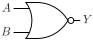

# NOR2

Two input NOR gate

## Pin information

| Pin   | Description   |
| :-:    | :-            |
| A | Input A |
| B | Input B |
| Y | Output |
| VDD | Power supply |
| VSS | Ground |


## Logic function and Truth table

### Logic function (Python)
<div align="center">
Y = ~(A | B)
</div>

### Logic function (Boolean)
\\[ Y = \overline{A + B} \\]

### Truth Table for Y


| A | B | Y |
| :--- | :--- | :--- |
| 0 | 0 | 1 | 
| 1 | - | 0 | 
| - | 1 | 0 | 


## Symbol

<div align="center">

</div>

## Schematic

<div align="center">

</div>

## Cell variants

| Cell name <br> | Width <br> [unit sites] | Area <br> [\\(\mu m^2\\)] |
| :-        | :-:   | :-:   |
| [NOR2_DL](#nor2_dl) | TBD | TBD |
| [NOR2_D1](#nor2_d1) | TBD | TBD |
| [NOR2_D2](#nor2_d2) | TBD | TBD |
| [NOR2_D4](#nor2_d4) | TBD | TBD |
| [NOR2_D8](#nor2_d8) | TBD | TBD |


### NOR2_DL

#### Hierarchical SPICE netlist
```spice
.subckt NOR2_DL A B Y VDD VSS
Xnor2 A B Y VDD VSS nor2_par WP=4.800000000000001e-07 WN=3.2e-07 
.ends
```

#### Flat SPICE netlist
```spice
.subckt NOR2_DL A B Y VDD VSS
XMN0 Y A VSS VSS sg13_lv_nmos w=3.2e-07 l=1.3e-07 ad=9.92e-14 as=9.92e-14 pd=1.26e-06 ps=1.26e-06 ng=1 
XMN1 Y B VSS VSS sg13_lv_nmos w=3.2e-07 l=1.3e-07 ad=9.92e-14 as=9.92e-14 pd=1.26e-06 ps=1.26e-06 ng=1 
XMP0 n0 A VDD VDD sg13_lv_pmos w=4.8e-07 l=1.3e-07 ad=1.488e-13 as=1.488e-13 pd=1.58e-06 ps=1.58e-06 ng=1 
XMP1 Y B n0 VDD sg13_lv_pmos w=4.8e-07 l=1.3e-07 ad=1.488e-13 as=1.488e-13 pd=1.58e-06 ps=1.58e-06 ng=1 
.ends
```

#### CDL netlist
```cdl
.SUBCKT NOR2_DL A B Y VDD VSS
*.PININFO A:I B:I Y:O VDD:B VSS:B 
MN0 Y A VSS VSS sg13_lv_nmos w=3.2e-07 l=1.3e-07 ng=1 
MN1 Y B VSS VSS sg13_lv_nmos w=3.2e-07 l=1.3e-07 ng=1 
MP0 n0 A VDD VDD sg13_lv_pmos w=4.8e-07 l=1.3e-07 ng=1 
MP1 Y B n0 VDD sg13_lv_pmos w=4.8e-07 l=1.3e-07 ng=1 
.ENDS
```

#### Layout

<div align="center">

</div>

### NOR2_D1

#### Hierarchical SPICE netlist
```spice
.subckt NOR2_D1 A B Y VDD VSS
Xnor2 A B Y VDD VSS nor2_par 
.ends
```

#### Flat SPICE netlist
```spice
.subckt NOR2_D1 A B Y VDD VSS
XMN0 Y A VSS VSS sg13_lv_nmos w=6.4e-07 l=1.3e-07 ad=1.984e-13 as=1.984e-13 pd=1.9e-06 ps=1.9e-06 ng=1 
XMN1 Y B VSS VSS sg13_lv_nmos w=6.4e-07 l=1.3e-07 ad=1.984e-13 as=1.984e-13 pd=1.9e-06 ps=1.9e-06 ng=1 
XMP0 n0 A VDD VDD sg13_lv_pmos w=9.8e-07 l=1.3e-07 ad=3.038e-13 as=3.038e-13 pd=2.58e-06 ps=2.58e-06 ng=1 
XMP1 Y B n0 VDD sg13_lv_pmos w=9.8e-07 l=1.3e-07 ad=3.038e-13 as=3.038e-13 pd=2.58e-06 ps=2.58e-06 ng=1 
.ends
```

#### CDL netlist
```cdl
.SUBCKT NOR2_D1 A B Y VDD VSS
*.PININFO A:I B:I Y:O VDD:B VSS:B 
MN0 Y A VSS VSS sg13_lv_nmos w=6.4e-07 l=1.3e-07 ng=1 
MN1 Y B VSS VSS sg13_lv_nmos w=6.4e-07 l=1.3e-07 ng=1 
MP0 n0 A VDD VDD sg13_lv_pmos w=9.8e-07 l=1.3e-07 ng=1 
MP1 Y B n0 VDD sg13_lv_pmos w=9.8e-07 l=1.3e-07 ng=1 
.ENDS
```

#### Layout

<div align="center">

</div>

### NOR2_D2

#### Hierarchical SPICE netlist
```spice
.subckt NOR2_D2 A B Y VDD VSS
Xnor2_pdn1 A B Y VDD VSS nor2_pdn_par WN=1.07e-06 
Xnor2_pun1 A B Y VDD VSS nor2_pun_par WP=1.07e-06 
Xnor2_pun2 A B Y VDD VSS nor2_pun_par WP=1.07e-06 
.ends
```

#### Flat SPICE netlist
```spice
.subckt NOR2_D2 A B Y VDD VSS
XMN0 Y B VSS VSS sg13_lv_nmos w=1.07e-06 l=1.3e-07 ad=3.317e-13 as=3.317e-13 pd=2.76e-06 ps=2.76e-06 ng=1 
XMN1 Y A VSS VSS sg13_lv_nmos w=1.07e-06 l=1.3e-07 ad=3.317e-13 as=3.317e-13 pd=2.76e-06 ps=2.76e-06 ng=1 
XMP0 n0 A VDD VDD sg13_lv_pmos w=1.07e-06 l=1.3e-07 ad=3.317e-13 as=3.317e-13 pd=2.76e-06 ps=2.76e-06 ng=1 
XMP1 Y B n0 VDD sg13_lv_pmos w=1.07e-06 l=1.3e-07 ad=3.317e-13 as=3.317e-13 pd=2.76e-06 ps=2.76e-06 ng=1 
XMP2 n1 A VDD VDD sg13_lv_pmos w=1.07e-06 l=1.3e-07 ad=3.317e-13 as=3.317e-13 pd=2.76e-06 ps=2.76e-06 ng=1 
XMP3 Y B n1 VDD sg13_lv_pmos w=1.07e-06 l=1.3e-07 ad=3.317e-13 as=3.317e-13 pd=2.76e-06 ps=2.76e-06 ng=1 
.ends
```

#### CDL netlist
```cdl
.SUBCKT NOR2_D2 A B Y VDD VSS
*.PININFO A:I B:I Y:O VDD:B VSS:B 
MN0 Y B VSS VSS sg13_lv_nmos w=1.07e-06 l=1.3e-07 ng=1 
MN1 Y A VSS VSS sg13_lv_nmos w=1.07e-06 l=1.3e-07 ng=1 
MP0 n0 A VDD VDD sg13_lv_pmos w=1.07e-06 l=1.3e-07 ng=1 
MP1 Y B n0 VDD sg13_lv_pmos w=1.07e-06 l=1.3e-07 ng=1 
MP2 n1 A VDD VDD sg13_lv_pmos w=1.07e-06 l=1.3e-07 ng=1 
MP3 Y B n1 VDD sg13_lv_pmos w=1.07e-06 l=1.3e-07 ng=1 
.ENDS
```

#### Layout

<div align="center">

</div>

### NOR2_D4

#### Hierarchical SPICE netlist
```spice
.subckt NOR2_D4 A B Y VDD VSS
Xnor2_pdn1 A B Y VDD VSS nor2_pdn_par WN=2.14e-06 NGN=2 
Xnor2_pun1 A B Y VDD VSS nor2_pun_par WP=1.43e-06 
Xnor2_pun2 A B Y VDD VSS nor2_pun_par WP=1.43e-06 
Xnor2_pun3 A B Y VDD VSS nor2_pun_par WP=1.43e-06 
.ends
```

#### Flat SPICE netlist
```spice
.subckt NOR2_D4 A B Y VDD VSS
XMN0 Y B VSS VSS sg13_lv_nmos w=2.14e-06 l=1.3e-07 ad=6.634e-13 as=6.634e-13 pd=4.9e-06 ps=4.9e-06 ng=2 
XMN1 Y A VSS VSS sg13_lv_nmos w=2.14e-06 l=1.3e-07 ad=6.634e-13 as=6.634e-13 pd=4.9e-06 ps=4.9e-06 ng=2 
XMP0 n0 A VDD VDD sg13_lv_pmos w=1.43e-06 l=1.3e-07 ad=4.433e-13 as=4.433e-13 pd=3.48e-06 ps=3.48e-06 ng=1 
XMP1 Y B n0 VDD sg13_lv_pmos w=1.43e-06 l=1.3e-07 ad=4.433e-13 as=4.433e-13 pd=3.48e-06 ps=3.48e-06 ng=1 
XMP2 n1 A VDD VDD sg13_lv_pmos w=1.43e-06 l=1.3e-07 ad=4.433e-13 as=4.433e-13 pd=3.48e-06 ps=3.48e-06 ng=1 
XMP3 Y B n1 VDD sg13_lv_pmos w=1.43e-06 l=1.3e-07 ad=4.433e-13 as=4.433e-13 pd=3.48e-06 ps=3.48e-06 ng=1 
XMP4 n2 A VDD VDD sg13_lv_pmos w=1.43e-06 l=1.3e-07 ad=4.433e-13 as=4.433e-13 pd=3.48e-06 ps=3.48e-06 ng=1 
XMP5 Y B n2 VDD sg13_lv_pmos w=1.43e-06 l=1.3e-07 ad=4.433e-13 as=4.433e-13 pd=3.48e-06 ps=3.48e-06 ng=1 
.ends
```

#### CDL netlist
```cdl
.SUBCKT NOR2_D4 A B Y VDD VSS
*.PININFO A:I B:I Y:O VDD:B VSS:B 
MN0 Y B VSS VSS sg13_lv_nmos w=2.14e-06 l=1.3e-07 ng=2 
MN1 Y A VSS VSS sg13_lv_nmos w=2.14e-06 l=1.3e-07 ng=2 
MP0 n0 A VDD VDD sg13_lv_pmos w=1.43e-06 l=1.3e-07 ng=1 
MP1 Y B n0 VDD sg13_lv_pmos w=1.43e-06 l=1.3e-07 ng=1 
MP2 n1 A VDD VDD sg13_lv_pmos w=1.43e-06 l=1.3e-07 ng=1 
MP3 Y B n1 VDD sg13_lv_pmos w=1.43e-06 l=1.3e-07 ng=1 
MP4 n2 A VDD VDD sg13_lv_pmos w=1.43e-06 l=1.3e-07 ng=1 
MP5 Y B n2 VDD sg13_lv_pmos w=1.43e-06 l=1.3e-07 ng=1 
.ENDS
```

#### Layout

<div align="center">

</div>

### NOR2_D8

#### Hierarchical SPICE netlist
```spice
.subckt NOR2_D8 A B Y VDD VSS
Xnor2_pdn1 A B Y VDD VSS nor2_pdn_par WN=4.28e-06 NGN=4 
Xnor2_pun1 A B Y VDD VSS nor2_pun_par WP=1.43e-06 
Xnor2_pun2 A B Y VDD VSS nor2_pun_par WP=1.43e-06 
Xnor2_pun3 A B Y VDD VSS nor2_pun_par WP=1.43e-06 
Xnor2_pun4 A B Y VDD VSS nor2_pun_par WP=1.43e-06 
Xnor2_pun5 A B Y VDD VSS nor2_pun_par WP=1.43e-06 
Xnor2_pun6 A B Y VDD VSS nor2_pun_par WP=1.43e-06 
.ends
```

#### Flat SPICE netlist
```spice
.subckt NOR2_D8 A B Y VDD VSS
XMN0 Y B VSS VSS sg13_lv_nmos w=4.28e-06 l=1.3e-07 ad=1.327e-12 as=1.327e-12 pd=9.18e-06 ps=9.18e-06 ng=4 
XMN1 Y A VSS VSS sg13_lv_nmos w=4.28e-06 l=1.3e-07 ad=1.327e-12 as=1.327e-12 pd=9.18e-06 ps=9.18e-06 ng=4 
XMP0 n0 A VDD VDD sg13_lv_pmos w=1.43e-06 l=1.3e-07 ad=4.433e-13 as=4.433e-13 pd=3.48e-06 ps=3.48e-06 ng=1 
XMP1 Y B n0 VDD sg13_lv_pmos w=1.43e-06 l=1.3e-07 ad=4.433e-13 as=4.433e-13 pd=3.48e-06 ps=3.48e-06 ng=1 
XMP2 n1 A VDD VDD sg13_lv_pmos w=1.43e-06 l=1.3e-07 ad=4.433e-13 as=4.433e-13 pd=3.48e-06 ps=3.48e-06 ng=1 
XMP3 Y B n1 VDD sg13_lv_pmos w=1.43e-06 l=1.3e-07 ad=4.433e-13 as=4.433e-13 pd=3.48e-06 ps=3.48e-06 ng=1 
XMP4 n2 A VDD VDD sg13_lv_pmos w=1.43e-06 l=1.3e-07 ad=4.433e-13 as=4.433e-13 pd=3.48e-06 ps=3.48e-06 ng=1 
XMP5 Y B n2 VDD sg13_lv_pmos w=1.43e-06 l=1.3e-07 ad=4.433e-13 as=4.433e-13 pd=3.48e-06 ps=3.48e-06 ng=1 
XMP6 n3 A VDD VDD sg13_lv_pmos w=1.43e-06 l=1.3e-07 ad=4.433e-13 as=4.433e-13 pd=3.48e-06 ps=3.48e-06 ng=1 
XMP7 Y B n3 VDD sg13_lv_pmos w=1.43e-06 l=1.3e-07 ad=4.433e-13 as=4.433e-13 pd=3.48e-06 ps=3.48e-06 ng=1 
XMP8 n4 A VDD VDD sg13_lv_pmos w=1.43e-06 l=1.3e-07 ad=4.433e-13 as=4.433e-13 pd=3.48e-06 ps=3.48e-06 ng=1 
XMP9 Y B n4 VDD sg13_lv_pmos w=1.43e-06 l=1.3e-07 ad=4.433e-13 as=4.433e-13 pd=3.48e-06 ps=3.48e-06 ng=1 
XMP10 n5 A VDD VDD sg13_lv_pmos w=1.43e-06 l=1.3e-07 ad=4.433e-13 as=4.433e-13 pd=3.48e-06 ps=3.48e-06 ng=1 
XMP11 Y B n5 VDD sg13_lv_pmos w=1.43e-06 l=1.3e-07 ad=4.433e-13 as=4.433e-13 pd=3.48e-06 ps=3.48e-06 ng=1 
.ends
```

#### CDL netlist
```cdl
.SUBCKT NOR2_D8 A B Y VDD VSS
*.PININFO A:I B:I Y:O VDD:B VSS:B 
MN0 Y B VSS VSS sg13_lv_nmos w=4.28e-06 l=1.3e-07 ng=4 
MN1 Y A VSS VSS sg13_lv_nmos w=4.28e-06 l=1.3e-07 ng=4 
MP0 n0 A VDD VDD sg13_lv_pmos w=1.43e-06 l=1.3e-07 ng=1 
MP1 Y B n0 VDD sg13_lv_pmos w=1.43e-06 l=1.3e-07 ng=1 
MP2 n1 A VDD VDD sg13_lv_pmos w=1.43e-06 l=1.3e-07 ng=1 
MP3 Y B n1 VDD sg13_lv_pmos w=1.43e-06 l=1.3e-07 ng=1 
MP4 n2 A VDD VDD sg13_lv_pmos w=1.43e-06 l=1.3e-07 ng=1 
MP5 Y B n2 VDD sg13_lv_pmos w=1.43e-06 l=1.3e-07 ng=1 
MP6 n3 A VDD VDD sg13_lv_pmos w=1.43e-06 l=1.3e-07 ng=1 
MP7 Y B n3 VDD sg13_lv_pmos w=1.43e-06 l=1.3e-07 ng=1 
MP8 n4 A VDD VDD sg13_lv_pmos w=1.43e-06 l=1.3e-07 ng=1 
MP9 Y B n4 VDD sg13_lv_pmos w=1.43e-06 l=1.3e-07 ng=1 
MP10 n5 A VDD VDD sg13_lv_pmos w=1.43e-06 l=1.3e-07 ng=1 
MP11 Y B n5 VDD sg13_lv_pmos w=1.43e-06 l=1.3e-07 ng=1 
.ENDS
```

#### Layout

<div align="center">

</div>

## Pin capacitance
No pin capacitance data


## Static power
No static power data


## Dynamic power
No dynamic power data


## Delay
No delay data

