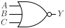

# NOR3

Three input NOR gate

## Pin information

| Pin   | Description   |
| :-:    | :-            |
| A | Input A |
| B | Input B |
| C | Input C |
| Y | Output |
| VDD | Power supply |
| VSS | Ground |


## Logic function and Truth table

### Logic function (Python)
<div align="center">
Y = ~(A | B | C)
</div>

### Logic function (Boolean)
\\[ Y = \overline{A + B + C} \\]

### Truth Table for Y


| A | B | C | Y |
| :--- | :--- | :--- | :--- |
| 0 | 0 | 0 | 1 | 
| 1 | - | - | 0 | 
| - | 1 | - | 0 | 
| - | - | 1 | 0 | 


## Symbol

<div align="center">

</div>

## Schematic

<div align="center">

</div>

## Cell variants

| Cell name <br> | Width <br> [unit sites] | Area <br> [\\(\mu m^2\\)] |
| :-        | :-:   | :-:   |
| [NOR3_DL](#nor3_dl) | TBD | TBD |
| [NOR3_D1](#nor3_d1) | TBD | TBD |
| [NOR3_D2](#nor3_d2) | TBD | TBD |
| [NOR3_D4](#nor3_d4) | TBD | TBD |


### NOR3_DL

#### Hierarchical SPICE netlist
```spice
.subckt NOR3_DL A B C Y VDD VSS
Xnor3 A B C Y VDD VSS nor3_par WP=7.5e-07 WN=3e-07 
.ends
```

#### Flat SPICE netlist
```spice
.subckt NOR3_DL A B C Y VDD VSS
XMN0 Y A VSS VSS sg13_lv_nmos w=3e-07 l=1.3e-07 ad=9.3e-14 as=9.3e-14 pd=1.22e-06 ps=1.22e-06 ng=1 
XMN1 Y B VSS VSS sg13_lv_nmos w=3e-07 l=1.3e-07 ad=9.3e-14 as=9.3e-14 pd=1.22e-06 ps=1.22e-06 ng=1 
XMN2 Y C VSS VSS sg13_lv_nmos w=3e-07 l=1.3e-07 ad=9.3e-14 as=9.3e-14 pd=1.22e-06 ps=1.22e-06 ng=1 
XMP0 n0 A VDD VDD sg13_lv_pmos w=7.5e-07 l=1.3e-07 ad=2.325e-13 as=2.325e-13 pd=2.12e-06 ps=2.12e-06 ng=1 
XMP1 n1 B n0 VDD sg13_lv_pmos w=7.5e-07 l=1.3e-07 ad=2.325e-13 as=2.325e-13 pd=2.12e-06 ps=2.12e-06 ng=1 
XMP2 Y C n1 VDD sg13_lv_pmos w=7.5e-07 l=1.3e-07 ad=2.325e-13 as=2.325e-13 pd=2.12e-06 ps=2.12e-06 ng=1 
.ends
```

#### CDL netlist
```cdl
.SUBCKT NOR3_DL A B C Y VDD VSS
*.PININFO B:I C:I A:I Y:O VDD:B VSS:B 
MN0 Y A VSS VSS sg13_lv_nmos w=3e-07 l=1.3e-07 ng=1 
MN1 Y B VSS VSS sg13_lv_nmos w=3e-07 l=1.3e-07 ng=1 
MN2 Y C VSS VSS sg13_lv_nmos w=3e-07 l=1.3e-07 ng=1 
MP0 n0 A VDD VDD sg13_lv_pmos w=7.5e-07 l=1.3e-07 ng=1 
MP1 n1 B n0 VDD sg13_lv_pmos w=7.5e-07 l=1.3e-07 ng=1 
MP2 Y C n1 VDD sg13_lv_pmos w=7.5e-07 l=1.3e-07 ng=1 
.ENDS
```

#### Layout

<div align="center">

</div>

### NOR3_D1

#### Hierarchical SPICE netlist
```spice
.subckt NOR3_D1 A B C Y VDD VSS
Xnor3 A B C Y VDD VSS nor3_par 
.ends
```

#### Flat SPICE netlist
```spice
.subckt NOR3_D1 A B C Y VDD VSS
XMN0 Y A VSS VSS sg13_lv_nmos w=5e-07 l=1.3e-07 ad=1.55e-13 as=1.55e-13 pd=1.62e-06 ps=1.62e-06 ng=1 
XMN1 Y B VSS VSS sg13_lv_nmos w=5e-07 l=1.3e-07 ad=1.55e-13 as=1.55e-13 pd=1.62e-06 ps=1.62e-06 ng=1 
XMN2 Y C VSS VSS sg13_lv_nmos w=5e-07 l=1.3e-07 ad=1.55e-13 as=1.55e-13 pd=1.62e-06 ps=1.62e-06 ng=1 
XMP0 n0 A VDD VDD sg13_lv_pmos w=1.25e-06 l=1.3e-07 ad=3.875e-13 as=3.875e-13 pd=3.12e-06 ps=3.12e-06 ng=1 
XMP1 n1 B n0 VDD sg13_lv_pmos w=1.25e-06 l=1.3e-07 ad=3.875e-13 as=3.875e-13 pd=3.12e-06 ps=3.12e-06 ng=1 
XMP2 Y C n1 VDD sg13_lv_pmos w=1.25e-06 l=1.3e-07 ad=3.875e-13 as=3.875e-13 pd=3.12e-06 ps=3.12e-06 ng=1 
.ends
```

#### CDL netlist
```cdl
.SUBCKT NOR3_D1 A B C Y VDD VSS
*.PININFO B:I C:I A:I Y:O VDD:B VSS:B 
MN0 Y A VSS VSS sg13_lv_nmos w=5e-07 l=1.3e-07 ng=1 
MN1 Y B VSS VSS sg13_lv_nmos w=5e-07 l=1.3e-07 ng=1 
MN2 Y C VSS VSS sg13_lv_nmos w=5e-07 l=1.3e-07 ng=1 
MP0 n0 A VDD VDD sg13_lv_pmos w=1.25e-06 l=1.3e-07 ng=1 
MP1 n1 B n0 VDD sg13_lv_pmos w=1.25e-06 l=1.3e-07 ng=1 
MP2 Y C n1 VDD sg13_lv_pmos w=1.25e-06 l=1.3e-07 ng=1 
.ENDS
```

#### Layout

<div align="center">

</div>

### NOR3_D2

#### Hierarchical SPICE netlist
```spice
.subckt NOR3_D2 A B C Y VDD VSS
Xnor3_1 A B C Y VDD VSS nor3_par 
Xnor3_2 A B C Y VDD VSS nor3_par 
.ends
```

#### Flat SPICE netlist
```spice
.subckt NOR3_D2 A B C Y VDD VSS
XMN0 Y A VSS VSS sg13_lv_nmos w=5e-07 l=1.3e-07 ad=1.55e-13 as=1.55e-13 pd=1.62e-06 ps=1.62e-06 ng=1 
XMN1 Y B VSS VSS sg13_lv_nmos w=5e-07 l=1.3e-07 ad=1.55e-13 as=1.55e-13 pd=1.62e-06 ps=1.62e-06 ng=1 
XMN2 Y C VSS VSS sg13_lv_nmos w=5e-07 l=1.3e-07 ad=1.55e-13 as=1.55e-13 pd=1.62e-06 ps=1.62e-06 ng=1 
XMP0 n0 A VDD VDD sg13_lv_pmos w=1.25e-06 l=1.3e-07 ad=3.875e-13 as=3.875e-13 pd=3.12e-06 ps=3.12e-06 ng=1 
XMP1 n1 B n0 VDD sg13_lv_pmos w=1.25e-06 l=1.3e-07 ad=3.875e-13 as=3.875e-13 pd=3.12e-06 ps=3.12e-06 ng=1 
XMP2 Y C n1 VDD sg13_lv_pmos w=1.25e-06 l=1.3e-07 ad=3.875e-13 as=3.875e-13 pd=3.12e-06 ps=3.12e-06 ng=1 
XMN3 Y A VSS VSS sg13_lv_nmos w=5e-07 l=1.3e-07 ad=1.55e-13 as=1.55e-13 pd=1.62e-06 ps=1.62e-06 ng=1 
XMN4 Y B VSS VSS sg13_lv_nmos w=5e-07 l=1.3e-07 ad=1.55e-13 as=1.55e-13 pd=1.62e-06 ps=1.62e-06 ng=1 
XMN5 Y C VSS VSS sg13_lv_nmos w=5e-07 l=1.3e-07 ad=1.55e-13 as=1.55e-13 pd=1.62e-06 ps=1.62e-06 ng=1 
XMP3 n2 A VDD VDD sg13_lv_pmos w=1.25e-06 l=1.3e-07 ad=3.875e-13 as=3.875e-13 pd=3.12e-06 ps=3.12e-06 ng=1 
XMP4 n3 B n2 VDD sg13_lv_pmos w=1.25e-06 l=1.3e-07 ad=3.875e-13 as=3.875e-13 pd=3.12e-06 ps=3.12e-06 ng=1 
XMP5 Y C n3 VDD sg13_lv_pmos w=1.25e-06 l=1.3e-07 ad=3.875e-13 as=3.875e-13 pd=3.12e-06 ps=3.12e-06 ng=1 
.ends
```

#### CDL netlist
```cdl
.SUBCKT NOR3_D2 A B C Y VDD VSS
*.PININFO B:I C:I A:I Y:O VDD:B VSS:B 
MN0 Y A VSS VSS sg13_lv_nmos w=5e-07 l=1.3e-07 ng=1 
MN1 Y B VSS VSS sg13_lv_nmos w=5e-07 l=1.3e-07 ng=1 
MN2 Y C VSS VSS sg13_lv_nmos w=5e-07 l=1.3e-07 ng=1 
MP0 n0 A VDD VDD sg13_lv_pmos w=1.25e-06 l=1.3e-07 ng=1 
MP1 n1 B n0 VDD sg13_lv_pmos w=1.25e-06 l=1.3e-07 ng=1 
MP2 Y C n1 VDD sg13_lv_pmos w=1.25e-06 l=1.3e-07 ng=1 
MN3 Y A VSS VSS sg13_lv_nmos w=5e-07 l=1.3e-07 ng=1 
MN4 Y B VSS VSS sg13_lv_nmos w=5e-07 l=1.3e-07 ng=1 
MN5 Y C VSS VSS sg13_lv_nmos w=5e-07 l=1.3e-07 ng=1 
MP3 n2 A VDD VDD sg13_lv_pmos w=1.25e-06 l=1.3e-07 ng=1 
MP4 n3 B n2 VDD sg13_lv_pmos w=1.25e-06 l=1.3e-07 ng=1 
MP5 Y C n3 VDD sg13_lv_pmos w=1.25e-06 l=1.3e-07 ng=1 
.ENDS
```

#### Layout

<div align="center">

</div>

### NOR3_D4

#### Hierarchical SPICE netlist
```spice
.subckt NOR3_D4 A B C Y VDD VSS
Xnor3_1 A B C Y VDD VSS nor3_par 
Xnor3_2 A B C Y VDD VSS nor3_par 
Xnor3_3 A B C Y VDD VSS nor3_par 
Xnor3_4 A B C Y VDD VSS nor3_par 
.ends
```

#### Flat SPICE netlist
```spice
.subckt NOR3_D4 A B C Y VDD VSS
XMN0 Y A VSS VSS sg13_lv_nmos w=5e-07 l=1.3e-07 ad=1.55e-13 as=1.55e-13 pd=1.62e-06 ps=1.62e-06 ng=1 
XMN1 Y B VSS VSS sg13_lv_nmos w=5e-07 l=1.3e-07 ad=1.55e-13 as=1.55e-13 pd=1.62e-06 ps=1.62e-06 ng=1 
XMN2 Y C VSS VSS sg13_lv_nmos w=5e-07 l=1.3e-07 ad=1.55e-13 as=1.55e-13 pd=1.62e-06 ps=1.62e-06 ng=1 
XMP0 n0 A VDD VDD sg13_lv_pmos w=1.25e-06 l=1.3e-07 ad=3.875e-13 as=3.875e-13 pd=3.12e-06 ps=3.12e-06 ng=1 
XMP1 n1 B n0 VDD sg13_lv_pmos w=1.25e-06 l=1.3e-07 ad=3.875e-13 as=3.875e-13 pd=3.12e-06 ps=3.12e-06 ng=1 
XMP2 Y C n1 VDD sg13_lv_pmos w=1.25e-06 l=1.3e-07 ad=3.875e-13 as=3.875e-13 pd=3.12e-06 ps=3.12e-06 ng=1 
XMN3 Y A VSS VSS sg13_lv_nmos w=5e-07 l=1.3e-07 ad=1.55e-13 as=1.55e-13 pd=1.62e-06 ps=1.62e-06 ng=1 
XMN4 Y B VSS VSS sg13_lv_nmos w=5e-07 l=1.3e-07 ad=1.55e-13 as=1.55e-13 pd=1.62e-06 ps=1.62e-06 ng=1 
XMN5 Y C VSS VSS sg13_lv_nmos w=5e-07 l=1.3e-07 ad=1.55e-13 as=1.55e-13 pd=1.62e-06 ps=1.62e-06 ng=1 
XMP3 n2 A VDD VDD sg13_lv_pmos w=1.25e-06 l=1.3e-07 ad=3.875e-13 as=3.875e-13 pd=3.12e-06 ps=3.12e-06 ng=1 
XMP4 n3 B n2 VDD sg13_lv_pmos w=1.25e-06 l=1.3e-07 ad=3.875e-13 as=3.875e-13 pd=3.12e-06 ps=3.12e-06 ng=1 
XMP5 Y C n3 VDD sg13_lv_pmos w=1.25e-06 l=1.3e-07 ad=3.875e-13 as=3.875e-13 pd=3.12e-06 ps=3.12e-06 ng=1 
XMN6 Y A VSS VSS sg13_lv_nmos w=5e-07 l=1.3e-07 ad=1.55e-13 as=1.55e-13 pd=1.62e-06 ps=1.62e-06 ng=1 
XMN7 Y B VSS VSS sg13_lv_nmos w=5e-07 l=1.3e-07 ad=1.55e-13 as=1.55e-13 pd=1.62e-06 ps=1.62e-06 ng=1 
XMN8 Y C VSS VSS sg13_lv_nmos w=5e-07 l=1.3e-07 ad=1.55e-13 as=1.55e-13 pd=1.62e-06 ps=1.62e-06 ng=1 
XMP6 n4 A VDD VDD sg13_lv_pmos w=1.25e-06 l=1.3e-07 ad=3.875e-13 as=3.875e-13 pd=3.12e-06 ps=3.12e-06 ng=1 
XMP7 n5 B n4 VDD sg13_lv_pmos w=1.25e-06 l=1.3e-07 ad=3.875e-13 as=3.875e-13 pd=3.12e-06 ps=3.12e-06 ng=1 
XMP8 Y C n5 VDD sg13_lv_pmos w=1.25e-06 l=1.3e-07 ad=3.875e-13 as=3.875e-13 pd=3.12e-06 ps=3.12e-06 ng=1 
XMN9 Y A VSS VSS sg13_lv_nmos w=5e-07 l=1.3e-07 ad=1.55e-13 as=1.55e-13 pd=1.62e-06 ps=1.62e-06 ng=1 
XMN10 Y B VSS VSS sg13_lv_nmos w=5e-07 l=1.3e-07 ad=1.55e-13 as=1.55e-13 pd=1.62e-06 ps=1.62e-06 ng=1 
XMN11 Y C VSS VSS sg13_lv_nmos w=5e-07 l=1.3e-07 ad=1.55e-13 as=1.55e-13 pd=1.62e-06 ps=1.62e-06 ng=1 
XMP9 n6 A VDD VDD sg13_lv_pmos w=1.25e-06 l=1.3e-07 ad=3.875e-13 as=3.875e-13 pd=3.12e-06 ps=3.12e-06 ng=1 
XMP10 n7 B n6 VDD sg13_lv_pmos w=1.25e-06 l=1.3e-07 ad=3.875e-13 as=3.875e-13 pd=3.12e-06 ps=3.12e-06 ng=1 
XMP11 Y C n7 VDD sg13_lv_pmos w=1.25e-06 l=1.3e-07 ad=3.875e-13 as=3.875e-13 pd=3.12e-06 ps=3.12e-06 ng=1 
.ends
```

#### CDL netlist
```cdl
.SUBCKT NOR3_D4 A B C Y VDD VSS
*.PININFO B:I C:I A:I Y:O VDD:B VSS:B 
MN0 Y A VSS VSS sg13_lv_nmos w=5e-07 l=1.3e-07 ng=1 
MN1 Y B VSS VSS sg13_lv_nmos w=5e-07 l=1.3e-07 ng=1 
MN2 Y C VSS VSS sg13_lv_nmos w=5e-07 l=1.3e-07 ng=1 
MP0 n0 A VDD VDD sg13_lv_pmos w=1.25e-06 l=1.3e-07 ng=1 
MP1 n1 B n0 VDD sg13_lv_pmos w=1.25e-06 l=1.3e-07 ng=1 
MP2 Y C n1 VDD sg13_lv_pmos w=1.25e-06 l=1.3e-07 ng=1 
MN3 Y A VSS VSS sg13_lv_nmos w=5e-07 l=1.3e-07 ng=1 
MN4 Y B VSS VSS sg13_lv_nmos w=5e-07 l=1.3e-07 ng=1 
MN5 Y C VSS VSS sg13_lv_nmos w=5e-07 l=1.3e-07 ng=1 
MP3 n2 A VDD VDD sg13_lv_pmos w=1.25e-06 l=1.3e-07 ng=1 
MP4 n3 B n2 VDD sg13_lv_pmos w=1.25e-06 l=1.3e-07 ng=1 
MP5 Y C n3 VDD sg13_lv_pmos w=1.25e-06 l=1.3e-07 ng=1 
MN6 Y A VSS VSS sg13_lv_nmos w=5e-07 l=1.3e-07 ng=1 
MN7 Y B VSS VSS sg13_lv_nmos w=5e-07 l=1.3e-07 ng=1 
MN8 Y C VSS VSS sg13_lv_nmos w=5e-07 l=1.3e-07 ng=1 
MP6 n4 A VDD VDD sg13_lv_pmos w=1.25e-06 l=1.3e-07 ng=1 
MP7 n5 B n4 VDD sg13_lv_pmos w=1.25e-06 l=1.3e-07 ng=1 
MP8 Y C n5 VDD sg13_lv_pmos w=1.25e-06 l=1.3e-07 ng=1 
MN9 Y A VSS VSS sg13_lv_nmos w=5e-07 l=1.3e-07 ng=1 
MN10 Y B VSS VSS sg13_lv_nmos w=5e-07 l=1.3e-07 ng=1 
MN11 Y C VSS VSS sg13_lv_nmos w=5e-07 l=1.3e-07 ng=1 
MP9 n6 A VDD VDD sg13_lv_pmos w=1.25e-06 l=1.3e-07 ng=1 
MP10 n7 B n6 VDD sg13_lv_pmos w=1.25e-06 l=1.3e-07 ng=1 
MP11 Y C n7 VDD sg13_lv_pmos w=1.25e-06 l=1.3e-07 ng=1 
.ENDS
```

#### Layout

<div align="center">

</div>

## Pin capacitance
No pin capacitance data


## Static power
No static power data


## Dynamic power
No dynamic power data


## Delay
No delay data

