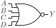

# NOR4

Four input NOR gate

## Pin information

| Pin   | Description   |
| :-:    | :-            |
| A | Input A |
| B | Input B |
| C | Input C |
| D | Input D |
| Y | Output |
| VDD | Power supply |
| VSS | Ground |


## Logic function and Truth table

### Logic function (Python)
<div align="center">
Y = ~(A | B | C | D)
</div>

### Logic function (Boolean)
\\[ Y = \overline{A + B + C + D} \\]

### Truth Table for Y


| A | B | C | D | Y |
| :--- | :--- | :--- | :--- | :--- |
| 0 | 0 | 0 | 0 | 1 | 
| 1 | - | - | - | 0 | 
| - | 1 | - | - | 0 | 
| - | - | 1 | - | 0 | 
| - | - | - | 1 | 0 | 


## Symbol

<div align="center">

</div>

## Schematic

<div align="center">

</div>

## Cell variants

| Cell name <br> | Width <br> [unit sites] | Area <br> [\\(\mu m^2\\)] |
| :-        | :-:   | :-:   |
| [NOR4_DL](#nor4_dl) | TBD | TBD |
| [NOR4_D1](#nor4_d1) | TBD | TBD |
| [NOR4_D2](#nor4_d2) | TBD | TBD |
| [NOR4_D4](#nor4_d4) | TBD | TBD |


### NOR4_DL

#### Hierarchical SPICE netlist
```spice
.subckt NOR4_DL A B C D Y VDD VSS
Xnor4 A B C D Y VDD VSS nor4_par WP=8.4e-07 WN=3e-07 
.ends
```

#### Flat SPICE netlist
```spice
.subckt NOR4_DL A B C D Y VDD VSS
XMN0 Y A VSS VSS sg13_lv_nmos w=3e-07 l=1.3e-07 ad=9.3e-14 as=9.3e-14 pd=1.22e-06 ps=1.22e-06 ng=1 
XMN1 Y B VSS VSS sg13_lv_nmos w=3e-07 l=1.3e-07 ad=9.3e-14 as=9.3e-14 pd=1.22e-06 ps=1.22e-06 ng=1 
XMN2 Y C VSS VSS sg13_lv_nmos w=3e-07 l=1.3e-07 ad=9.3e-14 as=9.3e-14 pd=1.22e-06 ps=1.22e-06 ng=1 
XMN3 Y D VSS VSS sg13_lv_nmos w=3e-07 l=1.3e-07 ad=9.3e-14 as=9.3e-14 pd=1.22e-06 ps=1.22e-06 ng=1 
XMP0 n0 D VDD VDD sg13_lv_pmos w=8.4e-07 l=1.3e-07 ad=2.604e-13 as=2.604e-13 pd=2.3e-06 ps=2.3e-06 ng=1 
XMP1 n1 C n0 VDD sg13_lv_pmos w=8.4e-07 l=1.3e-07 ad=2.604e-13 as=2.604e-13 pd=2.3e-06 ps=2.3e-06 ng=1 
XMP2 n2 B n1 VDD sg13_lv_pmos w=8.4e-07 l=1.3e-07 ad=2.604e-13 as=2.604e-13 pd=2.3e-06 ps=2.3e-06 ng=1 
XMP3 Y A n2 VDD sg13_lv_pmos w=8.4e-07 l=1.3e-07 ad=2.604e-13 as=2.604e-13 pd=2.3e-06 ps=2.3e-06 ng=1 
.ends
```

#### CDL netlist
```cdl
.SUBCKT NOR4_DL A B C D Y VDD VSS
*.PININFO B:I D:I C:I A:I Y:O VDD:B VSS:B 
MN0 Y A VSS VSS sg13_lv_nmos w=3e-07 l=1.3e-07 ng=1 
MN1 Y B VSS VSS sg13_lv_nmos w=3e-07 l=1.3e-07 ng=1 
MN2 Y C VSS VSS sg13_lv_nmos w=3e-07 l=1.3e-07 ng=1 
MN3 Y D VSS VSS sg13_lv_nmos w=3e-07 l=1.3e-07 ng=1 
MP0 n0 D VDD VDD sg13_lv_pmos w=8.4e-07 l=1.3e-07 ng=1 
MP1 n1 C n0 VDD sg13_lv_pmos w=8.4e-07 l=1.3e-07 ng=1 
MP2 n2 B n1 VDD sg13_lv_pmos w=8.4e-07 l=1.3e-07 ng=1 
MP3 Y A n2 VDD sg13_lv_pmos w=8.4e-07 l=1.3e-07 ng=1 
.ENDS
```

#### Layout

<div align="center">

</div>

### NOR4_D1

#### Hierarchical SPICE netlist
```spice
.subckt NOR4_D1 A B C D Y VDD VSS
Xnor4 A B C D Y VDD VSS nor4_par 
.ends
```

#### Flat SPICE netlist
```spice
.subckt NOR4_D1 A B C D Y VDD VSS
XMN0 Y A VSS VSS sg13_lv_nmos w=5e-07 l=1.3e-07 ad=1.55e-13 as=1.55e-13 pd=1.62e-06 ps=1.62e-06 ng=1 
XMN1 Y B VSS VSS sg13_lv_nmos w=5e-07 l=1.3e-07 ad=1.55e-13 as=1.55e-13 pd=1.62e-06 ps=1.62e-06 ng=1 
XMN2 Y C VSS VSS sg13_lv_nmos w=5e-07 l=1.3e-07 ad=1.55e-13 as=1.55e-13 pd=1.62e-06 ps=1.62e-06 ng=1 
XMN3 Y D VSS VSS sg13_lv_nmos w=5e-07 l=1.3e-07 ad=1.55e-13 as=1.55e-13 pd=1.62e-06 ps=1.62e-06 ng=1 
XMP0 n0 D VDD VDD sg13_lv_pmos w=1.4e-06 l=1.3e-07 ad=4.34e-13 as=4.34e-13 pd=3.42e-06 ps=3.42e-06 ng=1 
XMP1 n1 C n0 VDD sg13_lv_pmos w=1.4e-06 l=1.3e-07 ad=4.34e-13 as=4.34e-13 pd=3.42e-06 ps=3.42e-06 ng=1 
XMP2 n2 B n1 VDD sg13_lv_pmos w=1.4e-06 l=1.3e-07 ad=4.34e-13 as=4.34e-13 pd=3.42e-06 ps=3.42e-06 ng=1 
XMP3 Y A n2 VDD sg13_lv_pmos w=1.4e-06 l=1.3e-07 ad=4.34e-13 as=4.34e-13 pd=3.42e-06 ps=3.42e-06 ng=1 
.ends
```

#### CDL netlist
```cdl
.SUBCKT NOR4_D1 A B C D Y VDD VSS
*.PININFO B:I D:I C:I A:I Y:O VDD:B VSS:B 
MN0 Y A VSS VSS sg13_lv_nmos w=5e-07 l=1.3e-07 ng=1 
MN1 Y B VSS VSS sg13_lv_nmos w=5e-07 l=1.3e-07 ng=1 
MN2 Y C VSS VSS sg13_lv_nmos w=5e-07 l=1.3e-07 ng=1 
MN3 Y D VSS VSS sg13_lv_nmos w=5e-07 l=1.3e-07 ng=1 
MP0 n0 D VDD VDD sg13_lv_pmos w=1.4e-06 l=1.3e-07 ng=1 
MP1 n1 C n0 VDD sg13_lv_pmos w=1.4e-06 l=1.3e-07 ng=1 
MP2 n2 B n1 VDD sg13_lv_pmos w=1.4e-06 l=1.3e-07 ng=1 
MP3 Y A n2 VDD sg13_lv_pmos w=1.4e-06 l=1.3e-07 ng=1 
.ENDS
```

#### Layout

<div align="center">

</div>

### NOR4_D2

#### Hierarchical SPICE netlist
```spice
.subckt NOR4_D2 A B C D Y VDD VSS
Xnor4 A B C D Y VDD VSS nor4_par WP=2.2e-06 NGP=2 WN=8e-07 NGN=1 
.ends
```

#### Flat SPICE netlist
```spice
.subckt NOR4_D2 A B C D Y VDD VSS
XMN0 Y A VSS VSS sg13_lv_nmos w=8e-07 l=1.3e-07 ad=2.48e-13 as=2.48e-13 pd=2.22e-06 ps=2.22e-06 ng=1 
XMN1 Y B VSS VSS sg13_lv_nmos w=8e-07 l=1.3e-07 ad=2.48e-13 as=2.48e-13 pd=2.22e-06 ps=2.22e-06 ng=1 
XMN2 Y C VSS VSS sg13_lv_nmos w=8e-07 l=1.3e-07 ad=2.48e-13 as=2.48e-13 pd=2.22e-06 ps=2.22e-06 ng=1 
XMN3 Y D VSS VSS sg13_lv_nmos w=8e-07 l=1.3e-07 ad=2.48e-13 as=2.48e-13 pd=2.22e-06 ps=2.22e-06 ng=1 
XMP0 n0 D VDD VDD sg13_lv_pmos w=2.2e-06 l=1.3e-07 ad=6.82e-13 as=6.82e-13 pd=5.02e-06 ps=5.02e-06 ng=2 
XMP1 n1 C n0 VDD sg13_lv_pmos w=2.2e-06 l=1.3e-07 ad=6.82e-13 as=6.82e-13 pd=5.02e-06 ps=5.02e-06 ng=2 
XMP2 n2 B n1 VDD sg13_lv_pmos w=2.2e-06 l=1.3e-07 ad=6.82e-13 as=6.82e-13 pd=5.02e-06 ps=5.02e-06 ng=2 
XMP3 Y A n2 VDD sg13_lv_pmos w=2.2e-06 l=1.3e-07 ad=6.82e-13 as=6.82e-13 pd=5.02e-06 ps=5.02e-06 ng=2 
.ends
```

#### CDL netlist
```cdl
.SUBCKT NOR4_D2 A B C D Y VDD VSS
*.PININFO B:I D:I C:I A:I Y:O VDD:B VSS:B 
MN0 Y A VSS VSS sg13_lv_nmos w=8e-07 l=1.3e-07 ng=1 
MN1 Y B VSS VSS sg13_lv_nmos w=8e-07 l=1.3e-07 ng=1 
MN2 Y C VSS VSS sg13_lv_nmos w=8e-07 l=1.3e-07 ng=1 
MN3 Y D VSS VSS sg13_lv_nmos w=8e-07 l=1.3e-07 ng=1 
MP0 n0 D VDD VDD sg13_lv_pmos w=2.2e-06 l=1.3e-07 ng=2 
MP1 n1 C n0 VDD sg13_lv_pmos w=2.2e-06 l=1.3e-07 ng=2 
MP2 n2 B n1 VDD sg13_lv_pmos w=2.2e-06 l=1.3e-07 ng=2 
MP3 Y A n2 VDD sg13_lv_pmos w=2.2e-06 l=1.3e-07 ng=2 
.ENDS
```

#### Layout

<div align="center">

</div>

### NOR4_D4

#### Hierarchical SPICE netlist
```spice
.subckt NOR4_D4 A B C D Y VDD VSS
Xnor4 A B C D Y VDD VSS nor4_par WP=4.41e-06 NGP=3 WN=1.5e-06 NGN=2 
.ends
```

#### Flat SPICE netlist
```spice
.subckt NOR4_D4 A B C D Y VDD VSS
XMN0 Y A VSS VSS sg13_lv_nmos w=1.5e-06 l=1.3e-07 ad=4.65e-13 as=4.65e-13 pd=3.62e-06 ps=3.62e-06 ng=2 
XMN1 Y B VSS VSS sg13_lv_nmos w=1.5e-06 l=1.3e-07 ad=4.65e-13 as=4.65e-13 pd=3.62e-06 ps=3.62e-06 ng=2 
XMN2 Y C VSS VSS sg13_lv_nmos w=1.5e-06 l=1.3e-07 ad=4.65e-13 as=4.65e-13 pd=3.62e-06 ps=3.62e-06 ng=2 
XMN3 Y D VSS VSS sg13_lv_nmos w=1.5e-06 l=1.3e-07 ad=4.65e-13 as=4.65e-13 pd=3.62e-06 ps=3.62e-06 ng=2 
XMP0 n0 D VDD VDD sg13_lv_pmos w=4.41e-06 l=1.3e-07 ad=1.367e-12 as=1.367e-12 pd=9.44e-06 ps=9.44e-06 ng=3 
XMP1 n1 C n0 VDD sg13_lv_pmos w=4.41e-06 l=1.3e-07 ad=1.367e-12 as=1.367e-12 pd=9.44e-06 ps=9.44e-06 ng=3 
XMP2 n2 B n1 VDD sg13_lv_pmos w=4.41e-06 l=1.3e-07 ad=1.367e-12 as=1.367e-12 pd=9.44e-06 ps=9.44e-06 ng=3 
XMP3 Y A n2 VDD sg13_lv_pmos w=4.41e-06 l=1.3e-07 ad=1.367e-12 as=1.367e-12 pd=9.44e-06 ps=9.44e-06 ng=3 
.ends
```

#### CDL netlist
```cdl
.SUBCKT NOR4_D4 A B C D Y VDD VSS
*.PININFO B:I D:I C:I A:I Y:O VDD:B VSS:B 
MN0 Y A VSS VSS sg13_lv_nmos w=1.5e-06 l=1.3e-07 ng=2 
MN1 Y B VSS VSS sg13_lv_nmos w=1.5e-06 l=1.3e-07 ng=2 
MN2 Y C VSS VSS sg13_lv_nmos w=1.5e-06 l=1.3e-07 ng=2 
MN3 Y D VSS VSS sg13_lv_nmos w=1.5e-06 l=1.3e-07 ng=2 
MP0 n0 D VDD VDD sg13_lv_pmos w=4.41e-06 l=1.3e-07 ng=3 
MP1 n1 C n0 VDD sg13_lv_pmos w=4.41e-06 l=1.3e-07 ng=3 
MP2 n2 B n1 VDD sg13_lv_pmos w=4.41e-06 l=1.3e-07 ng=3 
MP3 Y A n2 VDD sg13_lv_pmos w=4.41e-06 l=1.3e-07 ng=3 
.ENDS
```

#### Layout

<div align="center">

</div>

## Pin capacitance
No pin capacitance data


## Static power
No static power data


## Dynamic power
No dynamic power data


## Delay
No delay data

