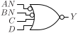

# NOR4N2

Four input NOR gate with two inputs inverted

## Pin information

| Pin   | Description   |
| :-:    | :-            |
| AN | Input AN, inverted |
| BN | Input BN, inverted |
| C | Input C |
| D | Input D |
| Y | Output |
| VDD | Power supply |
| VSS | Ground |


## Logic function and Truth table

### Logic function (Python)
<div align="center">
Y = ~(~AN | ~BN | C | D)
</div>

### Logic function (Boolean)
\\[ Y = \overline{\overline{AN} + \overline{BN} + C + D} \\]

### Truth Table for Y


| AN | BN | C | D | Y |
| :--- | :--- | :--- | :--- | :--- |
| 1 | 1 | 0 | 0 | 1 | 
| 0 | - | - | - | 0 | 
| - | 0 | - | - | 0 | 
| - | - | 1 | - | 0 | 
| - | - | - | 1 | 0 | 


## Symbol

<div align="center">

</div>

## Schematic

<div align="center">

</div>

## Cell variants

| Cell name <br> | Width <br> [unit sites] | Area <br> [\\(\mu m^2\\)] |
| :-        | :-:   | :-:   |
| [NOR4N2_DL](#nor4n2_dl) | TBD | TBD |
| [NOR4N2_D1](#nor4n2_d1) | TBD | TBD |
| [NOR4N2_D2](#nor4n2_d2) | TBD | TBD |


### NOR4N2_DL

#### Hierarchical SPICE netlist
```spice
.subckt NOR4N2_DL AN BN C D Y VDD VSS
Xinv1 AN A VDD VSS inv_par WN=1.5e-07 WP=2.3e-07 
Xinv2 BN B VDD VSS inv_par WN=1.5e-07 WP=2.3e-07 
Xnor4 A B C D Y VDD VSS nor4_par WP=8e-07 WN=3e-07 
.ends
```

#### Flat SPICE netlist
```spice
.subckt NOR4N2_DL AN BN C D Y VDD VSS
XMN0 n0 AN VSS VSS sg13_lv_nmos w=1.5e-07 l=1.3e-07 ad=4.65e-14 as=4.65e-14 pd=9.2e-07 ps=9.2e-07 ng=1 
XMP0 n0 AN VDD VDD sg13_lv_pmos w=2.3e-07 l=1.3e-07 ad=7.13e-14 as=7.13e-14 pd=1.08e-06 ps=1.08e-06 ng=1 
XMN1 n1 BN VSS VSS sg13_lv_nmos w=1.5e-07 l=1.3e-07 ad=4.65e-14 as=4.65e-14 pd=9.2e-07 ps=9.2e-07 ng=1 
XMP1 n1 BN VDD VDD sg13_lv_pmos w=2.3e-07 l=1.3e-07 ad=7.13e-14 as=7.13e-14 pd=1.08e-06 ps=1.08e-06 ng=1 
XMN2 Y n0 VSS VSS sg13_lv_nmos w=3e-07 l=1.3e-07 ad=9.3e-14 as=9.3e-14 pd=1.22e-06 ps=1.22e-06 ng=1 
XMN3 Y n1 VSS VSS sg13_lv_nmos w=3e-07 l=1.3e-07 ad=9.3e-14 as=9.3e-14 pd=1.22e-06 ps=1.22e-06 ng=1 
XMN4 Y C VSS VSS sg13_lv_nmos w=3e-07 l=1.3e-07 ad=9.3e-14 as=9.3e-14 pd=1.22e-06 ps=1.22e-06 ng=1 
XMN5 Y D VSS VSS sg13_lv_nmos w=3e-07 l=1.3e-07 ad=9.3e-14 as=9.3e-14 pd=1.22e-06 ps=1.22e-06 ng=1 
XMP2 n2 D VDD VDD sg13_lv_pmos w=8e-07 l=1.3e-07 ad=2.48e-13 as=2.48e-13 pd=2.22e-06 ps=2.22e-06 ng=1 
XMP3 n3 C n2 VDD sg13_lv_pmos w=8e-07 l=1.3e-07 ad=2.48e-13 as=2.48e-13 pd=2.22e-06 ps=2.22e-06 ng=1 
XMP4 n4 n1 n3 VDD sg13_lv_pmos w=8e-07 l=1.3e-07 ad=2.48e-13 as=2.48e-13 pd=2.22e-06 ps=2.22e-06 ng=1 
XMP5 Y n0 n4 VDD sg13_lv_pmos w=8e-07 l=1.3e-07 ad=2.48e-13 as=2.48e-13 pd=2.22e-06 ps=2.22e-06 ng=1 
.ends
```

#### CDL netlist
```cdl
.SUBCKT NOR4N2_DL AN BN C D Y VDD VSS
*.PININFO AN:I BN:I C:I D:I Y:O VDD:B VSS:B 
MN0 n0 AN VSS VSS sg13_lv_nmos w=1.5e-07 l=1.3e-07 ng=1 
MP0 n0 AN VDD VDD sg13_lv_pmos w=2.3e-07 l=1.3e-07 ng=1 
MN1 n1 BN VSS VSS sg13_lv_nmos w=1.5e-07 l=1.3e-07 ng=1 
MP1 n1 BN VDD VDD sg13_lv_pmos w=2.3e-07 l=1.3e-07 ng=1 
MN2 Y n0 VSS VSS sg13_lv_nmos w=3e-07 l=1.3e-07 ng=1 
MN3 Y n1 VSS VSS sg13_lv_nmos w=3e-07 l=1.3e-07 ng=1 
MN4 Y C VSS VSS sg13_lv_nmos w=3e-07 l=1.3e-07 ng=1 
MN5 Y D VSS VSS sg13_lv_nmos w=3e-07 l=1.3e-07 ng=1 
MP2 n2 D VDD VDD sg13_lv_pmos w=8e-07 l=1.3e-07 ng=1 
MP3 n3 C n2 VDD sg13_lv_pmos w=8e-07 l=1.3e-07 ng=1 
MP4 n4 n1 n3 VDD sg13_lv_pmos w=8e-07 l=1.3e-07 ng=1 
MP5 Y n0 n4 VDD sg13_lv_pmos w=8e-07 l=1.3e-07 ng=1 
.ENDS
```

#### Layout

<div align="center">

</div>

### NOR4N2_D1

#### Hierarchical SPICE netlist
```spice
.subckt NOR4N2_D1 AN BN C D Y VDD VSS
Xinv1 AN A VDD VSS inv_par WN=2.5e-07 WP=4e-07 
Xinv2 BN B VDD VSS inv_par WN=2.5e-07 WP=4e-07 
Xnor4 A B C D Y VDD VSS nor4_par 
.ends
```

#### Flat SPICE netlist
```spice
.subckt NOR4N2_D1 AN BN C D Y VDD VSS
XMN0 n0 AN VSS VSS sg13_lv_nmos w=2.5e-07 l=1.3e-07 ad=7.75e-14 as=7.75e-14 pd=1.12e-06 ps=1.12e-06 ng=1 
XMP0 n0 AN VDD VDD sg13_lv_pmos w=4e-07 l=1.3e-07 ad=1.24e-13 as=1.24e-13 pd=1.42e-06 ps=1.42e-06 ng=1 
XMN1 n1 BN VSS VSS sg13_lv_nmos w=2.5e-07 l=1.3e-07 ad=7.75e-14 as=7.75e-14 pd=1.12e-06 ps=1.12e-06 ng=1 
XMP1 n1 BN VDD VDD sg13_lv_pmos w=4e-07 l=1.3e-07 ad=1.24e-13 as=1.24e-13 pd=1.42e-06 ps=1.42e-06 ng=1 
XMN2 Y n0 VSS VSS sg13_lv_nmos w=5e-07 l=1.3e-07 ad=1.55e-13 as=1.55e-13 pd=1.62e-06 ps=1.62e-06 ng=1 
XMN3 Y n1 VSS VSS sg13_lv_nmos w=5e-07 l=1.3e-07 ad=1.55e-13 as=1.55e-13 pd=1.62e-06 ps=1.62e-06 ng=1 
XMN4 Y C VSS VSS sg13_lv_nmos w=5e-07 l=1.3e-07 ad=1.55e-13 as=1.55e-13 pd=1.62e-06 ps=1.62e-06 ng=1 
XMN5 Y D VSS VSS sg13_lv_nmos w=5e-07 l=1.3e-07 ad=1.55e-13 as=1.55e-13 pd=1.62e-06 ps=1.62e-06 ng=1 
XMP2 n2 D VDD VDD sg13_lv_pmos w=1.4e-06 l=1.3e-07 ad=4.34e-13 as=4.34e-13 pd=3.42e-06 ps=3.42e-06 ng=1 
XMP3 n3 C n2 VDD sg13_lv_pmos w=1.4e-06 l=1.3e-07 ad=4.34e-13 as=4.34e-13 pd=3.42e-06 ps=3.42e-06 ng=1 
XMP4 n4 n1 n3 VDD sg13_lv_pmos w=1.4e-06 l=1.3e-07 ad=4.34e-13 as=4.34e-13 pd=3.42e-06 ps=3.42e-06 ng=1 
XMP5 Y n0 n4 VDD sg13_lv_pmos w=1.4e-06 l=1.3e-07 ad=4.34e-13 as=4.34e-13 pd=3.42e-06 ps=3.42e-06 ng=1 
.ends
```

#### CDL netlist
```cdl
.SUBCKT NOR4N2_D1 AN BN C D Y VDD VSS
*.PININFO AN:I BN:I C:I D:I Y:O VDD:B VSS:B 
MN0 n0 AN VSS VSS sg13_lv_nmos w=2.5e-07 l=1.3e-07 ng=1 
MP0 n0 AN VDD VDD sg13_lv_pmos w=4e-07 l=1.3e-07 ng=1 
MN1 n1 BN VSS VSS sg13_lv_nmos w=2.5e-07 l=1.3e-07 ng=1 
MP1 n1 BN VDD VDD sg13_lv_pmos w=4e-07 l=1.3e-07 ng=1 
MN2 Y n0 VSS VSS sg13_lv_nmos w=5e-07 l=1.3e-07 ng=1 
MN3 Y n1 VSS VSS sg13_lv_nmos w=5e-07 l=1.3e-07 ng=1 
MN4 Y C VSS VSS sg13_lv_nmos w=5e-07 l=1.3e-07 ng=1 
MN5 Y D VSS VSS sg13_lv_nmos w=5e-07 l=1.3e-07 ng=1 
MP2 n2 D VDD VDD sg13_lv_pmos w=1.4e-06 l=1.3e-07 ng=1 
MP3 n3 C n2 VDD sg13_lv_pmos w=1.4e-06 l=1.3e-07 ng=1 
MP4 n4 n1 n3 VDD sg13_lv_pmos w=1.4e-06 l=1.3e-07 ng=1 
MP5 Y n0 n4 VDD sg13_lv_pmos w=1.4e-06 l=1.3e-07 ng=1 
.ENDS
```

#### Layout

<div align="center">

</div>

### NOR4N2_D2

#### Hierarchical SPICE netlist
```spice
.subckt NOR4N2_D2 AN BN C D Y VDD VSS
Xinv1 AN A VDD VSS inv_par WN=5.3e-07 WP=8e-07 
Xinv2 BN B VDD VSS inv_par WN=5.3e-07 WP=8e-07 
Xnor4 A B C D Y VDD VSS nor4_par WP=2.2e-06 NGP=2 WN=8e-07 NGN=1 
.ends
```

#### Flat SPICE netlist
```spice
.subckt NOR4N2_D2 AN BN C D Y VDD VSS
XMN0 n0 AN VSS VSS sg13_lv_nmos w=5.3e-07 l=1.3e-07 ad=1.643e-13 as=1.643e-13 pd=1.68e-06 ps=1.68e-06 ng=1 
XMP0 n0 AN VDD VDD sg13_lv_pmos w=8e-07 l=1.3e-07 ad=2.48e-13 as=2.48e-13 pd=2.22e-06 ps=2.22e-06 ng=1 
XMN1 n1 BN VSS VSS sg13_lv_nmos w=5.3e-07 l=1.3e-07 ad=1.643e-13 as=1.643e-13 pd=1.68e-06 ps=1.68e-06 ng=1 
XMP1 n1 BN VDD VDD sg13_lv_pmos w=8e-07 l=1.3e-07 ad=2.48e-13 as=2.48e-13 pd=2.22e-06 ps=2.22e-06 ng=1 
XMN2 Y n0 VSS VSS sg13_lv_nmos w=8e-07 l=1.3e-07 ad=2.48e-13 as=2.48e-13 pd=2.22e-06 ps=2.22e-06 ng=1 
XMN3 Y n1 VSS VSS sg13_lv_nmos w=8e-07 l=1.3e-07 ad=2.48e-13 as=2.48e-13 pd=2.22e-06 ps=2.22e-06 ng=1 
XMN4 Y C VSS VSS sg13_lv_nmos w=8e-07 l=1.3e-07 ad=2.48e-13 as=2.48e-13 pd=2.22e-06 ps=2.22e-06 ng=1 
XMN5 Y D VSS VSS sg13_lv_nmos w=8e-07 l=1.3e-07 ad=2.48e-13 as=2.48e-13 pd=2.22e-06 ps=2.22e-06 ng=1 
XMP2 n2 D VDD VDD sg13_lv_pmos w=2.2e-06 l=1.3e-07 ad=6.82e-13 as=6.82e-13 pd=5.02e-06 ps=5.02e-06 ng=2 
XMP3 n3 C n2 VDD sg13_lv_pmos w=2.2e-06 l=1.3e-07 ad=6.82e-13 as=6.82e-13 pd=5.02e-06 ps=5.02e-06 ng=2 
XMP4 n4 n1 n3 VDD sg13_lv_pmos w=2.2e-06 l=1.3e-07 ad=6.82e-13 as=6.82e-13 pd=5.02e-06 ps=5.02e-06 ng=2 
XMP5 Y n0 n4 VDD sg13_lv_pmos w=2.2e-06 l=1.3e-07 ad=6.82e-13 as=6.82e-13 pd=5.02e-06 ps=5.02e-06 ng=2 
.ends
```

#### CDL netlist
```cdl
.SUBCKT NOR4N2_D2 AN BN C D Y VDD VSS
*.PININFO AN:I BN:I C:I D:I Y:O VDD:B VSS:B 
MN0 n0 AN VSS VSS sg13_lv_nmos w=5.3e-07 l=1.3e-07 ng=1 
MP0 n0 AN VDD VDD sg13_lv_pmos w=8e-07 l=1.3e-07 ng=1 
MN1 n1 BN VSS VSS sg13_lv_nmos w=5.3e-07 l=1.3e-07 ng=1 
MP1 n1 BN VDD VDD sg13_lv_pmos w=8e-07 l=1.3e-07 ng=1 
MN2 Y n0 VSS VSS sg13_lv_nmos w=8e-07 l=1.3e-07 ng=1 
MN3 Y n1 VSS VSS sg13_lv_nmos w=8e-07 l=1.3e-07 ng=1 
MN4 Y C VSS VSS sg13_lv_nmos w=8e-07 l=1.3e-07 ng=1 
MN5 Y D VSS VSS sg13_lv_nmos w=8e-07 l=1.3e-07 ng=1 
MP2 n2 D VDD VDD sg13_lv_pmos w=2.2e-06 l=1.3e-07 ng=2 
MP3 n3 C n2 VDD sg13_lv_pmos w=2.2e-06 l=1.3e-07 ng=2 
MP4 n4 n1 n3 VDD sg13_lv_pmos w=2.2e-06 l=1.3e-07 ng=2 
MP5 Y n0 n4 VDD sg13_lv_pmos w=2.2e-06 l=1.3e-07 ng=2 
.ENDS
```

#### Layout

<div align="center">

</div>

## Pin capacitance
No pin capacitance data


## Static power
No static power data


## Dynamic power
No dynamic power data


## Delay
No delay data

