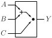
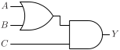

# OA21

OR-AND gate with two OR inputs and one direct AND input

## Pin information

| Pin   | Description   |
| :-:    | :-            |
| A | Input A, connected to OR gate |
| B | Input B, connected to OR gate |
| C | Input C, direct input to AND gate |
| Y | Output |
| VDD | Power supply |
| VSS | Ground |


## Logic function and Truth table

### Logic function (Python)
<div align="center">
Y = (A | B) & C
</div>

### Logic function (Boolean)
\\[ Y = (A + B) \cdot C \\]

### Truth Table for Y


| A | B | C | Y |
| :--- | :--- | :--- | :--- |
| 1 | - | 1 | 1 | 
| - | 1 | 1 | 1 | 
| - | - | 0 | 0 | 
| 0 | 0 | - | 0 | 


## Symbol

<div align="center">

</div>

## Schematic

<div align="center">

</div>

## Cell variants

| Cell name <br> | Width <br> [unit sites] | Area <br> [\\(\mu m^2\\)] |
| :-        | :-:   | :-:   |
| [OA21_DL](#oa21_dl) | TBD | TBD |
| [OA21_D1](#oa21_d1) | TBD | TBD |
| [OA21_D2](#oa21_d2) | TBD | TBD |
| [OA21_D4](#oa21_d4) | TBD | TBD |


### OA21_DL

#### Hierarchical SPICE netlist
```spice
.subckt OA21_DL A B C Y VDD VSS
XMN0 nabp A VSS VSS sg13_lv_nmos w=2e-07 l=1.3e-07 ad={2e-07*3.1e-07} as={2e-07*3.1e-07} pd={2*(2e-07+3.1e-07)} ps={2*(2e-07+3.1e-07)} 
XMN1 nabp B VSS VSS sg13_lv_nmos w=2e-07 l=1.3e-07 ad={2e-07*3.1e-07} as={2e-07*3.1e-07} pd={2*(2e-07+3.1e-07)} ps={2*(2e-07+3.1e-07)} 
XMN2 nabp C NY VSS sg13_lv_nmos w=2e-07 l=1.3e-07 ad={2e-07*3.1e-07} as={2e-07*3.1e-07} pd={2*(2e-07+3.1e-07)} ps={2*(2e-07+3.1e-07)} 
XMP0 NY C VDD VDD sg13_lv_pmos w=2.5e-07 l=1.3e-07 ad={2.5e-07*3.1e-07} as={2.5e-07*3.1e-07} pd={2*(2.5e-07+3.1e-07)} ps={2*(2.5e-07+3.1e-07)} 
XMP1 nabs A VDD VDD sg13_lv_pmos w=3e-07 l=1.3e-07 ad={3e-07*3.1e-07} as={3e-07*3.1e-07} pd={2*(3e-07+3.1e-07)} ps={2*(3e-07+3.1e-07)} 
XMP2 nabs B NY VDD sg13_lv_pmos w=3e-07 l=1.3e-07 ad={3e-07*3.1e-07} as={3e-07*3.1e-07} pd={2*(3e-07+3.1e-07)} ps={2*(3e-07+3.1e-07)} 
Xinv1 NY Y VDD VSS inv_par WN=3.2e-07 WP=4.9e-07 
.ends
```

#### Flat SPICE netlist
```spice
.subckt OA21_DL A B C Y VDD VSS
XMN0 n0 A VSS VSS sg13_lv_nmos w=2e-07 l=1.3e-07 ad=6.2e-14 as=6.2e-14 pd=1.02e-06 ps=1.02e-06 
XMN1 n0 B VSS VSS sg13_lv_nmos w=2e-07 l=1.3e-07 ad=6.2e-14 as=6.2e-14 pd=1.02e-06 ps=1.02e-06 
XMN2 n0 C n1 VSS sg13_lv_nmos w=2e-07 l=1.3e-07 ad=6.2e-14 as=6.2e-14 pd=1.02e-06 ps=1.02e-06 
XMP0 n1 C VDD VDD sg13_lv_pmos w=2.5e-07 l=1.3e-07 ad=7.75e-14 as=7.75e-14 pd=1.12e-06 ps=1.12e-06 
XMP1 n2 A VDD VDD sg13_lv_pmos w=3e-07 l=1.3e-07 ad=9.3e-14 as=9.3e-14 pd=1.22e-06 ps=1.22e-06 
XMP2 n2 B n1 VDD sg13_lv_pmos w=3e-07 l=1.3e-07 ad=9.3e-14 as=9.3e-14 pd=1.22e-06 ps=1.22e-06 
XMN3 Y n1 VSS VSS sg13_lv_nmos w=3.2e-07 l=1.3e-07 ad=9.92e-14 as=9.92e-14 pd=1.26e-06 ps=1.26e-06 ng=1 
XMP3 Y n1 VDD VDD sg13_lv_pmos w=4.9e-07 l=1.3e-07 ad=1.519e-13 as=1.519e-13 pd=1.6e-06 ps=1.6e-06 ng=1 
.ends
```

#### CDL netlist
```cdl
.SUBCKT OA21_DL A B C Y VDD VSS
*.PININFO A:I B:I C:I Y:O VDD:B VSS:B 
MN0 n0 A VSS VSS sg13_lv_nmos w=2e-07 l=1.3e-07 
MN1 n0 B VSS VSS sg13_lv_nmos w=2e-07 l=1.3e-07 
MN2 n0 C n1 VSS sg13_lv_nmos w=2e-07 l=1.3e-07 
MP0 n1 C VDD VDD sg13_lv_pmos w=2.5e-07 l=1.3e-07 
MP1 n2 A VDD VDD sg13_lv_pmos w=3e-07 l=1.3e-07 
MP2 n2 B n1 VDD sg13_lv_pmos w=3e-07 l=1.3e-07 
MN3 Y n1 VSS VSS sg13_lv_nmos w=3.2e-07 l=1.3e-07 ng=1 
MP3 Y n1 VDD VDD sg13_lv_pmos w=4.9e-07 l=1.3e-07 ng=1 
.ENDS
```

#### Layout

<div align="center">

</div>

### OA21_D1

#### Hierarchical SPICE netlist
```spice
.subckt OA21_D1 A B C Y VDD VSS
XMN0 nabp A VSS VSS sg13_lv_nmos w=3e-07 l=1.3e-07 ad={3e-07*3.1e-07} as={3e-07*3.1e-07} pd={2*(3e-07+3.1e-07)} ps={2*(3e-07+3.1e-07)} 
XMN1 nabp B VSS VSS sg13_lv_nmos w=3e-07 l=1.3e-07 ad={3e-07*3.1e-07} as={3e-07*3.1e-07} pd={2*(3e-07+3.1e-07)} ps={2*(3e-07+3.1e-07)} 
XMN2 nabp C NY VSS sg13_lv_nmos w=3e-07 l=1.3e-07 ad={3e-07*3.1e-07} as={3e-07*3.1e-07} pd={2*(3e-07+3.1e-07)} ps={2*(3e-07+3.1e-07)} 
XMP0 NY C VDD VDD sg13_lv_pmos w=3.5e-07 l=1.3e-07 ad={3.5e-07*3.1e-07} as={3.5e-07*3.1e-07} pd={2*(3.5e-07+3.1e-07)} ps={2*(3.5e-07+3.1e-07)} 
XMP1 nabs A VDD VDD sg13_lv_pmos w=4.5e-07 l=1.3e-07 ad={4.5e-07*3.1e-07} as={4.5e-07*3.1e-07} pd={2*(4.5e-07+3.1e-07)} ps={2*(4.5e-07+3.1e-07)} 
XMP2 nabs B NY VDD sg13_lv_pmos w=4.5e-07 l=1.3e-07 ad={4.5e-07*3.1e-07} as={4.5e-07*3.1e-07} pd={2*(4.5e-07+3.1e-07)} ps={2*(4.5e-07+3.1e-07)} 
Xinv1 NY Y VDD VSS inv_par WN=6.4e-07 WP=9.8e-07 
.ends
```

#### Flat SPICE netlist
```spice
.subckt OA21_D1 A B C Y VDD VSS
XMN0 n0 A VSS VSS sg13_lv_nmos w=3e-07 l=1.3e-07 ad=9.3e-14 as=9.3e-14 pd=1.22e-06 ps=1.22e-06 
XMN1 n0 B VSS VSS sg13_lv_nmos w=3e-07 l=1.3e-07 ad=9.3e-14 as=9.3e-14 pd=1.22e-06 ps=1.22e-06 
XMN2 n0 C n1 VSS sg13_lv_nmos w=3e-07 l=1.3e-07 ad=9.3e-14 as=9.3e-14 pd=1.22e-06 ps=1.22e-06 
XMP0 n1 C VDD VDD sg13_lv_pmos w=3.5e-07 l=1.3e-07 ad=1.085e-13 as=1.085e-13 pd=1.32e-06 ps=1.32e-06 
XMP1 n2 A VDD VDD sg13_lv_pmos w=4.5e-07 l=1.3e-07 ad=1.395e-13 as=1.395e-13 pd=1.52e-06 ps=1.52e-06 
XMP2 n2 B n1 VDD sg13_lv_pmos w=4.5e-07 l=1.3e-07 ad=1.395e-13 as=1.395e-13 pd=1.52e-06 ps=1.52e-06 
XMN3 Y n1 VSS VSS sg13_lv_nmos w=6.4e-07 l=1.3e-07 ad=1.984e-13 as=1.984e-13 pd=1.9e-06 ps=1.9e-06 ng=1 
XMP3 Y n1 VDD VDD sg13_lv_pmos w=9.8e-07 l=1.3e-07 ad=3.038e-13 as=3.038e-13 pd=2.58e-06 ps=2.58e-06 ng=1 
.ends
```

#### CDL netlist
```cdl
.SUBCKT OA21_D1 A B C Y VDD VSS
*.PININFO A:I B:I C:I Y:O VDD:B VSS:B 
MN0 n0 A VSS VSS sg13_lv_nmos w=3e-07 l=1.3e-07 
MN1 n0 B VSS VSS sg13_lv_nmos w=3e-07 l=1.3e-07 
MN2 n0 C n1 VSS sg13_lv_nmos w=3e-07 l=1.3e-07 
MP0 n1 C VDD VDD sg13_lv_pmos w=3.5e-07 l=1.3e-07 
MP1 n2 A VDD VDD sg13_lv_pmos w=4.5e-07 l=1.3e-07 
MP2 n2 B n1 VDD sg13_lv_pmos w=4.5e-07 l=1.3e-07 
MN3 Y n1 VSS VSS sg13_lv_nmos w=6.4e-07 l=1.3e-07 ng=1 
MP3 Y n1 VDD VDD sg13_lv_pmos w=9.8e-07 l=1.3e-07 ng=1 
.ENDS
```

#### Layout

<div align="center">

</div>

### OA21_D2

#### Hierarchical SPICE netlist
```spice
.subckt OA21_D2 A B C Y VDD VSS
XMN0 nabp A VSS VSS sg13_lv_nmos w=5.5e-07 l=1.3e-07 ad={5.5e-07*3.1e-07} as={5.5e-07*3.1e-07} pd={2*(5.5e-07+3.1e-07)} ps={2*(5.5e-07+3.1e-07)} 
XMN1 nabp B VSS VSS sg13_lv_nmos w=5.5e-07 l=1.3e-07 ad={5.5e-07*3.1e-07} as={5.5e-07*3.1e-07} pd={2*(5.5e-07+3.1e-07)} ps={2*(5.5e-07+3.1e-07)} 
XMN2 nabp C NY VSS sg13_lv_nmos w=5.5e-07 l=1.3e-07 ad={5.5e-07*3.1e-07} as={5.5e-07*3.1e-07} pd={2*(5.5e-07+3.1e-07)} ps={2*(5.5e-07+3.1e-07)} 
XMP0 NY C VDD VDD sg13_lv_pmos w=6.5e-07 l=1.3e-07 ad={6.5e-07*3.1e-07} as={6.5e-07*3.1e-07} pd={2*(6.5e-07+3.1e-07)} ps={2*(6.5e-07+3.1e-07)} 
XMP1 nabs A VDD VDD sg13_lv_pmos w=8e-07 l=1.3e-07 ad={8e-07*3.1e-07} as={8e-07*3.1e-07} pd={2*(8e-07+3.1e-07)} ps={2*(8e-07+3.1e-07)} 
XMP2 nabs B NY VDD sg13_lv_pmos w=8e-07 l=1.3e-07 ad={8e-07*3.1e-07} as={8e-07*3.1e-07} pd={2*(8e-07+3.1e-07)} ps={2*(8e-07+3.1e-07)} 
Xinv1 NY Y VDD VSS inv_par WN=1.07e-06 WP=1.6e-06 
.ends
```

#### Flat SPICE netlist
```spice
.subckt OA21_D2 A B C Y VDD VSS
XMN0 n0 A VSS VSS sg13_lv_nmos w=5.5e-07 l=1.3e-07 ad=1.705e-13 as=1.705e-13 pd=1.72e-06 ps=1.72e-06 
XMN1 n0 B VSS VSS sg13_lv_nmos w=5.5e-07 l=1.3e-07 ad=1.705e-13 as=1.705e-13 pd=1.72e-06 ps=1.72e-06 
XMN2 n0 C n1 VSS sg13_lv_nmos w=5.5e-07 l=1.3e-07 ad=1.705e-13 as=1.705e-13 pd=1.72e-06 ps=1.72e-06 
XMP0 n1 C VDD VDD sg13_lv_pmos w=6.5e-07 l=1.3e-07 ad=2.015e-13 as=2.015e-13 pd=1.92e-06 ps=1.92e-06 
XMP1 n2 A VDD VDD sg13_lv_pmos w=8e-07 l=1.3e-07 ad=2.48e-13 as=2.48e-13 pd=2.22e-06 ps=2.22e-06 
XMP2 n2 B n1 VDD sg13_lv_pmos w=8e-07 l=1.3e-07 ad=2.48e-13 as=2.48e-13 pd=2.22e-06 ps=2.22e-06 
XMN3 Y n1 VSS VSS sg13_lv_nmos w=1.07e-06 l=1.3e-07 ad=3.317e-13 as=3.317e-13 pd=2.76e-06 ps=2.76e-06 ng=1 
XMP3 Y n1 VDD VDD sg13_lv_pmos w=1.6e-06 l=1.3e-07 ad=4.96e-13 as=4.96e-13 pd=3.82e-06 ps=3.82e-06 ng=1 
.ends
```

#### CDL netlist
```cdl
.SUBCKT OA21_D2 A B C Y VDD VSS
*.PININFO A:I B:I C:I Y:O VDD:B VSS:B 
MN0 n0 A VSS VSS sg13_lv_nmos w=5.5e-07 l=1.3e-07 
MN1 n0 B VSS VSS sg13_lv_nmos w=5.5e-07 l=1.3e-07 
MN2 n0 C n1 VSS sg13_lv_nmos w=5.5e-07 l=1.3e-07 
MP0 n1 C VDD VDD sg13_lv_pmos w=6.5e-07 l=1.3e-07 
MP1 n2 A VDD VDD sg13_lv_pmos w=8e-07 l=1.3e-07 
MP2 n2 B n1 VDD sg13_lv_pmos w=8e-07 l=1.3e-07 
MN3 Y n1 VSS VSS sg13_lv_nmos w=1.07e-06 l=1.3e-07 ng=1 
MP3 Y n1 VDD VDD sg13_lv_pmos w=1.6e-06 l=1.3e-07 ng=1 
.ENDS
```

#### Layout

<div align="center">

</div>

### OA21_D4

#### Hierarchical SPICE netlist
```spice
.subckt OA21_D4 A B C Y VDD VSS
XMN0 nabp A VSS VSS sg13_lv_nmos w=1e-06 l=1.3e-07 ad={1e-06*3.1e-07} as={1e-06*3.1e-07} pd={2*(1e-06+3.1e-07)} ps={2*(1e-06+3.1e-07)} 
XMN1 nabp B VSS VSS sg13_lv_nmos w=1e-06 l=1.3e-07 ad={1e-06*3.1e-07} as={1e-06*3.1e-07} pd={2*(1e-06+3.1e-07)} ps={2*(1e-06+3.1e-07)} 
XMN2 nabp C NY VSS sg13_lv_nmos w=1e-06 l=1.3e-07 ad={1e-06*3.1e-07} as={1e-06*3.1e-07} pd={2*(1e-06+3.1e-07)} ps={2*(1e-06+3.1e-07)} 
XMP0 NY C VDD VDD sg13_lv_pmos w=1.1e-06 l=1.3e-07 ad={1.1e-06*3.1e-07} as={1.1e-06*3.1e-07} pd={2*(1.1e-06+3.1e-07)} ps={2*(1.1e-06+3.1e-07)} 
XMP1 nabs A VDD VDD sg13_lv_pmos w=1.5e-06 l=1.3e-07 ad={1.5e-06*3.1e-07} as={1.5e-06*3.1e-07} pd={2*(1.5e-06+3.1e-07)} ps={2*(1.5e-06+3.1e-07)} 
XMP2 nabs B NY VDD sg13_lv_pmos w=1.5e-06 l=1.3e-07 ad={1.5e-06*3.1e-07} as={1.5e-06*3.1e-07} pd={2*(1.5e-06+3.1e-07)} ps={2*(1.5e-06+3.1e-07)} 
Xinv1 NY Y VDD VSS inv_par WN=2.14e-06 WP=3.2e-06 NGN=2 
.ends
```

#### Flat SPICE netlist
```spice
.subckt OA21_D4 A B C Y VDD VSS
XMN0 n0 A VSS VSS sg13_lv_nmos w=1e-06 l=1.3e-07 ad=3.1e-13 as=3.1e-13 pd=2.62e-06 ps=2.62e-06 
XMN1 n0 B VSS VSS sg13_lv_nmos w=1e-06 l=1.3e-07 ad=3.1e-13 as=3.1e-13 pd=2.62e-06 ps=2.62e-06 
XMN2 n0 C n1 VSS sg13_lv_nmos w=1e-06 l=1.3e-07 ad=3.1e-13 as=3.1e-13 pd=2.62e-06 ps=2.62e-06 
XMP0 n1 C VDD VDD sg13_lv_pmos w=1.1e-06 l=1.3e-07 ad=3.41e-13 as=3.41e-13 pd=2.82e-06 ps=2.82e-06 
XMP1 n2 A VDD VDD sg13_lv_pmos w=1.5e-06 l=1.3e-07 ad=4.65e-13 as=4.65e-13 pd=3.62e-06 ps=3.62e-06 
XMP2 n2 B n1 VDD sg13_lv_pmos w=1.5e-06 l=1.3e-07 ad=4.65e-13 as=4.65e-13 pd=3.62e-06 ps=3.62e-06 
XMN3 Y n1 VSS VSS sg13_lv_nmos w=2.14e-06 l=1.3e-07 ad=6.634e-13 as=6.634e-13 pd=4.9e-06 ps=4.9e-06 ng=2 
XMP3 Y n1 VDD VDD sg13_lv_pmos w=3.2e-06 l=1.3e-07 ad=9.92e-13 as=9.92e-13 pd=7.02e-06 ps=7.02e-06 ng=1 
.ends
```

#### CDL netlist
```cdl
.SUBCKT OA21_D4 A B C Y VDD VSS
*.PININFO A:I B:I C:I Y:O VDD:B VSS:B 
MN0 n0 A VSS VSS sg13_lv_nmos w=1e-06 l=1.3e-07 
MN1 n0 B VSS VSS sg13_lv_nmos w=1e-06 l=1.3e-07 
MN2 n0 C n1 VSS sg13_lv_nmos w=1e-06 l=1.3e-07 
MP0 n1 C VDD VDD sg13_lv_pmos w=1.1e-06 l=1.3e-07 
MP1 n2 A VDD VDD sg13_lv_pmos w=1.5e-06 l=1.3e-07 
MP2 n2 B n1 VDD sg13_lv_pmos w=1.5e-06 l=1.3e-07 
MN3 Y n1 VSS VSS sg13_lv_nmos w=2.14e-06 l=1.3e-07 ng=2 
MP3 Y n1 VDD VDD sg13_lv_pmos w=3.2e-06 l=1.3e-07 ng=1 
.ENDS
```

#### Layout

<div align="center">

</div>

## Pin capacitance
No pin capacitance data


## Static power
No static power data


## Dynamic power
No dynamic power data


## Delay
No delay data

