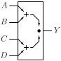
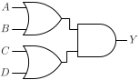

# OA22

OR-AND gate with two two-input OR gates

## Pin information

| Pin   | Description   |
| :-:    | :-            |
| A | Input A, connected to first OR gate |
| B | Input B, connected to first OR gate |
| C | Input C, connected to second OR gate |
| D | Input D, connected to second OR gate |
| Y | Output |
| VDD | Power supply |
| VSS | Ground |


## Logic function and Truth table

### Logic function (Python)
<div align="center">
Y = (A | B) & (C | D)
</div>

### Logic function (Boolean)
\\[ Y = (A + B) \cdot (C + D) \\]

### Truth Table for Y


| A | B | C | D | Y |
| :--- | :--- | :--- | :--- | :--- |
| 1 | - | 1 | - | 1 | 
| 1 | - | - | 1 | 1 | 
| - | 1 | 1 | - | 1 | 
| - | 1 | - | 1 | 1 | 
| 0 | 0 | - | - | 0 | 
| - | - | 0 | 0 | 0 | 


## Symbol

<div align="center">

</div>

## Schematic

<div align="center">

</div>

## Cell variants

| Cell name <br> | Width <br> [unit sites] | Area <br> [\\(\mu m^2\\)] |
| :-        | :-:   | :-:   |
| [OA22_DL](#oa22_dl) | TBD | TBD |
| [OA22_D1](#oa22_d1) | TBD | TBD |
| [OA22_D2](#oa22_d2) | TBD | TBD |


### OA22_DL

#### Hierarchical SPICE netlist
```spice
.subckt OA22_DL A B C D Y VDD VSS
XMN0 nabp C VSS VSS sg13_lv_nmos w=2.5e-07 l=1.3e-07 ad={2.5e-07*3.1e-07} as={2.5e-07*3.1e-07} pd={2*(2.5e-07+3.1e-07)} ps={2*(2.5e-07+3.1e-07)} 
XMN1 nabp D VSS VSS sg13_lv_nmos w=2.5e-07 l=1.3e-07 ad={2.5e-07*3.1e-07} as={2.5e-07*3.1e-07} pd={2*(2.5e-07+3.1e-07)} ps={2*(2.5e-07+3.1e-07)} 
XMN2 nabp A NY VSS sg13_lv_nmos w=2.5e-07 l=1.3e-07 ad={2.5e-07*3.1e-07} as={2.5e-07*3.1e-07} pd={2*(2.5e-07+3.1e-07)} ps={2*(2.5e-07+3.1e-07)} 
XMN3 nabp B NY VSS sg13_lv_nmos w=2.5e-07 l=1.3e-07 ad={2.5e-07*3.1e-07} as={2.5e-07*3.1e-07} pd={2*(2.5e-07+3.1e-07)} ps={2*(2.5e-07+3.1e-07)} 
XMP0 nabs A VDD VDD sg13_lv_pmos w=4e-07 l=1.3e-07 ad={4e-07*3.1e-07} as={4e-07*3.1e-07} pd={2*(4e-07+3.1e-07)} ps={2*(4e-07+3.1e-07)} 
XMP1 nabs B NY VDD sg13_lv_pmos w=4e-07 l=1.3e-07 ad={4e-07*3.1e-07} as={4e-07*3.1e-07} pd={2*(4e-07+3.1e-07)} ps={2*(4e-07+3.1e-07)} 
XMP2 ncds C VDD VDD sg13_lv_pmos w=4e-07 l=1.3e-07 ad={4e-07*3.1e-07} as={4e-07*3.1e-07} pd={2*(4e-07+3.1e-07)} ps={2*(4e-07+3.1e-07)} 
XMP3 ncds D NY VDD sg13_lv_pmos w=4e-07 l=1.3e-07 ad={4e-07*3.1e-07} as={4e-07*3.1e-07} pd={2*(4e-07+3.1e-07)} ps={2*(4e-07+3.1e-07)} 
Xinv1 NY Y VDD VSS inv_par WN=4e-07 WP=6e-07 
.ends
```

#### Flat SPICE netlist
```spice
.subckt OA22_DL A B C D Y VDD VSS
XMN0 n0 C VSS VSS sg13_lv_nmos w=2.5e-07 l=1.3e-07 ad=7.75e-14 as=7.75e-14 pd=1.12e-06 ps=1.12e-06 
XMN1 n0 D VSS VSS sg13_lv_nmos w=2.5e-07 l=1.3e-07 ad=7.75e-14 as=7.75e-14 pd=1.12e-06 ps=1.12e-06 
XMN2 n0 A n1 VSS sg13_lv_nmos w=2.5e-07 l=1.3e-07 ad=7.75e-14 as=7.75e-14 pd=1.12e-06 ps=1.12e-06 
XMN3 n0 B n1 VSS sg13_lv_nmos w=2.5e-07 l=1.3e-07 ad=7.75e-14 as=7.75e-14 pd=1.12e-06 ps=1.12e-06 
XMP0 n2 A VDD VDD sg13_lv_pmos w=4e-07 l=1.3e-07 ad=1.24e-13 as=1.24e-13 pd=1.42e-06 ps=1.42e-06 
XMP1 n2 B n1 VDD sg13_lv_pmos w=4e-07 l=1.3e-07 ad=1.24e-13 as=1.24e-13 pd=1.42e-06 ps=1.42e-06 
XMP2 n3 C VDD VDD sg13_lv_pmos w=4e-07 l=1.3e-07 ad=1.24e-13 as=1.24e-13 pd=1.42e-06 ps=1.42e-06 
XMP3 n3 D n1 VDD sg13_lv_pmos w=4e-07 l=1.3e-07 ad=1.24e-13 as=1.24e-13 pd=1.42e-06 ps=1.42e-06 
XMN4 Y n1 VSS VSS sg13_lv_nmos w=4e-07 l=1.3e-07 ad=1.24e-13 as=1.24e-13 pd=1.42e-06 ps=1.42e-06 ng=1 
XMP4 Y n1 VDD VDD sg13_lv_pmos w=6e-07 l=1.3e-07 ad=1.86e-13 as=1.86e-13 pd=1.82e-06 ps=1.82e-06 ng=1 
.ends
```

#### CDL netlist
```cdl
.SUBCKT OA22_DL A B C D Y VDD VSS
*.PININFO A:I B:I C:I D:I Y:O VDD:B VSS:B 
MN0 n0 C VSS VSS sg13_lv_nmos w=2.5e-07 l=1.3e-07 
MN1 n0 D VSS VSS sg13_lv_nmos w=2.5e-07 l=1.3e-07 
MN2 n0 A n1 VSS sg13_lv_nmos w=2.5e-07 l=1.3e-07 
MN3 n0 B n1 VSS sg13_lv_nmos w=2.5e-07 l=1.3e-07 
MP0 n2 A VDD VDD sg13_lv_pmos w=4e-07 l=1.3e-07 
MP1 n2 B n1 VDD sg13_lv_pmos w=4e-07 l=1.3e-07 
MP2 n3 C VDD VDD sg13_lv_pmos w=4e-07 l=1.3e-07 
MP3 n3 D n1 VDD sg13_lv_pmos w=4e-07 l=1.3e-07 
MN4 Y n1 VSS VSS sg13_lv_nmos w=4e-07 l=1.3e-07 ng=1 
MP4 Y n1 VDD VDD sg13_lv_pmos w=6e-07 l=1.3e-07 ng=1 
.ENDS
```

#### Layout

<div align="center">

</div>

### OA22_D1

#### Hierarchical SPICE netlist
```spice
.subckt OA22_D1 A B C D Y VDD VSS
XMN0 nabp C VSS VSS sg13_lv_nmos w=3.5e-07 l=1.3e-07 ad={3.5e-07*3.1e-07} as={3.5e-07*3.1e-07} pd={2*(3.5e-07+3.1e-07)} ps={2*(3.5e-07+3.1e-07)} 
XMN1 nabp D VSS VSS sg13_lv_nmos w=3.5e-07 l=1.3e-07 ad={3.5e-07*3.1e-07} as={3.5e-07*3.1e-07} pd={2*(3.5e-07+3.1e-07)} ps={2*(3.5e-07+3.1e-07)} 
XMN2 nabp A NY VSS sg13_lv_nmos w=3.5e-07 l=1.3e-07 ad={3.5e-07*3.1e-07} as={3.5e-07*3.1e-07} pd={2*(3.5e-07+3.1e-07)} ps={2*(3.5e-07+3.1e-07)} 
XMN3 nabp B NY VSS sg13_lv_nmos w=3.5e-07 l=1.3e-07 ad={3.5e-07*3.1e-07} as={3.5e-07*3.1e-07} pd={2*(3.5e-07+3.1e-07)} ps={2*(3.5e-07+3.1e-07)} 
XMP0 nabs A VDD VDD sg13_lv_pmos w=5e-07 l=1.3e-07 ad={5e-07*3.1e-07} as={5e-07*3.1e-07} pd={2*(5e-07+3.1e-07)} ps={2*(5e-07+3.1e-07)} 
XMP1 nabs B NY VDD sg13_lv_pmos w=5e-07 l=1.3e-07 ad={5e-07*3.1e-07} as={5e-07*3.1e-07} pd={2*(5e-07+3.1e-07)} ps={2*(5e-07+3.1e-07)} 
XMP2 ncds C VDD VDD sg13_lv_pmos w=5e-07 l=1.3e-07 ad={5e-07*3.1e-07} as={5e-07*3.1e-07} pd={2*(5e-07+3.1e-07)} ps={2*(5e-07+3.1e-07)} 
XMP3 ncds D NY VDD sg13_lv_pmos w=5e-07 l=1.3e-07 ad={5e-07*3.1e-07} as={5e-07*3.1e-07} pd={2*(5e-07+3.1e-07)} ps={2*(5e-07+3.1e-07)} 
Xinv1 NY Y VDD VSS inv_par WN=5e-07 WP=9.8e-07 
.ends
```

#### Flat SPICE netlist
```spice
.subckt OA22_D1 A B C D Y VDD VSS
XMN0 n0 C VSS VSS sg13_lv_nmos w=3.5e-07 l=1.3e-07 ad=1.085e-13 as=1.085e-13 pd=1.32e-06 ps=1.32e-06 
XMN1 n0 D VSS VSS sg13_lv_nmos w=3.5e-07 l=1.3e-07 ad=1.085e-13 as=1.085e-13 pd=1.32e-06 ps=1.32e-06 
XMN2 n0 A n1 VSS sg13_lv_nmos w=3.5e-07 l=1.3e-07 ad=1.085e-13 as=1.085e-13 pd=1.32e-06 ps=1.32e-06 
XMN3 n0 B n1 VSS sg13_lv_nmos w=3.5e-07 l=1.3e-07 ad=1.085e-13 as=1.085e-13 pd=1.32e-06 ps=1.32e-06 
XMP0 n2 A VDD VDD sg13_lv_pmos w=5e-07 l=1.3e-07 ad=1.55e-13 as=1.55e-13 pd=1.62e-06 ps=1.62e-06 
XMP1 n2 B n1 VDD sg13_lv_pmos w=5e-07 l=1.3e-07 ad=1.55e-13 as=1.55e-13 pd=1.62e-06 ps=1.62e-06 
XMP2 n3 C VDD VDD sg13_lv_pmos w=5e-07 l=1.3e-07 ad=1.55e-13 as=1.55e-13 pd=1.62e-06 ps=1.62e-06 
XMP3 n3 D n1 VDD sg13_lv_pmos w=5e-07 l=1.3e-07 ad=1.55e-13 as=1.55e-13 pd=1.62e-06 ps=1.62e-06 
XMN4 Y n1 VSS VSS sg13_lv_nmos w=5e-07 l=1.3e-07 ad=1.55e-13 as=1.55e-13 pd=1.62e-06 ps=1.62e-06 ng=1 
XMP4 Y n1 VDD VDD sg13_lv_pmos w=9.8e-07 l=1.3e-07 ad=3.038e-13 as=3.038e-13 pd=2.58e-06 ps=2.58e-06 ng=1 
.ends
```

#### CDL netlist
```cdl
.SUBCKT OA22_D1 A B C D Y VDD VSS
*.PININFO A:I B:I C:I D:I Y:O VDD:B VSS:B 
MN0 n0 C VSS VSS sg13_lv_nmos w=3.5e-07 l=1.3e-07 
MN1 n0 D VSS VSS sg13_lv_nmos w=3.5e-07 l=1.3e-07 
MN2 n0 A n1 VSS sg13_lv_nmos w=3.5e-07 l=1.3e-07 
MN3 n0 B n1 VSS sg13_lv_nmos w=3.5e-07 l=1.3e-07 
MP0 n2 A VDD VDD sg13_lv_pmos w=5e-07 l=1.3e-07 
MP1 n2 B n1 VDD sg13_lv_pmos w=5e-07 l=1.3e-07 
MP2 n3 C VDD VDD sg13_lv_pmos w=5e-07 l=1.3e-07 
MP3 n3 D n1 VDD sg13_lv_pmos w=5e-07 l=1.3e-07 
MN4 Y n1 VSS VSS sg13_lv_nmos w=5e-07 l=1.3e-07 ng=1 
MP4 Y n1 VDD VDD sg13_lv_pmos w=9.8e-07 l=1.3e-07 ng=1 
.ENDS
```

#### Layout

<div align="center">

</div>

### OA22_D2

#### Hierarchical SPICE netlist
```spice
.subckt OA22_D2 A B C D Y VDD VSS
XMN0 nabp C VSS VSS sg13_lv_nmos w=6e-07 l=1.3e-07 ad={6e-07*3.1e-07} as={6e-07*3.1e-07} pd={2*(6e-07+3.1e-07)} ps={2*(6e-07+3.1e-07)} 
XMN1 nabp D VSS VSS sg13_lv_nmos w=6e-07 l=1.3e-07 ad={6e-07*3.1e-07} as={6e-07*3.1e-07} pd={2*(6e-07+3.1e-07)} ps={2*(6e-07+3.1e-07)} 
XMN2 nabp A NY VSS sg13_lv_nmos w=6e-07 l=1.3e-07 ad={6e-07*3.1e-07} as={6e-07*3.1e-07} pd={2*(6e-07+3.1e-07)} ps={2*(6e-07+3.1e-07)} 
XMN3 nabp B NY VSS sg13_lv_nmos w=6e-07 l=1.3e-07 ad={6e-07*3.1e-07} as={6e-07*3.1e-07} pd={2*(6e-07+3.1e-07)} ps={2*(6e-07+3.1e-07)} 
XMP0 nabs A VDD VDD sg13_lv_pmos w=8e-07 l=1.3e-07 ad={8e-07*3.1e-07} as={8e-07*3.1e-07} pd={2*(8e-07+3.1e-07)} ps={2*(8e-07+3.1e-07)} 
XMP1 nabs B NY VDD sg13_lv_pmos w=8e-07 l=1.3e-07 ad={8e-07*3.1e-07} as={8e-07*3.1e-07} pd={2*(8e-07+3.1e-07)} ps={2*(8e-07+3.1e-07)} 
XMP2 ncds C VDD VDD sg13_lv_pmos w=8e-07 l=1.3e-07 ad={8e-07*3.1e-07} as={8e-07*3.1e-07} pd={2*(8e-07+3.1e-07)} ps={2*(8e-07+3.1e-07)} 
XMP3 ncds D NY VDD sg13_lv_pmos w=8e-07 l=1.3e-07 ad={8e-07*3.1e-07} as={8e-07*3.1e-07} pd={2*(8e-07+3.1e-07)} ps={2*(8e-07+3.1e-07)} 
Xinv1 NY Y VDD VSS inv_par WN=1.07e-06 WP=1.6e-06 
.ends
```

#### Flat SPICE netlist
```spice
.subckt OA22_D2 A B C D Y VDD VSS
XMN0 n0 C VSS VSS sg13_lv_nmos w=6e-07 l=1.3e-07 ad=1.86e-13 as=1.86e-13 pd=1.82e-06 ps=1.82e-06 
XMN1 n0 D VSS VSS sg13_lv_nmos w=6e-07 l=1.3e-07 ad=1.86e-13 as=1.86e-13 pd=1.82e-06 ps=1.82e-06 
XMN2 n0 A n1 VSS sg13_lv_nmos w=6e-07 l=1.3e-07 ad=1.86e-13 as=1.86e-13 pd=1.82e-06 ps=1.82e-06 
XMN3 n0 B n1 VSS sg13_lv_nmos w=6e-07 l=1.3e-07 ad=1.86e-13 as=1.86e-13 pd=1.82e-06 ps=1.82e-06 
XMP0 n2 A VDD VDD sg13_lv_pmos w=8e-07 l=1.3e-07 ad=2.48e-13 as=2.48e-13 pd=2.22e-06 ps=2.22e-06 
XMP1 n2 B n1 VDD sg13_lv_pmos w=8e-07 l=1.3e-07 ad=2.48e-13 as=2.48e-13 pd=2.22e-06 ps=2.22e-06 
XMP2 n3 C VDD VDD sg13_lv_pmos w=8e-07 l=1.3e-07 ad=2.48e-13 as=2.48e-13 pd=2.22e-06 ps=2.22e-06 
XMP3 n3 D n1 VDD sg13_lv_pmos w=8e-07 l=1.3e-07 ad=2.48e-13 as=2.48e-13 pd=2.22e-06 ps=2.22e-06 
XMN4 Y n1 VSS VSS sg13_lv_nmos w=1.07e-06 l=1.3e-07 ad=3.317e-13 as=3.317e-13 pd=2.76e-06 ps=2.76e-06 ng=1 
XMP4 Y n1 VDD VDD sg13_lv_pmos w=1.6e-06 l=1.3e-07 ad=4.96e-13 as=4.96e-13 pd=3.82e-06 ps=3.82e-06 ng=1 
.ends
```

#### CDL netlist
```cdl
.SUBCKT OA22_D2 A B C D Y VDD VSS
*.PININFO A:I B:I C:I D:I Y:O VDD:B VSS:B 
MN0 n0 C VSS VSS sg13_lv_nmos w=6e-07 l=1.3e-07 
MN1 n0 D VSS VSS sg13_lv_nmos w=6e-07 l=1.3e-07 
MN2 n0 A n1 VSS sg13_lv_nmos w=6e-07 l=1.3e-07 
MN3 n0 B n1 VSS sg13_lv_nmos w=6e-07 l=1.3e-07 
MP0 n2 A VDD VDD sg13_lv_pmos w=8e-07 l=1.3e-07 
MP1 n2 B n1 VDD sg13_lv_pmos w=8e-07 l=1.3e-07 
MP2 n3 C VDD VDD sg13_lv_pmos w=8e-07 l=1.3e-07 
MP3 n3 D n1 VDD sg13_lv_pmos w=8e-07 l=1.3e-07 
MN4 Y n1 VSS VSS sg13_lv_nmos w=1.07e-06 l=1.3e-07 ng=1 
MP4 Y n1 VDD VDD sg13_lv_pmos w=1.6e-06 l=1.3e-07 ng=1 
.ENDS
```

#### Layout

<div align="center">

</div>

## Pin capacitance
No pin capacitance data


## Static power
No static power data


## Dynamic power
No dynamic power data


## Delay
No delay data

