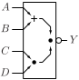
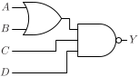

# OAI211

Inverted output OR-AND gate with two input OR gate and two direct inputs to AND gate

## Pin information

| Pin   | Description   |
| :-:    | :-            |
| A | Input A, connected to OR gate |
| B | Input B, connected to OR gate |
| C | Input C, connected to AND gate |
| D | Input D, connected to AND gate |
| Y | Output |
| VDD | Power supply |
| VSS | Ground |


## Logic function and Truth table

### Logic function (Python)
<div align="center">
Y = ~((A | B) & C & D)
</div>

### Logic function (Boolean)
\\[ Y = \overline{(A + B) \cdot C \cdot D} \\]

### Truth Table for Y


| A | B | C | D | Y |
| :--- | :--- | :--- | :--- | :--- |
| - | - | 0 | - | 1 | 
| - | - | - | 0 | 1 | 
| 0 | 0 | - | - | 1 | 
| 1 | - | 1 | 1 | 0 | 
| - | 1 | 1 | 1 | 0 | 


## Symbol

<div align="center">

</div>

## Schematic

<div align="center">

</div>

## Cell variants

| Cell name <br> | Width <br> [unit sites] | Area <br> [\\(\mu m^2\\)] |
| :-        | :-:   | :-:   |
| [OAI211_DL](#oai211_dl) | TBD | TBD |
| [OAI211_D1](#oai211_d1) | TBD | TBD |


### OAI211_DL

#### Hierarchical SPICE netlist
```spice
.subckt OAI211_DL A B C D Y VDD VSS
XMN0 nabp A VSS VSS sg13_lv_nmos w=6e-07 l=1.3e-07 ad={6e-07*3.1e-07} as={6e-07*3.1e-07} pd={2*(6e-07+3.1e-07)} ps={2*(6e-07+3.1e-07)} 
XMN1 nabp B VSS VSS sg13_lv_nmos w=6e-07 l=1.3e-07 ad={6e-07*3.1e-07} as={6e-07*3.1e-07} pd={2*(6e-07+3.1e-07)} ps={2*(6e-07+3.1e-07)} 
XMN2 nabp D ncn VSS sg13_lv_nmos w=6e-07 l=1.3e-07 ad={6e-07*3.1e-07} as={6e-07*3.1e-07} pd={2*(6e-07+3.1e-07)} ps={2*(6e-07+3.1e-07)} 
XMN3 ncn C Y VSS sg13_lv_nmos w=6e-07 l=1.3e-07 ad={6e-07*3.1e-07} as={6e-07*3.1e-07} pd={2*(6e-07+3.1e-07)} ps={2*(6e-07+3.1e-07)} 
XMP0 Y C VDD VDD sg13_lv_pmos w=6.5e-07 l=1.3e-07 ad={6.5e-07*3.1e-07} as={6.5e-07*3.1e-07} pd={2*(6.5e-07+3.1e-07)} ps={2*(6.5e-07+3.1e-07)} 
XMP1 Y D VDD VDD sg13_lv_pmos w=6.5e-07 l=1.3e-07 ad={6.5e-07*3.1e-07} as={6.5e-07*3.1e-07} pd={2*(6.5e-07+3.1e-07)} ps={2*(6.5e-07+3.1e-07)} 
XMP2 nabs A VDD VDD sg13_lv_pmos w=8.4e-07 l=1.3e-07 ad={8.4e-07*3.1e-07} as={8.4e-07*3.1e-07} pd={2*(8.4e-07+3.1e-07)} ps={2*(8.4e-07+3.1e-07)} 
XMP3 nabs B Y VDD sg13_lv_pmos w=8.4e-07 l=1.3e-07 ad={8.4e-07*3.1e-07} as={8.4e-07*3.1e-07} pd={2*(8.4e-07+3.1e-07)} ps={2*(8.4e-07+3.1e-07)} 
.ends
```

#### Flat SPICE netlist
```spice
.subckt OAI211_DL A B C D Y VDD VSS
XMN0 n0 A VSS VSS sg13_lv_nmos w=6e-07 l=1.3e-07 ad=1.86e-13 as=1.86e-13 pd=1.82e-06 ps=1.82e-06 
XMN1 n0 B VSS VSS sg13_lv_nmos w=6e-07 l=1.3e-07 ad=1.86e-13 as=1.86e-13 pd=1.82e-06 ps=1.82e-06 
XMN2 n0 D n1 VSS sg13_lv_nmos w=6e-07 l=1.3e-07 ad=1.86e-13 as=1.86e-13 pd=1.82e-06 ps=1.82e-06 
XMN3 n1 C Y VSS sg13_lv_nmos w=6e-07 l=1.3e-07 ad=1.86e-13 as=1.86e-13 pd=1.82e-06 ps=1.82e-06 
XMP0 Y C VDD VDD sg13_lv_pmos w=6.5e-07 l=1.3e-07 ad=2.015e-13 as=2.015e-13 pd=1.92e-06 ps=1.92e-06 
XMP1 Y D VDD VDD sg13_lv_pmos w=6.5e-07 l=1.3e-07 ad=2.015e-13 as=2.015e-13 pd=1.92e-06 ps=1.92e-06 
XMP2 n2 A VDD VDD sg13_lv_pmos w=8.4e-07 l=1.3e-07 ad=2.604e-13 as=2.604e-13 pd=2.3e-06 ps=2.3e-06 
XMP3 n2 B Y VDD sg13_lv_pmos w=8.4e-07 l=1.3e-07 ad=2.604e-13 as=2.604e-13 pd=2.3e-06 ps=2.3e-06 
.ends
```

#### CDL netlist
```cdl
.SUBCKT OAI211_DL A B C D Y VDD VSS
*.PININFO B:I D:I C:I A:I Y:O VDD:B VSS:B 
MN0 n0 A VSS VSS sg13_lv_nmos w=6e-07 l=1.3e-07 
MN1 n0 B VSS VSS sg13_lv_nmos w=6e-07 l=1.3e-07 
MN2 n0 D n1 VSS sg13_lv_nmos w=6e-07 l=1.3e-07 
MN3 n1 C Y VSS sg13_lv_nmos w=6e-07 l=1.3e-07 
MP0 Y C VDD VDD sg13_lv_pmos w=6.5e-07 l=1.3e-07 
MP1 Y D VDD VDD sg13_lv_pmos w=6.5e-07 l=1.3e-07 
MP2 n2 A VDD VDD sg13_lv_pmos w=8.4e-07 l=1.3e-07 
MP3 n2 B Y VDD sg13_lv_pmos w=8.4e-07 l=1.3e-07 
.ENDS
```

#### Layout

<div align="center">

</div>

### OAI211_D1

#### Hierarchical SPICE netlist
```spice
.subckt OAI211_D1 A B C D Y VDD VSS
XMN0 nabp A VSS VSS sg13_lv_nmos w=9e-07 l=1.3e-07 ad={9e-07*3.1e-07} as={9e-07*3.1e-07} pd={2*(9e-07+3.1e-07)} ps={2*(9e-07+3.1e-07)} 
XMN1 nabp B VSS VSS sg13_lv_nmos w=9e-07 l=1.3e-07 ad={9e-07*3.1e-07} as={9e-07*3.1e-07} pd={2*(9e-07+3.1e-07)} ps={2*(9e-07+3.1e-07)} 
XMN2 nabp D ncn VSS sg13_lv_nmos w=9e-07 l=1.3e-07 ad={9e-07*3.1e-07} as={9e-07*3.1e-07} pd={2*(9e-07+3.1e-07)} ps={2*(9e-07+3.1e-07)} 
XMN3 ncn C Y VSS sg13_lv_nmos w=9e-07 l=1.3e-07 ad={9e-07*3.1e-07} as={9e-07*3.1e-07} pd={2*(9e-07+3.1e-07)} ps={2*(9e-07+3.1e-07)} 
XMP0 Y C VDD VDD sg13_lv_pmos w=9.8e-07 l=1.3e-07 ad={9.8e-07*3.1e-07} as={9.8e-07*3.1e-07} pd={2*(9.8e-07+3.1e-07)} ps={2*(9.8e-07+3.1e-07)} 
XMP1 Y D VDD VDD sg13_lv_pmos w=9.8e-07 l=1.3e-07 ad={9.8e-07*3.1e-07} as={9.8e-07*3.1e-07} pd={2*(9.8e-07+3.1e-07)} ps={2*(9.8e-07+3.1e-07)} 
XMP2 nabs A VDD VDD sg13_lv_pmos w=1.27e-06 l=1.3e-07 ad={1.27e-06*3.1e-07} as={1.27e-06*3.1e-07} pd={2*(1.27e-06+3.1e-07)} ps={2*(1.27e-06+3.1e-07)} 
XMP3 nabs B Y VDD sg13_lv_pmos w=1.27e-06 l=1.3e-07 ad={1.27e-06*3.1e-07} as={1.27e-06*3.1e-07} pd={2*(1.27e-06+3.1e-07)} ps={2*(1.27e-06+3.1e-07)} 
.ends
```

#### Flat SPICE netlist
```spice
.subckt OAI211_D1 A B C D Y VDD VSS
XMN0 n0 A VSS VSS sg13_lv_nmos w=9e-07 l=1.3e-07 ad=2.79e-13 as=2.79e-13 pd=2.42e-06 ps=2.42e-06 
XMN1 n0 B VSS VSS sg13_lv_nmos w=9e-07 l=1.3e-07 ad=2.79e-13 as=2.79e-13 pd=2.42e-06 ps=2.42e-06 
XMN2 n0 D n1 VSS sg13_lv_nmos w=9e-07 l=1.3e-07 ad=2.79e-13 as=2.79e-13 pd=2.42e-06 ps=2.42e-06 
XMN3 n1 C Y VSS sg13_lv_nmos w=9e-07 l=1.3e-07 ad=2.79e-13 as=2.79e-13 pd=2.42e-06 ps=2.42e-06 
XMP0 Y C VDD VDD sg13_lv_pmos w=9.8e-07 l=1.3e-07 ad=3.038e-13 as=3.038e-13 pd=2.58e-06 ps=2.58e-06 
XMP1 Y D VDD VDD sg13_lv_pmos w=9.8e-07 l=1.3e-07 ad=3.038e-13 as=3.038e-13 pd=2.58e-06 ps=2.58e-06 
XMP2 n2 A VDD VDD sg13_lv_pmos w=1.27e-06 l=1.3e-07 ad=3.937e-13 as=3.937e-13 pd=3.16e-06 ps=3.16e-06 
XMP3 n2 B Y VDD sg13_lv_pmos w=1.27e-06 l=1.3e-07 ad=3.937e-13 as=3.937e-13 pd=3.16e-06 ps=3.16e-06 
.ends
```

#### CDL netlist
```cdl
.SUBCKT OAI211_D1 A B C D Y VDD VSS
*.PININFO B:I D:I C:I A:I Y:O VDD:B VSS:B 
MN0 n0 A VSS VSS sg13_lv_nmos w=9e-07 l=1.3e-07 
MN1 n0 B VSS VSS sg13_lv_nmos w=9e-07 l=1.3e-07 
MN2 n0 D n1 VSS sg13_lv_nmos w=9e-07 l=1.3e-07 
MN3 n1 C Y VSS sg13_lv_nmos w=9e-07 l=1.3e-07 
MP0 Y C VDD VDD sg13_lv_pmos w=9.8e-07 l=1.3e-07 
MP1 Y D VDD VDD sg13_lv_pmos w=9.8e-07 l=1.3e-07 
MP2 n2 A VDD VDD sg13_lv_pmos w=1.27e-06 l=1.3e-07 
MP3 n2 B Y VDD sg13_lv_pmos w=1.27e-06 l=1.3e-07 
.ENDS
```

#### Layout

<div align="center">

</div>

## Pin capacitance
No pin capacitance data


## Static power
No static power data


## Dynamic power
No dynamic power data


## Delay
No delay data

