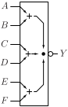
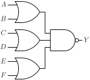

# OAI222

Inverted output OR-AND gate with three two-input OR gates

## Pin information

| Pin   | Description   |
| :-:    | :-            |
| A | Input A, connected to first OR gate |
| B | Input B, connected to first OR gate |
| C | Input C, connected to second OR gate |
| D | Input D, connected to second OR gate |
| E | Input E, connected to third OR gate |
| F | Input F, connected to third OR gate |
| Y | Output |
| VDD | Power supply |
| VSS | Ground |


## Logic function and Truth table

### Logic function (Python)
<div align="center">
Y = ~((A | B) & (C | D) & (E | F))
</div>

### Logic function (Boolean)
\\[ Y = \overline{(A + B) \cdot (C + D) \cdot (E + F)} \\]

### Truth Table for Y


| A | B | C | D | E | F | Y |
| :--- | :--- | :--- | :--- | :--- | :--- | :--- |
| 0 | 0 | - | - | - | - | 1 | 
| - | - | 0 | 0 | - | - | 1 | 
| - | - | - | - | 0 | 0 | 1 | 
| 1 | - | 1 | - | 1 | - | 0 | 
| 1 | - | 1 | - | - | 1 | 0 | 
| 1 | - | - | 1 | 1 | - | 0 | 
| 1 | - | - | 1 | - | 1 | 0 | 
| - | 1 | 1 | - | 1 | - | 0 | 
| - | 1 | 1 | - | - | 1 | 0 | 
| - | 1 | - | 1 | 1 | - | 0 | 
| - | 1 | - | 1 | - | 1 | 0 | 


## Symbol

<div align="center">

</div>

## Schematic

<div align="center">

</div>

## Cell variants

| Cell name <br> | Width <br> [unit sites] | Area <br> [\\(\mu m^2\\)] |
| :-        | :-:   | :-:   |
| [OAI222_DL](#oai222_dl) | TBD | TBD |
| [OAI222_D1](#oai222_d1) | TBD | TBD |


### OAI222_DL

#### Hierarchical SPICE netlist
```spice
.subckt OAI222_DL A B C D E F Y VDD VSS
XMN0 nefp F Y VSS sg13_lv_nmos w=6e-07 l=1.3e-07 ad={6e-07*3.1e-07} as={6e-07*3.1e-07} pd={2*(6e-07+3.1e-07)} ps={2*(6e-07+3.1e-07)} 
XMN1 nefp E Y VSS sg13_lv_nmos w=6e-07 l=1.3e-07 ad={6e-07*3.1e-07} as={6e-07*3.1e-07} pd={2*(6e-07+3.1e-07)} ps={2*(6e-07+3.1e-07)} 
XMN2 nabp A nefp VSS sg13_lv_nmos w=6e-07 l=1.3e-07 ad={6e-07*3.1e-07} as={6e-07*3.1e-07} pd={2*(6e-07+3.1e-07)} ps={2*(6e-07+3.1e-07)} 
XMN3 nabp B nefp VSS sg13_lv_nmos w=6e-07 l=1.3e-07 ad={6e-07*3.1e-07} as={6e-07*3.1e-07} pd={2*(6e-07+3.1e-07)} ps={2*(6e-07+3.1e-07)} 
XMN4 nabp D VSS VSS sg13_lv_nmos w=6e-07 l=1.3e-07 ad={6e-07*3.1e-07} as={6e-07*3.1e-07} pd={2*(6e-07+3.1e-07)} ps={2*(6e-07+3.1e-07)} 
XMN5 nabp C VSS VSS sg13_lv_nmos w=6e-07 l=1.3e-07 ad={6e-07*3.1e-07} as={6e-07*3.1e-07} pd={2*(6e-07+3.1e-07)} ps={2*(6e-07+3.1e-07)} 
XMP0 nefs F VDD VDD sg13_lv_pmos w=8e-07 l=1.3e-07 ad={8e-07*3.1e-07} as={8e-07*3.1e-07} pd={2*(8e-07+3.1e-07)} ps={2*(8e-07+3.1e-07)} 
XMP1 Y E nefs VDD sg13_lv_pmos w=8e-07 l=1.3e-07 ad={8e-07*3.1e-07} as={8e-07*3.1e-07} pd={2*(8e-07+3.1e-07)} ps={2*(8e-07+3.1e-07)} 
XMP2 ncds D VDD VDD sg13_lv_pmos w=8e-07 l=1.3e-07 ad={8e-07*3.1e-07} as={8e-07*3.1e-07} pd={2*(8e-07+3.1e-07)} ps={2*(8e-07+3.1e-07)} 
XMP3 Y C ncds VDD sg13_lv_pmos w=8e-07 l=1.3e-07 ad={8e-07*3.1e-07} as={8e-07*3.1e-07} pd={2*(8e-07+3.1e-07)} ps={2*(8e-07+3.1e-07)} 
XMP4 nabs B VDD VDD sg13_lv_pmos w=8e-07 l=1.3e-07 ad={8e-07*3.1e-07} as={8e-07*3.1e-07} pd={2*(8e-07+3.1e-07)} ps={2*(8e-07+3.1e-07)} 
XMP5 nabs A Y VDD sg13_lv_pmos w=8e-07 l=1.3e-07 ad={8e-07*3.1e-07} as={8e-07*3.1e-07} pd={2*(8e-07+3.1e-07)} ps={2*(8e-07+3.1e-07)} 
.ends
```

#### Flat SPICE netlist
```spice
.subckt OAI222_DL A B C D E F Y VDD VSS
XMN0 n0 F Y VSS sg13_lv_nmos w=6e-07 l=1.3e-07 ad=1.86e-13 as=1.86e-13 pd=1.82e-06 ps=1.82e-06 
XMN1 n0 E Y VSS sg13_lv_nmos w=6e-07 l=1.3e-07 ad=1.86e-13 as=1.86e-13 pd=1.82e-06 ps=1.82e-06 
XMN2 n1 A n0 VSS sg13_lv_nmos w=6e-07 l=1.3e-07 ad=1.86e-13 as=1.86e-13 pd=1.82e-06 ps=1.82e-06 
XMN3 n1 B n0 VSS sg13_lv_nmos w=6e-07 l=1.3e-07 ad=1.86e-13 as=1.86e-13 pd=1.82e-06 ps=1.82e-06 
XMN4 n1 D VSS VSS sg13_lv_nmos w=6e-07 l=1.3e-07 ad=1.86e-13 as=1.86e-13 pd=1.82e-06 ps=1.82e-06 
XMN5 n1 C VSS VSS sg13_lv_nmos w=6e-07 l=1.3e-07 ad=1.86e-13 as=1.86e-13 pd=1.82e-06 ps=1.82e-06 
XMP0 n2 F VDD VDD sg13_lv_pmos w=8e-07 l=1.3e-07 ad=2.48e-13 as=2.48e-13 pd=2.22e-06 ps=2.22e-06 
XMP1 Y E n2 VDD sg13_lv_pmos w=8e-07 l=1.3e-07 ad=2.48e-13 as=2.48e-13 pd=2.22e-06 ps=2.22e-06 
XMP2 n3 D VDD VDD sg13_lv_pmos w=8e-07 l=1.3e-07 ad=2.48e-13 as=2.48e-13 pd=2.22e-06 ps=2.22e-06 
XMP3 Y C n3 VDD sg13_lv_pmos w=8e-07 l=1.3e-07 ad=2.48e-13 as=2.48e-13 pd=2.22e-06 ps=2.22e-06 
XMP4 n4 B VDD VDD sg13_lv_pmos w=8e-07 l=1.3e-07 ad=2.48e-13 as=2.48e-13 pd=2.22e-06 ps=2.22e-06 
XMP5 n4 A Y VDD sg13_lv_pmos w=8e-07 l=1.3e-07 ad=2.48e-13 as=2.48e-13 pd=2.22e-06 ps=2.22e-06 
.ends
```

#### CDL netlist
```cdl
.SUBCKT OAI222_DL A B C D E F Y VDD VSS
*.PININFO B:I C:I D:I A:I F:I E:I Y:O VDD:B VSS:B 
MN0 n0 F Y VSS sg13_lv_nmos w=6e-07 l=1.3e-07 
MN1 n0 E Y VSS sg13_lv_nmos w=6e-07 l=1.3e-07 
MN2 n1 A n0 VSS sg13_lv_nmos w=6e-07 l=1.3e-07 
MN3 n1 B n0 VSS sg13_lv_nmos w=6e-07 l=1.3e-07 
MN4 n1 D VSS VSS sg13_lv_nmos w=6e-07 l=1.3e-07 
MN5 n1 C VSS VSS sg13_lv_nmos w=6e-07 l=1.3e-07 
MP0 n2 F VDD VDD sg13_lv_pmos w=8e-07 l=1.3e-07 
MP1 Y E n2 VDD sg13_lv_pmos w=8e-07 l=1.3e-07 
MP2 n3 D VDD VDD sg13_lv_pmos w=8e-07 l=1.3e-07 
MP3 Y C n3 VDD sg13_lv_pmos w=8e-07 l=1.3e-07 
MP4 n4 B VDD VDD sg13_lv_pmos w=8e-07 l=1.3e-07 
MP5 n4 A Y VDD sg13_lv_pmos w=8e-07 l=1.3e-07 
.ENDS
```

#### Layout

<div align="center">

</div>

### OAI222_D1

#### Hierarchical SPICE netlist
```spice
.subckt OAI222_D1 A B C D E F Y VDD VSS
XMN0 nefp F Y VSS sg13_lv_nmos w=1e-06 l=1.3e-07 ad={1e-06*3.1e-07} as={1e-06*3.1e-07} pd={2*(1e-06+3.1e-07)} ps={2*(1e-06+3.1e-07)} 
XMN1 nefp E Y VSS sg13_lv_nmos w=1e-06 l=1.3e-07 ad={1e-06*3.1e-07} as={1e-06*3.1e-07} pd={2*(1e-06+3.1e-07)} ps={2*(1e-06+3.1e-07)} 
XMN2 nabp A nefp VSS sg13_lv_nmos w=1e-06 l=1.3e-07 ad={1e-06*3.1e-07} as={1e-06*3.1e-07} pd={2*(1e-06+3.1e-07)} ps={2*(1e-06+3.1e-07)} 
XMN3 nabp B nefp VSS sg13_lv_nmos w=1e-06 l=1.3e-07 ad={1e-06*3.1e-07} as={1e-06*3.1e-07} pd={2*(1e-06+3.1e-07)} ps={2*(1e-06+3.1e-07)} 
XMN4 nabp D VSS VSS sg13_lv_nmos w=1e-06 l=1.3e-07 ad={1e-06*3.1e-07} as={1e-06*3.1e-07} pd={2*(1e-06+3.1e-07)} ps={2*(1e-06+3.1e-07)} 
XMN5 nabp C VSS VSS sg13_lv_nmos w=1e-06 l=1.3e-07 ad={1e-06*3.1e-07} as={1e-06*3.1e-07} pd={2*(1e-06+3.1e-07)} ps={2*(1e-06+3.1e-07)} 
XMP0 nefs F VDD VDD sg13_lv_pmos w=1.27e-06 l=1.3e-07 ad={1.27e-06*3.1e-07} as={1.27e-06*3.1e-07} pd={2*(1.27e-06+3.1e-07)} ps={2*(1.27e-06+3.1e-07)} 
XMP1 Y E nefs VDD sg13_lv_pmos w=1.27e-06 l=1.3e-07 ad={1.27e-06*3.1e-07} as={1.27e-06*3.1e-07} pd={2*(1.27e-06+3.1e-07)} ps={2*(1.27e-06+3.1e-07)} 
XMP2 ncds D VDD VDD sg13_lv_pmos w=1.27e-06 l=1.3e-07 ad={1.27e-06*3.1e-07} as={1.27e-06*3.1e-07} pd={2*(1.27e-06+3.1e-07)} ps={2*(1.27e-06+3.1e-07)} 
XMP3 Y C ncds VDD sg13_lv_pmos w=1.27e-06 l=1.3e-07 ad={1.27e-06*3.1e-07} as={1.27e-06*3.1e-07} pd={2*(1.27e-06+3.1e-07)} ps={2*(1.27e-06+3.1e-07)} 
XMP4 nabs B VDD VDD sg13_lv_pmos w=1.27e-06 l=1.3e-07 ad={1.27e-06*3.1e-07} as={1.27e-06*3.1e-07} pd={2*(1.27e-06+3.1e-07)} ps={2*(1.27e-06+3.1e-07)} 
XMP5 nabs A Y VDD sg13_lv_pmos w=1.27e-06 l=1.3e-07 ad={1.27e-06*3.1e-07} as={1.27e-06*3.1e-07} pd={2*(1.27e-06+3.1e-07)} ps={2*(1.27e-06+3.1e-07)} 
.ends
```

#### Flat SPICE netlist
```spice
.subckt OAI222_D1 A B C D E F Y VDD VSS
XMN0 n0 F Y VSS sg13_lv_nmos w=1e-06 l=1.3e-07 ad=3.1e-13 as=3.1e-13 pd=2.62e-06 ps=2.62e-06 
XMN1 n0 E Y VSS sg13_lv_nmos w=1e-06 l=1.3e-07 ad=3.1e-13 as=3.1e-13 pd=2.62e-06 ps=2.62e-06 
XMN2 n1 A n0 VSS sg13_lv_nmos w=1e-06 l=1.3e-07 ad=3.1e-13 as=3.1e-13 pd=2.62e-06 ps=2.62e-06 
XMN3 n1 B n0 VSS sg13_lv_nmos w=1e-06 l=1.3e-07 ad=3.1e-13 as=3.1e-13 pd=2.62e-06 ps=2.62e-06 
XMN4 n1 D VSS VSS sg13_lv_nmos w=1e-06 l=1.3e-07 ad=3.1e-13 as=3.1e-13 pd=2.62e-06 ps=2.62e-06 
XMN5 n1 C VSS VSS sg13_lv_nmos w=1e-06 l=1.3e-07 ad=3.1e-13 as=3.1e-13 pd=2.62e-06 ps=2.62e-06 
XMP0 n2 F VDD VDD sg13_lv_pmos w=1.27e-06 l=1.3e-07 ad=3.937e-13 as=3.937e-13 pd=3.16e-06 ps=3.16e-06 
XMP1 Y E n2 VDD sg13_lv_pmos w=1.27e-06 l=1.3e-07 ad=3.937e-13 as=3.937e-13 pd=3.16e-06 ps=3.16e-06 
XMP2 n3 D VDD VDD sg13_lv_pmos w=1.27e-06 l=1.3e-07 ad=3.937e-13 as=3.937e-13 pd=3.16e-06 ps=3.16e-06 
XMP3 Y C n3 VDD sg13_lv_pmos w=1.27e-06 l=1.3e-07 ad=3.937e-13 as=3.937e-13 pd=3.16e-06 ps=3.16e-06 
XMP4 n4 B VDD VDD sg13_lv_pmos w=1.27e-06 l=1.3e-07 ad=3.937e-13 as=3.937e-13 pd=3.16e-06 ps=3.16e-06 
XMP5 n4 A Y VDD sg13_lv_pmos w=1.27e-06 l=1.3e-07 ad=3.937e-13 as=3.937e-13 pd=3.16e-06 ps=3.16e-06 
.ends
```

#### CDL netlist
```cdl
.SUBCKT OAI222_D1 A B C D E F Y VDD VSS
*.PININFO B:I C:I D:I A:I F:I E:I Y:O VDD:B VSS:B 
MN0 n0 F Y VSS sg13_lv_nmos w=1e-06 l=1.3e-07 
MN1 n0 E Y VSS sg13_lv_nmos w=1e-06 l=1.3e-07 
MN2 n1 A n0 VSS sg13_lv_nmos w=1e-06 l=1.3e-07 
MN3 n1 B n0 VSS sg13_lv_nmos w=1e-06 l=1.3e-07 
MN4 n1 D VSS VSS sg13_lv_nmos w=1e-06 l=1.3e-07 
MN5 n1 C VSS VSS sg13_lv_nmos w=1e-06 l=1.3e-07 
MP0 n2 F VDD VDD sg13_lv_pmos w=1.27e-06 l=1.3e-07 
MP1 Y E n2 VDD sg13_lv_pmos w=1.27e-06 l=1.3e-07 
MP2 n3 D VDD VDD sg13_lv_pmos w=1.27e-06 l=1.3e-07 
MP3 Y C n3 VDD sg13_lv_pmos w=1.27e-06 l=1.3e-07 
MP4 n4 B VDD VDD sg13_lv_pmos w=1.27e-06 l=1.3e-07 
MP5 n4 A Y VDD sg13_lv_pmos w=1.27e-06 l=1.3e-07 
.ENDS
```

#### Layout

<div align="center">

</div>

## Pin capacitance
No pin capacitance data


## Static power
No static power data


## Dynamic power
No dynamic power data


## Delay
No delay data

