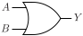
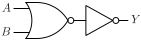

# OR2

Two input OR gate

## Pin information

| Pin   | Description   |
| :-:    | :-            |
| A | Input A |
| B | Input B |
| Y | Output |
| VDD | Power supply |
| VSS | Ground |


## Logic function and Truth table

### Logic function (Python)
<div align="center">
Y = A | B
</div>

### Logic function (Boolean)
\\[ Y = A + B \\]

### Truth Table for Y


| A | B | Y |
| :--- | :--- | :--- |
| 1 | - | 1 | 
| - | 1 | 1 | 
| 0 | 0 | 0 | 


## Symbol

<div align="center">

</div>

## Schematic

<div align="center">

</div>

## Cell variants

| Cell name <br> | Width <br> [unit sites] | Area <br> [\\(\mu m^2\\)] |
| :-        | :-:   | :-:   |
| [OR2_DL](#or2_dl) | TBD | TBD |
| [OR2_D1](#or2_d1) | TBD | TBD |
| [OR2_D2](#or2_d2) | TBD | TBD |
| [OR2_D4](#or2_d4) | TBD | TBD |


### OR2_DL

#### Hierarchical SPICE netlist
```spice
.subckt OR2_DL A B Y VDD VSS
Xnor2 B A NO VDD VSS nor2_par WN=1.5e-07 WP=3e-07 
Xinv NO Y VDD VSS inv_par WN=3.2e-07 WP=4.9e-07 
.ends
```

#### Flat SPICE netlist
```spice
.subckt OR2_DL A B Y VDD VSS
XMN0 n0 B VSS VSS sg13_lv_nmos w=1.5e-07 l=1.3e-07 ad=4.65e-14 as=4.65e-14 pd=9.2e-07 ps=9.2e-07 ng=1 
XMN1 n0 A VSS VSS sg13_lv_nmos w=1.5e-07 l=1.3e-07 ad=4.65e-14 as=4.65e-14 pd=9.2e-07 ps=9.2e-07 ng=1 
XMP0 n1 B VDD VDD sg13_lv_pmos w=3e-07 l=1.3e-07 ad=9.3e-14 as=9.3e-14 pd=1.22e-06 ps=1.22e-06 ng=1 
XMP1 n0 A n1 VDD sg13_lv_pmos w=3e-07 l=1.3e-07 ad=9.3e-14 as=9.3e-14 pd=1.22e-06 ps=1.22e-06 ng=1 
XMN2 Y n0 VSS VSS sg13_lv_nmos w=3.2e-07 l=1.3e-07 ad=9.92e-14 as=9.92e-14 pd=1.26e-06 ps=1.26e-06 ng=1 
XMP2 Y n0 VDD VDD sg13_lv_pmos w=4.9e-07 l=1.3e-07 ad=1.519e-13 as=1.519e-13 pd=1.6e-06 ps=1.6e-06 ng=1 
.ends
```

#### CDL netlist
```cdl
.SUBCKT OR2_DL A B Y VDD VSS
*.PININFO B:I A:I Y:O VDD:B VSS:B 
MN0 n0 B VSS VSS sg13_lv_nmos w=1.5e-07 l=1.3e-07 ng=1 
MN1 n0 A VSS VSS sg13_lv_nmos w=1.5e-07 l=1.3e-07 ng=1 
MP0 n1 B VDD VDD sg13_lv_pmos w=3e-07 l=1.3e-07 ng=1 
MP1 n0 A n1 VDD sg13_lv_pmos w=3e-07 l=1.3e-07 ng=1 
MN2 Y n0 VSS VSS sg13_lv_nmos w=3.2e-07 l=1.3e-07 ng=1 
MP2 Y n0 VDD VDD sg13_lv_pmos w=4.9e-07 l=1.3e-07 ng=1 
.ENDS
```

#### Layout

<div align="center">

</div>

### OR2_D1

#### Hierarchical SPICE netlist
```spice
.subckt OR2_D1 A B Y VDD VSS
Xnor2 A B NO VDD VSS nor2_par WN=2e-07 WP=4e-07 
Xinv NO Y VDD VSS inv_par WN=6.4e-07 WP=9.8e-07 
.ends
```

#### Flat SPICE netlist
```spice
.subckt OR2_D1 A B Y VDD VSS
XMN0 n0 A VSS VSS sg13_lv_nmos w=2e-07 l=1.3e-07 ad=6.2e-14 as=6.2e-14 pd=1.02e-06 ps=1.02e-06 ng=1 
XMN1 n0 B VSS VSS sg13_lv_nmos w=2e-07 l=1.3e-07 ad=6.2e-14 as=6.2e-14 pd=1.02e-06 ps=1.02e-06 ng=1 
XMP0 n1 A VDD VDD sg13_lv_pmos w=4e-07 l=1.3e-07 ad=1.24e-13 as=1.24e-13 pd=1.42e-06 ps=1.42e-06 ng=1 
XMP1 n0 B n1 VDD sg13_lv_pmos w=4e-07 l=1.3e-07 ad=1.24e-13 as=1.24e-13 pd=1.42e-06 ps=1.42e-06 ng=1 
XMN2 Y n0 VSS VSS sg13_lv_nmos w=6.4e-07 l=1.3e-07 ad=1.984e-13 as=1.984e-13 pd=1.9e-06 ps=1.9e-06 ng=1 
XMP2 Y n0 VDD VDD sg13_lv_pmos w=9.8e-07 l=1.3e-07 ad=3.038e-13 as=3.038e-13 pd=2.58e-06 ps=2.58e-06 ng=1 
.ends
```

#### CDL netlist
```cdl
.SUBCKT OR2_D1 A B Y VDD VSS
*.PININFO B:I A:I Y:O VDD:B VSS:B 
MN0 n0 A VSS VSS sg13_lv_nmos w=2e-07 l=1.3e-07 ng=1 
MN1 n0 B VSS VSS sg13_lv_nmos w=2e-07 l=1.3e-07 ng=1 
MP0 n1 A VDD VDD sg13_lv_pmos w=4e-07 l=1.3e-07 ng=1 
MP1 n0 B n1 VDD sg13_lv_pmos w=4e-07 l=1.3e-07 ng=1 
MN2 Y n0 VSS VSS sg13_lv_nmos w=6.4e-07 l=1.3e-07 ng=1 
MP2 Y n0 VDD VDD sg13_lv_pmos w=9.8e-07 l=1.3e-07 ng=1 
.ENDS
```

#### Layout

<div align="center">

</div>

### OR2_D2

#### Hierarchical SPICE netlist
```spice
.subckt OR2_D2 A B Y VDD VSS
Xnor2 B A NO VDD VSS nor2_par WN=5e-07 WP=1e-06 
Xinv NO Y VDD VSS inv_par WN=1.07e-06 WP=1.6e-06 NGN=2 NGP=2 
.ends
```

#### Flat SPICE netlist
```spice
.subckt OR2_D2 A B Y VDD VSS
XMN0 n0 B VSS VSS sg13_lv_nmos w=5e-07 l=1.3e-07 ad=1.55e-13 as=1.55e-13 pd=1.62e-06 ps=1.62e-06 ng=1 
XMN1 n0 A VSS VSS sg13_lv_nmos w=5e-07 l=1.3e-07 ad=1.55e-13 as=1.55e-13 pd=1.62e-06 ps=1.62e-06 ng=1 
XMP0 n1 B VDD VDD sg13_lv_pmos w=1e-06 l=1.3e-07 ad=3.1e-13 as=3.1e-13 pd=2.62e-06 ps=2.62e-06 ng=1 
XMP1 n0 A n1 VDD sg13_lv_pmos w=1e-06 l=1.3e-07 ad=3.1e-13 as=3.1e-13 pd=2.62e-06 ps=2.62e-06 ng=1 
XMN2 Y n0 VSS VSS sg13_lv_nmos w=1.07e-06 l=1.3e-07 ad=3.317e-13 as=3.317e-13 pd=2.76e-06 ps=2.76e-06 ng=2 
XMP2 Y n0 VDD VDD sg13_lv_pmos w=1.6e-06 l=1.3e-07 ad=4.96e-13 as=4.96e-13 pd=3.82e-06 ps=3.82e-06 ng=2 
.ends
```

#### CDL netlist
```cdl
.SUBCKT OR2_D2 A B Y VDD VSS
*.PININFO B:I A:I Y:O VDD:B VSS:B 
MN0 n0 B VSS VSS sg13_lv_nmos w=5e-07 l=1.3e-07 ng=1 
MN1 n0 A VSS VSS sg13_lv_nmos w=5e-07 l=1.3e-07 ng=1 
MP0 n1 B VDD VDD sg13_lv_pmos w=1e-06 l=1.3e-07 ng=1 
MP1 n0 A n1 VDD sg13_lv_pmos w=1e-06 l=1.3e-07 ng=1 
MN2 Y n0 VSS VSS sg13_lv_nmos w=1.07e-06 l=1.3e-07 ng=2 
MP2 Y n0 VDD VDD sg13_lv_pmos w=1.6e-06 l=1.3e-07 ng=2 
.ENDS
```

#### Layout

<div align="center">

</div>

### OR2_D4

#### Hierarchical SPICE netlist
```spice
.subckt OR2_D4 A B Y VDD VSS
Xnor2 B A NO VDD VSS nor2_par WN=8e-07 WP=1.5e-06 
Xinv NO Y VDD VSS inv_par WN=1.8e-06 WP=2.6e-06 NGN=2 NGP=2 
.ends
```

#### Flat SPICE netlist
```spice
.subckt OR2_D4 A B Y VDD VSS
XMN0 n0 B VSS VSS sg13_lv_nmos w=8e-07 l=1.3e-07 ad=2.48e-13 as=2.48e-13 pd=2.22e-06 ps=2.22e-06 ng=1 
XMN1 n0 A VSS VSS sg13_lv_nmos w=8e-07 l=1.3e-07 ad=2.48e-13 as=2.48e-13 pd=2.22e-06 ps=2.22e-06 ng=1 
XMP0 n1 B VDD VDD sg13_lv_pmos w=1.5e-06 l=1.3e-07 ad=4.65e-13 as=4.65e-13 pd=3.62e-06 ps=3.62e-06 ng=1 
XMP1 n0 A n1 VDD sg13_lv_pmos w=1.5e-06 l=1.3e-07 ad=4.65e-13 as=4.65e-13 pd=3.62e-06 ps=3.62e-06 ng=1 
XMN2 Y n0 VSS VSS sg13_lv_nmos w=1.8e-06 l=1.3e-07 ad=5.58e-13 as=5.58e-13 pd=4.22e-06 ps=4.22e-06 ng=2 
XMP2 Y n0 VDD VDD sg13_lv_pmos w=2.6e-06 l=1.3e-07 ad=8.06e-13 as=8.06e-13 pd=5.82e-06 ps=5.82e-06 ng=2 
.ends
```

#### CDL netlist
```cdl
.SUBCKT OR2_D4 A B Y VDD VSS
*.PININFO B:I A:I Y:O VDD:B VSS:B 
MN0 n0 B VSS VSS sg13_lv_nmos w=8e-07 l=1.3e-07 ng=1 
MN1 n0 A VSS VSS sg13_lv_nmos w=8e-07 l=1.3e-07 ng=1 
MP0 n1 B VDD VDD sg13_lv_pmos w=1.5e-06 l=1.3e-07 ng=1 
MP1 n0 A n1 VDD sg13_lv_pmos w=1.5e-06 l=1.3e-07 ng=1 
MN2 Y n0 VSS VSS sg13_lv_nmos w=1.8e-06 l=1.3e-07 ng=2 
MP2 Y n0 VDD VDD sg13_lv_pmos w=2.6e-06 l=1.3e-07 ng=2 
.ENDS
```

#### Layout

<div align="center">

</div>

## Pin capacitance
No pin capacitance data


## Static power
No static power data


## Dynamic power
No dynamic power data


## Delay
No delay data

