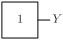
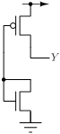

# TIEH

Tie high cell - constant logic '1'.

## Pin information

| Pin   | Description   |
| :-:    | :-            |
| Y | Output |
| VDD | Power supply |
| VSS | Ground |


## Logic function and Truth table

### Logic function (Python)
<div align="center">
Y = 1
</div>

### Logic function (Boolean)
\\[ Y = 1 \\]

### Truth Table for Y


| Y |
| :--- |
| 1 | 


## Symbol

<div align="center">

</div>

## Schematic

<div align="center">

</div>

## Cell variants

| Cell name <br> | Width <br> [unit sites] | Area <br> [\\(\mu m^2\\)] |
| :-        | :-:   | :-:   |
| [TIEH](#tieh) | TBD | TBD |


### TIEH

#### Hierarchical SPICE netlist
```spice
.subckt TIEH Y VDD VSS
XMN0 G G VSS VSS sg13_lv_nmos w=3.2e-07 l=1.3e-07 ad={3.2e-07*3.1e-07} as={3.2e-07*3.1e-07} pd={2*(3.2e-07+3.1e-07)} ps={2*(3.2e-07+3.1e-07)} 
XMP0 Y G VDD VDD sg13_lv_pmos w=1.2e-06 l=1.3e-07 ad={1.2e-06*3.1e-07} as={1.2e-06*3.1e-07} pd={2*(1.2e-06+3.1e-07)} ps={2*(1.2e-06+3.1e-07)} 
.ends
```

#### Flat SPICE netlist
```spice
.subckt TIEH Y VDD VSS
XMN0 n0 n0 VSS VSS sg13_lv_nmos w=3.2e-07 l=1.3e-07 ad=9.92e-14 as=9.92e-14 pd=1.26e-06 ps=1.26e-06 
XMP0 Y n0 VDD VDD sg13_lv_pmos w=1.2e-06 l=1.3e-07 ad=3.72e-13 as=3.72e-13 pd=3.02e-06 ps=3.02e-06 
.ends
```

#### CDL netlist
```cdl
.SUBCKT TIEH Y VDD VSS
*.PININFO Y:O VDD:B VSS:B 
MN0 n0 n0 VSS VSS sg13_lv_nmos w=3.2e-07 l=1.3e-07 
MP0 Y n0 VDD VDD sg13_lv_pmos w=1.2e-06 l=1.3e-07 
.ENDS
```

#### Layout

<div align="center">

</div>

## Pin capacitance
No pin capacitance data


## Static power
No static power data


## Dynamic power
No dynamic power data


## Delay
No delay data

