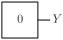
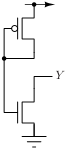

# TIEL

Tie low cell - constant logic '0'.

## Pin information

| Pin   | Description   |
| :-:    | :-            |
| Y | Output |
| VDD | Power supply |
| VSS | Ground |


## Logic function and Truth table

### Logic function (Python)
<div align="center">
Y = 0
</div>

### Logic function (Boolean)
\\[ Y = 0 \\]

### Truth Table for Y


| Y |
| :--- |
| 0 | 


## Symbol

<div align="center">

</div>

## Schematic

<div align="center">

</div>

## Cell variants

| Cell name <br> | Width <br> [unit sites] | Area <br> [\\(\mu m^2\\)] |
| :-        | :-:   | :-:   |
| [TIEL](#tiel) | TBD | TBD |


### TIEL

#### Hierarchical SPICE netlist
```spice
.subckt TIEL Y VDD VSS
XMN0 Y G VSS VSS sg13_lv_nmos w=6.4e-07 l=1.3e-07 ad={6.4e-07*3.1e-07} as={6.4e-07*3.1e-07} pd={2*(6.4e-07+3.1e-07)} ps={2*(6.4e-07+3.1e-07)} 
XMP0 G G VDD VDD sg13_lv_pmos w=6.4e-07 l=1.3e-07 ad={6.4e-07*3.1e-07} as={6.4e-07*3.1e-07} pd={2*(6.4e-07+3.1e-07)} ps={2*(6.4e-07+3.1e-07)} 
.ends
```

#### Flat SPICE netlist
```spice
.subckt TIEL Y VDD VSS
XMN0 Y n0 VSS VSS sg13_lv_nmos w=6.4e-07 l=1.3e-07 ad=1.984e-13 as=1.984e-13 pd=1.9e-06 ps=1.9e-06 
XMP0 n0 n0 VDD VDD sg13_lv_pmos w=6.4e-07 l=1.3e-07 ad=1.984e-13 as=1.984e-13 pd=1.9e-06 ps=1.9e-06 
.ends
```

#### CDL netlist
```cdl
.SUBCKT TIEL Y VDD VSS
*.PININFO Y:O VDD:B VSS:B 
MN0 Y n0 VSS VSS sg13_lv_nmos w=6.4e-07 l=1.3e-07 
MP0 n0 n0 VDD VDD sg13_lv_pmos w=6.4e-07 l=1.3e-07 
.ENDS
```

#### Layout

<div align="center">

</div>

## Pin capacitance
No pin capacitance data


## Static power
No static power data


## Dynamic power
No dynamic power data


## Delay
No delay data

