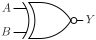

# XNOR2

Two input exclusive NOR.

## Pin information

| Pin   | Description   |
| :-:    | :-            |
| A | Input A |
| B | Input B |
| Y | Output |
| VDD | Power supply |
| VSS | Ground |


## Logic function and Truth table

### Logic function (Python)
<div align="center">
Y = ~(A ^ B)
</div>

### Logic function (Boolean)
\\[ Y = A \oplus B \\]

### Truth Table for Y


| A | B | Y |
| :--- | :--- | :--- |
| 1 | 1 | 1 | 
| 0 | 0 | 1 | 
| 0 | 1 | 0 | 
| 1 | 0 | 0 | 


## Symbol

<div align="center">

</div>

## Schematic

<div align="center">

</div>

## Cell variants

| Cell name <br> | Width <br> [unit sites] | Area <br> [\\(\mu m^2\\)] |
| :-        | :-:   | :-:   |
| [XNOR2_DL](#xnor2_dl) | TBD | TBD |
| [XNOR2_D1](#xnor2_d1) | TBD | TBD |


### XNOR2_DL

#### Hierarchical SPICE netlist
```spice
.subckt XNOR2_DL A B Y VDD VSS
Xinv1 BN BI VDD VSS inv_par WN=3e-07 WP=4e-07 
Xinv2 B BN VDD VSS inv_par WN=3e-07 WP=4e-07 
Xinv3 A AN VDD VSS inv_par WN=2e-07 WP=3e-07 
XMN0 BN AN Y VSS sg13_lv_nmos w=2e-07 l=1.3e-07 ad={2e-07*3.1e-07} as={2e-07*3.1e-07} pd={2*(2e-07+3.1e-07)} ps={2*(2e-07+3.1e-07)} 
XMN1 BI A Y VSS sg13_lv_nmos w=2e-07 l=1.3e-07 ad={2e-07*3.1e-07} as={2e-07*3.1e-07} pd={2*(2e-07+3.1e-07)} ps={2*(2e-07+3.1e-07)} 
XMP0 BN A Y VDD sg13_lv_pmos w=3e-07 l=1.3e-07 ad={3e-07*3.1e-07} as={3e-07*3.1e-07} pd={2*(3e-07+3.1e-07)} ps={2*(3e-07+3.1e-07)} 
XMP1 BI AN Y VDD sg13_lv_pmos w=3e-07 l=1.3e-07 ad={3e-07*3.1e-07} as={3e-07*3.1e-07} pd={2*(3e-07+3.1e-07)} ps={2*(3e-07+3.1e-07)} 
.ends
```

#### Flat SPICE netlist
```spice
.subckt XNOR2_DL A B Y VDD VSS
XMN0 n0 n1 VSS VSS sg13_lv_nmos w=3e-07 l=1.3e-07 ad=9.3e-14 as=9.3e-14 pd=1.22e-06 ps=1.22e-06 ng=1 
XMP0 n0 n1 VDD VDD sg13_lv_pmos w=4e-07 l=1.3e-07 ad=1.24e-13 as=1.24e-13 pd=1.42e-06 ps=1.42e-06 ng=1 
XMN1 n1 B VSS VSS sg13_lv_nmos w=3e-07 l=1.3e-07 ad=9.3e-14 as=9.3e-14 pd=1.22e-06 ps=1.22e-06 ng=1 
XMP1 n1 B VDD VDD sg13_lv_pmos w=4e-07 l=1.3e-07 ad=1.24e-13 as=1.24e-13 pd=1.42e-06 ps=1.42e-06 ng=1 
XMN2 n2 A VSS VSS sg13_lv_nmos w=2e-07 l=1.3e-07 ad=6.2e-14 as=6.2e-14 pd=1.02e-06 ps=1.02e-06 ng=1 
XMP2 n2 A VDD VDD sg13_lv_pmos w=3e-07 l=1.3e-07 ad=9.3e-14 as=9.3e-14 pd=1.22e-06 ps=1.22e-06 ng=1 
XMN3 n1 n2 Y VSS sg13_lv_nmos w=2e-07 l=1.3e-07 ad=6.2e-14 as=6.2e-14 pd=1.02e-06 ps=1.02e-06 
XMN4 n0 A Y VSS sg13_lv_nmos w=2e-07 l=1.3e-07 ad=6.2e-14 as=6.2e-14 pd=1.02e-06 ps=1.02e-06 
XMP3 n1 A Y VDD sg13_lv_pmos w=3e-07 l=1.3e-07 ad=9.3e-14 as=9.3e-14 pd=1.22e-06 ps=1.22e-06 
XMP4 n0 n2 Y VDD sg13_lv_pmos w=3e-07 l=1.3e-07 ad=9.3e-14 as=9.3e-14 pd=1.22e-06 ps=1.22e-06 
.ends
```

#### CDL netlist
```cdl
.SUBCKT XNOR2_DL A B Y VDD VSS
*.PININFO A:I B:I Y:O VDD:B VSS:B 
MN0 n0 n1 VSS VSS sg13_lv_nmos w=3e-07 l=1.3e-07 ng=1 
MP0 n0 n1 VDD VDD sg13_lv_pmos w=4e-07 l=1.3e-07 ng=1 
MN1 n1 B VSS VSS sg13_lv_nmos w=3e-07 l=1.3e-07 ng=1 
MP1 n1 B VDD VDD sg13_lv_pmos w=4e-07 l=1.3e-07 ng=1 
MN2 n2 A VSS VSS sg13_lv_nmos w=2e-07 l=1.3e-07 ng=1 
MP2 n2 A VDD VDD sg13_lv_pmos w=3e-07 l=1.3e-07 ng=1 
MN3 n1 n2 Y VSS sg13_lv_nmos w=2e-07 l=1.3e-07 
MN4 n0 A Y VSS sg13_lv_nmos w=2e-07 l=1.3e-07 
MP3 n1 A Y VDD sg13_lv_pmos w=3e-07 l=1.3e-07 
MP4 n0 n2 Y VDD sg13_lv_pmos w=3e-07 l=1.3e-07 
.ENDS
```

#### Layout

<div align="center">

</div>

### XNOR2_D1

#### Hierarchical SPICE netlist
```spice
.subckt XNOR2_D1 A B Y VDD VSS
Xinv1 BN BI VDD VSS inv_par WN=5e-07 WP=8e-07 
Xinv2 B BN VDD VSS inv_par WN=5e-07 WP=8e-07 
Xinv3 A AN VDD VSS inv_par WN=2e-07 WP=3e-07 
XMN0 BN AN Y VSS sg13_lv_nmos w=5e-07 l=1.3e-07 ad={5e-07*3.1e-07} as={5e-07*3.1e-07} pd={2*(5e-07+3.1e-07)} ps={2*(5e-07+3.1e-07)} 
XMN1 BI A Y VSS sg13_lv_nmos w=5e-07 l=1.3e-07 ad={5e-07*3.1e-07} as={5e-07*3.1e-07} pd={2*(5e-07+3.1e-07)} ps={2*(5e-07+3.1e-07)} 
XMP0 BN A Y VDD sg13_lv_pmos w=8e-07 l=1.3e-07 ad={8e-07*3.1e-07} as={8e-07*3.1e-07} pd={2*(8e-07+3.1e-07)} ps={2*(8e-07+3.1e-07)} 
XMP1 BI AN Y VDD sg13_lv_pmos w=8e-07 l=1.3e-07 ad={8e-07*3.1e-07} as={8e-07*3.1e-07} pd={2*(8e-07+3.1e-07)} ps={2*(8e-07+3.1e-07)} 
.ends
```

#### Flat SPICE netlist
```spice
.subckt XNOR2_D1 A B Y VDD VSS
XMN0 n0 n1 VSS VSS sg13_lv_nmos w=5e-07 l=1.3e-07 ad=1.55e-13 as=1.55e-13 pd=1.62e-06 ps=1.62e-06 ng=1 
XMP0 n0 n1 VDD VDD sg13_lv_pmos w=8e-07 l=1.3e-07 ad=2.48e-13 as=2.48e-13 pd=2.22e-06 ps=2.22e-06 ng=1 
XMN1 n1 B VSS VSS sg13_lv_nmos w=5e-07 l=1.3e-07 ad=1.55e-13 as=1.55e-13 pd=1.62e-06 ps=1.62e-06 ng=1 
XMP1 n1 B VDD VDD sg13_lv_pmos w=8e-07 l=1.3e-07 ad=2.48e-13 as=2.48e-13 pd=2.22e-06 ps=2.22e-06 ng=1 
XMN2 n2 A VSS VSS sg13_lv_nmos w=2e-07 l=1.3e-07 ad=6.2e-14 as=6.2e-14 pd=1.02e-06 ps=1.02e-06 ng=1 
XMP2 n2 A VDD VDD sg13_lv_pmos w=3e-07 l=1.3e-07 ad=9.3e-14 as=9.3e-14 pd=1.22e-06 ps=1.22e-06 ng=1 
XMN3 n1 n2 Y VSS sg13_lv_nmos w=5e-07 l=1.3e-07 ad=1.55e-13 as=1.55e-13 pd=1.62e-06 ps=1.62e-06 
XMN4 n0 A Y VSS sg13_lv_nmos w=5e-07 l=1.3e-07 ad=1.55e-13 as=1.55e-13 pd=1.62e-06 ps=1.62e-06 
XMP3 n1 A Y VDD sg13_lv_pmos w=8e-07 l=1.3e-07 ad=2.48e-13 as=2.48e-13 pd=2.22e-06 ps=2.22e-06 
XMP4 n0 n2 Y VDD sg13_lv_pmos w=8e-07 l=1.3e-07 ad=2.48e-13 as=2.48e-13 pd=2.22e-06 ps=2.22e-06 
.ends
```

#### CDL netlist
```cdl
.SUBCKT XNOR2_D1 A B Y VDD VSS
*.PININFO A:I B:I Y:O VDD:B VSS:B 
MN0 n0 n1 VSS VSS sg13_lv_nmos w=5e-07 l=1.3e-07 ng=1 
MP0 n0 n1 VDD VDD sg13_lv_pmos w=8e-07 l=1.3e-07 ng=1 
MN1 n1 B VSS VSS sg13_lv_nmos w=5e-07 l=1.3e-07 ng=1 
MP1 n1 B VDD VDD sg13_lv_pmos w=8e-07 l=1.3e-07 ng=1 
MN2 n2 A VSS VSS sg13_lv_nmos w=2e-07 l=1.3e-07 ng=1 
MP2 n2 A VDD VDD sg13_lv_pmos w=3e-07 l=1.3e-07 ng=1 
MN3 n1 n2 Y VSS sg13_lv_nmos w=5e-07 l=1.3e-07 
MN4 n0 A Y VSS sg13_lv_nmos w=5e-07 l=1.3e-07 
MP3 n1 A Y VDD sg13_lv_pmos w=8e-07 l=1.3e-07 
MP4 n0 n2 Y VDD sg13_lv_pmos w=8e-07 l=1.3e-07 
.ENDS
```

#### Layout

<div align="center">

</div>

## Pin capacitance
No pin capacitance data


## Static power
No static power data


## Dynamic power
No dynamic power data


## Delay
No delay data

